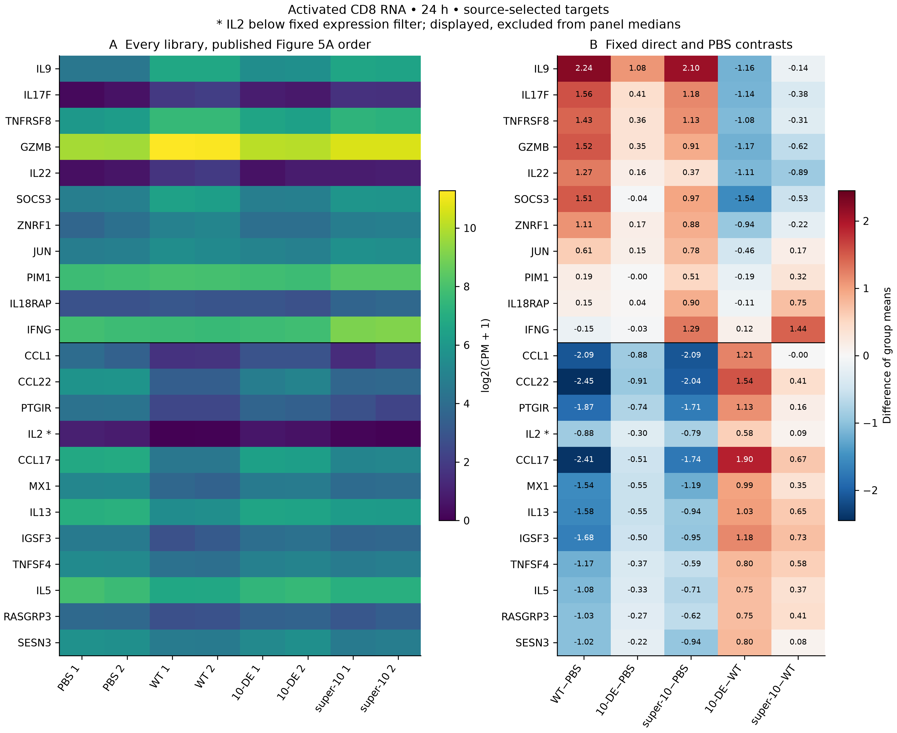
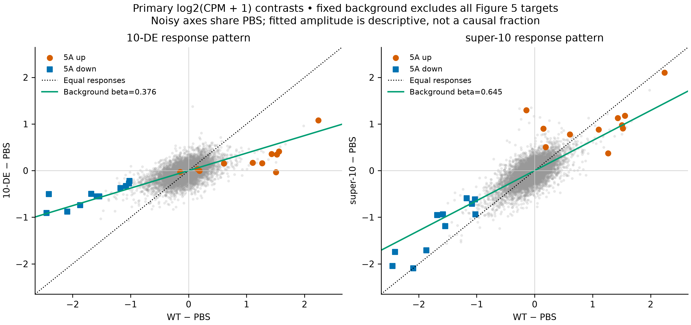
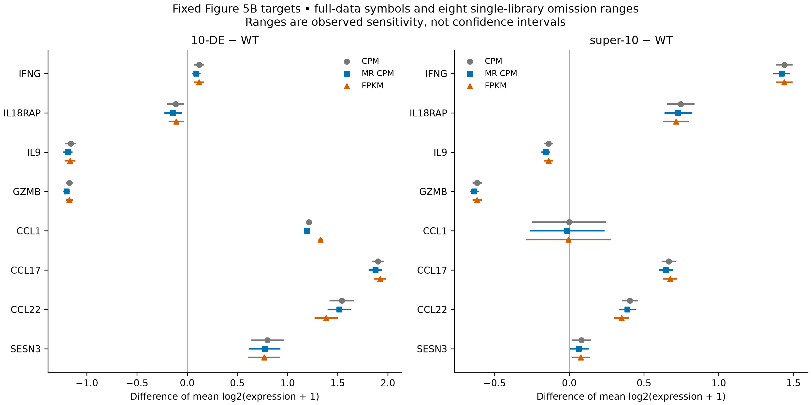

# Saxton IL-10 figures — Gate 3A, paper 7

[Study overview](README.md) · [Current results](RESULTS.md) ·
[Full captions and methods](../ungated_saxton_2021_il10/FIGURES.md).
These are the existing frozen Sx10-P01 figures, displayed from their original
receipt-bound output paths. No figure or numerical analysis was regenerated.
The old `ungated_` evidence directory is an archive location, not this paper's
roadmap classification.

## Published targets and direct contrasts

All eight libraries and the fixed source targets; contrasts are differences of
mean log2(CPM+1). IL2 remains displayed but outside panel summaries under the
fixed filter. RNA abundance is not cytokine secretion.
[PDF](../../analysis/research/runs/sx10_description_v1/fixed_targets.pdf).

## Variant response patterns

Both variants show overall attenuation alongside gene-specific differences.
The axes share vehicle observations; fitted reference slopes are descriptive,
not causal fractions, and genes are not independent subjects.
[PDF](../../analysis/research/runs/sx10_description_v1/response_pattern.pdf).

## Library-omission sensitivity

Full-data contrasts and eight single-library omissions across the three
prespecified scales. Ranges are not confidence intervals; CCL1's unstable
direction is retained. Source suffixes do not establish donor pairing.
[PDF](../../analysis/research/runs/sx10_description_v1/omission_sensitivity.pdf).
