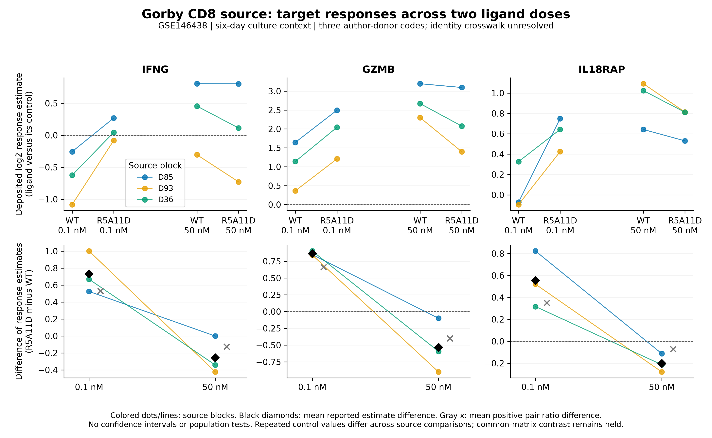

# IL-10 extensions: completed source description and co-input screen

8 November 2026. Sx10-P01; exposed descriptive work, not an accepted new RQ.
[Plans](PLAN.md) · [source amendment](SOURCE_AMENDMENT_V2.md) ·
[frozen methods](METHODS_V1.md) · [technical overview](../../../docs/research_reviews/2026-11-08-saxton-reading/EXTENSION_EXECUTION.md).

## Result and implication

The three-target Saxton pattern does **not** recur at either tested Gorby dose
in the deposited response estimates. At 0.1 nM, IFNG, GZMB and IL18RAP all have
larger R5A11D-than-WT estimates; at 50 nM all have smaller estimates. This is a
description of reported estimates, not proof of a biological dose crossover.
The source's normalization/model and donor identity limits remain unresolved.

The matched IL-10-variant × IL-18 interaction cannot be estimated from the
qualified public sources. Its plan is established and its bounded source search
is complete; the response experiment and numerical interaction remain held.

## Source qualification changed the permitted endpoint

The original [workbook qualification](../../../analysis/research/runs/sx10_gorby_qualification_v1/qualification.json)
failed the proposed common-matrix analysis: 48,162 unique gene IDs and 21 sample
aliases, but the three controls each recur six times, with 79,164 row-by-source-
block mismatches between copies. The 899,624 invalid/non-numeric abundance cells
include literal `NA` and repeated copies; this is not a count of unique missing
genes. No control copy was selected or averaged to make a matrix pass.

A prospective [source amendment](SOURCE_AMENDMENT_V2.md) instead qualified all
36 fixed target records in twelve separately deposited comparison tables. The
[v2 qualification](../../../analysis/research/runs/sx10_gorby_qualification_v2/qualification.json)
permits describing their estimates. It does not certify the tables' upstream
normalization or restore a common expression matrix. D85/D93/D36 remain source
codes backed by the authors' three-donor description, with inconsistent GEO
replicate labels and no independently recovered donor crosswalk.

## Fixed numerical results

Each primary value below is the mean across three source codes of
`reported log2foldchange(R5A11D/control) − reported log2foldchange(WTD/control)`.
The secondary value uses log2 of the supplied positive value pairs instead.
They are distinct quantities; neither is a newly fitted population treatment effect.

| Target | Dose (nM) | Primary mean | Primary single-code-omission range | Secondary mean | Secondary single-code-omission range |
|---|---:|---:|---:|---:|---:|
| IFNG | 0.1 | +0.732 | +0.597 to +0.835 | +0.529 | +0.479 to +0.559 |
| IFNG | 50 | −0.255 | −0.383 to −0.172 | −0.125 | −0.240 to −0.011 |
| GZMB | 0.1 | +0.865 | +0.847 to +0.876 | +0.663 | +0.587 to +0.759 |
| GZMB | 50 | −0.531 | −0.746 to −0.347 | −0.400 | −0.528 to −0.186 |
| IL18RAP | 0.1 | +0.553 | +0.419 to +0.672 | +0.351 | +0.133 to +0.468 |
| IL18RAP | 50 | −0.201 | −0.246 to −0.162 | −0.070 | −0.223 to +0.014 |

All individual primary differences have the stated dose-specific direction,
although high-dose IFNG in D85 is almost zero (−0.001). Secondary high-dose
IFNG and IL18RAP reverse direction in D36; omitting D85 changes the secondary
IL18RAP mean to +0.014. Thus high-dose IL18RAP is not directionally robust to
both calculation and source omission. All 36 source pairs are positive and
finite; none triggers the prespecified below-1 abundance flag. Omission ranges
are sensitivity summaries, not confidence intervals or independent replication.

[PDF figure](../../../analysis/research/runs/sx10_gorby_reported_description_v1/gorby_responses.pdf) ·
[all source values](../../../analysis/research/runs/sx10_gorby_reported_description_v1/source_estimates.csv) ·
[all differences](../../../analysis/research/runs/sx10_gorby_reported_description_v1/block_contrasts.csv) ·
[all 48 summaries](../../../analysis/research/runs/sx10_gorby_reported_description_v1/summaries.csv).

## Published finding → observation → remaining question

**Stronger low-dose R5A11D responses were already specified by Gorby et al.
(2020), Figs. 5–6** ([primary paper](https://doi.org/10.1126/scisignal.abc0653)).
The present low-dose description agrees with that premise using the same data;
it is not an independent validation. The high-dose RNA estimates must not be
substituted for Gorby's separate granzyme-protein measurements.

**The mixed super-10 transcriptional pattern was already specified by Saxton
et al. (2021), Fig. 5** ([primary paper](https://doi.org/10.1126/science.abc8433)).
The repository's [Saxton result](../RESULTS.md) retained IFNG/IL18RAP above WT
and GZMB below WT. Here the enhanced ligand is R5A11D, with a different culture
schedule and doses. Ligand, exposure and study differences cannot be separated
by comparing these deposits. The 2026 modeling code also reuses both sources;
neither reanalysis is an independent model validation. See the
[dated attribution review](../../../docs/research_reviews/2026-11-08-saxton-reading/POST_RESULT_LITERATURE.md).

The defensible next comparison is a matched donor/preparation experiment that
tests whether opposing IFNG/GZMB responses persist across ligand and dose under
one activation schedule, with RNA and corresponding protein outputs retained
separately. It should not start from an assumption that increased affinity
uniformly amplifies all outputs. Dose/timing, ligand access, meaningful effect
and precision remain to be qualified. No new target was added after this result.

## IL-18 route: source screen completed, interaction held

The [screen record](../../../analysis/research/runs/sx10_coinput_qualification_v2/screen.json)
retains two broad-query candidates and no exact-variant-query hits. GSE248984
concerns mouse infection/genetic background and CD11c cells; GSE162791 concerns
pancreatic primary/metastatic tumors. Their full GEO metadata do not supply
matched human CD8 engineered-ligand × IL-18 arms. The exact query reported an
unrecognized `R5A11` phrase and omitted it from the translated query; the saved
record preserves this coverage limitation. This is a bounded negative screen,
not proof of universal data absence or novelty.

**IL-10/IL-18 coactivation was already specified by Freeman et al. (2012),
Fig. 1** ([primary paper](https://pmc.ncbi.nlm.nih.gov/articles/PMC3382521/)), in
a different mouse antiviral CD8 context. The remaining question is ligand-dependent
IL-18 response increments in human CD8 preparations. IL18RAP RNA still nominates
a component to measure; it does not establish receptor availability, mediation
or an increased IFNγ response. The [plan](PLAN.md#route-2-does-ligand-choice-alter-the-il-18-response-increment)
specifies the missing arms, biological unit, response/protein endpoints and
informative outcomes. No interaction estimate or wet-lab result is fabricated.

## Separate technical record

The numerical contract and all three scripts were committed at `d31c123` before
execution. The [receipt](../../../analysis/research/runs/sx10_gorby_reported_description_v1/receipt.json)
binds 36 source records, 36 differences, 48 summaries and PNG/PDF outputs.
An independent raw-table lookup with Decimal arithmetic checked 324 scalar
values at 1e-10 tolerance: [verification](../../../analysis/research/runs/sx10_gorby_reported_description_v1/verification.json).
The PNG was inspected for all panels, labels, source-block colors, means and
the stated limitations. No population tests or original-script replay occurred.

The [serialization correction](FREEZE_CORRECTION.md) preserves the original
freeze issue and the failed scientific qualification; v2 sources and numerical
code were checked against exact committed bytes before running. Source acquisition
manifests and public raw inputs are retained in ignored
`raw_data/Saxton_extensions_20261108/`; input hashes are in the committed contracts.
Repository validation is recorded in the linked technical overview and PROGRESS.
