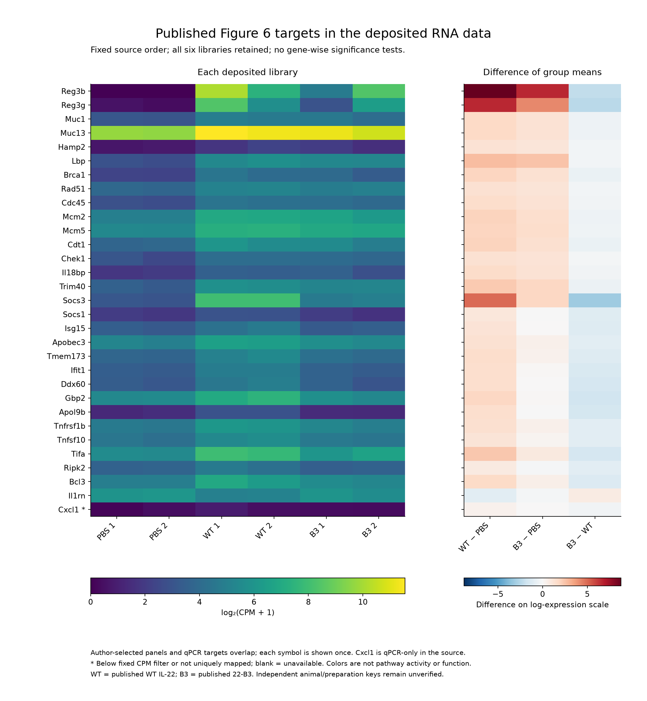
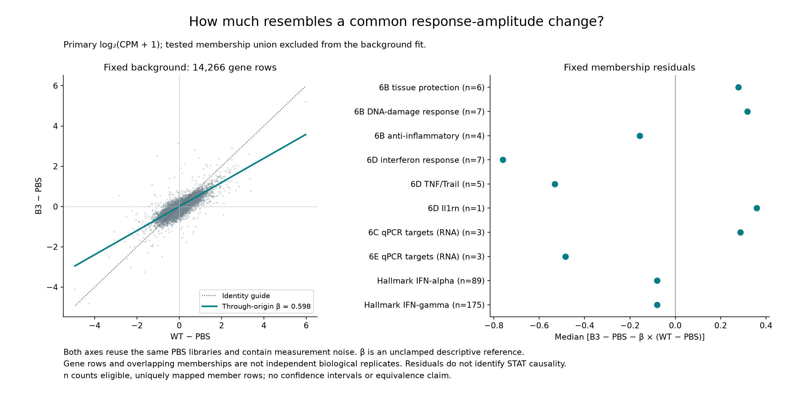
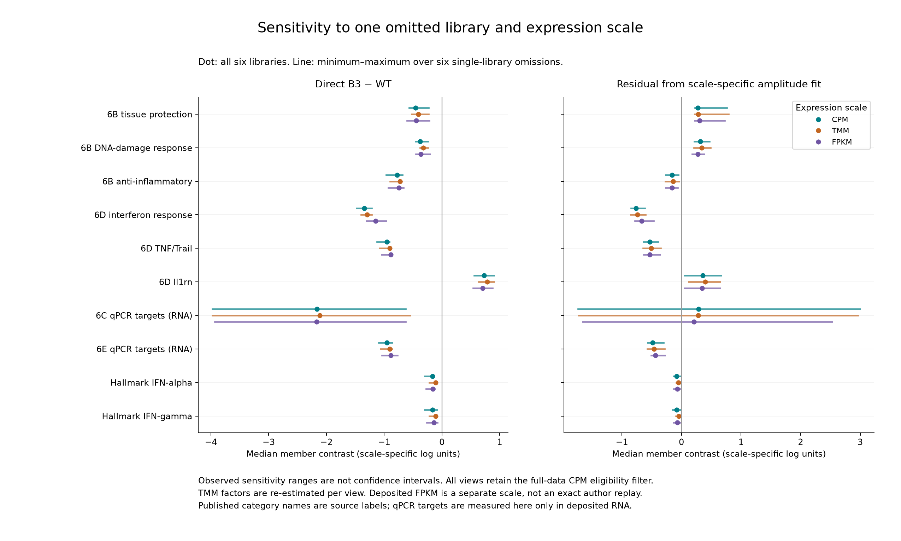
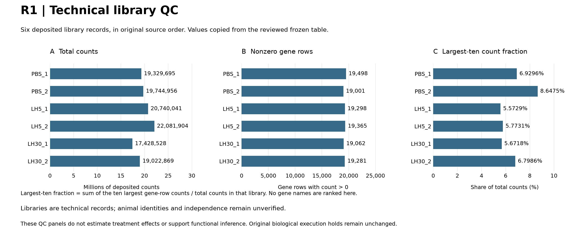
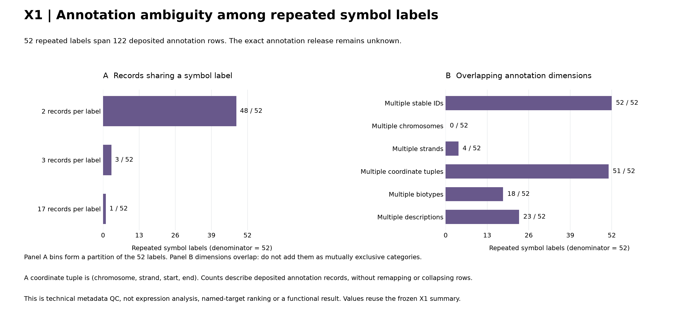
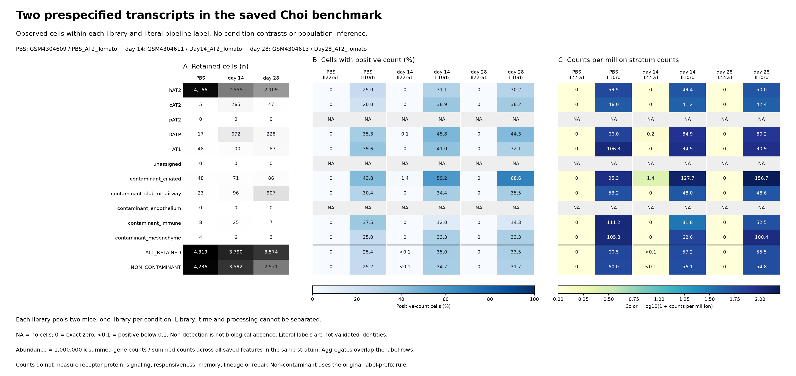

# Saxton 2021 IL-22: combined figure gallery

1 November 2026. **Six figures: three direct colon RNA descriptions, two technical
QC visualizations and one external feasibility figure.** The [reviewed reassessment](reassessment_v1/RESULTS.md)
now addresses the paper's deposited Figure 6 comparison. The selected-panel
distinction persists descriptively, while broader IFN medians are much smaller
and the three-target Figure 6C subset is sensitive to library omission.

**Scientific status:** these are exposed, shared-source descriptions, not
population inference, causal STAT separation or demonstrated tissue function.
Figures 4–6 contain the new RNA results and are presented first. Existing figure
numbers remain stable. Figures 1–2 describe data readiness. Figure 3 remains an
external feasibility check with no measured correlation to Saxton's results.

[Article and completion status](README.md) · [All paper galleries](../README.md#figure-galleries) ·
[Repository root](../../README.md#figure-galleries-by-analysis-branch).

| Figure | Source and measurement unit | What it establishes |
|---|---|---|
| [4. Published targets](#figure-4-published-targets) | Six deposited colon libraries; 31 author-selected targets | Per-library expression and three contrasts; target selection and qPCR/RNA distinctions remain visible |
| [5. Overall-amplitude reference](#figure-5-overall-amplitude-reference) | Same six libraries; fixed background and ten overlapping memberships | Selected-panel residuals versus broader IFN summaries; descriptive shared-control reference, no mechanistic attribution |
| [6. Sensitivity](#figure-6-sensitivity) | Same source; three scales and six single-library omissions | Pattern stability and the unstable three-target subset; observed ranges, not confidence intervals |
| [1. Library QC](#figure-1-library-qc) | R1; six deposited sequencing libraries | Count coverage and concentration diagnostics; animal identities remain unverified |
| [2. Identifier QC](#figure-2-identifier-qc) | X1; deposited annotation rows and repeated symbol labels | Symbol ambiguity; no expression or biological target ranking |
| [3. External-dataset feasibility](#figure-3-observed-transcripts) | E1a; retained cells within three pooled Choi libraries | Receptor-transcript capture in another study; no measured IL-22 response or correlation with Saxton's results |

Each figure's PNG and SVG are alternative formats. Figure 3 has three panels;
its historical v1 is a superseded rendering, not an additional result. X2 and X3
remain tabular/documentary reviews and are indexed below.

## Figure 4. Published targets

[PNG](../../analysis/research/runs/sx22_program_description_v1/published_targets.png) ·
[SVG](../../analysis/research/runs/sx22_program_description_v1/published_targets.svg) ·
[Exact values](../../analysis/research/runs/sx22_program_description_v1/primary_gene_expression.csv).

All 31 unique author symbols map uniquely; Cxcl1 is below the fixed filter and
marked visibly. The left panel displays each library's log2(CPM+1); the right
shows differences of group means on that scale. The qPCR target lists are viewed
in RNA data here, not reconstructed qPCR. Gene labels and colors do not establish
STAT activation or tissue protection. See [methods and coverage](reassessment_v1/METHODS.md).

## Figure 5. Overall-amplitude reference

[PNG](../../analysis/research/runs/sx22_program_description_v1/amplitude_reference.png) ·
[SVG](../../analysis/research/runs/sx22_program_description_v1/amplitude_reference.svg) ·
[Membership medians](../../analysis/research/runs/sx22_program_description_v1/panel_set_summaries.csv).

The background coefficient is 0.598 on 14,266 eligible rows excluding tested
memberships. The selected IFN residual is -0.760; the selected tissue-protection
residual is +0.278, despite its negative direct B3-WT contrast. Both broad IFN
residual medians are about -0.081. Shared controls, noisy axes and overlapping
genes prevent a causal or independent-replication interpretation. The coefficient
is not a fraction of response explained. See [results](reassessment_v1/RESULTS.md).

## Figure 6. Sensitivity

[PNG](../../analysis/research/runs/sx22_program_description_v1/sensitivity_ranges.png) ·
[SVG](../../analysis/research/runs/sx22_program_description_v1/sensitivity_ranges.svg) ·
[All ranges](../../analysis/research/runs/sx22_program_description_v1/sensitivity_ranges.csv).

Dots use all six libraries; lines are observed minima/maxima over six omissions.
CPM, TMM and deposited FPKM retain the fixed primary eligibility universe. The
selected IFN-versus-barrier distinction persists, but the Figure 6C three-target
residual crosses zero under omissions on every scale. These are not confidence
intervals, biological replicates or grounds for removing a library. All outcomes
remain in the [reviewed package](reassessment_v1/ORIGINATING_REVIEW.md).

## Figure 1. Library QC

[PNG](../../analysis/research/runs/sx22_qc_gallery_render_v1/r1_library_qc.png) ·
[SVG](../../analysis/research/runs/sx22_qc_gallery_render_v1/r1_library_qc.svg) ·
[Exact plotted values](../../analysis/research/runs/sx22_qc_gallery_render_v1/r1_plot_values.csv).

The [render-only QC package](qc_gallery_v1/README.md) visualizes the original
[library_qc.csv](../../analysis/research/runs/sx22_r1_v2/library_qc.csv): total counts,
nonzero gene rows and the fraction of counts contributed by the ten largest rows.
All six libraries remain in source order. Each point/bar describes one library;
there is no treatment contrast, uncertainty interval, quality cutoff or exclusion.
Similar totals do not establish biological comparability, and distinct library
identifiers do not establish independent animals. The original R1 recovery
produced these tables on 31 October; this later rendering adds their visual display.

## Figure 2. Identifier QC

[PNG](../../analysis/research/runs/sx22_qc_gallery_render_v1/x1_annotation_qc.png) ·
[SVG](../../analysis/research/runs/sx22_qc_gallery_render_v1/x1_annotation_qc.svg) ·
[Exact plotted values](../../analysis/research/runs/sx22_qc_gallery_render_v1/x1_plot_values.csv).

The [same render-only package](qc_gallery_v1/README.md) displays the frozen
[X1 summary](../../analysis/research/runs/sx22_x1_annotation_v1/summary.json) and
[repeated-symbol inventory](../../analysis/research/runs/sx22_x1_annotation_v1/repeated_symbols.csv).
Of 52 repeated symbol labels spanning 122 rows, 48 occur twice, three occur
three times and one occurs 17 times. Every repeated label maps to multiple stable
IDs; 51 span multiple deposited locus tuples, four span strand labels, 18 span
biotypes and 23 span descriptions. None spans chromosomes. These ambiguity
categories overlap and must not be added together. This supports retaining
stable row identifiers; it does not validate the external annotation release,
collapse genes or identify biological targets.

## Figure 3. Observed transcripts

**External-dataset feasibility, not a Saxton reproduction or mechanistic result.**
The rationale was to ask whether an existing lung dataset could support a
recipient-context follow-up, motivated by Saxton's evidence that receptor context
affects signaling. This is a conceptual connection, not a measured correlation.
The Choi data provide no controlled IL-22 exposure comparison, paired receptor
protein/STAT activation measurements or linked IL-22 functional outcome. The
very sparse Il22ra1 capture does not qualify this dataset for that intended
mechanistic comparison. It also does not demonstrate lack of biological responsiveness.

[PNG](../../analysis/research/runs/sx22_e1a_render_v2/recipient_transcripts_v2.png) ·
[SVG](../../analysis/research/runs/sx22_e1a_render_v2/recipient_transcripts_v2.svg) ·
[Detailed caption, exact tables and render history](recipient_context_v1/FIGURES.md) ·
[Results](recipient_context_v1/RESULTS.md) · [Independent review](recipient_context_v1/REVIEW.md).

Panel A gives retained-cell denominators; B gives the percentage with positive
counts; C gives one million times summed gene counts divided by all saved feature
counts in the same stratum. C uses `log10(1 + value)` for color only. Rows are
literal pipeline labels and two overlapping aggregates. `NA` means an empty
stratum, `0` means an exact observed zero, and `<0.1` preserves small positive
values. Each library pools two mice, with one library per condition.

Only two single Il22ra1 counts were observed among 11,683 retained cells. Sparse
capture does not establish biological absence, state-specific responsiveness,
receptor protein or repair. Il10rb measurement does not supply those missing
discriminators. These are shared-source descriptions, not independent replication.

## Source tables and documentary evidence

| Evidence item | Frozen source | What can be read / caption limit |
|---|---|---|
| Sample identity map | [samples.csv](../../analysis/research/runs/sx22_r1_v2/samples.csv) | Six library records joined to GEO/BioSample and source treatment; biological n is source-reported. `paired=no` means no pairing established/used, not verified unpaired animals |
| Library QC | [library_qc.csv](../../analysis/research/runs/sx22_r1_v2/library_qc.csv) | Total counts, detected gene rows and largest-ten fraction per library; these are technical summaries with no group effect or interval. Exact values and independent review appear in [R1_REVIEW](R1_REVIEW.md) |
| Identifier / zero-row QC | [gene_qc.csv](../../analysis/research/runs/sx22_r1_v2/gene_qc.csv) | Every deposited gene retained, with symbol multiplicity and all-library zero flag; no collapse or exclusion |
| Frozen diagnostic summary | [summary.json](../../analysis/research/runs/sx22_r1_v2/summary.json) | 35,275 rows; six libraries; 52 repeated nonempty symbol labels, not 52 gene rows; 12,935 all-zero rows |
| Execution provenance | [receipt.json](../../analysis/research/runs/sx22_r1_v2/receipt.json), [environment](../../analysis/research/runs/sx22_r1_v2/environment.txt), [stdout](../../analysis/research/runs/sx22_r1_v2/stdout.log), [stderr](../../analysis/research/runs/sx22_r1_v2/stderr.log) | Original immutable execution facts; later verification is in the separate review, not rewritten receipt fields |
| X1 annotation audit | [Results and exact definitions](extensions_20261031/RESULTS.md#x1-deposited-annotation-ambiguity) | Metadata only; no expression columns selected or source rows collapsed |
| X2 sample provenance | [sample_provenance.csv](../../analysis/research/runs/sx22_x2_provenance_v1/sample_provenance.csv) | Six consistent public-record chains; missing animal/preparation keys remain missing |
| X3 endpoint linkage | [Source review](extensions_20261031/X3_SOURCE_LINKAGE.md) | Documentary qualification; no reconstructed raw values or linked persistence/function estimate |

The [source-panel correction](SOURCE_CORRECTION_2026-10-31.md) provides exact
PDF/figure locators and render provenance for the literature audit. Temporary
page images are review aids from the supplied hash-verified PDF, not new repository
figures or reconstructed data. The newly scoped R2a/R3a-R3c descriptions are
Figures 4–6 above. Population inference, exact replay and numerical R4/R5/E1/E2
remain specifically held in the [current completion ledger](COMPLETION_LEDGER.md).
E1a and QC figures do not complete those analyses. Earlier frozen outputs remain
unchanged.

[QC render receipt](../../analysis/research/runs/sx22_qc_gallery_render_v1/receipt.json) ·
[Gallery review and integration checks](GALLERY_REVIEW_2026-11-01.md).
