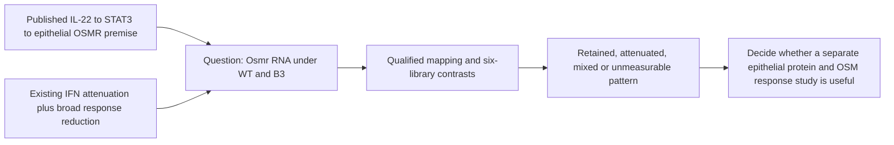

# IL-22: additional work after the completed description

8 November 2026. Planning under **Sx22-P01**; no new run, canonical RQ, acceptance
or replacement of frozen results. [Current results](reassessment_v1/RESULTS.md) ·
[Hold ledger](COMPLETION_LEDGER.md) ·
[Literature update](../../docs/research_reviews/2026-11-08-saxton-reading/LITERATURE_CONTEXT.md) ·
[IL-10 plan](../../docs/research_reviews/2026-11-08-saxton-reading/IL10_ANALYSIS_PLAN.md).

## Completed work that should be reused

The six-library colon description, author panels, two broader IFN memberships,
amplitude reference, CPM/TMM/FPKM and omission sensitivities are complete.
Selected IFN effects exceed those of the barrier-labelled panel, but the latter
also decreases; broader IFN changes are smaller and the three-target subset is
unstable. Repeating scores would not resolve the remaining biological questions.

The sparse pooled Choi receptor-transcript check is complete. Arozamena's
separate [RNA](../ungated_arozamena_2026_inflammatory_memory/RNA_RESULTS.md) and
[paired RNA/fragment](../ungated_arozamena_2026_inflammatory_memory/ACCESSIBILITY_RESULTS.md)
descriptions also exist, with state/unit/function limits. Neither is an unstarted
Saxton extension or a direct IL-22 response dataset.

## A bounded additional question

**Does 22-B3's attenuated selected IFN response coexist with an acute change in
Osmr transcript abundance in the same deposited colon libraries?**

The published premise is Cineus/Luo's IL-22/STAT3-dependent epithelial OSMR
induction and inflammatory OSM response (Figures 3-4 and 6). The repository's
bounded IFN/barrier distinction leaves other inflammation-relevant recipient
features unresolved. This motivates a literature-grounded source description,
not discovery of a new IL-22-OSM mechanism.

Comparison: **B3 versus WT, with each versus PBS**, at six hours. Biological unit:
original mouse/preparation, still unverified; permitted descriptive unit:
deposited library. Endpoint: **Osmr RNA**. Working possibility: reduced selected
IFN transcripts need not remove every inflammation-relevant recipient feature.
General attenuation, whole-colon composition, low capture and library variation
are leading alternatives/validity threats. Do not assume Osmr induction in this
healthy acute setting or epithelial localization in bulk colon.

This diagram is qualitative reasoning, not a measured pathway in Saxton's samples.

1. Verify exact Osmr mapping/availability without selecting on favorable response.
   Il6st can be separately labelled receptor-complex context only if its rationale
   and mapping qualify before freeze; it is not a score or proven limiting factor.
2. Freeze a narrow amendment binding the existing immutable all-gene output or
   source counts, methods and target manifest. Record prior genome-wide outcome
   exposure. Reuse valid normalization/eligibility; do not lower a threshold for
   Osmr or replay historical scripts.
3. Show all six library values, the three contrasts and bounded scale/omission
   sensitivities. Display existing IFN/barrier results as reused context.
4. Close the decision: an observable B3 response motivates checking actual protein
   and response; attenuation narrows that motivation in this source; mixed or
   unmeasurable values remain informative. None establishes OSM sensitivity,
   epithelial origin, chronic risk or absence of the published circuit.

The specific Osmr values were not inspected/calculated in this planning pass.
The source has no OSM challenge, epithelial isolation or protein-response assay.
A missing target does not authorize an unlimited atlas/signature search.

## Other additions and exact prerequisites

| Addition | Next legitimate work | Evidence needed for numerical interpretation |
|---|---|---|
| Direct signaling selectivity | Bounded public-source recovery for Figures 3-5/supplements | Raw pSTAT values, doses/times, experiment/donor keys, backgrounds and panel identity. Eligible curves estimate context-specific responses, not binding kinetics. |
| Functional protection/inflammation | Recover Figure 7 measurements and nesting | Animal/preparation units, crypt/organoid nesting, controls and G/H organ-label resolution. Estimate B3-WT separately per endpoint; similar bars or different PBS significance are not equivalence. |
| Cellular origin | Qualify one relevant intestinal epithelial reference if attribution would change interpretation | Comparable context and qualified labels/units. Deconvolution is an exploratory attribution sensitivity, not proof of within-cell regulation. Sparse pooled Choi data cannot supply the missing response. |
| Persistence/history | Reuse X3 and Arozamena audits; pursue one missing exposure/cessation/response join | Actual biological-unit linkage to the intended later endpoint. The published Osmr withdrawal curve is not a joint repair dataset; six-hour RNA is not memory. |

A later biological comparison could ask whether a common epithelial preparation
responds differently to OSM after WT versus B3 exposure. Recipient competence
requires receptor protein and an actual response endpoint. Verified withdrawal
is needed if persistence is claimed; mature repair measurement is needed if repair
is claimed. Sample size, effect margin and laboratory feasibility remain unknown.
No compulsory rescue arm or bench readiness is invented.

## Reading and recommended order

Revisit IL-22 Figures 4-7, legends and methods, using the source-panel corrections;
there is no need to restart from page one. For the Osmr proposal, read Cineus/Luo
Results around Figures 3-4 and functional evidence in Figure 6; reuse X3 for S5e.
This is a context-bound extension, not evidence that B3 fails.

The next computation worth considering is the narrow receptor-transcript
description after qualification/freeze. Public raw signaling/function recovery
is another route if the required values can be recovered. Additional generic
scoring, pooled-lung searches, structural reprocessing or an unidentifiable causal
STAT model is not justified by this unresolved comparison.
