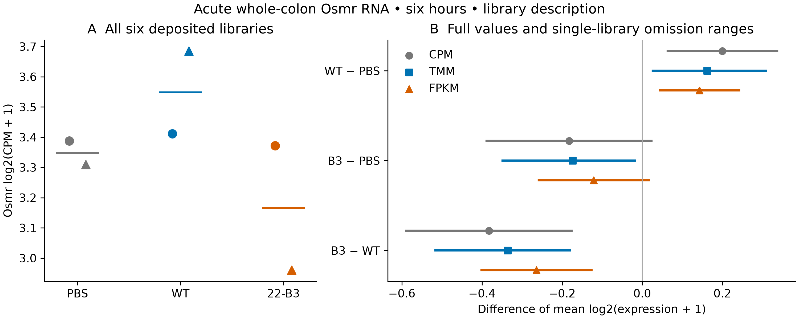

# Osmr RNA gallery

**A:** six-hour whole-colon RNA, all six deposited libraries. Dots/triangles are
source suffixes 1/2, not verified paired animals; short lines are group means.
**B:** full-data contrasts (symbols) and six single-library omission extrema
(lines), separately for log2(CPM+1), log2(TMM-CPM+1), log2(FPKM+1). Lines are not
confidence intervals. Direct B3-WT is negative throughout; B3-PBS depends on
library/scale. RNA does not measure OSM response or epithelial localization.

[Vector PDF](../../../analysis/research/runs/sx22_osmr_v1/osmr.pdf) ·
[Plotted ranges](../../../analysis/research/runs/sx22_osmr_v1/ranges.csv) ·
[Results, limits and verification](RESULTS.md).
