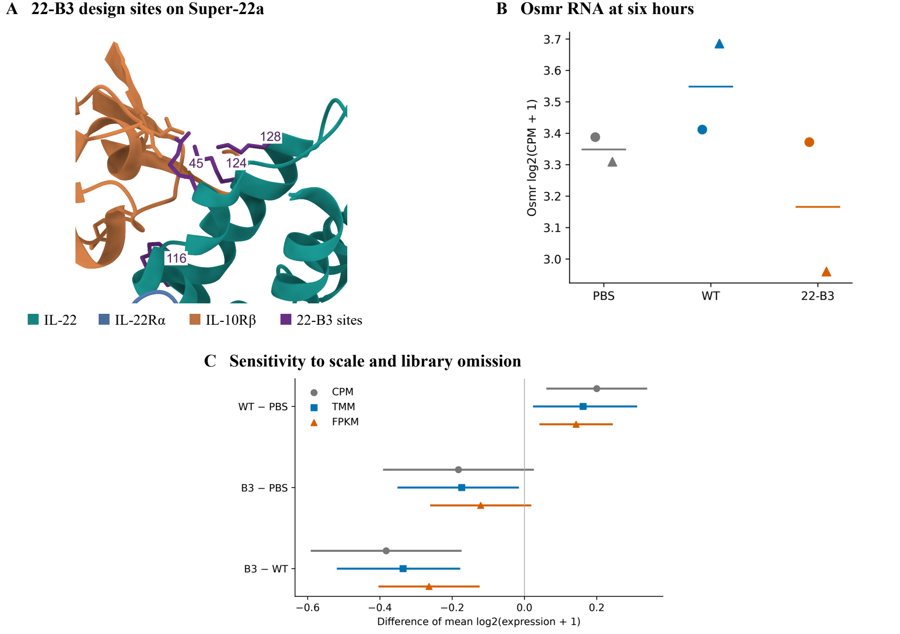
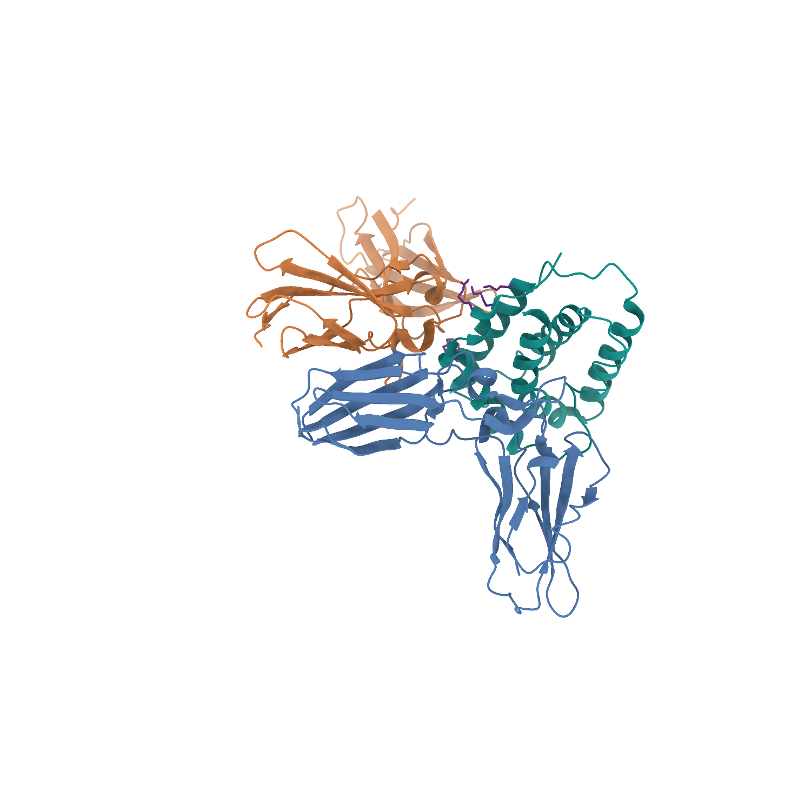
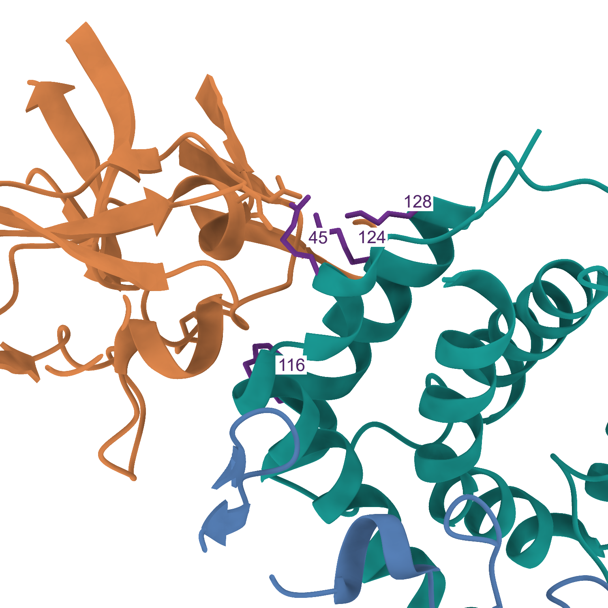

# Approved figure displays — 13 November 2026

These figures preserve approved public-data displays prepared for a research portfolio. They reuse the linked article analyses; they are not independent replication or new scientific acceptance. Numerical results and historical figures are unchanged.

[Article home](../README.md) · [Archive overview](../../../docs/PORTFOLIO_FIGURE_ARCHIVE_20261113.md)

G-SURF microscopy and personal outreach documents are deliberately excluded.

## IL-22 design sites and Osmr RNA

Published S45E, Q116A, K124A and Q128A design sites mapped onto the experimental Super-22a structure (6WEO), alongside six deposited whole-colon libraries and omission/scale sensitivity. This is a structure-based illustration, not a binding-affinity prediction or a demonstration of OSM responsiveness.

[PNG](../../../analysis/research/runs/portfolio_saxton_figures_20261113_v1/structure_osmr.png) · [PDF](../../../analysis/research/runs/portfolio_saxton_figures_20261113_v1/structure_osmr.pdf) · [Provenance](../../../analysis/research/runs/portfolio_saxton_figures_20261113_v1/manifest.json)

## Experimental IL-22 receptor complex

ChimeraX 1.12 rendering of experimental Super-22a structure PDB 6WEO. Purple sites correspond to the published substitution positions. Not a novel predicted structure or calculated affinity.

[PNG](../../../analysis/research/runs/portfolio_saxton_figures_20261113_v1/6weo_complex.png) · [Provenance](../../../analysis/research/runs/portfolio_saxton_figures_20261113_v1/manifest.json)

## IL-22 interface close-up

ChimeraX 1.12 rendering of experimental Super-22a structure PDB 6WEO. Purple sites correspond to the published substitution positions. Not a novel predicted structure or calculated affinity.

[PNG](../../../analysis/research/runs/portfolio_saxton_figures_20261113_v1/6weo_interface.png) · [Provenance](../../../analysis/research/runs/portfolio_saxton_figures_20261113_v1/manifest.json)
