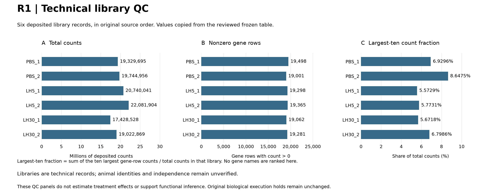
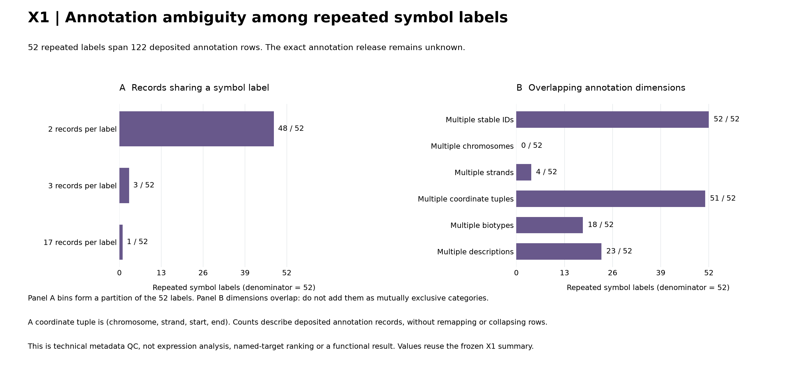

# Technical QC gallery v1

1 November 2026 (Asia/Seoul). Owner **Sx22-P01**. This package makes two already
reviewed technical summaries visible as figures. It does not add biological
findings or repeat the original analyses.

**Completed locally:** two QC figures, exact plot-value tables and a verified
[render receipt](../../../analysis/research/runs/sx22_qc_gallery_render_v1/receipt.json).
[Validation and handoff](VALIDATION.md) records the freeze, checks and scope.

## Prospective render-only plan

Question: how can the existing library and annotation QC quantities be displayed
with their technical units, source order and denominator limits intact? Purpose:
provide two useful, auditable views of the saved evidence. The principal threat
is mistaking technical libraries for independent animals, or overlapping
annotation dimensions for mutually exclusive groups.

| Figure | Fixed source and display | Unit and boundary |
|---|---|---|
| R1 library QC | Three aligned horizontal-bar panels: total counts, nonzero gene rows and largest-ten count fraction. All six libraries in the frozen table's original order; one color, no treatment grouping or contrast | Technical library records. Animal identity/independence remains unknown. Values are copied, not recomputed from expression data |
| X1 annotation QC | Multiplicity distribution of repeated symbol labels; separate bars for six overlapping annotation dimensions in fixed metadata order | 52 repeated symbol labels covering 122 deposited rows. No named symbols, gene ranking, remapping, functional inference or category pie chart |

R1 authority: [review](../R1_REVIEW.md) and its immutable
[library table](../../../analysis/research/runs/sx22_r1_v2/library_qc.csv).
X1 authority: [reviewed results](../extensions_20261031/RESULTS.md), frozen
[summary](../../../analysis/research/runs/sx22_x1_annotation_v1/summary.json) and
[repeated-symbol metadata](../../../analysis/research/runs/sx22_x1_annotation_v1/repeated_symbols.csv).
Source receipts and sample order are hash-bound. No raw counts, H5AD, treatment
model, source pipeline or literature refresh is required for this rendering task.

All source values were exposed in prior reviews and in this task's input reading.
The new contract/code/tests must be committed before rendering the real tables.
Rendering uses the repository runner and a fresh immutable directory. Auditable
plot-value tables retain exact source quantities, explicit denominators and
display labels. Missing or inconsistent source fields stop rendering; no silent
replacement, small-group exclusion or post-result selection is permitted.

The largest-ten fraction is displayed as a percentage, with four decimal places;
integer labels remain exact. X1 multiplicity bins are numerically ordered, and
the six ambiguity dimensions retain source metadata order. Each dimension uses
the same denominator of 52 labels; the dimensions overlap and cannot be summed
as a partition. Zero categories remain visible and labelled. No error bars,
significance tests or population precision is implied.

SVG text is normalized for trailing whitespace in memory before its first write,
then parsed as XML before the runner hashes it. Frozen outputs are never edited.
PNG readability and independent source-to-plot values will be checked before
handoff. Scope is this package, its new run and runner-required registry entries.
The parent owns root/paper navigation, the article/E1a galleries and PROGRESS.

Original R2/R3 and all biological execution holds remain unchanged. No new
canonical RQ, scientific acceptance, push, PR creation or publication is included.

## Rendered figures

The plan/code/contract were committed at `05fa2ff` before the single rendering
execution. The run reuses reviewed quantities; it supplies no new treatment,
functional or independent biological result. The prospective plan above remains
the execution specification. Root/paper navigation and publication are separate
parent-owned updates.

### R1: technical library QC

All six technical library records remain in source order. A shows total counts
with exact integer annotations, B nonzero gene rows, and C the fraction of counts
in the ten largest gene rows, displayed as a percentage. Treatment contrasts and
animal-level inference are not supported by this figure; animal IDs remain unknown.
[SVG](../../../analysis/research/runs/sx22_qc_gallery_render_v1/r1_library_qc.svg) ·
[Exact values and display labels](../../../analysis/research/runs/sx22_qc_gallery_render_v1/r1_plot_values.csv).

### X1: deposited annotation ambiguity

A partitions the 52 repeated labels into 48 labels with two records, three with
three records and one with 17 records, spanning 122 rows. B shows six overlapping
dimensions; every bar uses denominator 52. The zero chromosome-multiplicity
category is retained explicitly. These are annotation cardinalities, not gene
function, named-target priority or expression effects; the annotation release
remains unknown. [SVG](../../../analysis/research/runs/sx22_qc_gallery_render_v1/x1_annotation_qc.svg) ·
[Exact category counts and denominators](../../../analysis/research/runs/sx22_qc_gallery_render_v1/x1_plot_values.csv).

The [render summary](../../../analysis/research/runs/sx22_qc_gallery_render_v1/render_summary.json)
records source order, scope and prospective SVG handling. Original tables,
receipts, figures, source reviews and biological holds remain unchanged.
