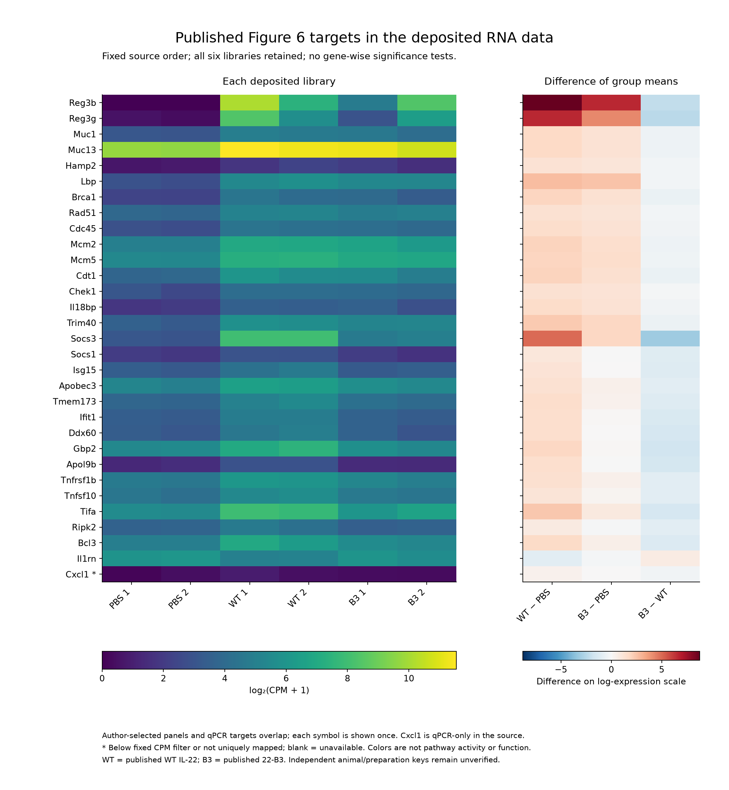
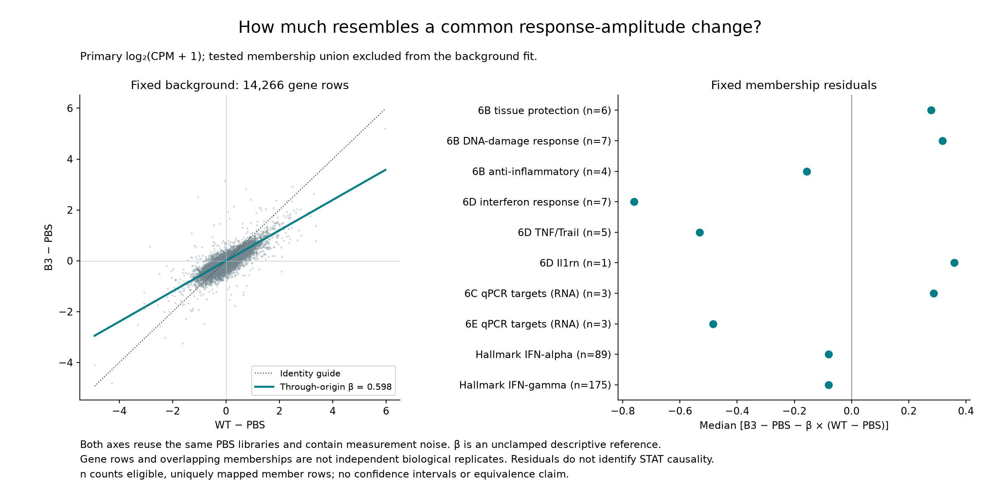
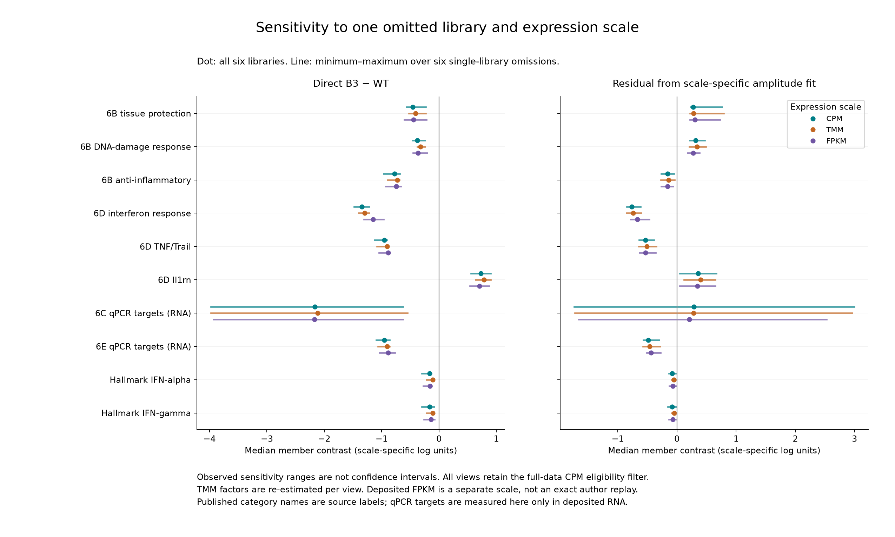

# Descriptive RNA figures

1 November 2026. [Question and scope](README.md) · [Results](RESULTS.md) ·
[Methods](METHODS.md) · [Validation](VALIDATION.md).
All three figures are from the single frozen
[run receipt](../../../analysis/research/runs/sx22_program_description_v1/receipt.json),
under [contract v2](config/description_contract_v2.json). Values reuse the same
six libraries. None is an activity assay, functional test or independent replication.

## Published targets

[SVG](../../../analysis/research/runs/sx22_program_description_v1/published_targets.svg) ·
[Full numerical table](../../../analysis/research/runs/sx22_program_description_v1/primary_gene_expression.csv) ·
[Exact membership and coverage](../../../analysis/research/runs/sx22_program_description_v1/member_mapping.csv).

All 31 unique published RNA/qPCR target symbols map uniquely. Cxcl1 is below
the fixed CPM filter and marked with an asterisk; its measured RNA values remain
visible. Each other published member is eligible. The labels retain author
selection and category wording. qPCR targets shown here are RNA measurements.
Color differences are transformed expression, not STAT activity or tissue function.

## Overall-amplitude reference

[SVG](../../../analysis/research/runs/sx22_program_description_v1/amplitude_reference.svg) ·
[All fits](../../../analysis/research/runs/sx22_program_description_v1/amplitude_fits.csv) ·
[All membership summaries](../../../analysis/research/runs/sx22_program_description_v1/panel_set_summaries.csv).

The primary reference coefficient is 0.598 on 14,266 eligible background rows,
excluding the complete tested-membership union. The selected IFN panel lies below
this reference, while the selected tissue-protection panel lies above it. The
broader IFN sets lie only modestly below it. Both axes share PBS and contain noise;
the coefficient is not a fraction of response explained or a causal partition.
Dots are member medians with eligible-row counts, not independent estimates with
sampling intervals. See the results for overlap and annotation limitations.

## Prespecified sensitivity family

[SVG](../../../analysis/research/runs/sx22_program_description_v1/sensitivity_ranges.svg) ·
[Range table](../../../analysis/research/runs/sx22_program_description_v1/sensitivity_ranges.csv) ·
[Every tested-gene case](../../../analysis/research/runs/sx22_program_description_v1/tested_gene_sensitivity.csv).

Dots use all six libraries; lines are observed minimum-to-maximum values across
the six single-library omissions, not confidence intervals. Each scale retains
the primary eligibility filter. The Figure 6C three-target subset has conspicuous
omission sensitivity, including residual sign changes, and remains displayed.
The broad IFN memberships have much smaller median contrasts than the selected
IFN panel. Published tissue-protection membership has a negative direct B3-WT
contrast even though its residual relative to the amplitude reference is positive.
This distinction prevents a claim that protection is unchanged or equivalent.
