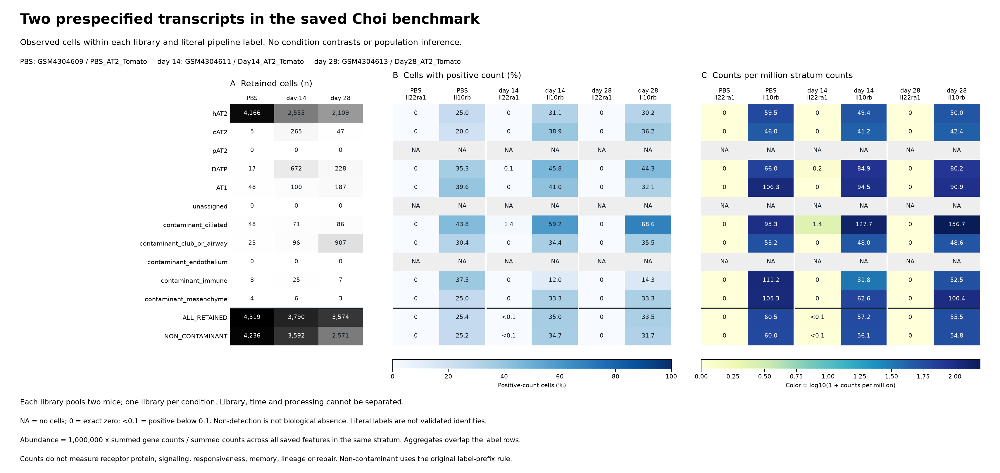

# E1a descriptive figure and tables

**Current presentation: rendering v2.** [Results](RESULTS.md) ·
[Display amendment](RENDER_AMENDMENT_V2.md) · [Validation](VALIDATION.md).

**Figure.** A gives retained-cell denominators. B gives the percentage of cells
with positive counts for each of the two prespecified genes. C gives one million
times summed gene counts divided by summed counts across all saved features in
the same stratum; colors use `log10(1 + value)` only for display, while annotations
remain on the original abundance scale. Rows are literal pipeline labels, then
two overlapping aggregates. Columns identify the saved libraries, with one pooled
library per condition. They do not estimate condition or time effects.

`NA` means no retained cells in a label; `0` is an exact observed zero;
`<0.1` means a strictly positive value below 0.1 in the displayed units. The
v2 rule prevents four positive annotations from appearing to be exact zeros.
Other annotations are rounded to one decimal. Exact endpoints remain in the CSV.
The source's non-contaminant rule includes unassigned and excludes only labels
beginning `contaminant_`. Labels are not independently validated identities, and
transcript counts do not establish receptor protein, response, memory or repair.

| Artifact | Purpose |
|---|---|
| [PNG](../../../analysis/research/runs/sx22_e1a_render_v2/recipient_transcripts_v2.png) / [SVG](../../../analysis/research/runs/sx22_e1a_render_v2/recipient_transcripts_v2.svg) | Current static figure; inspected for alignment, visible labels, denominators, empty rows and small positives |
| [Stratum measurements](../../../analysis/research/runs/sx22_e1a_recipient_description_v1/strata.csv) | All 78 rows with exact denominators, endpoints and count bins |
| [Cell audit table](../../../analysis/research/runs/sx22_e1a_recipient_description_v1/cell_counts.csv) | Original IDs/labels and both selected counts plus total counts for 11,683 cells |
| [Display audit](../../../analysis/research/runs/sx22_e1a_render_v2/display_values.csv) | All 156 displayed measurement annotations, without changing numerical values |
| [Numerical summary](../../../analysis/research/runs/sx22_e1a_recipient_description_v1/summary.json) | Exact scale, runtime and scope |
| [Numerical receipt](../../../analysis/research/runs/sx22_e1a_recipient_description_v1/receipt.json) / [render receipt](../../../analysis/research/runs/sx22_e1a_render_v2/receipt.json) | Immutable execution/input/code/output provenance |
| [Historical v1 PNG](../../../analysis/research/runs/sx22_e1a_recipient_description_v1/recipient_transcripts.png) / [SVG](../../../analysis/research/runs/sx22_e1a_recipient_description_v1/recipient_transcripts.svg) | Preserved; superseded only for small-positive display precision |
