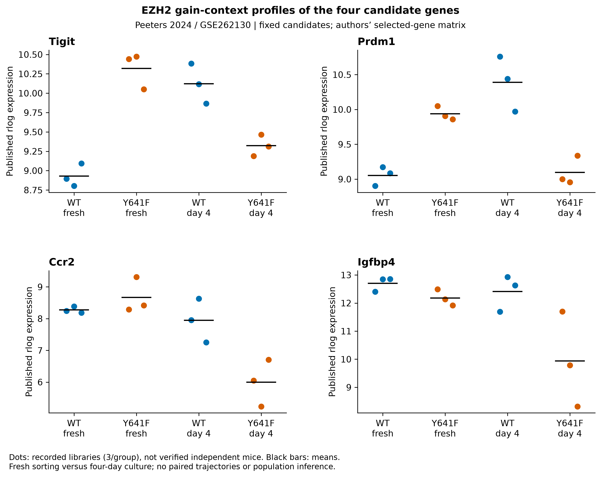
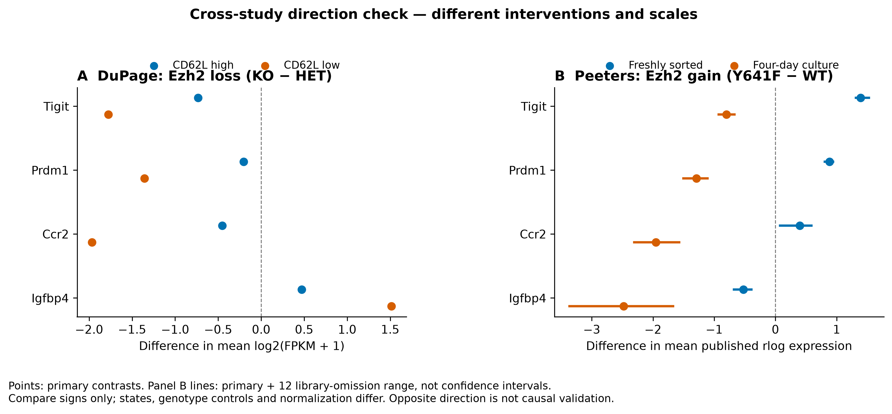

# Executed candidate follow-up: context-dependent gain effects

7 November 2026. **Numerical analysis completed**, after source/assay qualification.
Frozen commit `8f7fa76`; [plan](CANDIDATE_ANALYSIS_PLAN_V1.md),
[contract](contracts/Dp1.candidate_followup_v1.json),
[receipt](../../analysis/research/runs/dupage_candidate_followup_v1/receipt.json).
Dp1-P01 remains exploratory and article-local; no target is validated or accepted.

## Main result

**The simple reciprocal-direction model does not generalize across the three
routes.** In Peeters' gain-context matrix, Tigit, Prdm1 and Ccr2 are higher in
fresh Y641F Tregs than WT, but lower after four-day culture. Igfbp4 is lower in
both conditions. All four genes were uniquely available; none was replaced.

| Gene | Gain − WT, fresh | Gain − WT, day 4 | Difference of those contrasts | DuPage loss versus gain direction |
|---|---:|---:|---:|---|
| Tigit | +1.390 | −0.801 | −2.191 | Opposite at high/fresh; same negative at low/day 4 |
| Prdm1 | +0.884 | −1.292 | −2.176 | Opposite at high/fresh; same negative at low/day 4 |
| Ccr2 | +0.397 | −1.952 | −2.349 | Opposite at high/fresh; same negative at low/day 4 |
| Igfbp4 | −0.523 | −2.479 | −1.957 | Opposite at both descriptive states |

Values are differences in mean published rlog expression, not log2 fold changes
or comparable effect sizes to DuPage's mean-log-FPKM contrasts. All listed signs
persist across primary plus twelve single-library omissions. These are observed
library perturbations, not confidence intervals or independent-animal evidence.

## Biological implications

- **TIGIT–PRDM1:** retain a context-dependent response question, not a monotonic
  EZH2-to-output model. Areg is higher with gain both fresh (+0.501) and day 4
  (+0.324), while its interaction is omission-sensitive. Lower cultured
  Tigit/Prdm1 RNA cannot be equated with lower AREG output. Peeters' fresh-tissue
  protein phenotyping differs from this cultured RNA comparison.
- **CCR2:** the cultured gain effect does not reciprocate the loss effect.
  A context-specific movement/fitness question remains; deficient homing or an
  invariant EZH2–CCR2 relationship is not established. The WT activation contrast
  itself changes sign under omission.
- **IGFBP4:** directions fit the reciprocal screening model in both contexts,
  supporting continued source/protein qualification, not selection as a winner.
  Its WT activation contrast is omission-sensitive. Intact Treg-derived protein,
  native-IGF response and compensation remain unresolved.

Il2ra is near-zero/unstable at baseline and lower after culture in the gain
source; Igf1r is higher in both conditions. These fixed anchors remain in the
tables and do not convert RNA into receptor signaling or function.

## Figures and source values

Figure 5: dots are recorded libraries, three/group; black bars are means.
No lines imply paired mice. [PDF](../../analysis/research/runs/dupage_candidate_followup_v1/fig05_candidate_profiles.pdf)
· [SVG](../../analysis/research/runs/dupage_candidate_followup_v1/fig05_candidate_profiles.svg)
· [source values](../../analysis/research/runs/dupage_candidate_followup_v1/observations.tsv).

Figure 6: axes retain distinct units/designs. Gain-panel lines show primary plus
omission ranges, not uncertainty intervals.
[PDF](../../analysis/research/runs/dupage_candidate_followup_v1/fig06_candidate_direction_context.pdf)
· [SVG](../../analysis/research/runs/dupage_candidate_followup_v1/fig06_candidate_direction_context.svg)
· [direction table](../../analysis/research/runs/dupage_candidate_followup_v1/direction_comparison.tsv).

## Coverage, validation and limits

The authors' selected matrix contains 11,440 rows; all four candidates and three
predeclared anchors were uniquely present. The run retained twelve libraries,
saved 84 sample values and computed five contrasts in thirteen configurations
per gene. [Sample map](../../analysis/research/runs/dupage_candidate_followup_v1/sample_metadata.tsv),
[availability](../../analysis/research/runs/dupage_candidate_followup_v1/availability.tsv),
[contrasts](../../analysis/research/runs/dupage_candidate_followup_v1/contrasts.tsv),
[sensitivity](../../analysis/research/runs/dupage_candidate_followup_v1/sensitivity.tsv)
and [summary](../../analysis/research/runs/dupage_candidate_followup_v1/summary.json)
retain every specified outcome.

Independent standard-library recomputation reconciled all 84 values, 455
configuration/contrast values, 35 extrema/sign records (tolerance 1e−11) and six
figure hashes. The receipt verified; both PNGs were inspected for clipping,
labels, units and provenance. No biological rerun was needed.
Repository validation passed 17,122 checks; the research gate passed against
refreshed, unchanged main `dcee4b6`. Generated SVG path whitespace is retained
verbatim with exact-file Git attributes so receipt hashes remain unchanged.

This is exposed descriptive reanalysis of a published outcome-selected matrix,
not independent validation or a new differential-expression test. Y641F mutation,
WT control, culture/IL-2, normalization and unknown animal/pool units differ from
DuPage's KO/HET observed states. No pooled effect, population p-value, mechanism,
secretion, homing, suppression or repair function is established. The
[candidate cards](CANDIDATE_FOLLOWUP.md) remain proposed experiments; none has
been performed in a laboratory. The TIGIT single-cell accession discrepancy
remains unresolved and was not used in this numerical run.
