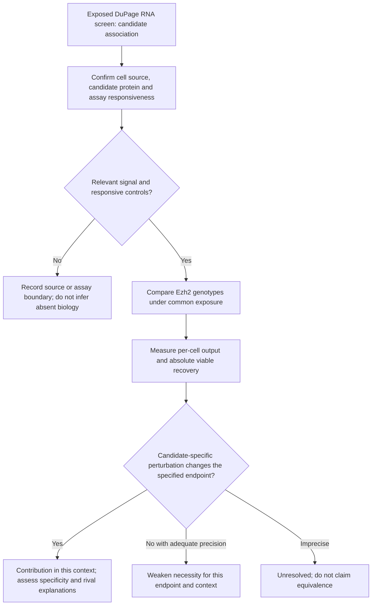

# Three-candidate follow-up: source qualification and experimental questions

7 November 2026. Dp1-P01, article-local exploratory continuation requested after
[biological review](BIOLOGICAL_REVIEW_20261107.md) and opening
[PR #167](https://github.com/xorca0711/ravel/pull/167). All screening outcomes were
already exposed. This is literature/source qualification and proposal development,
not new biological execution, independent validation or canonical-RQ adoption.

This page records the qualification checkpoint. After the owner clarified the
need for actual numerical follow-up, the separate
[candidate analysis plan](CANDIDATE_ANALYSIS_PLAN_V1.md) specifies the next run.
Qualification and execution status must not be conflated.
**Subsequent numerical run completed:** [results and figures](CANDIDATE_ANALYSIS_RESULT_V1.md).
The paragraphs below retain the earlier qualification checkpoint; the linked
result supplies the completed gain-context analysis and updated interpretation.

## What the completed screen supports

The coding screen provides a finite, auditable set of genes for further reading.
It does not resolve the mixed broad state result or validate a causal target.
The three requested routes now have separate comparison specifications and
informative negative outcomes:

| Candidate record | Question advanced here | Immediate discriminator | Current qualification |
|---|---|---|---|
| [TIGIT–PRDM1](candidates/TIGIT_PRDM1.md) | Does Ezh2 loss alter a TIGIT-dependent inducible output in a responsive Treg context? | Genotype difference in response to TIGIT engagement, with protein/output and viable recovery measured separately | Published pathway is a premise. ArrayExpress accession conflicts with the paper; Zenodo matches the description but animal identities remain unqualified. |
| [CCR2](candidates/CCR2.md) | Does reduced CCR2 track impaired directed movement, context-dependent fitness, both, or neither? | Direct migration versus accessory-dependent CD25 response and survival | A simple CCL2→CD25 assay is not established by the cited paper. No qualified new expression dataset can answer the functional contrast. |
| [IGFBP4](candidates/IGFBP4.md) | Is the KO-low RNA excess produced by Tregs, and does intact protein alter their IGF response or compensate for dysfunction? | Source/protein verification, then native-ligand response with target-specific reduction | Expression context and protein processing are unresolved. Recent Th17 evidence and older MSC evidence constrain interpretation. |

No candidate is selected as a winner or removed from the portfolio. These are
different questions, not three independent confirmations of the same mechanism.

## Proposed sequence and interpretation

This is an editorial decision diagram, not an executed workflow or numerical
result. A baseline genotype comparison can answer its own effect question.
Candidate perturbation, recipient assays or rescue are added only for the
additional causal claims described in the individual cards.

## Source and design boundaries established in this pass

[Source qualification](candidates/SOURCE_QUALIFICATION.md) records actual reads,
queries, access failures and metadata provenance. In particular:

- The TIGIT article's E-MTAB-8861 identifier currently resolves to a different
  bulk infection study. Its linked Zenodo record is a better-matching lead,
  not yet a qualified animal-level validation dataset.
- Peeters GSE262130 is an Ezh2 gain-of-function, freshly sorted versus four-day
  culture comparison. Its activated condition is not DuPage's observed CD62L-low
  population. A targeted descriptive comparison could be specified later, but
  it cannot estimate the same interaction or establish mediation.
- The IGF 2020 RNA-seq experiment concerns sorted Th17 cells. Neither that
  dataset nor a published repair score becomes a Treg functional endpoint.

No multi-gigabyte expression matrix was downloaded: source identity and biological
unit qualification currently matter more than another numerical screen. No
new expression contrast, p-value, effect margin or sample-size calculation was run.

## Proposal readiness and next executable work

The three cards provide the scientific rationale, estimand, competing accounts,
controls justified by the intended inference, and a staged experimental design.
Before a bench protocol is finalized, the laboratory must specify available
Ezh2 alleles/controls and reporter, tissue and animal background, perturbation
tools, detection range, feasible timing, assay variance and meaningful precision.
These are unknowns, not assumed resources or additional approval requirements.

The next computational step, if selected, is a frozen source-qualification
contract for the matching TIGIT record: reconcile sample/hashtag labels with
animals or pools and the published methods before inspecting gene outcomes.
The next bench-facing step is the common-exposure protein/response qualification
in each card. Any subsequent quantitative work gets a new committed contract;
none overwrites the seven existing run records.

The [four-figure portfolio](TARGET_SCREEN_FIGURES.md) remains the numerical
illustration of the screen. Its qualitative proposal panel should be read with
these newer qualifications. The original figures and unfavorable results remain
unchanged.
