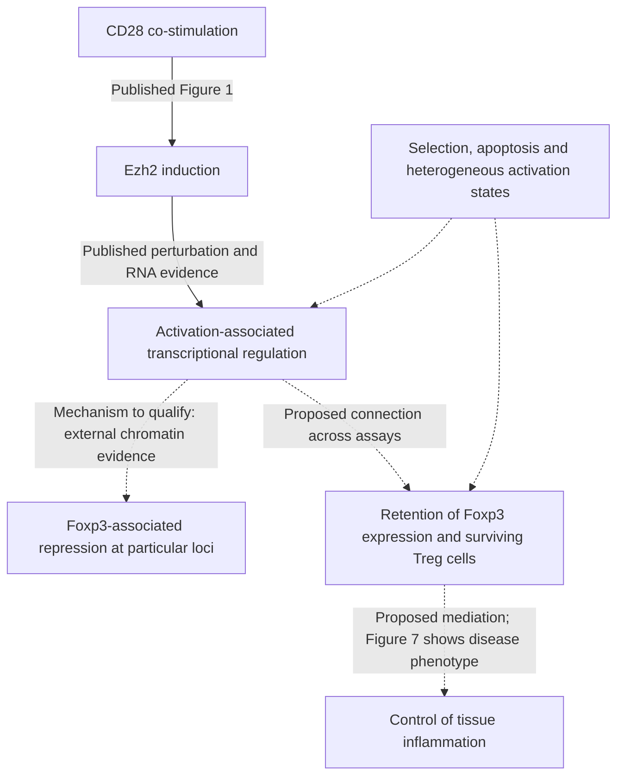

# DuPage 2015: activation and maintenance of Treg identity

## Organizing Biological Q

How does Ezh2 help activated regulatory T cells retain their transcriptional
identity, and which part of that regulation can explain their subsequent loss
from inflamed tissues?

**7 November 2026: owner reading complete; annotated paper, private notes and
deposited-file structure reviewed; analysis planned, not executed.** Stable
paper ID **9**, Gate **3B**. **Dp1-P01** is an article-local planning candidate,
not a new canonical A question or an accepted mechanism.

[Stepwise plan and aims](ANALYSIS_PLAN.md) · [Paper, notes and data review](SOURCE_REVIEW.md) ·
[Current primary-literature context](LITERATURE_CONTEXT.md) ·
[Published article](https://doi.org/10.1016/j.immuni.2015.01.007) ·
[GSE58998](https://www.ncbi.nlm.nih.gov/geo/query/acc.cgi?acc=GSE58998)

## Literature context & visual hypothesis

The paper connects several experiments; it does not follow all links in one
sequenced population. The organizing sequence below preserves that distinction.

This is a qualitative reasoning map, not a measured trajectory or a completed
causal chain. Figures 4-5 directly support instability after perturbation;
the arrows connecting the RNA observations to fate and clinical remission remain
to be resolved. Ezh2-deficient-cell H3K27me3 was not profiled in GSE58998.

## What the review changed

- The appropriate starting comparison is **Ezh2 KO versus HET within CD62L-low
  and CD62L-high Tregs**, then the genotype-by-state difference. HET is not WT;
  these sorted populations are not longitudinal samples of the same cells.
- GEO has 12 libraries, but the published analysis excludes HET/CD62L-high
  replicate 3 for low read depth: the retained design is **2/3/3/3**.
- The merged FPKM file has four condition estimates. The `RAW.tar` contains
  per-library FPKM files, not read counts or FASTQ. Source reconstruction and a
  modern count-based interaction analysis therefore require different inputs.
- The RNA samples are Foxp3-positive Tregs from healthy mosaic females. They
  inform dysregulation among retained Tregs, not the transcriptomes or transition
  rates of cells that already lost Foxp3.
- The 2024 gain-of-function study already compared EZH2 gain and loss, and the
  2026 KDM6B study supplies an important counterweight to a simple global
  methylation model. These change the next comparison; they are not a reason to
  generate an open-ended set of scores. See the [context](LITERATURE_CONTEXT.md).

No new biological result has been produced in this review. The older
Niethamer/D1 external-lung Treg gate remains unmet. It is distinct from qualifying
the already sorted Treg source data in this paper.

## Next biological decision

First establish whether the deposited expression features and biological-sample
identities support a faithful reconstruction. Then ask whether the genotype
difference is concentrated in the activated state and in an externally defined
repression programme. Only an informative result justifies the conditional
chromatin, reciprocal-perturbation or tissue follow-up.

| Step | Aim | Immediate disposition |
|---|---|---|
| Dp1-S0 | Establish what each sample/file can measure | Next: source and feature-identity qualification |
| Dp1-S1 | Reconstruct the published activation-associated RNA pattern | Planned descriptive source reanalysis |
| Dp1-S2 | Estimate whether the KO-HET difference changes with CD62L state | Conditional on suitable inputs and biological units |
| Dp1-S3 | Distinguish repression-associated changes from other state changes | Conditional on S1/S2 and exact external reference sets |
| Dp1-S4 | Test whether a specific unresolved pattern generalizes across perturbations | Optional, literature-bounded comparison |
| Dp1-S5 | Separate identity loss, survival, migration and inflammatory control | Published-evidence synthesis; new inference needs matching assays |
| Dp1-S6 | Turn the findings into one justified next question or explicit stop | Synthesis after every completed step; final decision here |

The [full plan](ANALYSIS_PLAN.md) states the endpoint, unit, alternative,
informative outcomes and stop condition for each step. Its stages are a
decision sequence, not an instruction to execute every stage regardless of results.

## Repository relationship and execution history

The current registry contains 33 canonical questions and no pre-existing DuPage
candidate, contract, receipt or result. A30 studies paired human CSF/blood RNA
associations; it does not own this murine Ezh2 perturbation. Other epithelial,
myeloid and lymphocyte questions remain unchanged. Similar words such as
"identity" or "resolution" do not make their evidence interchangeable.

This package follows the [4 November decision workflow](../../docs/AGENT_DECISION_WORKFLOW.md#screening-as-question-development).
Planning is authorized by the owner's 7 November request. Numerical execution
still requires a completed, frozen versioned contract, qualified inputs and the
[research runner](../../docs/RESEARCH_GOVERNANCE.md). No scientific acceptance,
experimental readiness, gate reopening or new execution is asserted.
