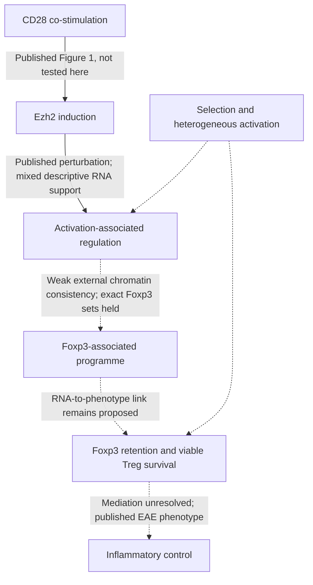
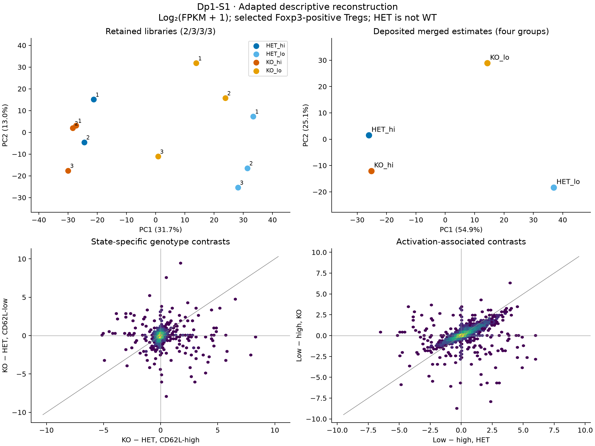
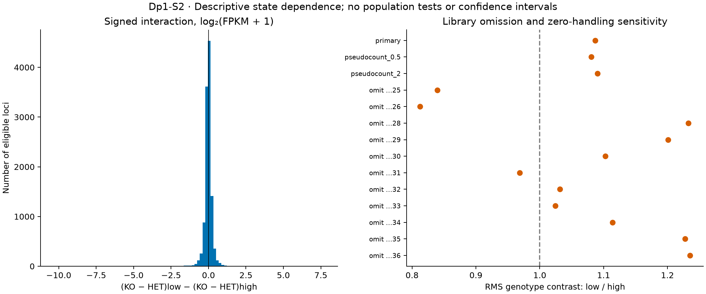
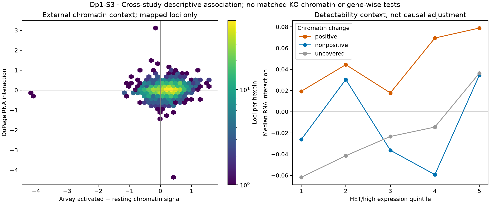

# DuPage 2015: activation and maintenance of Treg identity

## Organizing Biological Q

How does Ezh2 help activated regulatory T cells retain their transcriptional
identity, and which part of that regulation can explain their subsequent loss
from inflamed tissues?

**7 November 2026: S0–S6 disposition complete.** S0–S3 were executed within
qualified descriptive scope; S4 was not informative for another numerical run;
S5–S6 completed the functional evidence map and next-question synthesis.
**Dp1-P01** remains article-local, paper **9**, Gate **3B**. No canonical RQ,
claim grade or human scientific decision was created or promoted.

[Current results and S4–S6](RESULTS.md) · [Stage ledger](STAGE_STATUS.md) ·
[Original plan](ANALYSIS_PLAN.md) · [Prospective amendment](ANALYSIS_AMENDMENT_V2.md) ·
[Source review](SOURCE_REVIEW.md) · [Literature context](LITERATURE_CONTEXT.md) ·
[Validation](VALIDATION.md)

**New exploratory follow-up:** [32-candidate screen and proposed experiments](TARGET_SCREEN_RESULT.md)
· [Four-figure portfolio, with PDF/SVG downloads](TARGET_SCREEN_FIGURES.md).
Read the [biological review and current qualifications](BIOLOGICAL_REVIEW_20261107.md)
before choosing an experimental comparison.
The [three candidate records](CANDIDATE_FOLLOWUP.md) separate source qualification
from the [prospective numerical follow-up](CANDIDATE_ANALYSIS_PLAN_V1.md).
**Executed follow-up:** [candidate results and two new figures](CANDIDATE_ANALYSIS_RESULT_V1.md).
Tigit/Prdm1/Ccr2 gain effects reverse across fresh/cultured contexts; Igfbp4
retains a reciprocal direction. This is descriptive cross-context evidence.
This DuPage-first screen is independent of the owner's optional Zhang reading
direction, but reuses the same exposed DuPage samples; it is not replication.

## What the screening changed

| Stage | Result or disposition | Consequence |
|---|---|---|
| [S0](S0_RESULT.md) | 23,102 compatible loci; 22,997 all-OK; 12 libraries / 24 runs; 11 libraries retained | Descriptive FPKM eligible; count/population inference held |
| [S1](S1_RESULT.md) | 11,614 eligible loci; low/high KO–HET RMS ratio 1.087; KO/low library spread | Published direction modestly supported; direct interaction needed |
| [S2](S2_RESULT.md) | Ratio 0.812–1.235 after library omission; 59.0% of interaction signs stable | Broad activation specificity remains mixed and sample-sensitive |
| [S3](S3_RESULT.md) | Weak chromatin association, rho 0.162 across 1,180 mapped loci; 0.149 in single-gene-domain sensitivity | Covered-subset consistency, not direct targets or mediation |
| [S4](RESULTS.md#s4--later-study-comparison-reviewed-not-informative-to-execute) | No specific new discriminator beyond published broad loss/gain comparison | No additional numerical dataset imported |
| [S5](RESULTS.md#s5--functional-bridge-evidence-map-completed-raw-reanalysis-held) | Published identity and survival evidence coexist; trafficking unresolved | Distinct phenotype endpoints retained; raw-data analysis held |
| [S6](RESULTS.md#s6--defensible-next-scientific-decision) | Bounded reconstruction; no validated target or new mechanism | Proposed next comparison separates within-viable-cell regulation from cell loss |

RNA differences compare conditional **KO versus HET**, not ordinary WT.
CD62L states are observed after perturbation, and profiled cells remain
Foxp3-positive. This is shared-source exposed reconstruction, not independent
replication. Sign counts and omission ranges are not tests or confidence intervals.

## Literature context & visual hypothesis

This qualitative map does not assert temporal mediation. Arvey chromatin used
a different activation context and mm9 loci. No matched DuPage KO chromatin was
measured. The 2024 EZH2 gain-of-function and 2026 KDM6B papers constrain
generalization; see [literature context](LITERATURE_CONTEXT.md).

## Measured figures

[S1 PDF](../../analysis/research/runs/dupage_s1_reconstruction_v1/reconstruction.pdf) · [Tables/methods/receipt](S1_RESULT.md)

[S2 PDF](../../analysis/research/runs/dupage_s2_state_contrast_v1/state_dependence.pdf) · [Tables/methods/receipt](S2_RESULT.md)

[S3 PDF](../../analysis/research/runs/dupage_s3_regulatory_context_v1/regulatory_context.pdf) · [Mappings/methods/receipt](S3_RESULT.md)

## Next biological decision

**Owner-requested follow-up completed:** the [DuPage-first target screen](TARGET_SCREEN_RESULT.md)
qualified a separate protein-coding view after finding small-RNA-label dominance
in the unrestricted ranking. Proposed routes address TIGIT–PRDM1 inducible
output, CCR2 localization versus fitness, and IGFBP4 buffering versus compensation.
Zhang 2026 is optional context; no candidate is validated or adopted as an RQ.

The proposed next question is whether regulatory changes appear **within viable
lineage-labelled HET/KO Tregs under a common activation exposure before changes
in Foxp3 retention or selective cell loss**. Direct chromatin/RNA, viable absolute
numbers, lineage-marker retention, division and death address distinct parts of
that question. Function and trafficking require their own endpoints if claimed.
No target, effect margin, sample-size basis or laboratory readiness is established;
see [S6](RESULTS.md#s6--defensible-next-scientific-decision).

The original Niethamer/D1 lung-Treg gate remains separate and unmet. A30's paired
human compartment RNA comparison and all other canonical questions are unchanged.

## Execution history

Execution authorization superseded the planning-only scope, with all stages
ultimately kept in one technical chat. Four frozen contracts, immutable receipts,
independent arithmetic/mapping checks and retained unfavorable results document
the work. [AM01](ANALYSIS_AMENDMENT_V2.md) records the prospective adapted S3
mapping. Original plans remain readable; public raw inputs are ignored and
private reading material was not tracked. Local commits only; no push, PR,
external message or wet-lab execution.
