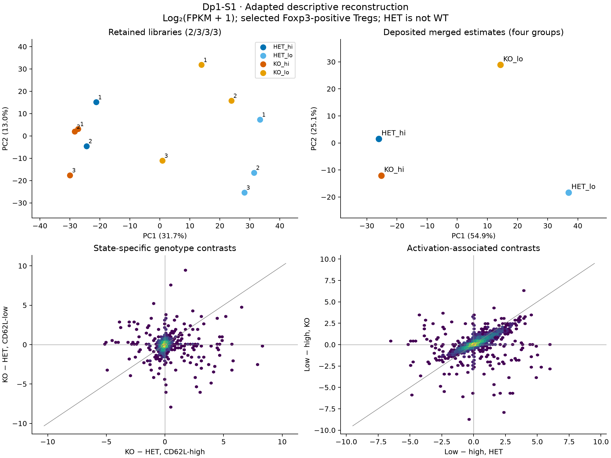

# Dp1-S1: adapted expression reconstruction

7 November 2026. **Executed and checked; descriptive shared-source reanalysis.**
[Contract](contracts/Dp1.S1.reconstruction_v1.json) ·
[Receipt](../../analysis/research/runs/dupage_s1_reconstruction_v1/receipt.json) ·
[All 11,614 contrasts](../../analysis/research/runs/dupage_s1_reconstruction_v1/gene_contrasts.tsv) ·
[Sample QC/PCA](../../analysis/research/runs/dupage_s1_reconstruction_v1/sample_qc_pca.tsv) ·
[Summary](../../analysis/research/runs/dupage_s1_reconstruction_v1/summary.json)

Among 22,997 all-OK common loci, 11,614 have FPKM ≥1 in at least one retained
library. Means are calculated **after log2(FPKM+1)**; differences are not unshifted
log2 fold changes. The 1-FPKM eligibility rule is not a biological effect margin.

| Contrast | RMS | Median absolute |
|---|---:|---:|
| Low − high, HET | 0.5634 | 0.1740 |
| Low − high, KO | 0.4627 | 0.1217 |
| KO − HET, high | 0.3408 | 0.0653 |
| KO − HET, low | 0.3704 | 0.0977 |

Low-state genotype divergence is greater by both summaries, but the RMS increase
is modest (ratio 1.087). The library PCA separates activation-associated states
on PC1 and shows substantial KO/low spread. The four-estimate PCA uses 11,246
eligible rows from the **separate merged file**; it has no replicate degrees of
freedom. PCA axes and percentages across those plots are not directly comparable.
Point numbers are source replicate labels within groups, not paired-mouse IDs.
The lower panels show log-scaled hexbin density, with a gray identity line.

This supports the direction of the published observation, while weakening an
unqualified claim of uniformly large activation-specific disruption. It is not
an exact Figure 6 replay: original DEG lists, full filtering/FDR universe and
supplemental procedures remain unrecovered. Published DEG counts were not used
as targets; no DEG calls or population confidence bounds were produced.

Receipt verification passed. A separate standard-library calculation checked
46,456 signed contrasts from S0 raw values (maximum difference 3.56e-15).
An independent Gram-matrix eigendecomposition reproduced the PCA spectrum
(maximum difference 2.50e-16). The rendered figure was visually inspected.

**Checkpoint:** the source-like direction survives library-level reconstruction,
but sample spread and choice of summary matter. Selection and heterogeneous
activation remain alternatives. Next, **S2 estimates the interaction directly**
on the fixed S1 universe, with leave-one-library and pseudocount sensitivities.
Those omission ranges will describe fragility, not estimate animal uncertainty.
