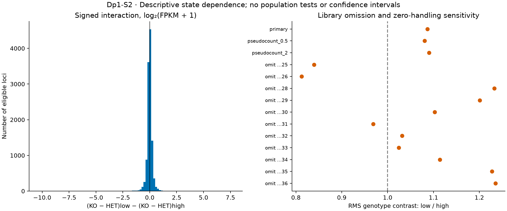

# Dp1-S2: descriptive state dependence

7 November 2026. **Executed; mixed, library-sensitive evidence.**
[Contract](contracts/Dp1.S2.state_contrast_v1.json) ·
[Receipt](../../analysis/research/runs/dupage_s2_state_contrast_v1/receipt.json) ·
[Every interaction](../../analysis/research/runs/dupage_s2_state_contrast_v1/interaction.tsv) ·
[Sensitivity table](../../analysis/research/runs/dupage_s2_state_contrast_v1/sensitivity.tsv)

On the fixed 11,614-locus S1 universe, the interaction is
`(KO_low − HET_low) − (KO_high − HET_high)` using mean log2(FPKM+1).
Its median is −0.0116, median absolute magnitude 0.1083, and RMS 0.4994.
There are 5,455 positive and 6,159 negative values. These are signed locus
descriptions, not significant genes or independent biological observations.

The global low/high RMS ratio is 1.087 but ranges **0.812–1.235** after omitting
one library. Both HET/high omissions reverse the global RMS ordering, leaving
only one HET/high preparation. This demonstrates dependence on the sparse
comparator summary; it is not a formal test disproving the biological effect.
The median-absolute metric and RMS need not describe the same aspect of the
distribution. All original libraries remain in the primary result.

**6,857/11,614 (59.0%) interaction signs** remain unchanged in all 11 omissions.
Changing the pseudocount to 0.5 and 2 preserves 11,525/11,614 signs (99.2%);
the global RMS ratios are 1.081 and 1.090. Library composition is therefore a
more consequential sensitivity here than these particular zero-handling choices.
Sensitivity extrema are not confidence intervals; sign consistency is not an
effect-size threshold or biological acceptance criterion.

The algebraic design has rank 4 and nominal library residual df 7. Biological
residual df and population inference remain unqualified because mouse/pool
independence is unresolved. No p-values or FDR claims were made.

Receipt verification passed. Independent verification used the alternative
`activation_KO − activation_HET` identity for all 11,614 interactions; maximum
floating-point discrepancy was 1.78e-15. The figure was visually inspected.

**Checkpoint:** broad activation specificity is mixed and sensitive to sparse
preparations. The result does not identify one repression mechanism. S3 may
separate normally increased/decreased source classes, explicitly acknowledge
same-data coupling, and ask whether qualified external chromatin association
adds information. Newly recovered Arvey Table 6 permits an adapted mapping
under [prospective amendment AM01](ANALYSIS_AMENDMENT_V2.md); exact 2015 sets
and matched KO chromatin remain missing.
