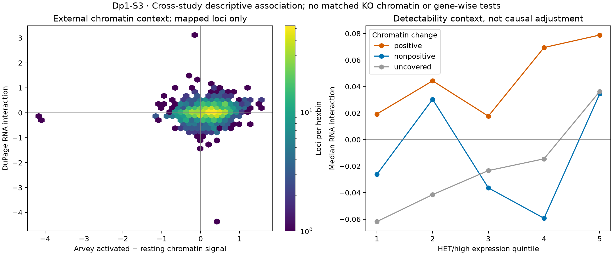

# Dp1-S3: regulatory context, with partial reference holds

7 November 2026. **Adapted branch executed and independently checked.**
[AM01](ANALYSIS_AMENDMENT_V2.md) · [Contract](contracts/Dp1.S3.regulatory_context_v1.json) ·
[Receipt](../../analysis/research/runs/dupage_s3_regulatory_context_v1/receipt.json) ·
[Gene context](../../analysis/research/runs/dupage_s3_regulatory_context_v1/gene_context.tsv) ·
[All class/stratum summaries](../../analysis/research/runs/dupage_s3_regulatory_context_v1/class_summary.tsv)

## What was measured

The internal HET activation-down group contains 4,400 loci; its median RNA
interaction is +0.1024. The activation-up group has 7,175 loci with median
interaction −0.0799. Another 39 loci have exactly zero HET activation contrast
and remain separate. Both attenuation of repression and attenuation of induction
are visible as descriptions. **These groups share the HET terms with the
interaction**, so their opposing signs cannot independently establish either
mechanism. No significant-gene lists, enrichment tests or biological replicates
are inferred from these counts.

External Arvey chromatin data contain 4,390 domains. The pinned annotation yields
5,022 gene-domain edges; 984 domains overlap multiple genes. Of the fixed 11,614
RNA loci, **1,180 (10.2%)** map by exact same-chromosome symbol after within-mm9
overlap; 659 have single-gene-domain support. The other **10,434 are uncovered**,
not demonstrated to be unmarked. No mapping pair changed under the tested
one-base start-coordinate convention sensitivity.

| Descriptive Spearman association with external chromatin change | All mapped, n=1,180 | Single-gene-domain subset, n=659 |
|---|---:|---:|
| KO − HET, high | 0.0009 | 0.0272 |
| KO − HET, low | 0.1381 | 0.1293 |
| State interaction | **0.1624** | **0.1495** |

815 mapped loci have positive median activation-associated chromatin change;
their median RNA interaction is +0.0411. For 365 mapped loci with nonpositive
change it is −0.0021. The positive-change group's median interaction is higher
in each of the five HET/high expression strata; exact denominators and values
are in the class table. This check does not eliminate expression/selection bias.
No p-values are assigned to correlated genes or shared domains.

## Source and mapping provenance

[Arvey 2014](https://doi.org/10.1038/ni.2868), Figures 5–6 and online methods,
was read in full XML recovered via [NCBI efetch](https://eutils.ncbi.nlm.nih.gov/entrez/eutils/efetch.fcgi?db=pmc&id=4112080)
on 7 November. The manuscript identifies mm9 processing and the H3K27me3
domain method. [GSE55753](https://www.ncbi.nlm.nih.gov/geo/query/acc.cgi?acc=GSE55753)
links expression GSE55705 and sequencing **GSE55773**. The latter's
[README](https://ftp.ncbi.nlm.nih.gov/geo/series/GSE55nnn/GSE55773/suppl/GSE55773_README.txt)
names the selected activated/resting Treg columns and specifies
log2(RPKM+0.3), followed by quantile normalization. Its
[H3K27me3 table](https://ftp.ncbi.nlm.nih.gov/geo/series/GSE55nnn/GSE55773/suppl/GSE55773_h3k27me3_qn.txt.gz)
is the numerical source. It is **not logged again**; global methylation abundance
cannot be recovered from quantile-normalized relative signals.

[Publisher Table 6](https://static-content.springer.com/esm/art%3A10.1038%2Fni.2868/MediaObjects/41590_2014_BFni2868_MOESM7_ESM.xls)
was recovered as a tab-delimited text file despite its XLS suffix (354,172 bytes;
SHA-256 `306f5de678fd86186c4ded61ced57de24792d9c0acfdd0940caf311242e7d513`).
It contains a repeated Tn1 header; no Tn contrast was used. Its less-explicit
transform was not guessed or pooled with the qualified GEO table. The failed
PMC table route returned download-challenge HTML. The first guessed publisher
CDN hostname did not resolve; the valid publisher host succeeded. This corrects
the initial reference-access limitation, without asserting recovery of the
separate DuPage 2015 supplement.

Annotation: [UCSC mm9 refGene](https://hgdownload.soe.ucsc.edu/goldenPath/mm9/database/refGene.txt.gz),
[schema](https://hgdownload.soe.ucsc.edu/goldenPath/mm9/database/refGene.sql),
downloaded 7 November 2026; SQL dump dated 13 September 2020. This is not the
original 2014/2015 gene assignment. The [coordinate convention](https://genomes.soe.ucsc.edu/FAQ/FAQtracks.html)
and both tested domain-start interpretations are explicit in AM01. No raw mm9
coordinate was joined to mm10. Exact source/code hashes are in the contract.
[Every gene-domain edge](../../analysis/research/runs/dupage_s3_regulatory_context_v1/gene_domain_edges.tsv)
is retained, with one median signal per mapped gene and no transcript summation.

## Verification and checkpoint

Receipt verification passed. A separate interval-overlap implementation checked
all 4,390 domains and 5,022 edges, rederived the source-column differences
(maximum error 4.45e-16), and checked all 1,180 mapped-gene medians. Independently
implemented tied ranks and scalar correlation reproduced rho=0.1624049305.
The rendered figure was inspected. The same verification pass independently
checked all 11,614 S2 library-omission extrema (maximum error 5.33e-15).

**Narrowing:** a weak positive association is compatible with the published
repression model for a covered subset, with a similar result under the
single-gene-domain sensitivity. It does not establish a coherent global programme,
a direct target or chromatin mediation. Most RNA loci are uncovered; activation
contexts differ; surviving-cell selection and indirect regulation remain plausible.
Arvey reuse is the original analytical lineage, not new independent replication.

The exact Gavin Foxp3-loss, Samstein binding and Hill signature memberships used
in DuPage Figure 6 remain **unqualified**, because the separate 2015 supplement
and its selection/annotation record were not recovered. No substitute list is
represented as an exact replay. Externally specified cycle/survival gene sets
were not added: neither a new score nor adjustment for post-perturbation RNA
would resolve the selection alternative with these bulk data. Its informative
follow-up is the endpoint distinction in S5.

**Next:** S4's broad loss/gain comparison would reproduce an existing published
comparison and no specific validated discordant class has been nominated here.
Record that branch as not informative, then map identity, viability, location
and inflammatory-control endpoints separately in [S4–S6 synthesis](RESULTS.md).
