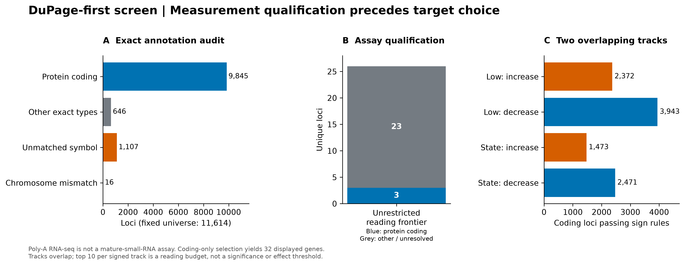
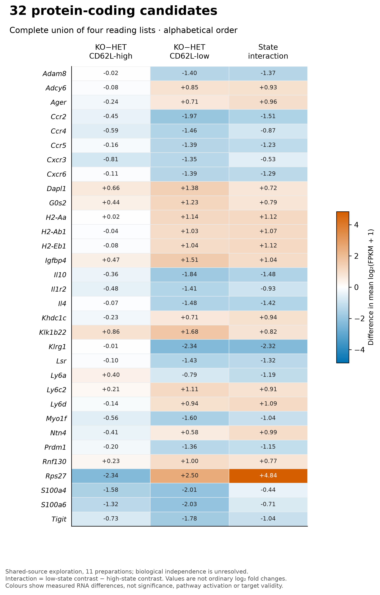
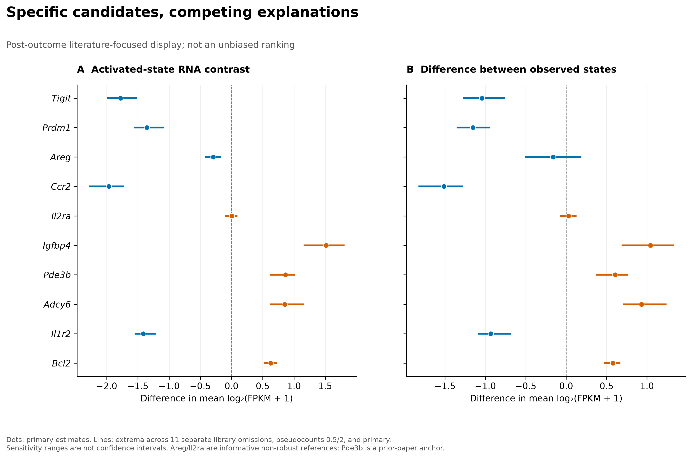
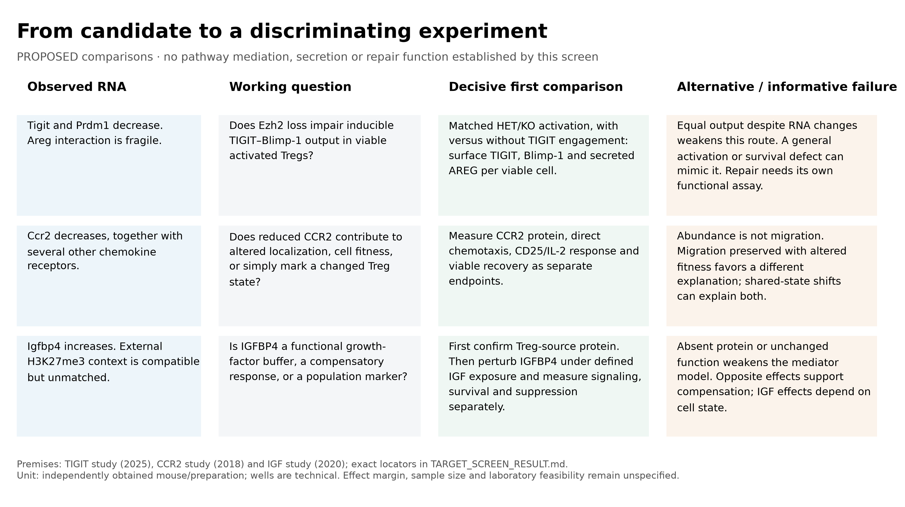

# DuPage-first target-screen portfolio

7 November 2026. [Scientific interpretation and proposal](TARGET_SCREEN_RESULT.md)
· [Frozen screen plan](TARGET_SCREEN_PLAN_V1.md) · [Assay-motivated amendment](TARGET_SCREEN_AMENDMENT_V2.md)
· [Figure specification](contracts/Dp1.target_figures_v1.json)

All panels are generated from repository tables. Numerical figures are exposed,
shared-source exploration. **Figure 4 describes proposed experiments.** No panel
establishes a direct EZH2 target, protein activity, secretion or tissue repair.
The subsequent [biological review](BIOLOGICAL_REVIEW_20261107.md) qualifies
Figure 4's assay context and candidate direction; use it with the caption.

## Figure 1 — qualification changes the reading frontier

[Vector PDF](../../analysis/research/runs/dupage_target_figures_v1/fig01_screen_qualification.pdf)
· [Editable SVG](../../analysis/research/runs/dupage_target_figures_v1/fig01_screen_qualification.svg)

A: exact current NCBI symbol/chromosome/type qualification of the fixed 11,614
loci. B: only 3 of the initial 26 distinct displayed loci qualify as protein
coding; poly-A library preparation limits interpretation of mature-small-RNA
labels. C: separate signed low-state and state-prioritized tracks among coding
loci. Tracks overlap and must not be summed. The coding view reselects the
reading frontier within the full coding universe; it is not a subset of those
three initial hits. Ten per signed track is a reading budget.

## Figure 2 — all 32 coding-frontier candidates

[Vector PDF](../../analysis/research/runs/dupage_target_figures_v1/fig02_complete_protein_frontier.pdf)
· [Editable SVG](../../analysis/research/runs/dupage_target_figures_v1/fig02_complete_protein_frontier.svg)

Alphabetical display of every distinct candidate in the four coding reading
lists. Each cell shows the unchanged mean-log RNA contrast. I = low minus high
KO–HET contrast. These values are not ordinary log2 fold changes, significance
tests or pathway scores. The scale spans the full observed matrix; no gene is
removed from this displayed union to strengthen a proposed biological story.

## Figure 3 — candidate estimates and fragility

[Vector PDF](../../analysis/research/runs/dupage_target_figures_v1/fig03_candidate_sensitivity.pdf)
· [Editable SVG](../../analysis/research/runs/dupage_target_figures_v1/fig03_candidate_sensitivity.svg)

Post-outcome focused display of candidates and explicitly declared endpoint or
prior-paper anchors. Dots are primary estimates. Lines span the primary,
11 separate one-library omissions and full-sample pseudocounts 0.5 and 2:
14 configurations, not a crossed design. **These ranges are not confidence
intervals.** Areg/Il2ra retain their unfavorable interaction stability. Gene
selection is not independent of the inspected literature or outcomes.

## Figure 4 — comparisons that could change the decision

[Vector PDF](../../analysis/research/runs/dupage_target_figures_v1/fig04_proposed_comparisons.pdf)
· [Editable SVG](../../analysis/research/runs/dupage_target_figures_v1/fig04_proposed_comparisons.svg)

Qualitative proposal matrix connecting measured RNA to three distinct questions:
TIGIT–PRDM1 inducible output, CCR2 localization versus fitness, and IGFBP4
growth-factor buffering versus compensation. Published mechanisms are premises;
the Ezh2-to-function links remain proposed. The report supplies exact primary
locators, alternative explanations and readiness limits. No experimental result
is represented in this panel.

## Reuse and provenance

[Exact plotted source values](../../analysis/research/runs/dupage_target_figures_v1/figure_source_values.tsv)
· [Manifest](../../analysis/research/runs/dupage_target_figures_v1/figure_manifest.json)
· [Rendering script](scripts/target_figures_v1.py)
· [Immutable receipt](../../analysis/research/runs/dupage_target_figures_v1/receipt.json)

PNG files are 300 dpi; PDFs and SVGs are vector exports. Keep these captions and
the exploratory/proposed labels when reusing figures in a portfolio. Do not
overwrite frozen exports; later corrections require a new version and link.
