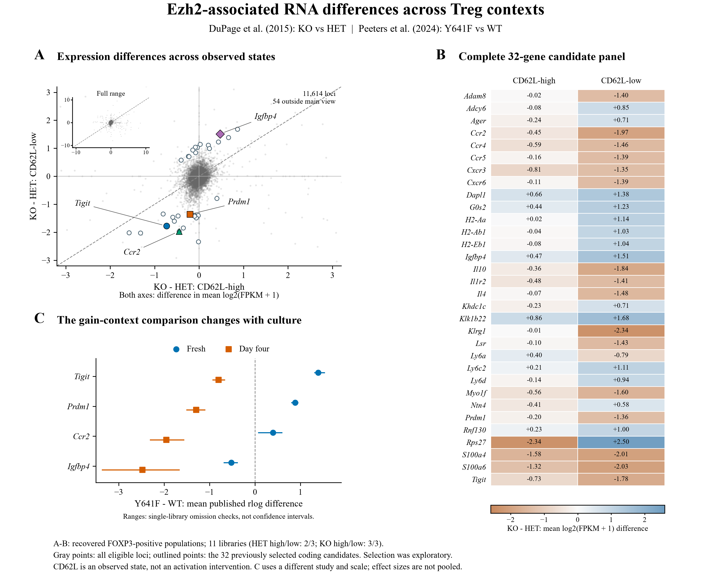
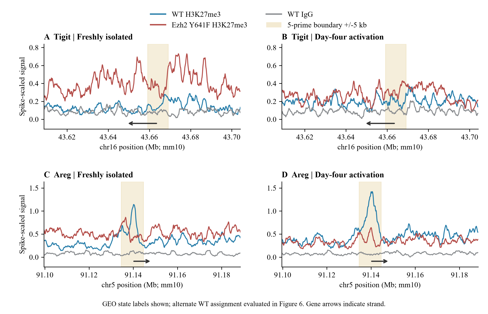
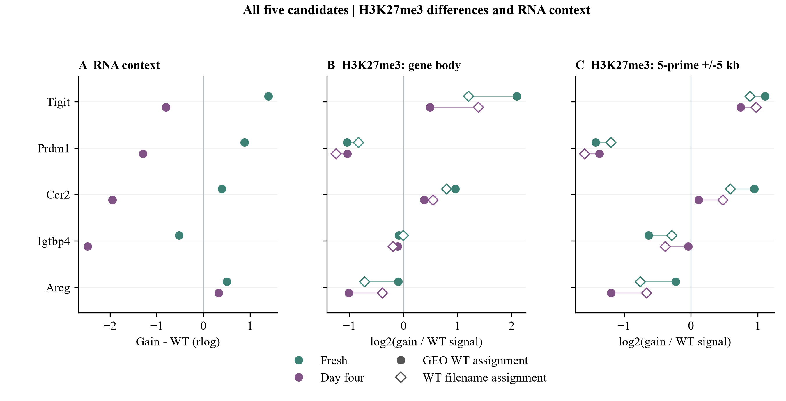
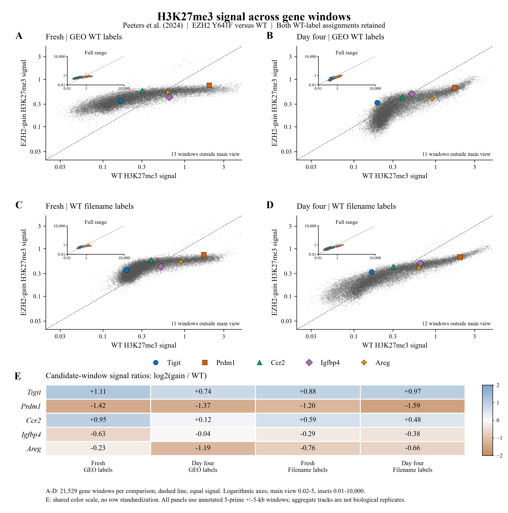

# Approved figure displays — 13 November 2026

These figures preserve approved public-data displays prepared for a research portfolio. They reuse the linked article analyses; they are not independent replication or new scientific acceptance. Numerical results and historical figures are unchanged.

[Article home](../README.md) · [Archive overview](../../../docs/PORTFOLIO_FIGURE_ARCHIVE_20261113.md)

G-SURF microscopy and personal outreach documents are deliberately excluded.

## EZH2 perturbation across Treg contexts

All 11,614 shared loci provide the background for 32 previously examined candidates. The separate gain-of-function comparison uses Peeters RNA estimates. Context dependence is descriptive; candidate selection followed prior outcome exposure.

[PNG](../../../analysis/research/runs/portfolio_dupage_figures_20261113_v1/ezh2_rna_context.png) · [PDF](../../../analysis/research/runs/portfolio_dupage_figures_20261113_v1/ezh2_rna_context.pdf) · [SVG](../../../analysis/research/runs/portfolio_dupage_figures_20261113_v1/ezh2_rna_context.svg) · [Provenance](../../../analysis/research/runs/portfolio_dupage_figures_20261113_v1/manifest.json)

## H3K27me3 profiles at Tigit and Areg

Figure 5. Two illustrative loci from the five-candidate extension. Exact deposited 100-bp profiles, with the same vertical scale across states within each gene. Tigit and Areg were selected after viewing results to illustrate different chromatin/RNA relationships; all five candidates appear in Figure 6. Shading marks the annotated 5-prime boundary +/-5 kb, not a measured regulatory element. Tracks were already yeast-spike scaled and smoothed in the source; no further smoothing or background subtraction was applied. Each line is an aggregate deposited track. WT IgG supplies background context; no gain-specific IgG is available. A missing 100-bp IgG bin in the Areg flank remains missing and lies outside both summary windows.

[PNG](../../../analysis/research/runs/portfolio_dupage_figures_20261113_v1/chromatin_loci.png) · [PDF](../../../analysis/research/runs/portfolio_dupage_figures_20261113_v1/chromatin_loci.pdf) · [Provenance](../../../analysis/research/runs/portfolio_dupage_figures_20261113_v1/manifest.json)

The Peeters chromatin extension was frozen locally and was not on origin/main at archive creation. Supporting values and original run records are retained here; this import is not a new analysis or independent replication.

## Five candidates under both WT assignments

Figure 6. All fixed candidates, both WT assignments. (A) Prior gain-minus-WT RNA estimates in rlog units. (B-C) Log2 ratios of length-weighted aggregate-track means over the annotated gene body and 5-prime boundary +/-5 kb. Filled circles follow GEO; open diamonds swap the two WT state assignments, with gain and IgG unchanged. Connecting segments represent label sensitivity, not uncertainty intervals. RNA and chromatin are joined by gene and experimental context, without a verified mouse/aliquot match. No population significance test is implied.

[PNG](../../../analysis/research/runs/portfolio_dupage_figures_20261113_v1/chromatin_rna_context.png) · [PDF](../../../analysis/research/runs/portfolio_dupage_figures_20261113_v1/chromatin_rna_context.pdf) · [Provenance](../../../analysis/research/runs/portfolio_dupage_figures_20261113_v1/manifest.json)

The Peeters chromatin extension was frozen locally and was not on origin/main at archive creation. Supporting values and original run records are retained here; this import is not a new analysis or independent replication.

## Candidates within 21,529 gene windows

Figure 7. Five candidates within a broader H3K27me3 reference. [4] (A-D) WT versus EZH2 Y641F signal across 21,529 complete protein-coding gene windows. Rows retain both WT assignments; columns compare fresh and day-four Tregs. (E) Log2(gain/WT) window-mean ratios on a shared scale. Windows span the annotated outer 5-prime boundary +/-5 kb (GRCm38.78); 490 of 22,019 eligible windows lacked complete coverage. Insets retain every window, including values outside the enlarged main views. Aggregate tracks do not supply biological replication; no new normalization or significance test was applied.

[PNG](../../../analysis/research/runs/portfolio_dupage_figures_20261113_v1/chromatin_reference.png) · [PDF](../../../analysis/research/runs/portfolio_dupage_figures_20261113_v1/chromatin_reference.pdf) · [SVG](../../../analysis/research/runs/portfolio_dupage_figures_20261113_v1/chromatin_reference.svg) · [Provenance](../../../analysis/research/runs/portfolio_dupage_figures_20261113_v1/manifest.json)

The Peeters chromatin extension was frozen locally and was not on origin/main at archive creation. Supporting values and original run records are retained here; this import is not a new analysis or independent replication.
