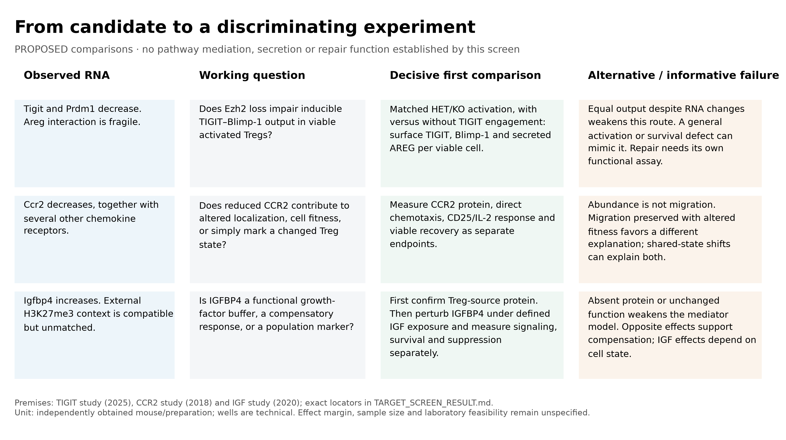

# DuPage-derived Treg questions: derivation and proposed comparisons

7 November 2026. This article-owned derivation record organizes question development separately
from the [measured DuPage gallery](../TARGET_SCREEN_FIGURES.md).
The owner requested distinct RQ placement after review of the earlier reframing
discussion. A33–A35 are proposed registrations, not human scientific acceptance,
validated targets, novelty claims or an instruction to execute every experiment.
Dp1-P01 continues to own the source reconstruction and all frozen numerical runs.

## Three questions, three decisions

| Home | Published premise → repository observation → question | What the next comparison can change |
|---|---|---|
| [A33: TIGIT-responsive AREG output](../../../RQ_Specified/A33_ezh2_tigit_areg_output/README.md) | Published TIGIT/Blimp-1/AREG response → Tigit/Prdm1 RNA differs by Ezh2 context without matching Areg direction → is the evoked output response altered? | A genotype-by-engagement output comparison can identify a response deficit or preserved response. It does not itself establish PRDM1 mediation or repair. |
| [A34: CCR2 movement and fitness](../../../RQ_Specified/A34_ezh2_ccr2_movement_fitness/README.md) | Published movement/fitness possibilities, with a genetic-background counterexample → lower Ccr2 without a stable Il2ra RNA deficit → which measured responses change? | Separate movement, signaling and recovery; establish CCR2 contribution only with a target-restricted test. The CD25 account is conditional. |
| [A35: IGFBP4 source and IGF response](../../../RQ_Specified/A35_treg_igfbp4_source_igf_response/README.md) | Known IGFBP4/IGF biology with cell-source and cleavage boundaries → reciprocal RNA direction across unmatched studies → is intact protein produced by Tregs, and does it modulate response? | Source/protein qualification is useful in its own right; native-IGF perturbation is conditional. A benefit from blockade is not presumed. |

All three are adequate as distinct **developing questions**. Their endpoints,
comparators and informative unfavorable outcomes differ. This judgment does not
rank them against the other 29 coding-frontier genes or infer experimental readiness.
The top-ten-per-track rule was a finite reading budget, and the focus on these
routes followed outcome and literature exposure.

## Overlap scan and placement

Inspected the current registry, all A0–A32 card titles and question-home organizing
questions, plus the nearest source/recipient and lymphocyte scopes. At the
starting revision there were 33 canonical homes and two supporting workspaces;
the actual root collection is `RQ_Specified/`, not a directory named
`Research Question/`. Existing folders and evidence were preserved.

| Existing scope inspected | Relation to these proposals | Placement decision |
|---|---|---|
| A2, A9, A12 | AREG epithelial delivery, fibroblast competence, IL-1 recipient context | Related signaling concepts; A33 measures Treg receptor-evoked source output, so it is not absorbed into the recipient questions. |
| A26–A30 | CD8 repertoires, Th17 outputs/PGAM, paired CSF–blood RNA | Related lymphocyte context; no existing CCR2 movement/fitness or Treg IGFBP4-source estimand. |
| A0–A1, A3–A8, A10–A11, A13–A25, A31–A32 | Epithelial/stromal/myeloid state, response, growth, ageing and recovery questions | Shared methods or broad themes do not supply the same population–perturbation–endpoint comparison. Preserve every owner. |
| Dp1-P01 and its three article-local cards | The actual common origin of A33–A35 | Keep source results and older cards in the article; current question development lives in the three linked homes. No extra article-candidate identity is invented. |

## Reframing audit: what recurred and what held up

The earlier owner-supplied chat, **Ravel_User_Guided_Session**
(`01a18687-3e55-7b51-b514-52f5f55a210b`),
emphasized scientific progression, rather than accumulating analyses or forcing
every observation into a mechanism. This audit found specific corrections:

- **Literature selection:** the previous bounded CCR2 review missed a close
  genetic-background counterexample. The correction below changes the prospective
  comparison; a source list alone was insufficient biological review.
- **Overstated narrowing:** the headline about a failed reciprocal-direction
  model could sound like a mechanistic test. Different alleles, controls, states,
  culture and expression scales make the completed comparison descriptive.
  Its useful contribution is the observed sign dependence and receptor/output
  discordance, not causal falsification of an inverse loss/gain mechanism.
- **Current versus historical authority:** the old cards mainly appended a link
  to the new numerical result. The new homes integrate what the result changes
  and supply a single current development route. Historical designs remain linked.
- **Gallery scope:** the proposal matrix was mixed into measured figures.
  It is now an archived design illustration here; the measured gallery links
  only the screening and executed candidate plots.

The audit did **not** find evidence of fabricated independence, count-based
inference from FPKM, omitted unfavorable anchor results, overwritten frozen
outputs or target validation conferred by sensitivity checks. These boundaries
remain necessary. Small library counts and unknown animal/pool mapping still
restrict biological inference; they do not prove that the patterns are noise.

## Literature correction

[Chorro et al., 2018](https://doi.org/10.1038/s41467-018-07806-6), published
18 December, Results “Isolation of a novel IL-2 receptor alpha point mutant
mouse,” Figure 1 and the Il2ra-transfection Methods: one Ccr2-knockout colony
had low CD25 because of an independently segregating **Il2ra Y129H** mutation;
a reacquired Ccr2-knockout colony did not show that phenotype. Primary Results,
legend and relevant Methods were accessed through the publisher on 7 November.
This is contrary/background evidence, not proof that
[Zhan et al.](https://doi.org/10.1038/s41423-018-0187-8) used the affected colony.
Zhan's pharmacological and chimera evidence is retained. The reviewed record
does not settle the cross-study discrepancy. A34 therefore treats CD25 as a
qualified branch and requires actual Il2ra/background attribution before a
CCR2-specific claim. The original DuPage RNA estimates are unaffected.

For A33, [Panetti 2025](https://doi.org/10.1038/s41590-025-02300-w), Figures 5–6
and Extended Data 8, already provides the core TIGIT/output premise; PRDM1
mediation in the new Ezh2/Treg comparison remains untested. For A35,
[Karino 2025](https://doi.org/10.1002/art.43313), Figure 3G–I, makes expression
context and intact-versus-cleaved protein consequential. The older
[Miyagawa 2017](https://pubmed.ncbi.nlm.nih.gov/28724578/) precedent remains
abstract-level access. The [earlier source audit](../candidates/SOURCE_QUALIFICATION.md)
records the full versus partial reads, source-accession mismatch and reused data.
No target is established as novel by this review.

## Search record

Actual refresh: **7 November 2026**, web search with unrestricted years plus an
explicit 2026 query, primary publisher/PMC/PubMed records. Main queries:
`TIGIT EZH2 Blimp-1 amphiregulin Panetti 2025 regulatory T cells`;
`CCR2 regulatory T cells CD25 Ezh2 Zhan 2020`;
`IGFBP4 regulatory T cells Miyagawa Karino 2025 Ezh2`;
`"CCR2" "CD25" "Chorro" "Zhan"`;
`"IGFBP4" "Treg" "2026"`;
`"CCR2 enhances CD25" correction retraction`;
`"CCR2 enhances CD25" "Il2ra"`;
`"Interleukin 2 modulates" "CCR2" "Zhan"`.
Additional exact-PMC queries for Zhan's mutation, Chorro and Methods terms
returned noisy/incomplete indexing; they do not establish absence.

The same-day earlier 2024–2026/foundational scans were reused. The refresh
rechecked Karino Figure 3 Results and Chorro Figure 1/Methods; Panetti's earlier
full primary read remains applicable. Zhan direct PMC/publisher and Europe PMC
XML access still failed (browser check/HTTP 500). Full supplementary methods
and a comprehensive correction/retraction audit remain incomplete. No systematic
forward-citation census was performed. Indexed 2026 asthma/pregnancy Treg papers
([asthma lead](https://pmc.ncbi.nlm.nih.gov/articles/PMC12997964/),
[pregnancy lead](https://doi.org/10.1111/imcb.70081)) mention Igfbp4 in expression
contexts; they were not read as full perturbation reports and are not added as
functional validation. Stop this pass at the closest comparison and material
counterexample; refresh exact methods when selecting an executable model.

## Archived proposal matrix — former Figure 4

The original qualitative matrix is retained with its frozen run. It is **not a
measured result or the current experiment specification**. Its CCR2 and output
premises must be read with the corrections above and the current A33–A35 plans.

[Original PDF](../../../analysis/research/runs/dupage_target_figures_v1/fig04_proposed_comparisons.pdf)
· [Original SVG](../../../analysis/research/runs/dupage_target_figures_v1/fig04_proposed_comparisons.svg)
· [Immutable receipt](../../../analysis/research/runs/dupage_target_figures_v1/receipt.json).
The asset and its original number are preserved, so later measured Figures 5–6
retain their published filenames and labels.

## Validation and integration

Documentation and question registration only. Frozen inputs, scripts, contracts,
receipts and measured figures are unchanged. Final checks and integration state
are recorded in the current PROGRESS entry; no biological rerun is needed.

**Explicit PR review item:** registration requires updating the layout validator's
exact expected sequence from A0–A32 to A0–A35. Its equality constraint is retained;
rejection tests cover missing A33/A34/A35, duplicates, reordered IDs and an extra
unregistered A36. No governance rule or claim threshold is relaxed. The new
interpretation boundaries and this inventory assertion require review in PR #168;
agent validation is not that human review, and the PR is not merged here.

## Owner-approved format revision — 8 November 2026

A33–A35 now follow the neighboring A28/A31/A32 reasoning sequence, with local primary-source tables, candidate-specific evidence, explicit narrowing assessments and stage-based development plans. Their new [biological illustrations](FIGURE_REVIEW_20261108.md) replace the displayed workflow drafts. This common derivation/audit record was placed with its source article; no extra RQ collection folder is needed. Existing measured results and hypotheses are unchanged.

Final local validation for this revision: **17,481 repository checks passed**, as did the research provenance gate against refreshed main `32ab85e`. The 167 prior tests (two skipped) remain applicable, including exact-identity rejection cases. All 18 newly displayed values match existing source tables. Original A0–A32 cards/guides/raster records, contracts, receipts and source-inventory artifacts are preserved. Three selected PNGs were inspected; their prompt/source/hypothesis bindings are recorded. No biological analysis was rerun.
