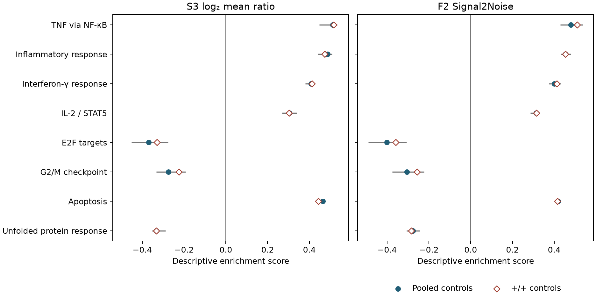

# F2 results for Signal2Noise ranking

12 November 2026, Asia/Seoul. The TNF/NF-κB and inflammatory response
Hallmarks retained positive scores when the same day-four RNA libraries
were ranked by Signal2Noise. E2F and G2/M remained negative, while
apoptosis remained positive. This strengthens the description of those
specific patterns in the deposited libraries. Three other Hallmarks
reversed sign, limiting the claim of broader rank robustness.
[Frozen method and F1 review](F2_METHOD_V1.md) ·
[Contract](contracts/Wang18.F2.signal2noise_v1.json) ·
[Run receipt](../../analysis/research/runs/wang18_f2_signal2noise_v1/receipt.json).

## Inflammatory and culture-state themes

The analysis kept all 50 mouse Hallmarks and the same 13,932 uniquely
mapped, count-eligible genes as S3. Coverage was identical for each set.
The table shows weighted running-sum scores. Pooled controls include four
+/+ and one fl/+ library. The +/+ column uses only the four deposited +/+
controls. The biological-unit and control-label uncertainties in
[F1](F1_SOURCE_AUDIT_20261112.md) still apply.

| Hallmark | Covered / total | S3 pooled | F2 pooled | F2 +/+ | F2 pooled omission range | F2 +/+ omission range |
|---|---:|---:|---:|---:|---:|---:|
| TNF via NF-κB | 163/196 | +0.512 | +0.480 | +0.510 | +0.429 to +0.537 | +0.434 to +0.553 |
| Inflammatory response | 135/197 | +0.488 | +0.454 | +0.455 | +0.432 to +0.480 | +0.421 to +0.479 |
| Interferon-γ response | 158/188 | +0.408 | +0.400 | +0.413 | +0.374 to +0.433 | +0.372 to +0.438 |
| IL-2 / STAT5 signaling | 189/199 | +0.304 | +0.314 | +0.315 | +0.286 to +0.328 | +0.294 to +0.332 |
| E2F targets | 191/199 | −0.370 | −0.401 | −0.359 | −0.490 to −0.307 | −0.478 to −0.224 |
| G2/M checkpoint | 179/195 | −0.275 | −0.306 | −0.257 | −0.375 to −0.224 | −0.362 to −0.139 |
| Apoptosis | 136/161 | +0.465 | +0.419 | +0.416 | +0.407 to +0.433 | +0.402 to +0.439 |
| Unfolded protein response | 101/111 | −0.332 | −0.277 | −0.284 | −0.307 to −0.243 | −0.333 to −0.236 |

The [complete 50-set table](../../analysis/research/runs/wang18_f2_signal2noise_v1/hallmark_signal2noise.tsv)
retains both S3 point scores, both F2 point scores, covered and unmatched
members, leading edges and all 17 F2 single-library omissions. Group
means, sample SDs and ranks were recomputed after each omission while
keeping the size factors fixed. The smallest group contained three
libraries, and none of the 19 F2 configurations had exact score ties.
[Ranking diagnostics](../../analysis/research/runs/wang18_f2_signal2noise_v1/ranking_diagnostics.json).

**Figure 1.** Selected themes from the original S3 display. The left panel
uses the log₂ mean ratio, and the right panel uses Signal2Noise. Filled
circles use pooled controls and open diamonds use +/+ controls. Gray
lines show single-library omission ranges for the pooled comparison.
Those lines measure leverage of the deposited libraries. Scores use the
same running-sum algorithm, with hit weights derived from each ranking.

## Ranking-dependent findings and next decision

Forty-seven of 50 sets retained their S3 direction with either control
definition. In the pooled comparison, glycolysis reversed from +0.225 to
−0.208, heme metabolism from −0.196 to +0.201, and WNT/β-catenin signaling
from +0.258 to −0.320. The same three reversals appeared with +/+ controls.
All F2 pooled directions survived single-library omission. With +/+ controls,
the bile acid metabolism, heme metabolism and spermatogenesis sets crossed
zero under at least one omission. These are dependencies of a signed
weighted set score on ranking and library composition. They do not
identify changes in metabolic flux, signaling or cell state.

F2 strengthens the reported inflammatory rank pattern under a second
metric and preserves the concurrent proliferation and apoptosis contrast.
It weakens any claim of ranking invariance across the full collection.
The next measurement decision is the same. Distinguishing changes in
recovery and state proportions from RNA differences within observed states
requires linked viable counts and state-resolved measurements from
identified preparations. A genotype contrast within post-perturbation
states alone would not identify a direct effect. F1 still governs the
separate holds on population inference, exact author replay and functional
reconstruction. F2 is ready for agent checkpoint review.

## Verification

Five synthetic checks covered sample SD, the nonzero-mean and zero-mean
floors, two zero means, and a small nonzero mean. Separate checks rejected
groups below three libraries and confirmed ascending stable-ID order for
exact ties. An independent standard-library calculation recomputed the
ranking statistics and weighted hit-position extrema. It matched 100 S3
point scores, all 950 F2 set scores and their coverage, 100 F2 leading
edges and 100 omission ranges. The figure was inspected and the receipt
verified. Scientific acceptance remains unassessed.
