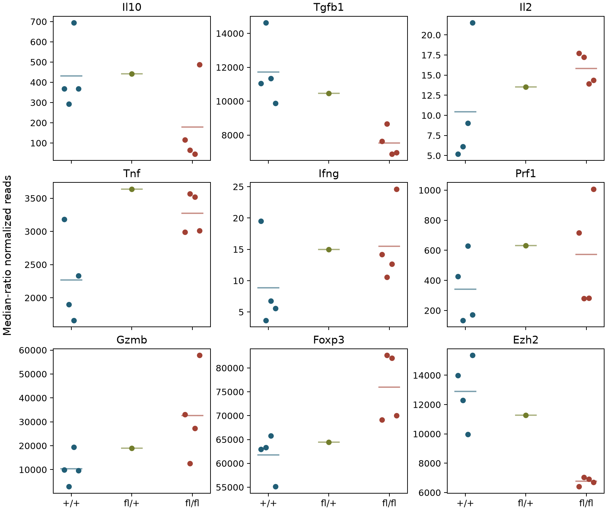
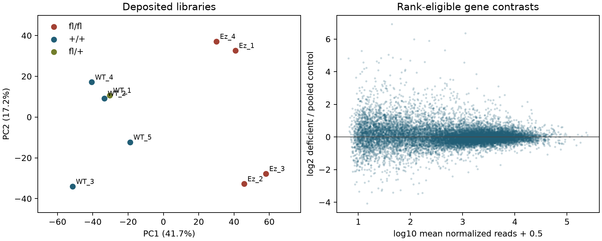
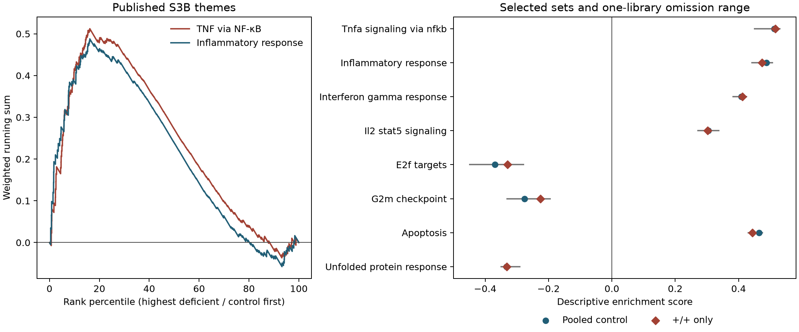
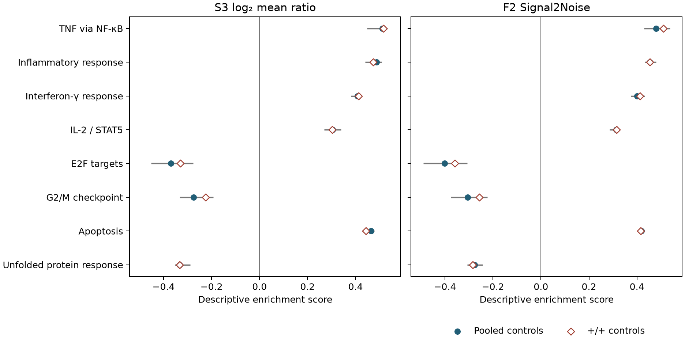

# Wang EZH2/Treg figure gallery

[Article overview](README.md) · [S1–S5 results](RESULTS_V1.md) ·
[F2 ranking sensitivity](F2_RESULTS_V1.md) · [Biological interpretation](BIOLOGICAL_INTERPRETATION_V1.md).

All four measured figures generated by the completed Wang18-P01 S2, S3 and
F2 runs are displayed below at their original, receipt-bound paths. These are
adapted descriptions of deposited day-four cultured-Treg RNA. Dots represent
libraries or genes as specified; animal/pool identities remain unresolved.
Omission ranges describe library leverage, not confidence intervals. The
figures do not measure secretion, survival, movement or tumor control.

## 1. Published RNA anchors and identity-related transcripts

Individual deposited libraries are grouped by recorded allele; horizontal
bars show group means. Each gene has its own read-count axis. The single
fl/+ library is D4_WT_1. Lower Il10/Tgfb1 and higher bulk Foxp3 concern the
recovered cultured population, not cytokine release or lineage stability.

[Library values](../../analysis/research/runs/wang18_s2_library_description_v1/anchor_values.tsv) ·
[S2 run receipt](../../analysis/research/runs/wang18_s2_library_description_v1/receipt.json).

## 2. Library structure and expression contrast

Left: PCA of centered log2(normalized reads + 1) across rank-eligible genes.
Right: each point is a gene, with a vertical coordinate given by the log2 ratio
of group mean normalized reads after adding 0.5 to each mean. The display
describes genotype-associated library structure; it does not establish
independent biological replication or remove processing confounding.

[PCA coordinates](../../analysis/research/runs/wang18_s2_library_description_v1/library_coordinates.tsv) ·
[Complete contrast](../../analysis/research/runs/wang18_s2_library_description_v1/complete_contrast.tsv) ·
[S2 run receipt](../../analysis/research/runs/wang18_s2_library_description_v1/receipt.json).

## 3. Hallmark patterns and control/library sensitivity

Left: weighted running sums for the two published S3B themes. Positive
scores place a gene set toward the deficient-high end of the rank. Right:
pooled-control and strict +/+ scores for selected sets. Gray lines span
single-library omissions with the ranking universe and size factors fixed.
These are descriptive rank patterns; apoptosis or cell-cycle themes do not
measure death or proliferation.

[All Hallmark scores and leading edges](../../analysis/research/runs/wang18_s3_breadth_v1/hallmark_scores.tsv) ·
[Gene sensitivity](../../analysis/research/runs/wang18_s3_breadth_v1/gene_sensitivity.tsv) ·
[S3 run receipt](../../analysis/research/runs/wang18_s3_breadth_v1/receipt.json).

## 4. Sensitivity to the source-named Signal2Noise ranking

Selected themes from the original S3 display: log2 mean-ratio ranking on the
left and Signal2Noise ranking on the right. Filled circles use pooled controls;
open diamonds use +/+ controls. Gray lines show pooled-comparison omission
ranges. The same running-sum algorithm uses weights derived from each ranking.
Inflammatory directions remain stable, while some metabolic/context themes
change sign; the method-dependent findings remain in the interpretation.

[Signal2Noise scores and comparisons](../../analysis/research/runs/wang18_f2_signal2noise_v1/hallmark_signal2noise.tsv) ·
[Ranking diagnostics](../../analysis/research/runs/wang18_f2_signal2noise_v1/ranking_diagnostics.json) ·
[F2 run receipt](../../analysis/research/runs/wang18_f2_signal2noise_v1/receipt.json).

## Related results and proposed illustrations

S4's exposed five-gene comparison is a
[table with source-specific scales](../../analysis/research/runs/wang18_s4_context_v1/context_directions.tsv),
not an additional generated plot. S1/F1 provide source audits, S5 integrates
published functional evidence, and F3 specifies measurements; those stages
did not generate further measured figures.

The existing [A33 illustration](../../RQ_Specified/A33_ezh2_tigit_areg_output/README.md),
[A34 illustration](../../RQ_Specified/A34_ezh2_ccr2_movement_fitness/README.md) and
[A35 illustration](../../RQ_Specified/A35_treg_igfbp4_source_igf_response/README.md)
show proposed comparisons. They are retained in their RQ homes and are not
Wang experimental results. The [Bockman review](BOCKMAN_FULL_READ_20261112.md)
is a literature review; locally rendered publisher figure pages are reading
materials, not newly generated analysis figures.
