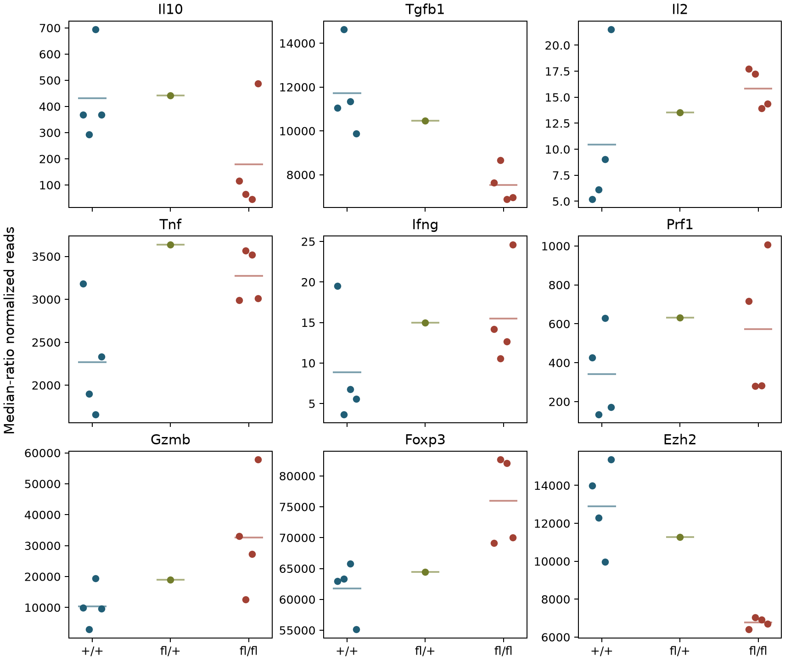
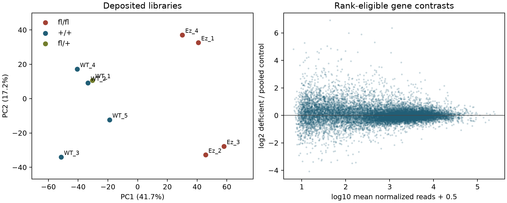
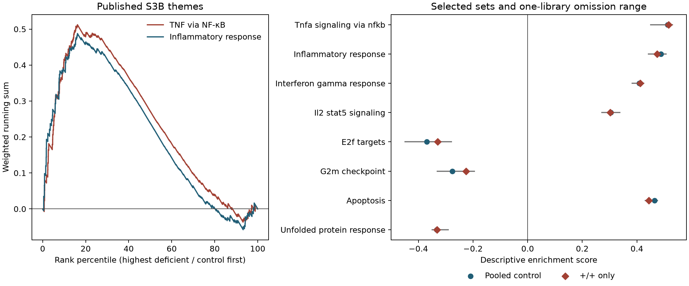

# Wang day-four Treg RNA results

12 November 2026. The comparison is relative transcript abundance after 96
hours of in-vitro activation in deposited libraries from initially CD62L-high
mouse Tregs. The four fl/fl libraries are compared with four +/+ and one fl/+
control, with a separate +/+ restriction. The unit is the deposited bulk
library. Mouse/pool, pairing and block identities remain unknown.
[Source qualification](SOURCE_QUALIFICATION.md) ·
[Prespecified adaptation](EXECUTION_AMENDMENT_V1.md).

## S1–S2 · The released counts reproduce the published anchor directions

The four-way crosswalk agrees for nine unique libraries with 32.47–62.20
million assigned gene counts each. The complete table retains 43,432 stable
IDs, including 20,593 all-zero and 8,878 low-count rows; 13,961 are
rank-eligible. Median-ratio normalization used 14,257 genes positive in
every library. Ensembl 78 maps all rows to gene names, with 145 rows sharing
ambiguous symbols. The strict +/+ comparison retains the primary directions
of all seven S3C targets.
[Sample manifest](../../analysis/research/runs/wang18_s1_qualification_v1/sample_manifest.tsv) ·
[Library QC](../../analysis/research/runs/wang18_s1_qualification_v1/library_qc.tsv) ·
[Complete gene table](../../analysis/research/runs/wang18_s2_library_description_v1/complete_contrast.tsv).

| RNA | Deficient / pooled, log2 | Deficient / +/+, log2 | One-library omission range, pooled |
|---|---:|---:|---:|
| Il10 | −1.28 | −1.27 | −2.52 to −0.96 |
| Tgfb1 | −0.61 | −0.64 | −0.68 to −0.50 |
| Il2 | +0.49 | +0.57 | +0.32 to +0.86 |
| Tnf | +0.36 | +0.53 | +0.24 to +0.53 |
| Ifng | +0.59 | +0.77 | +0.29 to +0.96 |
| Prf1 | +0.52 | +0.75 | +0.10 to +0.75 |
| Gzmb | +1.43 | +1.65 | +1.01 to +1.70 |
| Foxp3 | +0.29 | +0.30 | +0.24 to +0.33 |
| Ezh2 | −0.90 | −0.93 | −0.97 to −0.81 |

Il10 and Tgfb1 were lower and Il2 was higher, as Wang reported in S3C.
Il2 and Ifng were sparse (4–27 and 3–36 raw reads per library,
respectively). Tnf, Ifng, Prf1 and Gzmb all had positive descriptive ratios
with overlapping library values. Wang marked these four nonsignificant.
The adaptation supplies directions and leverage, with population tests held.
The deficient libraries retained gene-level Ezh2 reads, which do not measure
retention of the deleted SET-domain exons or enzyme activity. Foxp3 RNA was
higher at day four; Figure 5's tumor lineage tracing is a different endpoint
and setting. [Publisher S3C](https://ars.els-cdn.com/content/image/1-s2.0-S2211124718307964-mmc1.pdf) ·
[Anchor values](../../analysis/research/runs/wang18_s2_library_description_v1/anchor_values.tsv) ·
[Gene leverage](../../analysis/research/runs/wang18_s3_breadth_v1/gene_sensitivity.tsv).

**Figure 1.** Dots are individual deposited libraries, grouped by recorded
allele; horizontal bars are group means. Each gene uses its own read-count
axis. The single fl/+ dot is D4_WT_1.

**Figure 2.** Left, PCA of centered log2(normalized reads + 1) across
rank-eligible genes. PC1 explains 41.7% of variance and separates the
deposited genotype groups; PC2 explains 17.2%. WT_1 and WT_2 have nearby
labels; their exact points are in the
[coordinate table](../../analysis/research/runs/wang18_s2_library_description_v1/library_coordinates.tsv).
Right, each dot is a rank-eligible gene. The vertical coordinate is the
log2 ratio of group mean normalized reads with 0.5 added to each mean.
Genotype separation is compatible with unresolved genotype-linked batch or
differences in culture recovery.

## S3 · Inflammatory ranks rise alongside opposing culture-state patterns

All 50 mouse Hallmarks reached the coverage floor. TNF via NF-κB
(163/196 covered, score +0.512) and inflammatory response (135/197,
+0.488) stayed positive under strict +/+ controls, depth scaling, log-mean
ranking and every one-library omission. Omission ranges were +0.448 to
+0.533 and +0.440 to +0.509, respectively. Cxcl10 contributes to both
leading edges. These results recover the direction of the two themes shown in
S3B with a newer mouse collection and specified ranking.

The apoptosis set was positive (+0.465), E2F targets (−0.370) and G2M
checkpoint (−0.275) were negative, and unfolded protein response was
negative (−0.332). Those signs also held across the tested variants.
The joint pattern is compatible with differences in activation, proliferation
or recovery of cell states, alongside altered inflammatory RNA. The counts
alone cannot distinguish selection from within-state regulation, estimate
cell abundance, or establish pathway activity.
[All 50 set scores, coverage and leading edges](../../analysis/research/runs/wang18_s3_breadth_v1/hallmark_scores.tsv).

**Figure 3.** Left, weighted running sums for the two published S3B themes.
Positive scores place a set toward the deficient-high end of the rank.
Right, pooled and strict +/+ scores for selected sets. Gray lines span
single-library omissions with the ranking universe and size factors fixed.
These ranges describe library leverage. No permutation probabilities or
population intervals were computed.

## S4 · Five exposed genes across separate activation contexts

The fixed panel checks whether RNA directions transfer across the available
contexts. Each column retains the indicated source's direction and scale.

| Gene | Wang day-four loss | DuPage loss, CD62L-high / low | Peeters gain, fresh / day four | What changes |
|---|---|---|---|---|
| Tigit | ↓ | ↓ / ↓ | ↑ / ↓ | Fresh gain is opposite; cultured gain shares the loss direction. |
| Prdm1 | ↓ | ↓ / ↓ | ↑ / ↓ | The same context dependence appears. |
| Ccr2 | ↑, omission crosses zero | ↓ / ↓ | ↑ / ↓ | The Wang point sign is fragile (−0.18 to +0.35). |
| Igfbp4 | ↑ | ↑ / ↑ | ↓ / ↓ | Reciprocal directions across these recorded comparisons. Intact Treg-derived protein remains unmeasured here. |
| Areg | ↑ | ↓ / ↓ | ↑ / ↑ | Wang loss and Peeters gain agree in direction despite the opposite DuPage loss signs. |

Wang's log2 mean count ratios, DuPage's mean log2(FPKM + 1) differences
and Peeters' differences of published rlog means are retained in the
[source-unit table](../../analysis/research/runs/wang18_s4_context_v1/context_directions.tsv).
Allele, control, sorting, state and culture differences prevent estimation of
a common causal interaction. The human expression contrasts from Figure 2D–E
would address tissue associations. This follow-up stops with the mouse panel
because the human contrasts cannot discriminate the leading culture alternatives.
[Context amendment](CONTEXT_AMENDMENT_V1.md) ·
[Dp1 evidence](../gate3_09_dupage_2015/CANDIDATE_ANALYSIS_RESULT_V1.md).

## S5 · What the RNA changes add to the functional evidence

| Published comparison | Measured endpoint and remaining question |
|---|---|
| Figure 5A–E and S3A | Lineage-reporter GFP/RFP separates exFoxp3 from reporter-retaining Tregs. FOXP3-positive cells as a share of CD4 cells and the CD8-to-Treg ratio use different denominators. S3A is representative MC38 intracellular cytokine gating. The day-four RNA result supplies neither absolute viable recovery nor lineage-linked cytokine output. |
| Figure 5F–G | Restimulated FOXP3-positive MC38 Tregs show a changed intracellular cytokine distribution. The displayed 5F data are described as three mice per group and two experiments. Its samples cannot be linked to day-four RNA or read as unstimulated in-situ secretion. |
| Figure 6A–F and S4–S5 | The inducible comparison measures tumor growth/rejection and, in the short-course MC38 experiment, tissue CD8 frequency, effector IFN-γ capacity, FOXP3-positive share of CD4, and Treg IL-10:TNF positivity ratio. The reported undetected reduction in FOXP3-positive frequency leaves absolute counts, composition and later attrition unresolved. |
| Figure 7A–H and S6 | DTR and inducible models differ in Treg frequency and absolute effector counts. Residual deficient Tregs in the female mosaic comparison improve MC38 control relative to the specific DTR or residual-control arms under the tested schedules. This supplies evidence beyond that depletion comparator. The necessary mediator, source-specific secretion and transport to other recipients remain unresolved. |

The first unresolved discriminator raised by the RNA is whether the day-four
contrast persists within the same recovered Treg state once viable recovery
and state composition are measured. Sample-to-mouse/pool/block records and
linked absolute recovery and state-resolved measurements would make that
comparison interpretable. The functional experiments already address distinct
questions. No functional reconstruction was run because per-animal FCS,
absolute viable recovery and longitudinal tumor data with panel/cohort
crosswalks were not located in the article's public data route or the targeted
source search. No new animal protocol or checkpoint-combination question is
needed for this result. Zhang's local-depletion/NK comparison has a different
recipient and intervention. The available safety observations are limited to
the tested mouse settings.
[Wang article](https://doi.org/10.1016/j.celrep.2018.05.050) ·
[Literature and access record](LITERATURE_CONTEXT.md).

## Verification and frozen evidence

An independent standard-library calculation matched all nine library totals,
43,432 raw-count rows and eligibility statuses, pooled and strict estimates
for nonzero rows, 125,649 single-library omission effects, and all 50 primary
set scores and leading edges. The three figures were visually inspected.
The four run receipts verified, with scientific acceptance recorded as
`not_assessed`.

| Stage | Frozen contract | Run receipt |
|---|---|---|
| S1 | [Qualification](contracts/Wang18.S1.qualification_v1.json) | [Receipt](../../analysis/research/runs/wang18_s1_qualification_v1/receipt.json) |
| S2 | [Library description](contracts/Wang18.S2.library_description_v1.json) | [Receipt](../../analysis/research/runs/wang18_s2_library_description_v1/receipt.json) |
| S3 | [Breadth and sensitivity](contracts/Wang18.S3.breadth_v1.json) | [Receipt](../../analysis/research/runs/wang18_s3_breadth_v1/receipt.json) |
| S4 | [Fixed-panel context](contracts/Wang18.S4.context_v1.json) | [Receipt](../../analysis/research/runs/wang18_s4_context_v1/receipt.json) |
