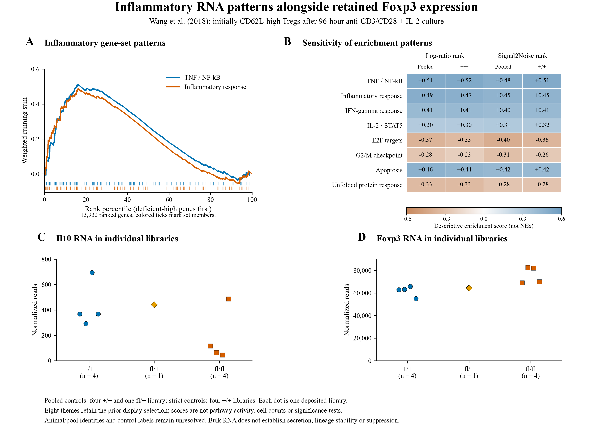

# Approved figure displays — 13 November 2026

These figures preserve approved public-data displays prepared for a research portfolio. They reuse the linked article analyses; they are not independent replication or new scientific acceptance. Numerical results and historical figures are unchanged.

[Article home](../README.md) · [Archive overview](../../../docs/PORTFOLIO_FIGURE_ARCHIVE_20261113.md)

G-SURF microscopy and personal outreach documents are deliberately excluded.

## Inflammatory RNA patterns and target sensitivity

Reconstructed enrichment curves use the frozen ranks and original gene-set membership. The selected Hallmark display and Il10/Foxp3 measurements retain all deposited libraries. No new enrichment test or normalized enrichment score is introduced; selection is exposed.

[PNG](../../../analysis/research/runs/portfolio_wang_figures_20261113_v1/inflammatory_rna.png) · [PDF](../../../analysis/research/runs/portfolio_wang_figures_20261113_v1/inflammatory_rna.pdf) · [SVG](../../../analysis/research/runs/portfolio_wang_figures_20261113_v1/inflammatory_rna.svg) · [Provenance](../../../analysis/research/runs/portfolio_wang_figures_20261113_v1/manifest.json)
