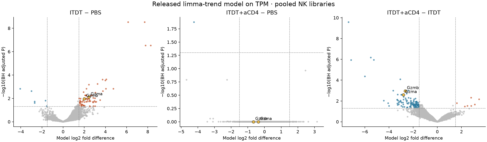
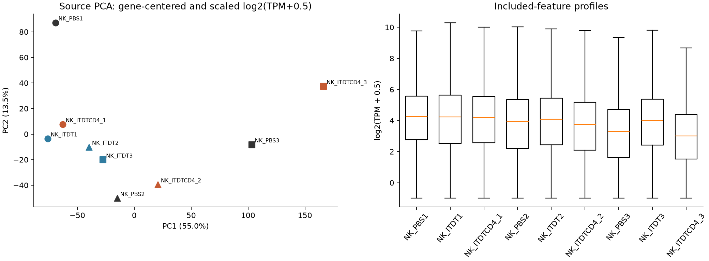
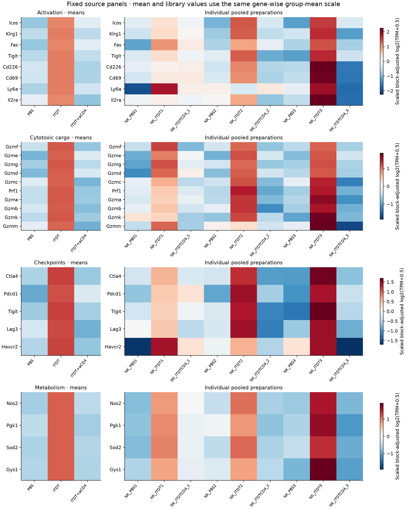
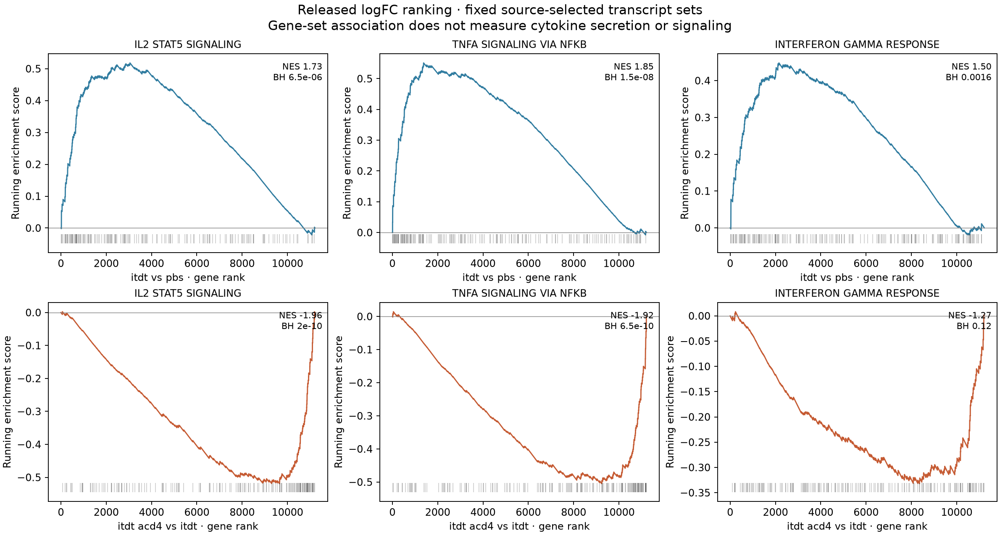
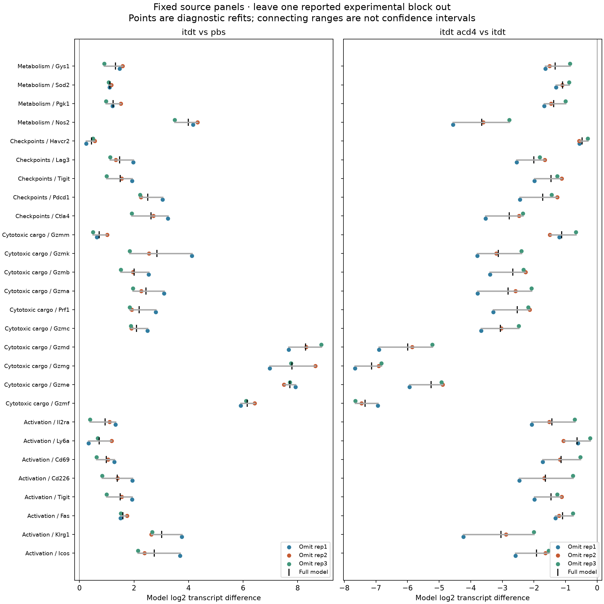
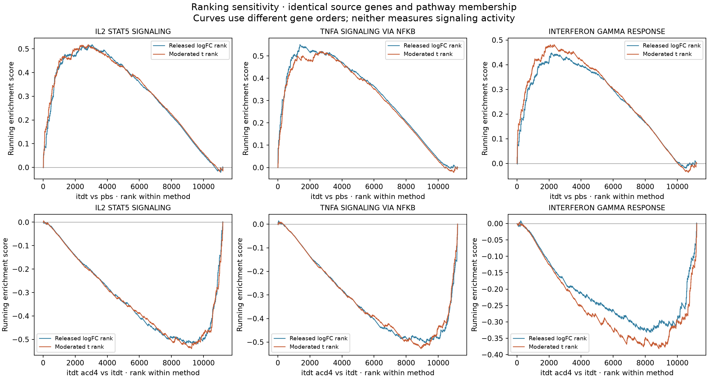

# Zhang RNA reproduction: figure guide

10 November 2026. [Current result and limitations](RESULTS.md).
Figures are newly styled displays of receipt-bound calculations, not pixel
copies of published panels. All were visually inspected. The source-panel
choices are exposed; none was selected from a favorable new screen.

## Content crosswalk

| Released file | Final-paper content locator | Reconstructed display |
|---|---|---|
| `fig_3h.pdf` | Figure 3B, ITDT−PBS volcano | First panel below |
| `fig_3i.pdf` | Figure 3D, ITDT+aCD4−ITDT volcano | Third panel below; the released third contrast is also shown |
| `fig_3d.pdf` | Figure 3C, activation-marker heatmap | Fixed-panel means plus individual libraries |
| `fig_3e.pdf` | Figure 3E, granzyme/perforin RNA | Fixed-panel means plus individual libraries |
| `fig_3f.pdf`, `fig_3g.pdf` | Figure 3F/G, checkpoint/metabolic RNA | Fixed-panel means plus individual libraries |
| `fig_3c.pdf` | Source PCA diagnostic; no final-main-panel equivalence asserted | PCA and per-library profiles |
| `fig_6g_itdt_vs_pbs.pdf` and second-contrast counterpart | Figure 6G, IL2/STAT5 RNA enrichment | Two contrasts, with the other fixed source-selected sets |
| `fig_s5b_*`, `fig_s5c_*` | Source TNF/NF-kappaB and IFN-gamma enrichment; final supplemental panel content not fully inspected | Fixed source-selected sets, labelled by measured statistic |

## All released contrasts

All 12,708 included genes. Dashed lines reproduce source display conventions.
These P values describe the released pooled-library model. Small Gzma/Gzmb
labels overlap in the near-null middle panel; exact values remain in the
[complete third-contrast table](../../analysis/research/runs/zh26_s1_reproduction_v1/itdt_acd4_vs_pbs_nk.csv).

## Library diagnostics

Source PCA centers and scales each retained gene after `log2(TPM+0.5)`.
Symbols identify experimental blocks; point labels identify each pool/library.
Separation is not a hypothesis test or a basis for excluding a sample.

## Fixed source panels

Source group means and nine individual libraries share the same gene-wise
scale derived from the three group means, after removing fitted block terms.
Colors denote the displayed RNA transform, not killing, secretion or pathway
activity. Scale magnitude is not comparable between different genes.

## Released enrichment

All displayed sets were selected in the source. ES/NES and leading-edge sets
match source outputs; Monte Carlo P values are not exact. The second IFN-gamma
contrast is retained despite BH 0.12. The full 236-pathway family per contrast
and the two unestimated source pathways remain in the tables.

## Experimental-block sensitivity

All fixed panels are shown for both main contrasts. Ranges connect three
diagnostic refits and are not confidence intervals. Tigit appears twice because
the source places it in two panels; that is not independent evidence.

## Ranking sensitivity

Each curve uses its own gene order on the identical universe. The moderated-t
comparison was frozen separately after the released outputs were inspected.
Direction retention does not imply identical leading edges or adjusted P values.
