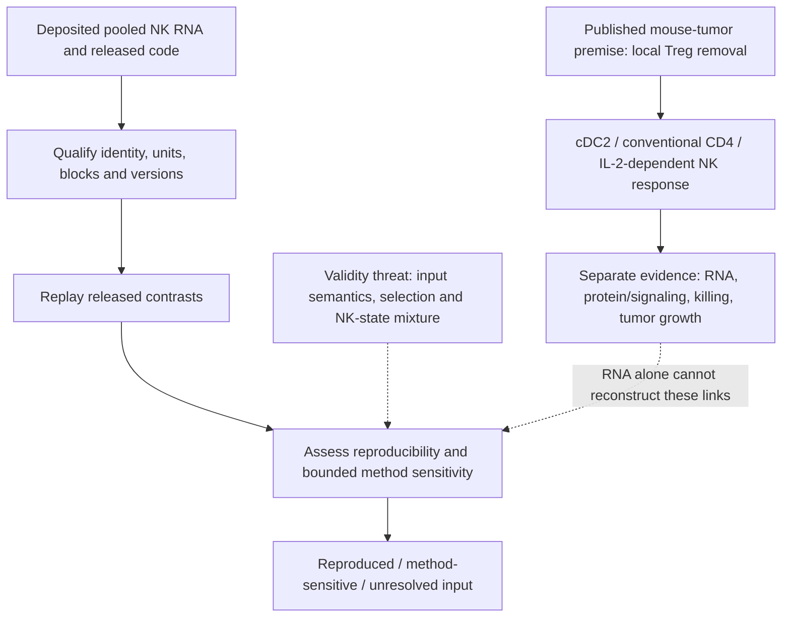

# Zhang 2026: local Treg control of tumor NK responses

10 November 2026. Stable reading paper **11**, Gate 3B.
Owner reports reading complete. **Planning and source review; no numerical analysis yet.**
Article-local candidate **Zh26-P01** concerns reproducibility and measurement;
it does not create a global RQ or scientific acceptance.

## Organizing question

How does local immune regulation limit NK-mediated tumor control, and what
part of the published evidence can be reconstructed from the deposited data?
[Zhang et al.](https://doi.org/10.1126/sciimmunol.adx4411) supply the biological
premise. Our first comparison concerns their sorted bulk NK RNA contrasts:
ITDT minus PBS and ITDT+aCD4 minus ITDT, with experimental-replicate blocking.
The endpoint is transcript abundance in pooled preparations, not killing,
IL-2 secretion, signaling activity or human therapeutic response.

The paper's functional experiments support the local immune circuit.
The new repository observation is a discrepancy between the published RNA
methods and released implementation, documented in the [source review](SOURCE_REVIEW.md).
The immediate contribution is source reconciliation and reproduction.

## Literature context and visual argument

This is a qualitative documentation diagram, not a measured result or registered
canonical-question illustration. The [literature context](LITERATURE_CONTEXT.md)
separates close precedents, current boundary findings and access limits.

## Read in this order

1. [Paper interpretation and neighboring studies](PAPER_REVIEW.md).
2. [Data inventory and discrepancies](SOURCE_REVIEW.md).
3. [Stepwise analysis plan and stage decisions](ANALYSIS_PLAN.md).
4. [Review and technical handoff](REVIEW_AND_HANDOFF.md).

The owner-authorized paper-specific work uses the paper's own NK data.
It does not certify the separate Niethamer/D1 lung Treg-separability gate.
A33–A35 remain distinct developing DuPage questions; their evidence is preserved.
Personal lab-fit and outreach notes remain outside the public repository.
