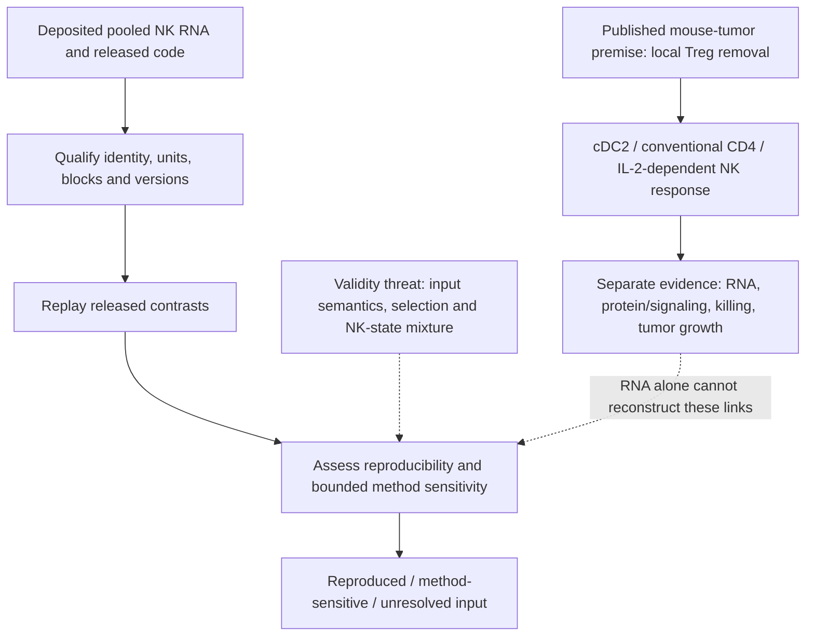
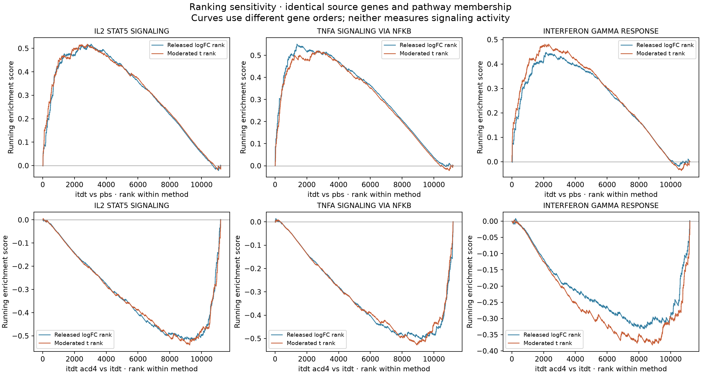

# Zhang 2026: local Treg control of tumor NK responses

10 November 2026. Stable reading paper **11**, Gate 3B.
Owner reports reading complete. **Released RNA reproduction and bounded sensitivity complete;
raw-read access is verified, while count-model qualification and functional-data
reconstruction remain unfinished.**
Article-local candidate **Zh26-P01** concerns reproducibility and measurement;
it does not create a global RQ or scientific acceptance.

The folder follows the existing Gate 3 convention: `gate3_11` denotes Gate 3
and stable paper number 11. The roadmap's more specific assignment is **3B**;
the prefix does not imply that the separate D1 lung-analysis gate has opened.

## Organizing question

How does local immune regulation limit NK-mediated tumor control, and what
part of the published evidence can be reconstructed from the deposited data?
[Zhang et al.](https://doi.org/10.1126/sciimmunol.adx4411) supply the biological
premise. Our first comparison concerns their sorted bulk NK RNA contrasts:
ITDT minus PBS and ITDT+aCD4 minus ITDT, with experimental-replicate blocking.
The endpoint is transcript abundance in pooled preparations, not killing,
IL-2 secretion, signaling activity or human therapeutic response.

The paper's functional experiments support the local immune circuit.
The released TPM/limma-trend implementation now reproduces all three contrast
tables across 12,708 genes. Fixed-panel directions survive each block omission.
Enrichment ES/NES and leading-edge sets match the source; Monte Carlo P values
are not exact, and the IFN-gamma second-contrast threshold-based description
depends on ranking. The [current result](RESULTS.md) records all outcomes,
verified receipts and exact holds. These results narrow uncertainty about the
RNA measurement without resolving bulk-state mixture or the paper/code model
disagreement.

The [biological reading and access review](INTERPRETATION_AND_ACCESS_V1.md)
explains all six figures and their relationship to the paper's functional
experiments. Public SRA/ENA reads now provide a feasible route to an adapted
count comparison; they do not recover the authors' original annotation or
count-processing provenance. Supplement downloads still encounter a browser
challenge, and PMC's replacement cloud service provides this manuscript's text
but no supplementary binaries. Holds apply to those dependent steps only.

## Literature context and visual argument

This is a qualitative documentation diagram, not a measured result or registered
canonical-question illustration. The [literature context](LITERATURE_CONTEXT.md)
separates close precedents, current boundary findings and access limits.

## Current measured evidence

The [six-figure guide](FIGURES.md) includes all contrasts, library diagnostics,
source panels, enrichment and block/ranking sensitivities, with source-panel
crosswalks. These measurements remain distinct from the qualitative diagram.

## Read in this order

1. [Current result, stage dispositions and exact holds](RESULTS.md).
2. [Biological interpretation and access](INTERPRETATION_AND_ACCESS_V1.md),
   [figure guide](FIGURES.md) and [execution validation](VALIDATION.md).
3. [Paper interpretation](PAPER_REVIEW.md) and [source review](SOURCE_REVIEW.md).
4. [Preserved plan](ANALYSIS_PLAN.md) and [planning handoff](REVIEW_AND_HANDOFF.md).

The owner-authorized paper-specific work uses the paper's own NK data.
It does not certify the separate Niethamer/D1 lung Treg-separability gate.
A33–A35 remain distinct developing DuPage questions; their evidence is preserved.
Personal lab-fit and outreach notes remain outside the public repository.
