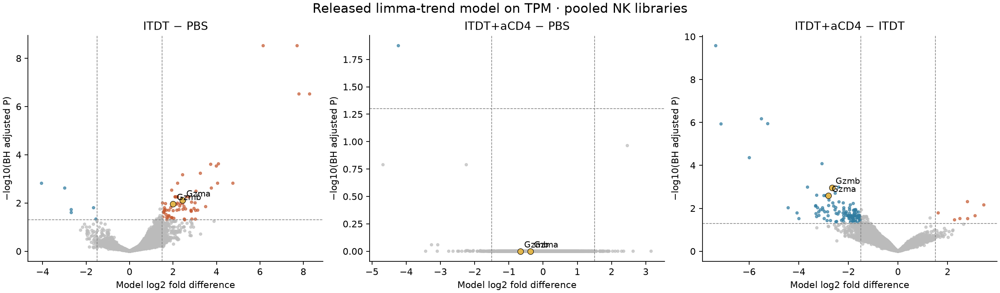
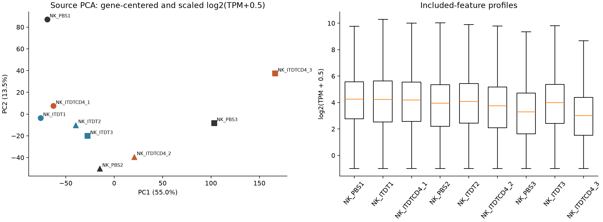
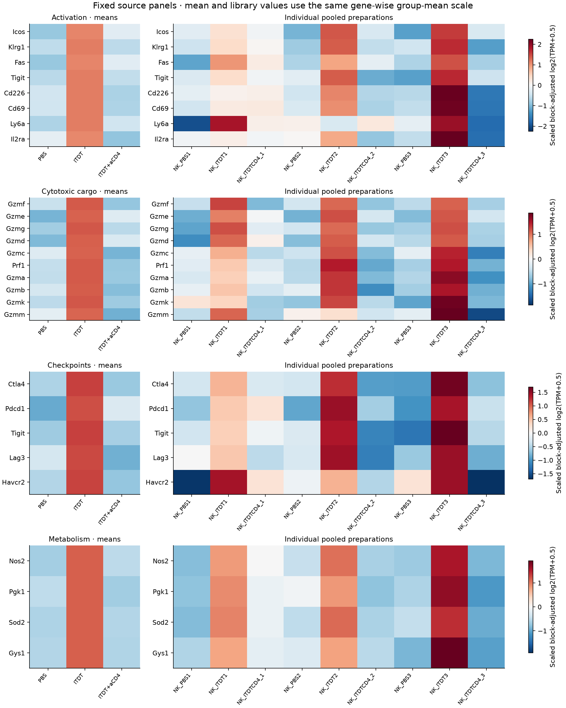
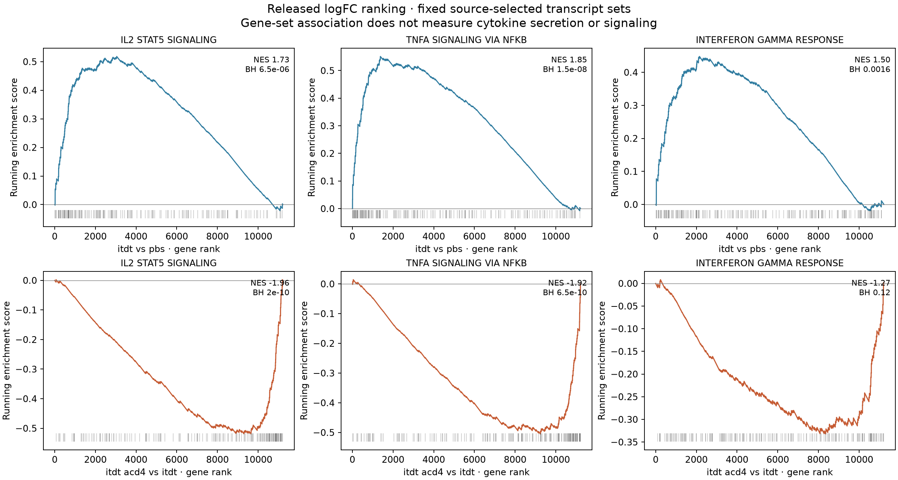
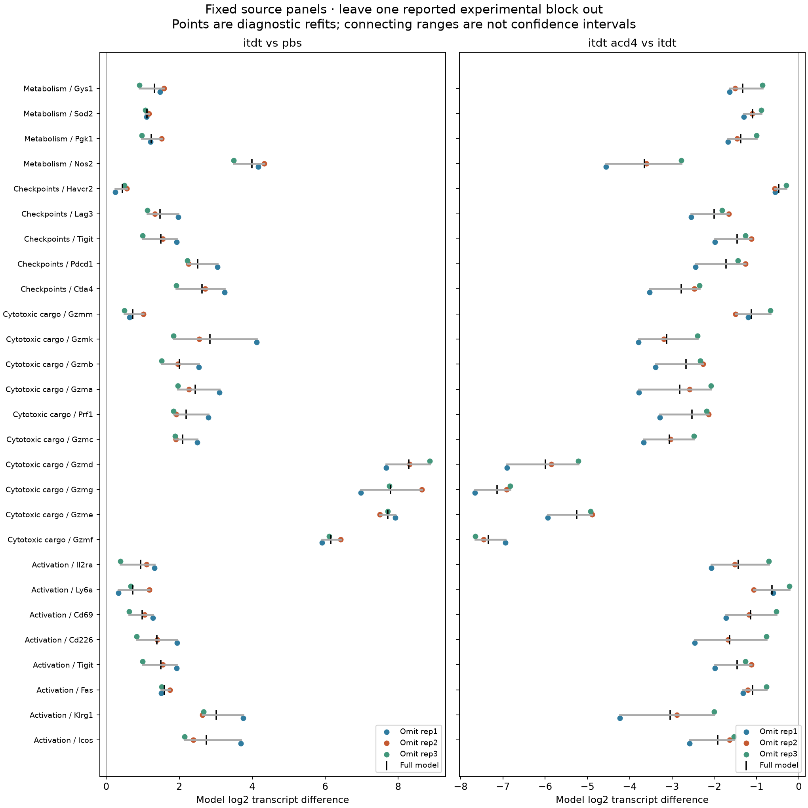
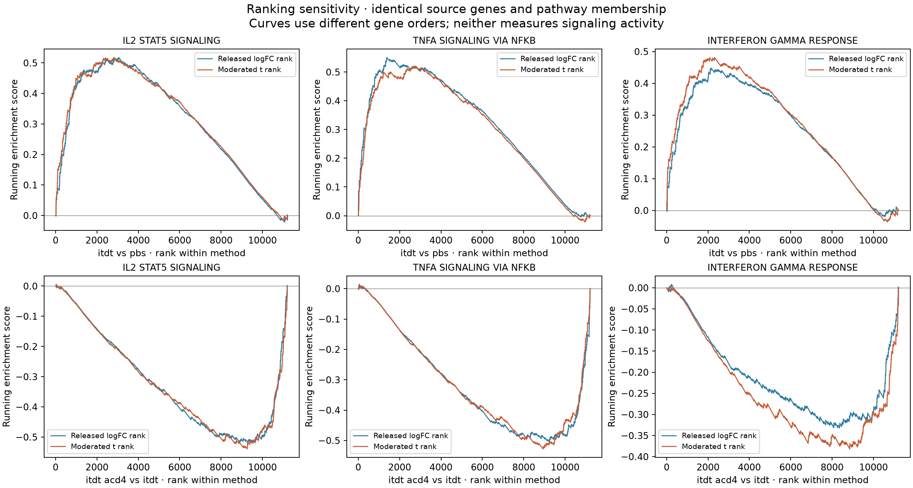

# Zhang et al. (2026) — Local Treg control of tumour NK-cell responses

<a id="zhang-2026-local-treg-control-of-tumor-nk-responses"></a>

<a id="organizing-biological-question"></a>

## Published findings

```text
CD8-resistant mouse tumours: local Tregs restrain a dendritic cell–CD4–NK circuit
  Intratumoral Treg depletion → release of suppression on conventional type 2 DCs
    └─ cDC2-dependent activation of conventional CD4 T cells → increased IL-2 supply
         └─ NK cells acquire an effector program and contribute to tumour control.
              ├─ CD4 codepletion attenuates the NK-cell transcriptional response.
              └─ Functional comparisons identify NK-dependent control in MHC-I-deficient
                 tumours and in selected MHC-I-positive tumours bearing NKG2D ligands.

Implication: tumour susceptibility to NK cells depends on local antigen-presenting
             and helper cells as well as the activating ligands present on the tumour.
```

The authors compared intratumoral Treg depletion with the combined depletion of Tregs and CD4 cells. Their NK RNA profiles and separate functional measurements addressed different links in the proposed circuit. [Paper, Fig. 3 and Figs. 6–7](https://doi.org/10.1126/sciimmunol.adx4411)

## Ravel analyses and results

Ravel reproduced the authors’ differential-expression results from nine pooled NK libraries. At 5% FDR, 87 genes differed after Treg depletion versus control. With both Tregs and CD4 cells depleted, one gene differed from control. These comparisons establish how closely the released RNA analysis can be reconstructed. Direct evidence about NK-mediated tumour killing comes from separate experiments. [RNA results and block sensitivity](RESULTS.md)

<details>
<summary>Additional analysis results</summary>

<a id="screening-and-analyses-performed"></a>

### Transcriptomic analyses

The executed work comprises input/feature qualification, reconstruction of the
authors' gene and pathway results, and bounded sensitivity checks. Gene panels
and the three displayed transcript sets follow the authors' choices; the
published outcomes were already exposed before this work. These panels were
not discovered by a new candidate screen.

| Stage | Exact comparison or procedure | Result and consequence | Evidence |
|---|---|---|---|
| **S0 — source/sample qualification** | Compared GEO and author TPM matrices, reconciled R-syntactic gene names, and joined GSMs, conditions and experimental blocks. | All 32,621 × nine values agree; 2,682 renamed symbols reconcile one-to-one. Released TPM analysis is eligible; mouse independence and count semantics are not recovered. | [Qualification](../../analysis/research/runs/zh26_s0_qualification_v3/qualification.json) · [sample crosswalk](../../analysis/research/runs/zh26_s0_qualification_v3/sample_crosswalk.csv) |
| **S1 — RNA contrasts and diagnostics** | Retained TPM > 1 in at least three libraries; fit `log2(TPM+0.5)` with `~0 + condition + replicate` using limma-trend. Reconstructed all three contrasts, PCA, library distributions and four fixed gene panels. | 12,708 genes retained; 19,913 excluded. All exported fields agree with the source within the declared tolerance; largest absolute discrepancy `9.95e-14`. This reproduces the released TPM model, not the paper's stated count/voom pipeline. | [Model and checks](RESULTS.md#s1-numerical-fidelity-and-diagnostics) · [feature inclusion](../../analysis/research/runs/zh26_s1_reproduction_v1/feature_inclusion.csv) |
| **S2 — released pathway enrichment** | Hallmark + CP:KEGG, source `AveExpr > 1` universe, signed logFC ranking; fgsea 1.26.0, seed 42, `nPermSimple=3000`, explicit serial backend. | 236 pathways per main contrast, 472 rows in total. ES/NES, sizes and leading-edge sets match; Monte Carlo P values do not exactly match. Two source unestimated P/NES patterns remain. | [Settings and limits](RESULTS.md#s2-enrichment-fidelity-and-its-limit) · [full source comparison](../../analysis/research/runs/zh26_s2_enrichment_v2/source_comparison.csv) |
| **S3 — experimental-block omission** | Refit both main contrasts after omitting each of the three blocks, retaining the feature universe and model form. | All 54 fixed-panel/contrast rows retain their signs. Many other genes change sign under omission: 5,015 in ITDT−PBS and 3,799 in ITDT+aCD4−ITDT. Selected direction stability does not establish uniform genome-wide stability. | [Panel stability](../../analysis/research/runs/zh26_s3_block_v2/fixed_panel_stability.csv) · [all-gene stability](../../analysis/research/runs/zh26_s3_block_v2/gene_stability.csv) |
| **S3 — ranking sensitivity** | Replaced logFC ranking with signed moderated t, keeping the same genes, pathway memberships and enrichment settings. | 18 of 472 pathway/contrast ES signs change. The three displayed sets retain direction; IFN-gamma in the second contrast changes from BH `0.1201` to `0.001024`. Threshold-based significance is ranking-sensitive. | [Complete ranking comparison](../../analysis/research/runs/zh26_s3_ranking_v1/ranking_comparison.csv) |
| **S4–S5 — functional evidence and next-question synthesis** | Reviewed published RNA, phenotype, protein/signaling, killing and tumor-control endpoints separately; assessed what the reconstruction adds. | Source-grounded synthesis completed. No numerical functional reanalysis, validated target, new mechanism or new RQ resulted. | [Functional evidence map](RESULTS.md#s4-rna-and-functional-evidence-remain-distinct) · [current interpretation](INTERPRETATION_AND_ACCESS_V1.md) |

The block panel has **27 panel memberships**, with Tigit appearing twice; the
54 contrast rows are not 54 independent genes. Omission ranges are not
confidence intervals. All stages use exposed source data and remain shared-source
reconstruction rather than independent biological replication.

The reproduced differential-expression counts are:

| Contrast / complete table | Genes with BH < 0.05 | Source display cutoff: up / down |
|---|---:|---:|
| [ITDT − PBS](../../analysis/research/runs/zh26_s1_reproduction_v1/itdt_vs_pbs_nk.csv) | 87 | 73 / 6 |
| [ITDT+aCD4 − PBS](../../analysis/research/runs/zh26_s1_reproduction_v1/itdt_acd4_vs_pbs_nk.csv) | 1 | 0 / 1 |
| [ITDT+aCD4 − ITDT](../../analysis/research/runs/zh26_s1_reproduction_v1/itdt_acd4_vs_itdt_nk.csv) | 152 | 7 / 120 |

The source display cutoff adds **absolute log2FC > 1.5** to BH < 0.05.
These counts reproduce source-model conventions; they are not newly validated
population discoveries. The near-null anti-CD4+ITDT versus PBS comparison does
not establish equivalence.

</details>

## Data and methods

The source contains nine pooled NK libraries across three experimental blocks. Ravel reconstructed all released RNA contrasts and examined sensitivity to block omission. [Results and design](RESULTS.md)

<details>
<summary>Experimental and computational methods</summary>

<a id="data-and-comparisons-actually-analyzed"></a>

### Source data and comparisons

The qualified input is **GSE287581**, matching author-code commit
`61ac9a440ba3f9db754ff8b8ad5008b450e647c0`: **32,621 genes × nine pooled NK
libraries**, with PBS, intratumoral Treg depletion (**ITDT**) and ITDT plus
anti-CD4 (**ITDT+aCD4**) represented in each of three experimental blocks.
The two main contrasts are **ITDT − PBS** and **ITDT+aCD4 − ITDT**; the released
**ITDT+aCD4 − PBS** contrast was also reproduced.

The unit is a sorted pooled preparation/library, not an identified mouse.
Constituent animal IDs, exact pool membership and cross-assay animal reuse are
unknown. The endpoint is transcript abundance. NK-state composition, selection
and within-state regulation remain possible explanations of bulk differences.
The main contrasts share ITDT samples; opposite signs do not constitute
independent replication, rescue or mediation.

</details>

## Interpretation and open questions

The sequenced unit is a pooled preparation. Bulk NK RNA cannot distinguish altered NK-state representation from regulation within a state or measure killing per cell.

<details>
<summary>Interpretation and related questions</summary>

### Biological interpretation and literature context

**What strengthened:** the released pooled-NK RNA pattern is numerically
reproducible, and the selected directions do not depend on one experimental
block. **What stayed mixed:** gene-wide block stability and threshold-based
pathway significance. **What remains unresolved:** NK-state mixture versus
within-state regulation, the published-method/code discrepancy, and links from
these particular bulk RNA differences to functional outcomes.

Zhang et al. **Figure 3** already reports the RNA pattern using the same samples.
Their **Figures 5–7** provide separate protein, signaling, killing and
perturbation evidence for the proposed circuit. Increased killing coexists with
no CD107a increase in the reported assay; more granule cargo is an explanation,
not a measured increase in release rate. Figure 5's caption/axis ordering and
Figure 6J's Tconv gating label remain recorded discrepancies.

[Gasteiger et al. (2013), Figures 3–6](https://doi.org/10.1084/jem.20122462)
provide an earlier Treg/CD4/IL-2/NK precedent in a different context. The
[literature context](LITERATURE_CONTEXT.md) separates those precedents,
context-dependent findings and access limits. The
[interpretation review](INTERPRETATION_AND_ACCESS_V1.md) explains the biological
meaning of each display without treating RNA as killing, secretion, signaling
or human therapeutic evidence.

<a id="next-biological-decision-and-work-not-run"></a>

### Outstanding research questions

The completed contribution is reconstruction of a published measurement with
explicit method sensitivity. It does not yet justify a new mechanistic question
or target ranking. The separate [DuPage candidate screen](../gate3_09_dupage_2015/TARGET_SCREEN_RESULT.md)
belongs to that paper; it was not executed on the Zhang data. A33–A35 retain
their own comparisons and evidence.

| Remaining work | What has actually been checked | Exact next requirement |
|---|---|---|
| Adapted count-based reanalysis | Public SRA/ENA metadata identify nine runs and 18 paired FASTQs, about 11.9 GB compressed; one small range request succeeded. Full reads were not downloaded or processed. | Qualify reference/annotation, read handling, quantification/aggregation and runtime under a new exposed-data contract. This would assess RNA method dependence, not resolve function or cell-state mixture. |
| Exact published count/voom replay | The available matrix is TPM; mm10 is reported, but original count/length outputs and exact processing provenance are unqualified. | Recover the original inputs/provenance; a chosen replacement pipeline must be described as adapted. |
| Functional numerical reconstruction | Published endpoint synthesis is complete. Official supplement filenames are located, but tested downloads encounter a browser challenge. | Obtain and verify the actual files, then qualify units and identities per panel. Missing cross-panel identities hold only analyses needing those identities. |
| Exact stochastic GSEA P replay | Deterministic scores/memberships agree; the source runtime/backend/random stream is unreported. | Original provenance is needed for an exact replay claim; no seed/backend search to match P values. |

Supplement qualification is the most direct next step toward numerical review
of the functional evidence. Count reanalysis answers a narrower measurement
question. Neither requires repeating the completed TPM replay.

</details>

## Figures and supporting documentation

| Study materials | Location |
|---|---|
| Data and design | [Sources and study design](SOURCE_REVIEW.md) |
| Computational methods | [Analysis code](scripts/) |
| Results | [Study results](RESULTS.md) |
| Figures | [Figures and captions](FIGURES.md) |

### Study context and analysis history

**Completed 10 November 2026:** source qualification, released RNA reproduction,
pathway enrichment, block/ranking sensitivity and source-grounded biological
synthesis. **Zh26-P01** remains article-local, stable paper **11**, Gate **3B**.
The owner reports reading complete. Count-model and numerical functional
reconstruction remain unfinished; no new target-discovery screen or canonical
RQ was created.

[Current results](RESULTS.md) · [Figure guide](FIGURES.md) ·
[Biological interpretation and access](INTERPRETATION_AND_ACCESS_V1.md) ·
[Literature context](LITERATURE_CONTEXT.md) · [Validation](VALIDATION.md)

### Measured figures

#### 1. Released RNA contrasts



Many source-selected transcripts increase after ITDT and decrease when CD4
cells are also depleted. Panels have different y-scales; two labels overlap in
the middle panel. Exact values are in the three tables above.
[Methods and numerical checks](RESULTS.md#s1-numerical-fidelity-and-diagnostics).

#### 2. Library and experimental-block diagnostics



The source PCA centers and scales retained log-transformed genes. It displays
ITDT separation alongside substantial library/block heterogeneity. This is
descriptive evidence, not a treatment test or a reason to discard a sample.
[PCA scores](../../analysis/research/runs/zh26_s1_reproduction_v1/pca_scores.csv).

#### 3. Fixed source gene panels



Group means and all individual libraries show activation-associated,
cytotoxic-cargo, checkpoint and selected metabolic transcripts. Gene-wise
scaling prevents cross-gene abundance comparisons. Checkpoint RNA does not
establish exhaustion; metabolic RNA does not measure flux.
[Panel data](../../analysis/research/runs/zh26_s1_reproduction_v1/fixed_panels.csv).

#### 4. Released pathway enrichment



IL2/STAT5, TNF/NF-kappaB and IFN-gamma transcript sets have positive enrichment
for ITDT−PBS and negative enrichment for ITDT+aCD4−ITDT. The second IFN-gamma
BH value of 0.1201 is retained. These scores measure ranked transcript-set
association, not cytokine secretion or pathway activity.
[ITDT−PBS results](../../analysis/research/runs/zh26_s2_enrichment_v2/gsea_itdt_vs_pbs.csv) ·
[ITDT+aCD4−ITDT results](../../analysis/research/runs/zh26_s2_enrichment_v2/gsea_itdt_acd4_vs_itdt.csv).

#### 5. Omit-one-block sensitivity



The selected directions survive each omission, while their magnitudes vary.
Each refit has six libraries, two blocks and two residual degrees of freedom.
Connecting ranges show diagnostic refits, not confidence intervals.
[All refit coefficients](../../analysis/research/runs/zh26_s3_block_v2/leave_one_block_out.csv).

#### 6. Ranking sensitivity



The displayed sets retain direction while enrichment weights and significance
change. Each curve has its own gene order; the same x position need not mean
the same gene. The IFN-gamma second contrast illustrates why directionally
consistent evidence can still have a method-dependent significance label.
[Ranking comparison](../../analysis/research/runs/zh26_s3_ranking_v1/ranking_comparison.csv).

The [figure guide](FIGURES.md) maps these displays to the authors' released
files and final-paper panels. All six images are existing receipt-bound outputs;
the README reorganization did not regenerate them.

<a id="execution-history-and-provenance"></a>

### Analysis history and provenance

Five successful analysis-stage receipts cover S0 v3, S1 v1, S2 v2, S3 block v2
and S3 ranking v1. A sixth metadata receipt preserves four failed runs
byte-for-byte; their corrected successors and exposure records remain linked.
Reporting amendments reused completed
calculations; they did not refit them to obtain agreement. The
[contract/receipt record](RESULTS.md#stage-dispositions-and-evidence) and
[failure-preservation record](RESULTS.md#s5-decision-preservation-and-exact-next-steps)
retain exact versions, exposure and restoration instructions.

[Original plan](ANALYSIS_PLAN.md) · [Source review](SOURCE_REVIEW.md) ·
[Paper evidence map](PAPER_REVIEW.md) · [Planning handoff](REVIEW_AND_HANDOFF.md) ·
[Execution validation](VALIDATION.md)

The `gate3_11` path follows the established Gate 3 / stable-paper-number
convention; the roadmap subgate is 3B. Paper-specific NK work does not open the
separate Niethamer/D1 lung Treg-separability gate. Raw downloads and personal
lab-fit/outreach notes remain outside the public repository. Numerical completion
does not confer scientific acceptance.

<a id="additional-display-archive"></a>

### Supplementary figures

[Approved public-data portfolio figures](portfolio_figures_20261113/README.md) (13 November 2026). Existing results and inference limits are unchanged.
