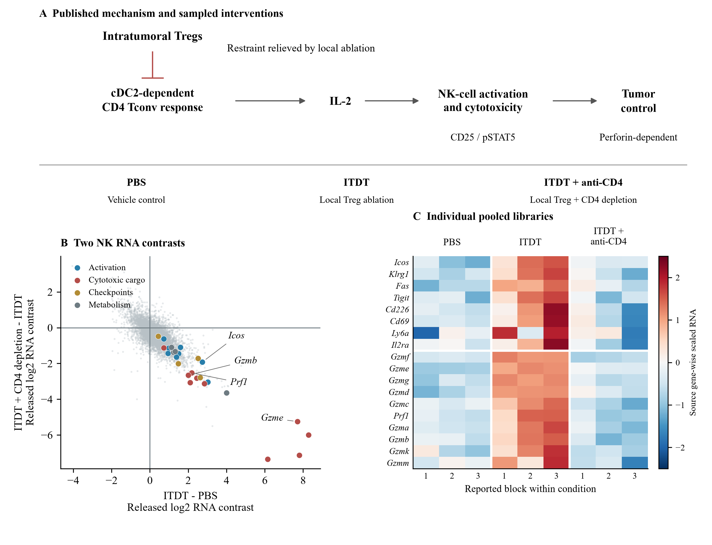

# Approved figure displays — 13 November 2026

These figures preserve approved public-data displays prepared for a research portfolio. They reuse the linked article analyses; they are not independent replication or new scientific acceptance. Numerical results and historical figures are unchanged.

[Article home](../README.md) · [Archive overview](../../../docs/PORTFOLIO_FIGURE_ARCHIVE_20261113.md)

G-SURF microscopy and personal outreach documents are deliberately excluded.

## Published immune circuit and deposited NK RNA

Panel A summarizes published functional dependencies (Zhang et al., Figures 5-7), not direct cellular contacts or an RNA-derived mechanism. Panels B-C retain the existing NK RNA contrasts and library values; nine pooled libraries do not establish individual-animal replication.

[PNG](../../../analysis/research/runs/portfolio_zhang_figures_20261113_v1/nk_circuit_rna.png) · [PDF](../../../analysis/research/runs/portfolio_zhang_figures_20261113_v1/nk_circuit_rna.pdf) · [Provenance](../../../analysis/research/runs/portfolio_zhang_figures_20261113_v1/manifest.json)
