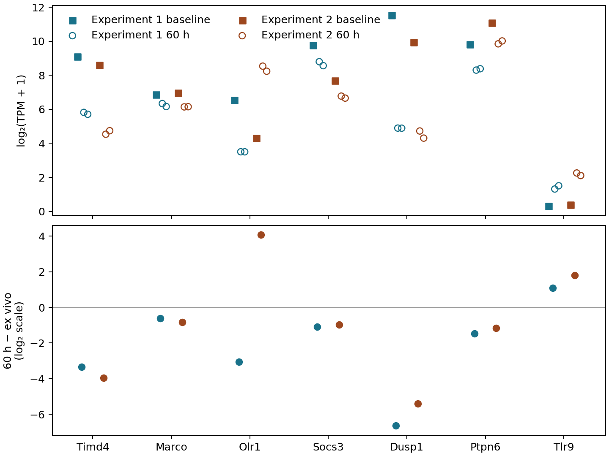
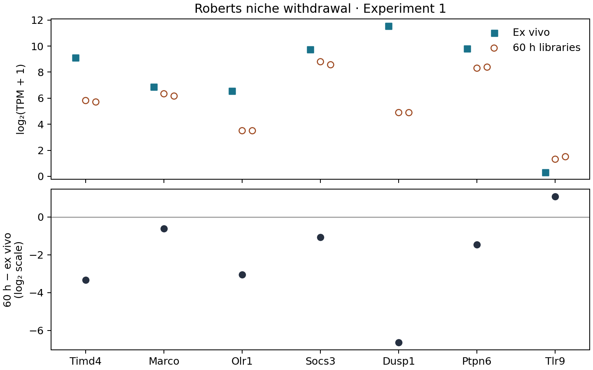
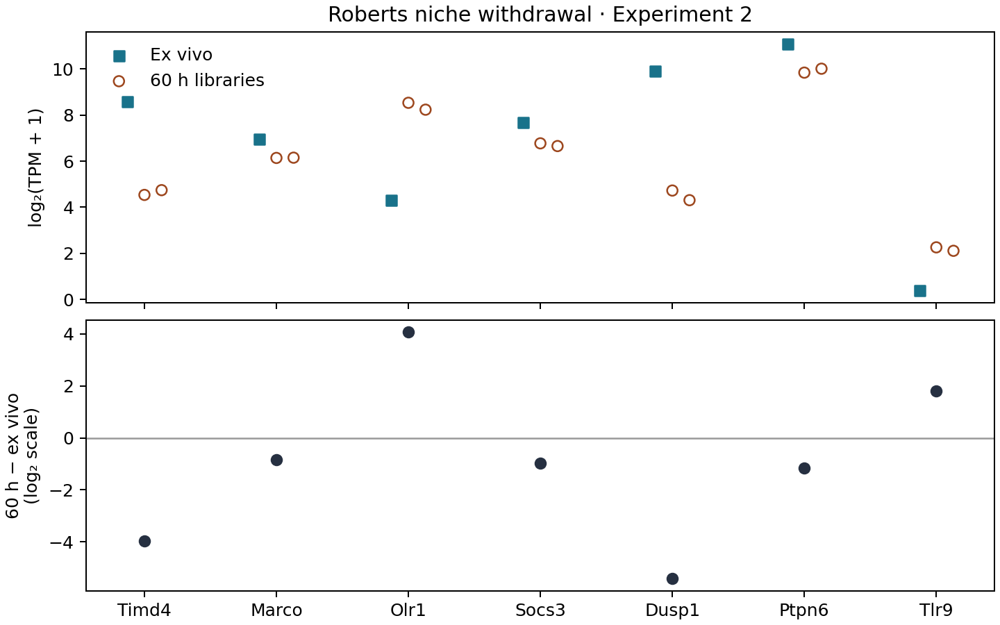

# Roberts · 60 h withdrawal from the tissue niche

## Combined comparison

Squares mark the immediate ex vivo library. Open circles mark the two cultured libraries in each experiment. The lower panel shows the mean culture log₂(TPM + 1) minus baseline. [Values for all six libraries](../../analysis/research/runs/roberts17_b1_withdrawal_figure_r84_v1/withdrawal_comparison.tsv) · [Results](RESULTS.md)

## Experiment 1

Expression was reconstructed from the three recovered read libraries. [Source values](../../analysis/research/runs/roberts17_b1_withdrawal_exp1_r84_v1/withdrawal.tsv) · [Reference amendment](REFERENCE_AMENDMENT.md)

## Experiment 2

This comparison uses deposited TPM values. Animal and pool nesting remain unresolved in both experiments. [Source values](../../analysis/research/runs/roberts17_b1_withdrawal_exp2_r84_v1/withdrawal.tsv)
