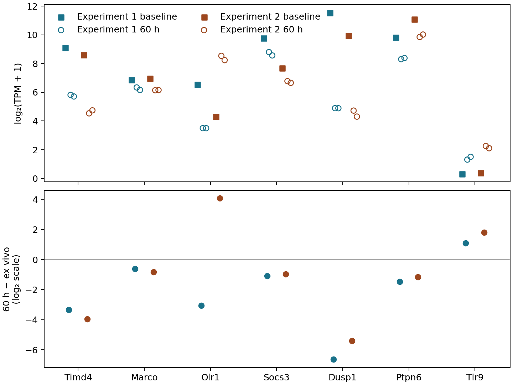

# Roberts et al. (2017) — Tissue-Resident Macrophages Are Locally Programmed for Silent Clearance of Apoptotic Cells

**gate3_2R_B1** · Brief owner read reported 26 November 2026. Fig. 2F and both 60 h withdrawal experiments are reconstructed.

## Published findings

```text
Resident peritoneal, pleural and alveolar macrophages engulf apoptotic cells in vivo
    → selected populations show low TLR9 and a restrained response to nucleic acids
Removal from the tissue and 60 h in culture
    → peritoneal macrophages retain uptake but can produce TNF in response to apoptotic cells
```

The distinction is between uptake and the inflammatory response to cargo. Tim-4 identifies the peritoneal and pleural engulfers in this comparison. Alveolar macrophages clear apoptotic cells despite lacking Tim-4. Figures 1–3 establish uptake, receptor expression and responsiveness with separate assays. Figure 5 tests the signaling threshold, and Figure 7 implicates KLF2 and KLF4. [Primary paper](https://doi.org/10.1016/j.immuni.2017.10.006)

## Ravel analyses and results

The earlier Damani–Yokota comparison raised the question of what a macrophage retains from its tissue. Fig. 2F separates restored CpG responsiveness from persistent restraint toward apoptotic cells. The 60 h culture and acute cargo challenge are analyzed separately. Both withdrawal experiments show lower *Timd4*, *Marco* and all three signaling regulators. *Olr1* changes in opposite directions and *Tlr9* rises from low baselines. Experiment 1 uses raw-read recovery on the release-84 cDNA reference identified from the compatible deposit. [Results and run evidence](RESULTS.md)

## Data and methods

GSE93820 contains bulk RNA from sorted mouse Tim-4-positive peritoneal macrophages, including two experiments comparing immediate isolation with 60 h in culture and a separate apoptotic-cell challenge. The GEO labels and Figure 3G constrain how the libraries can be grouped. [RNA deposit](https://www.ncbi.nlm.nih.gov/geo/query/acc.cgi?acc=GSE93820)

## Interpretation and open questions

Restoring a response to CpG while restraint toward apoptotic cells persists leaves a role for downstream signal handling or cargo presentation. The transfer and culture experiments ask how much restraint the niche can confer or remove. Studies of repeated uptake ask what engulfment induces even when inflammatory cytokines stay low.

## Figures and supporting documentation

[Silent clearance, corpse processing and cargo selection](LITERATURE_CONTEXT.md) · [Source and analysis handoff](ANALYSIS_PLAN.md) · [Damani–Yokota’s comparisons of macrophage abundance and state](../gate4M_04_damani_yokota_2026/ANALYSIS_INVENTORY_AND_SYNTHESIS_2026-10-30.md)

| Stage | Evidence and disposition |
|---|---|
| S0 · Population and exposure | [Figure key and Fig. 2F readback](SOURCE_AND_PHENOTYPE.md#population-by-exposure-figure-key). The quantitative readback is approximate and the published panels are representative. Individual TNF and uptake values remain unavailable. |
| S1 · 60 h withdrawal | [Combined figure and legend](#withdrawal-figure-and-legend). Both experiments are complete at descriptive scope. Animal and pool nesting remain unresolved. |
| S2 · Cargo RNA | [Exact-reference programmed and stimulated-only deprogrammed results](RESULTS.md#s2--rna-response-to-apoptotic-cargo). The matched deprogrammed baseline remains unresolved. |
| S3 · Signaling | [Perturbation evidence display](PERTURBATIONS.md). Published representative panels distinguish uptake, receptor, proximal signaling and cytokines. Threshold fits and between-mouse variation remain unestimated. |
| S4 · External cargo association | [Paired tissue results](RESULTS.md#s4--cargo-status-in-other-tissues) and [design](EXTERNAL_DESIGN.md). Cargo-status associations leave induction and subset selection unresolved. |
| S5 · Synthesis | [Uptake, restraint and induced processing](RESULTS.md#s5--biological-interpretation), with the [Pestal planning cross-reference](../gate3_2R_B2_pestal_2025/ANALYSIS_PLAN.md). |

### Withdrawal figure and legend



Squares show the immediate ex vivo library. Open circles show the two 60 h culture libraries for each experiment. The lower panel subtracts the baseline log₂(TPM + 1) from the mean of the two culture log₂(TPM + 1) values. The experiments are shown separately. [Combined source values](../../analysis/research/runs/roberts17_b1_withdrawal_figure_r84_v1/withdrawal_comparison.tsv)

### Run records

| Stage or run | Outputs | Implementation and receipt |
|---|---|---|
| S2 exact-reference challenge | [Mapping QC](../../analysis/research/runs/roberts17_b1_challenge_r84_v1/mapping_qc.tsv) · [Library TPMs](../../analysis/research/runs/roberts17_b1_challenge_r84_v1/gene_tpm.tsv) · [Challenge values](../../analysis/research/runs/roberts17_b1_challenge_r84_v1/challenge.tsv) | [replay.py](replay.py) · [release84.py](release84.py) · [Contract](../../analysis/research/contracts/Roberts17-B1.challenge_r84_v1.json) · [Receipt](../../analysis/research/runs/roberts17_b1_challenge_r84_v1/receipt.json) |
| S2 initial challenge, superseded | [Sample map](../../analysis/research/runs/roberts17_b1_challenge_v1/sample_map.tsv) · [Mapping QC](../../analysis/research/runs/roberts17_b1_challenge_v1/mapping_qc.tsv) · [Library TPMs](../../analysis/research/runs/roberts17_b1_challenge_v1/gene_tpm.tsv) · [Challenge values](../../analysis/research/runs/roberts17_b1_challenge_v1/challenge.tsv) | [replay.py](replay.py) · [Contract](../../analysis/research/contracts/Roberts17-B1.challenge_v1.json) · [Receipt](../../analysis/research/runs/roberts17_b1_challenge_v1/receipt.json) |
| S4 paired cargo association | [Sample map](../../analysis/research/runs/roberts17_b1_external_v1/sample_map.tsv) · [Pair values](../../analysis/research/runs/roberts17_b1_external_v1/pairs.tsv) · [Tissue summaries](../../analysis/research/runs/roberts17_b1_external_v1/tissue_summary.tsv) | [replay.py](replay.py) · [external.py](external.py) · [Contract](../../analysis/research/contracts/Roberts17-B1.external_v1.json) · [Receipt](../../analysis/research/runs/roberts17_b1_external_v1/receipt.json) |
| S0 sample and panel qualification | [Sample map](../../analysis/research/runs/roberts17_b1_map_v1/sample_map.tsv) · [Panel eligibility](../../analysis/research/runs/roberts17_b1_map_v1/panel_eligibility.tsv) | [replay.py](replay.py) · [Contract](../../analysis/research/contracts/Roberts17-B1.map_v1.json) · [Receipt](../../analysis/research/runs/roberts17_b1_map_v1/receipt.json) |
| S1 raw-read recovery GSM2462968 | [GSM2462968.cutadapt.txt](../../analysis/research/runs/roberts17_b1_requant_gsm2462968_v1/GSM2462968.cutadapt.txt) · [GSM2462968.run_info.json](../../analysis/research/runs/roberts17_b1_requant_gsm2462968_v1/GSM2462968.run_info.json) · [GSM2462968.abundance.tsv.gz](../../analysis/research/runs/roberts17_b1_requant_gsm2462968_v1/GSM2462968.abundance.tsv.gz) | [requantify.py](requantify.py) · [Contract](../../analysis/research/contracts/Roberts17-B1.requant_GSM2462968_v1.json) · [Receipt](../../analysis/research/runs/roberts17_b1_requant_gsm2462968_v1/receipt.json) |
| S1 raw-read recovery GSM2462969 | [GSM2462969.cutadapt.txt](../../analysis/research/runs/roberts17_b1_requant_gsm2462969_v1/GSM2462969.cutadapt.txt) · [GSM2462969.run_info.json](../../analysis/research/runs/roberts17_b1_requant_gsm2462969_v1/GSM2462969.run_info.json) · [GSM2462969.abundance.tsv.gz](../../analysis/research/runs/roberts17_b1_requant_gsm2462969_v1/GSM2462969.abundance.tsv.gz) · [GSM2462969.sra_validation.txt](../../analysis/research/runs/roberts17_b1_requant_gsm2462969_v1/GSM2462969.sra_validation.txt) | [requantify_cached.py](requantify_cached.py) · [Contract](../../analysis/research/contracts/Roberts17-B1.requant_GSM2462969_v1.json) · [Receipt](../../analysis/research/runs/roberts17_b1_requant_gsm2462969_v1/receipt.json) |
| S1 raw-read recovery GSM2462970 | [GSM2462970.cutadapt.txt](../../analysis/research/runs/roberts17_b1_requant_gsm2462970_v1/GSM2462970.cutadapt.txt) · [GSM2462970.run_info.json](../../analysis/research/runs/roberts17_b1_requant_gsm2462970_v1/GSM2462970.run_info.json) · [GSM2462970.abundance.tsv.gz](../../analysis/research/runs/roberts17_b1_requant_gsm2462970_v1/GSM2462970.abundance.tsv.gz) | [requantify_cached.py](requantify_cached.py) · [Contract](../../analysis/research/contracts/Roberts17-B1.requant_GSM2462970_v1.json) · [Receipt](../../analysis/research/runs/roberts17_b1_requant_gsm2462970_v1/receipt.json) |
| S1 experiment 1 | [Mapping QC](../../analysis/research/runs/roberts17_b1_withdrawal_exp1_r84_v1/mapping_qc.tsv) · [Library TPMs](../../analysis/research/runs/roberts17_b1_withdrawal_exp1_r84_v1/gene_tpm.tsv) · [Effects](../../analysis/research/runs/roberts17_b1_withdrawal_exp1_r84_v1/withdrawal.tsv) · [Figure](../../analysis/research/runs/roberts17_b1_withdrawal_exp1_r84_v1/withdrawal.png) | [replay.py](replay.py) · [release84.py](release84.py) · [Contract](../../analysis/research/contracts/Roberts17-B1.withdrawal_exp1_r84_v1.json) · [Receipt](../../analysis/research/runs/roberts17_b1_withdrawal_exp1_r84_v1/receipt.json) |
| S1 experiment 2 | [Mapping QC](../../analysis/research/runs/roberts17_b1_withdrawal_exp2_r84_v1/mapping_qc.tsv) · [Library TPMs](../../analysis/research/runs/roberts17_b1_withdrawal_exp2_r84_v1/gene_tpm.tsv) · [Effects](../../analysis/research/runs/roberts17_b1_withdrawal_exp2_r84_v1/withdrawal.tsv) · [Figure](../../analysis/research/runs/roberts17_b1_withdrawal_exp2_r84_v1/withdrawal.png) | [replay.py](replay.py) · [release84.py](release84.py) · [Contract](../../analysis/research/contracts/Roberts17-B1.withdrawal_exp2_r84_v1.json) · [Receipt](../../analysis/research/runs/roberts17_b1_withdrawal_exp2_r84_v1/receipt.json) |
| S1 initial experiment 2 readback, superseded | [Mapping QC](../../analysis/research/runs/roberts17_b1_withdrawal_exp2_v2/mapping_qc.tsv) · [Library TPMs](../../analysis/research/runs/roberts17_b1_withdrawal_exp2_v2/gene_tpm.tsv) · [Effects](../../analysis/research/runs/roberts17_b1_withdrawal_exp2_v2/withdrawal.tsv) · [Figure](../../analysis/research/runs/roberts17_b1_withdrawal_exp2_v2/withdrawal.png) | [replay.py](replay.py) · [withdrawal_v2.py](withdrawal_v2.py) · [Contract](../../analysis/research/contracts/Roberts17-B1.withdrawal_exp2_v2.json) · [Receipt](../../analysis/research/runs/roberts17_b1_withdrawal_exp2_v2/receipt.json) |
| S1 combined display | [Combined values](../../analysis/research/runs/roberts17_b1_withdrawal_figure_r84_v1/withdrawal_comparison.tsv) · [Figure](../../analysis/research/runs/roberts17_b1_withdrawal_figure_r84_v1/withdrawal.png) | [replay.py](replay.py) · [compare_withdrawal.py](compare_withdrawal.py) · [Contract](../../analysis/research/contracts/Roberts17-B1.withdrawal_figure_r84_v1.json) · [Receipt](../../analysis/research/runs/roberts17_b1_withdrawal_figure_r84_v1/receipt.json) |
