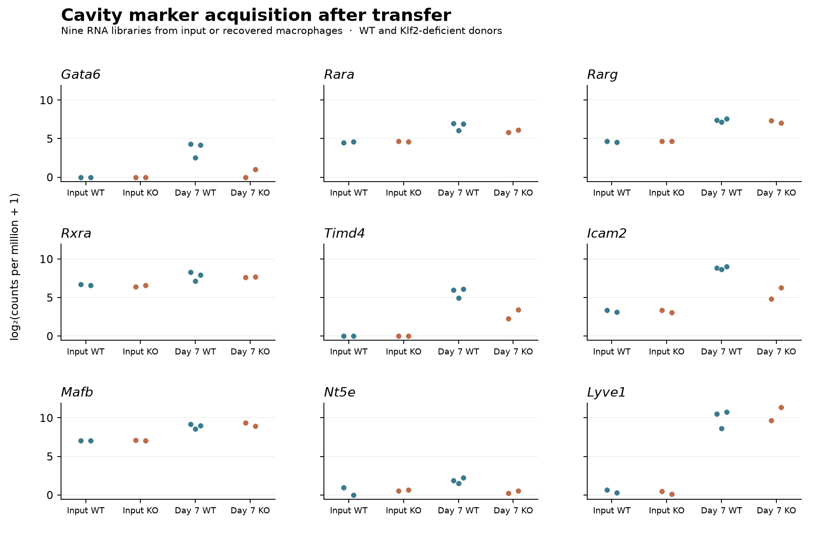
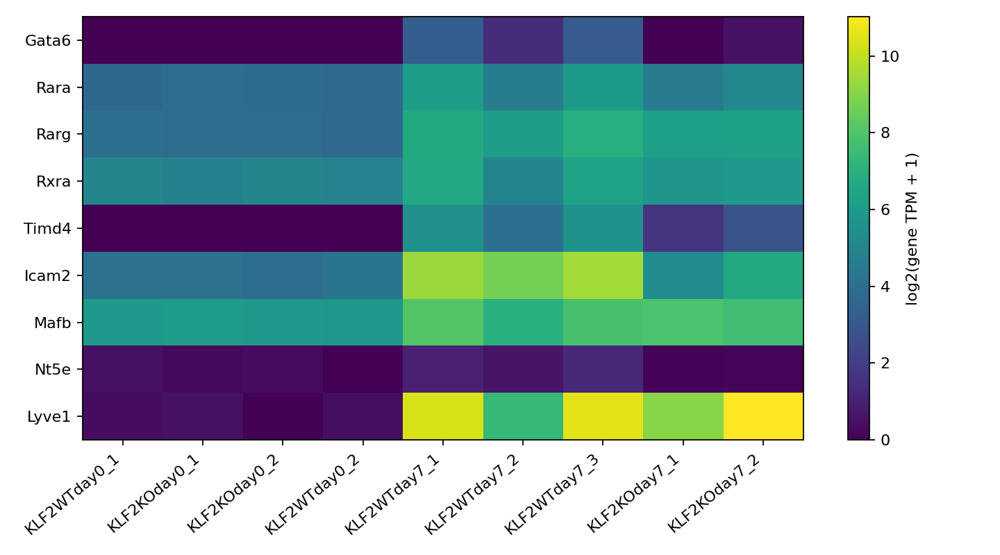
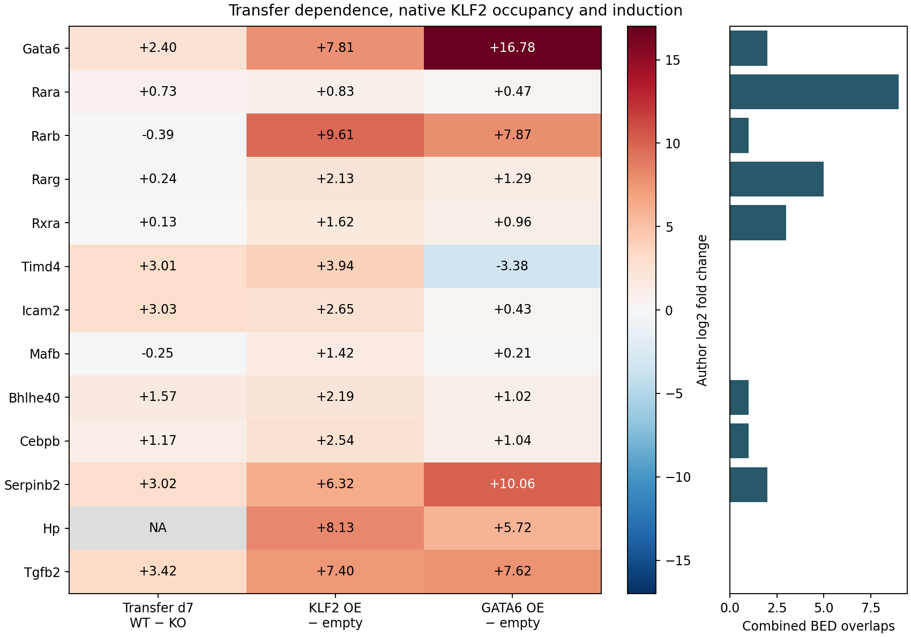
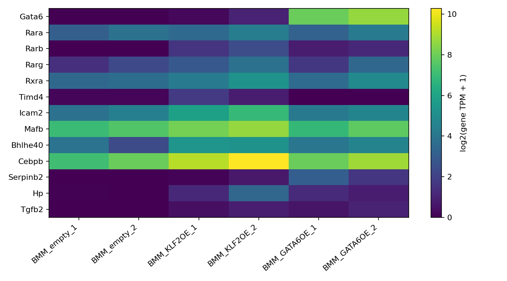
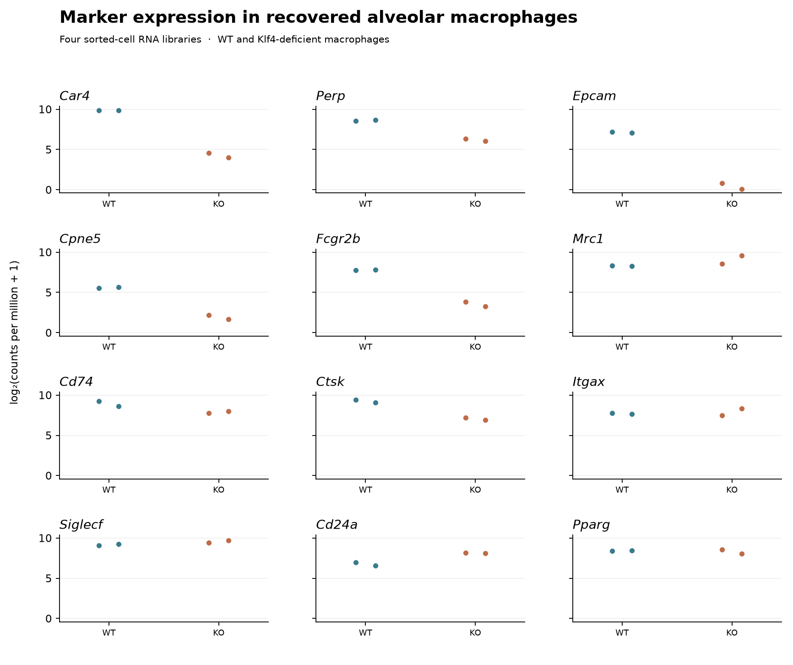
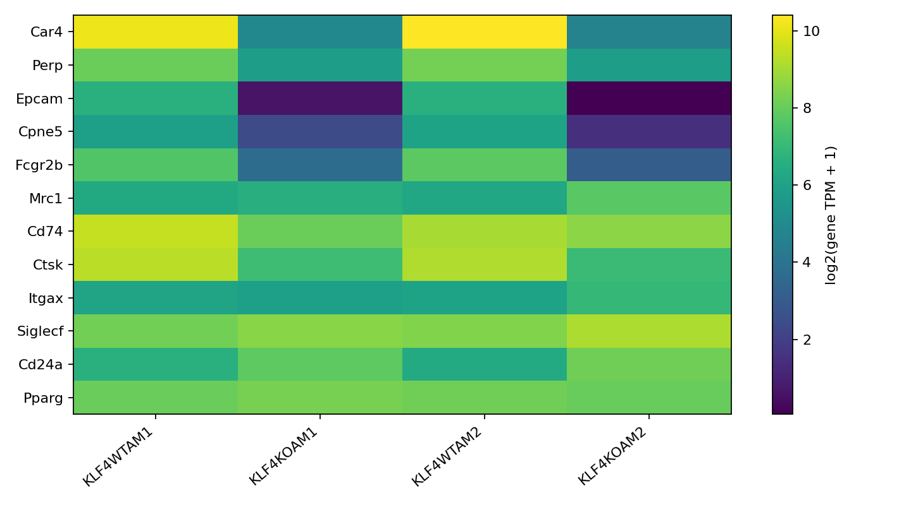

# Pestal · tissue macrophage identity

## Cavity marker acquisition after transfer

Each point is one RNA library. The four groups contain two WT and two Klf2-deficient input libraries, and three WT and two deficient day-7 libraries. The plot starts from the deposited Kallisto transcript fragment estimates. Ravel summed the transcripts for each marker and scaled by the total estimated fragments per library. [Unnormalized gene-by-library matrix](../../analysis/research/runs/pestal_gallery_counts_v1/cavity_estimated_counts.tsv) · [Library identifiers and totals](../../analysis/research/runs/pestal_gallery_counts_v1/libraries.tsv) · [Plotted values](../../analysis/research/runs/pestal_gallery_counts_v1/plot_values.tsv) · [GEO deposit](https://www.ncbi.nlm.nih.gov/geo/query/acc.cgi?acc=GSE288281)

The separate flow experiments in published Figs. 1–2 measured resident-cell abundance and donor contribution in shared hosts. No animal-keyed event files or count table were identified in the reviewed sources. Those endpoints remain published observations. [Flow gates and denominators](S0_CAVITY.md) · [Published Fig. 1](https://pmc.ncbi.nlm.nih.gov/articles/PMC11899981/#fig1) · [Published Fig. 2](https://pmc.ncbi.nlm.nih.gov/articles/PMC11899981/#fig2)

## Cavity markers after transfer

Each column is a library. Color shows log₂(gene TPM + 1). [Marker source values](../../analysis/research/runs/pestal_transfer_v1/markers.tsv)

## Transfer dependence, KLF2 occupancy and induction

The heatmap shows the reported fold changes. The adjacent bars count peaks overlapping each locus under the specified rule. [Locus evidence](../../analysis/research/runs/pestal_regulatory_v1/markers.tsv) · [Published CUT&RUN panels](https://pmc.ncbi.nlm.nih.gov/articles/PMC11899981/#fig4)

## Marker expression after overexpression

Color shows log₂(gene TPM + 1) for each library. [Overexpression source values](../../analysis/research/runs/pestal_regulatory_v1/markers.tsv)

## Marker counts in sorted alveolar macrophages

Each point is one sorted-cell RNA library from the LysM comparison. The twelve panels show marker expression among recovered cells. Donor representation in shared hosts was measured separately by flow in the paper. [Unnormalized gene-by-library matrix](../../analysis/research/runs/pestal_gallery_counts_v1/lung_estimated_counts.tsv) · [Plotted values](../../analysis/research/runs/pestal_gallery_counts_v1/plot_values.tsv) · [Lung interpretation](S3_LUNG.md) · [Published Fig. 7](https://pmc.ncbi.nlm.nih.gov/articles/PMC11899981/#fig7)

## Markers in recovered alveolar macrophages

The deposited estimates here are normalized for effective transcript length and library size. Color shows log₂(gene TPM + 1). [Lung marker source values](../../analysis/research/runs/pestal_lung_v1/markers.tsv) · [Figure rendering receipt](../../analysis/research/runs/pestal_figures_v1/receipt.json)

The [count-display script](count_gallery.py) and [run receipt](../../analysis/research/runs/pestal_gallery_counts_v1/receipt.json) identify the inputs to the two count plots. The earlier [cavity montage](../../analysis/research/runs/pestal_figures_v1/cavity_population.png) juxtaposes published Figs. 1 and 2. The earlier [lung composite](../../analysis/research/runs/pestal_figures_v1/lung_population_and_state.png) pairs published Fig. 7 with the Ravel TPM heatmap. Published material is credited to Pestal et al., CC BY 4.0.
