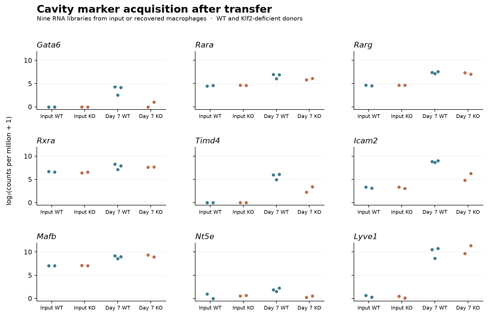

# Pestal et al. (2025) — KLF family members control expression of genes required for tissue macrophage identities

**gate3_2R_B2** · Brief owner read reported 26 November 2026. Source readback and descriptive replays completed.

## Published findings

```text
How do macrophages entering different organs acquire the identities each tissue needs?

Peritoneal cavity → transferred precursors acquire cavity markers over seven days.
  Klf2 loss changes which markers recovered cells acquire and reduces the contribution
  of deficient donors to large cavity macrophages in shared hosts.
Lung → Klf4 loss reduces alveolar macrophage recovery and alters the cells that remain.

Which cells occupy a tissue and which traits they acquire can both change.
Following the same entrants over time could distinguish failure to acquire a trait
from selective loss of cells that would have expressed it.
```

The day-0 and day-7 transfer experiment asks when KLF2-dependent expression emerges (Fig. 3). Native-cell binding and ectopic-expression experiments ask which loci might explain that dependence (Figs. 4–5). The lung experiments use a different KLF, macrophage population and set of comparisons (Figs. 6–7, Fig. S5 and Table S5). [Primary paper](https://doi.org/10.1084/jem.20240379)

## Ravel analyses and results

The published cavity flow panels show selective loss of large cavity macrophage representation and distinct residual phenotypes after Klf2 and Gata6 loss. The RNA reanalysis shows a larger separation in cavity marker expression at day 7, mixed locus-level evidence for KLF2 regulation, and partial correspondence to Han’s route markers. In lung, flow measured the population and competitive deficit, while RNA measured expression in recovered alveolar macrophages. [Published cavity flow readback](S0_CAVITY.md) · [Transfer and regulatory results](RESULTS.md) · [Alveolar results](S3_LUNG.md) · [Figures and source values](FIGURES.md)

## Data and methods

GSE288281 includes RNA from donor bone-marrow-derived macrophages before and after cavity transfer, an overexpression series, and sorted alveolar macrophages. GSE288282 contains native large cavity macrophage CUT&RUN, with anti-GFP and IgG paired within three mice. [RNA](https://www.ncbi.nlm.nih.gov/geo/query/acc.cgi?acc=GSE288281) · [CUT&RUN](https://www.ncbi.nlm.nih.gov/geo/query/acc.cgi?acc=GSE288282)

## Interpretation and open questions

Failure to recover a canonical cavity macrophage could reflect impaired niche sensing, poor survival or entry into a different maturation route. Day-zero precursors and the contrasting KLF2 and GATA6 perturbations constrain different explanations. In lung, both abundance and the phenotype of surviving cells can change.

## Figures and supporting documentation

[Figure gallery](FIGURES.md) · [Original source tables, scripts and run receipts](EVIDENCE.md)



The nine deposited transfer libraries show expression in recovered macrophages. Resident-cell frequencies and competitive donor shares in Figs. 1–2 are published flow measurements. [Count matrix](../../analysis/research/runs/pestal_gallery_counts_v1/cavity_estimated_counts.tsv) · [Flow source limits](S0_CAVITY.md)

[Retinoid competence, maturation routes and lung identity](LITERATURE_CONTEXT.md) · [RNA, binding and alveolar comparison handoff](ANALYSIS_PLAN.md) · [Roberts on the clearance phenotype](https://doi.org/10.1016/j.immuni.2017.10.006) · [Wang’s example of qualifying a sorted-cell RNA comparison](../gate3_10_wang_2018_ezh2/README.md)
