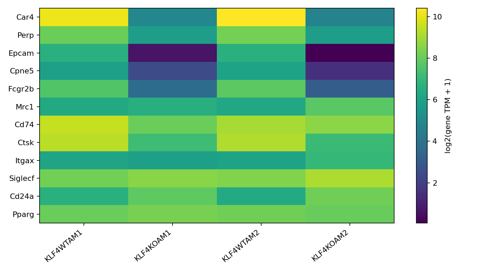

# S3 · KLF4 in alveolar macrophages

## A. Population abundance and shared-host competition

In lung tissue, Fig. 6A–B reports lower AM frequency and numbers in both LysM-Cre and CD11c-Cre conditional Klf4 lines versus their own controls. The AM gate is CD11c+ CD11b− Siglec-F+ CD24− after the live immune-cell gate. Other lung myeloid populations were relatively preserved. Fig. S5A–B separately shows reduced AM recovery in bronchoalveolar lavage. Lung and lavage sample different compartments. Fig. 7 compares LysM conditional and B6.SJL competitor donor shares against the control donor mixture. Conditional donor contribution is strongly reduced for AMs while donor representation is approximately balanced for interstitial macrophages. The sampled spleen, liver and small-intestine populations had no major reported defect. This is relative performance within a shared host. Reduced entry, persistence and maturation remain possible contributors. The published panels establish these directions, with no animal-keyed data recovered for new estimation. [Lung flow](https://pmc.ncbi.nlm.nih.gov/articles/PMC11899981/#fig6) · [Competition panel](https://pmc.ncbi.nlm.nih.gov/articles/PMC11899981/#fig7)

## B. Marker state within the recovered AM gate

Fig. 6C–D reports lower CD11c, Siglec-F, CD169, CD206, PD-L1 and CD16/32 and higher CD24 on remaining AMs in both Cre lines. The four sorted RNA libraries come from the LysM comparison alone (GSM8763481–3484). All five prespecified genes are lower in both KO libraries than either WT library. Across shared genes with absolute author log2 fold change ≥1 and nonzero replay contrast, 2,279/2,284 directions match. Spearman ρ = 0.947 over 11,745 shared genes.

| Gene | WT 1 TPM | WT 2 TPM | KO 1 TPM | KO 2 TPM | WT–KO log2(TPM+1) |
|---|---:|---:|---:|---:|---:|
| Car4 | 1141.9 | 1351.0 | 28.8 | 24.7 | +5.49 |
| Perp | 269.5 | 304.3 | 57.5 | 55.4 | +2.32 |
| Epcam | 99.0 | 97.2 | 0.55 | 0.05 | +6.28 |
| Cpne5 | 58.8 | 65.3 | 4.45 | 1.82 | +4.01 |
| Fcgr2b | 191.7 | 219.8 | 12.2 | 7.58 | +4.28 |

Cd24a is higher in KO RNA, consistent with increased CD24 protein. Pparg is nearly unchanged in the RNA replay (−0.06; author adjusted P ≈ 0.96). Mrc1, Itgax and Siglecf trend in the opposite direction to the reported CD206, CD11c and Siglec-F protein readouts, with weak author adjusted evidence (0.36, 0.86 and 0.70). The manuscript describes increased WT Cd206, but the released Mrc1 RNA row does not reproduce that direction. The protein panel and RNA sort differ in endpoint and residual selection. They cannot distinguish failure of maturation from selective recovery or incomplete deletion, and marker loss may itself shift cells across the AM gate.

Yu et al. placed TGF-β signaling in AM development and homeostasis and linked it to PPARγ. The largely unchanged Pparg transcript here and the absence of a matched directional perturbation leave KLF4's placement unresolved. The cavity KLF2 BED supplies no KLF4 occupancy evidence in AMs. [Yu et al.](https://doi.org/10.1016/j.immuni.2017.10.007) · [Marker values](../../analysis/research/runs/pestal_lung_v1/markers.tsv) · [Receipt](../../analysis/research/runs/pestal_lung_v1/receipt.json)

