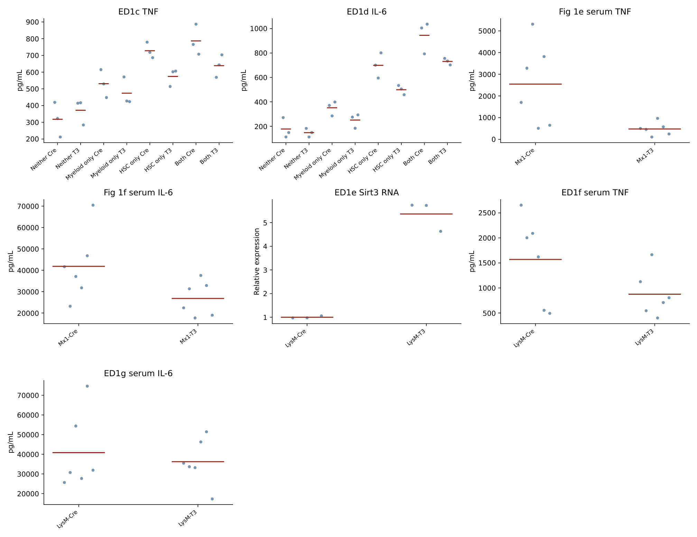
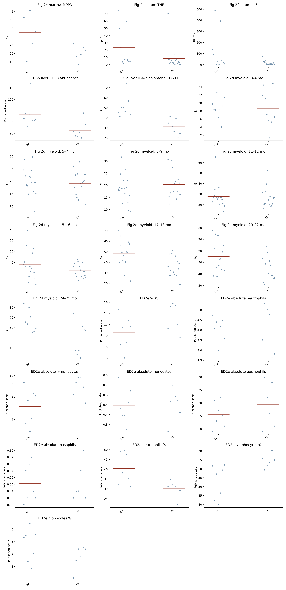
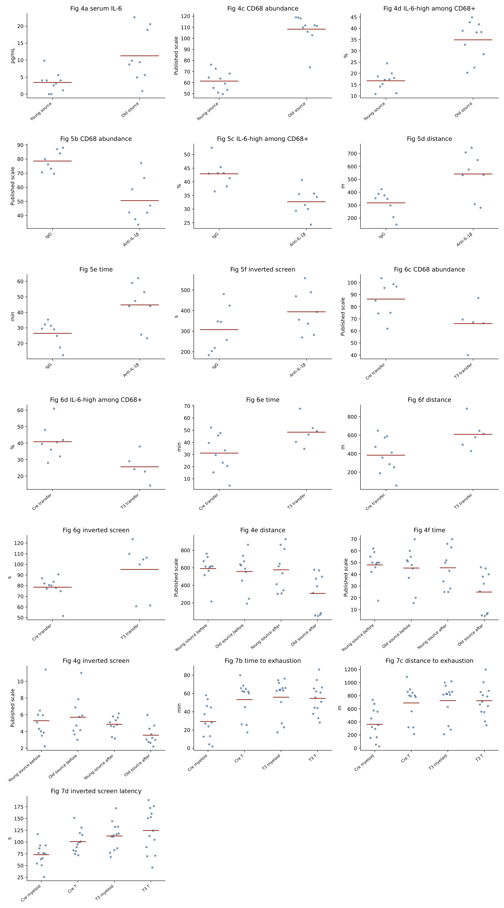
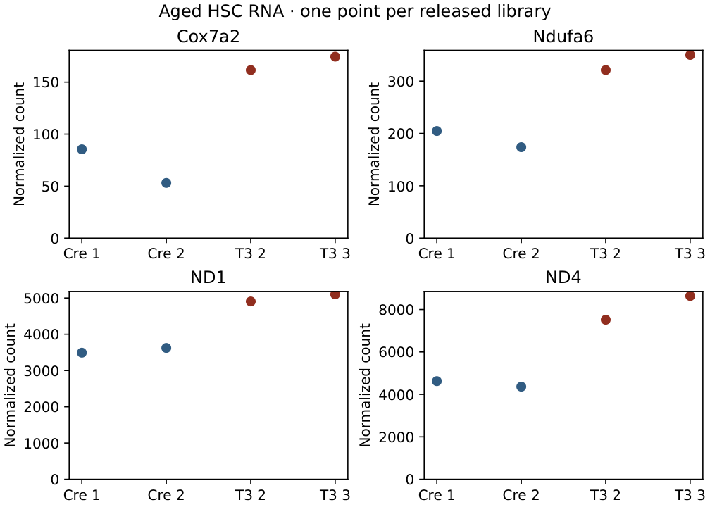

# Mu · priming, aging, transfer and HSC RNA

## Inflammatory recall after two stages of priming

Dots show released observations and red bars show group means. The four culture histories separate initial priming from later myeloid priming. [Original PDF](../../analysis/research/runs/mu2026_s1_v1/source_values.pdf) · [Source values](../../analysis/research/runs/mu2026_s1_v1/observations.tsv) · [Contrasts](../../analysis/research/runs/mu2026_s1_v1/contrasts.tsv) · [Replay script](replay_workbooks.py) · [Contract](s1_contract_v1.json) · [Receipt](../../analysis/research/runs/mu2026_s1_v1/receipt.json)

## Aging, blood counts and liver histology

Macrophage abundance and the IL-6-high fraction use separate axes. The source does not establish row pairing between assays. [Original PDF](../../analysis/research/runs/mu2026_s2_v1/source_values.pdf) · [Source values](../../analysis/research/runs/mu2026_s2_v1/observations.tsv) · [Contrasts](../../analysis/research/runs/mu2026_s2_v1/contrasts.tsv) · [Replay script](replay_workbooks.py) · [Contract](s2_contract_v1.json) · [Receipt](../../analysis/research/runs/mu2026_s2_v1/receipt.json)

## Transfer, cytokine blockade and recipient physiology

Dots show released values. The Fig. 7b panel reports time to exhaustion in minutes for all four recipient groups. Donor reuse remains unresolved. [Original PDF](../../analysis/research/runs/mu2026_s3_v1/source_values.pdf) · [Source values](../../analysis/research/runs/mu2026_s3_v1/observations.tsv) · [Contrasts](../../analysis/research/runs/mu2026_s3_v1/contrasts.tsv) · [Replay script](replay_workbooks.py) · [Contract](s3_contract_v1.json) · [Receipt](../../analysis/research/runs/mu2026_s3_v1/receipt.json)

## Aged HSC RNA libraries

Each dot represents a library. Cre is blue and T3 is red. Each gene has its own normalized count axis. [Original PDF](../../analysis/research/runs/mu2026_s4_rna_figure_v1/hsc_library_counts.pdf) · [Raw and normalized counts](../../analysis/research/runs/mu2026_s4_rna_v1/hsc_counts.tsv) · [Counts script](replay_hsc_counts.py) · [Counts receipt](../../analysis/research/runs/mu2026_s4_rna_v1/receipt.json) · [Plot script](plot_hsc_counts.py) · [Figure receipt](../../analysis/research/runs/mu2026_s4_rna_figure_v1/receipt.json)

The [study results](RESULTS.md) map the panels to their biological units. The [source qualification and synthesis](CLOSEOUT.md) covers the chromatin limits and recovery comparison. [Original source-data index](https://doi.org/10.1038/s43587-026-01175-2) · [Analysis plan](ANALYSIS_PLAN.md) · [Literature context](LITERATURE_CONTEXT.md) · [PNG rendering receipt](../../analysis/research/runs/mu2026_gallery_previews_v1/receipt.json)
