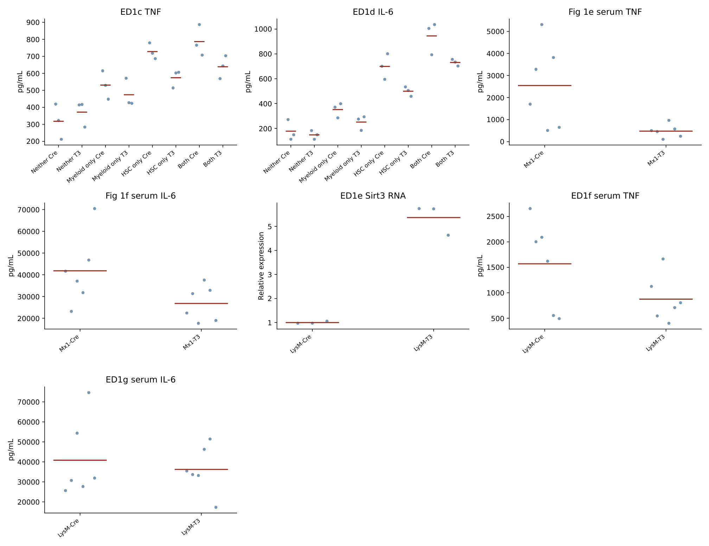

# Mu et al. (2026) — Trained immunity links hematopoietic stem cell aging to aging-associated inflammation

**gate3_2R_C1** · Brief owner read reported 26 November 2026. Descriptive recall, aging, transfer and HSC RNA replays complete.

## Published findings

```text
Where does chronic inflammation in aging begin, and how does it reach distant organs?

Long-lived hematopoietic stem cells (HSCs) continually replenish short-lived myeloid cells.
  ├─ After priming in mice, marrow-derived macrophages release more inflammatory
  │  cytokines when challenged again.
  │  Increasing SIRT3 in the hematopoietic compartment attenuates cytokine recall.
  ├─ Mice aged after marrow transplantation differ in liver inflammation and endurance
  │  according to the donor marrow they received.
  └─ Transferring myeloid cells from aged marrow chimeras to young mice carries a
     donor-dependent difference in endurance. The T-cell comparison is much smaller.

Aging blood formation can thus be one upstream source of inflammation and functional
decline beyond the marrow. How long an imprint persists after its driver is withdrawn,
and how much this route contributes to chronic inflammation in humans, remain open.
```

The authors test whether maladaptive trained immunity in an aging blood-forming system can affect tissues supplied by its descendants. Figures 1–3 distinguish acute priming from spontaneous aging and from aging after marrow transplantation. Figures 4–7 test what transfers to a young host, including an IL-1β-sensitive recipient response and a comparison of myeloid and T-cell donors. Figure 8 and Extended Data Figs. 5–6 examine candidate molecular changes upstream. These mouse experiments identify a hematopoietic contribution. Continuing SIRT3 expression and changes in the mix of progenitors remain alternatives to a persistent imprint within individual HSCs. [Mu et al., Figs. 1–8](https://doi.org/10.1038/s43587-026-01175-2)

## Ravel analyses and results

Mu appeared as X3 in the A3/A14 literature review. This plan returns to X3’s question of persistence after an initiating exposure, starting with cytokine recall and then tracing myeloid output and tissue inflammation through transfer. The former accession lead GSE335257 resolves to aged-HSC H3K4me3 CUT&Tag. No Mu numerical run was registered at `0d32085`. The current replay found a smaller cytokine increment after initial priming, lower liver CD68 abundance and inflammatory fraction, and a +25.26-minute myeloid-versus-T-cell endurance interaction. [Results, figures and provenance](RESULTS.md). [Historical X3 review](../../docs/portfolio_extensions/2026-10-07/SOURCE_ONLY_REVIEW.md) · [H3K4me3 deposit](https://www.ncbi.nlm.nih.gov/geo/query/acc.cgi?acc=GSE335257)

## Data and methods

Extended Data Fig. 1 supplies cytokine readouts for four combinations of stem-cell and myeloid-cell priming. Qualify the preparation behind each observation. In Fig. 7b a young recipient supplies a treadmill measurement, and several recipients may share donor material. The plan maps these workbooks and six sequencing accessions to their respective cohorts.

## Interpretation and open questions

Recall may depend on priming in HSCs, differentiated myeloid cells or both. The aging and transfer experiments then ask how altered myeloid supply, inflammatory activity within macrophages and amplification in a young recipient contribute. Continued hematopoietic SIRT3 expression leaves persistence after withdrawal open.

## Figures and supporting documentation

[Figure gallery](FIGURES.md) · [Original source tables, scripts and run receipts](EVIDENCE.md)



Initial and later priming histories are shown separately. Dots are released observations and red bars are group means.

[Inflammatory recall, subset selection and recovery](LITERATURE_CONTEXT.md) · [Inflammatory recall, transfer and sequencing handoff](ANALYSIS_PLAN.md) · [Navarro Negredo’s animal and RNA evidence](../gate3_12_navarro_negredo_2026/STAGE_STATUS.md)


[Source qualification and final synthesis](CLOSEOUT.md) · [Numerical results and study-unit map](RESULTS.md)

| Stage | Figure and legend | Source values | Code and receipt |
|---|---|---|---|
| S0 | [Panel, cohort and unit map](RESULTS.md#source-and-unit-map). Published-only panel limits are recorded in the closeout. | [Publisher source-data index](https://doi.org/10.1038/s43587-026-01175-2) | [Verified plan](ANALYSIS_PLAN.md) |
| S1 | [Cytokines and driver controls](../../analysis/research/runs/mu2026_s1_v1/source_values.pdf). Dots are released values and red bars are group means. Histories distinguish the two priming stages. | [Cells](../../analysis/research/runs/mu2026_s1_v1/observations.tsv) · [Contrasts](../../analysis/research/runs/mu2026_s1_v1/contrasts.tsv) | [Replay script](replay_workbooks.py) · [Contract](s1_contract_v1.json) · [Receipt](../../analysis/research/runs/mu2026_s1_v1/receipt.json) |
| S2 | [Aging, blood counts and liver histology](../../analysis/research/runs/mu2026_s2_v1/source_values.pdf). Dots are released values and red bars are group means. The abundance and IL-6-high fraction panels use separate axes without row pairing. | [Cells](../../analysis/research/runs/mu2026_s2_v1/observations.tsv) · [Contrasts](../../analysis/research/runs/mu2026_s2_v1/contrasts.tsv) | [Replay script](replay_workbooks.py) · [Contract](s2_contract_v1.json) · [Receipt](../../analysis/research/runs/mu2026_s2_v1/receipt.json) |
| S3 | [Transfer, blockade and physiology](../../analysis/research/runs/mu2026_s3_v1/source_values.pdf). Dots are released values and red bars are group means. Fig. 7b shows all four recipient distributions in minutes. | [Cells](../../analysis/research/runs/mu2026_s3_v1/observations.tsv) · [Contrasts](../../analysis/research/runs/mu2026_s3_v1/contrasts.tsv) | [Replay script](replay_workbooks.py) · [Contract](s3_contract_v1.json) · [Receipt](../../analysis/research/runs/mu2026_s3_v1/receipt.json) |
| S4 | [Aged HSC count figure](../../analysis/research/runs/mu2026_s4_rna_figure_v1/hsc_library_counts.pdf). One point per library, Cre in blue and T3 in red. Each gene has its own normalized count axis. [Chromatin source limits](CLOSEOUT.md#s4-bulk-chromatin-eligibility). | [Raw and normalized library counts](../../analysis/research/runs/mu2026_s4_rna_v1/hsc_counts.tsv) | [Counts script](replay_hsc_counts.py) · [Counts receipt](../../analysis/research/runs/mu2026_s4_rna_v1/receipt.json) · [Figure script](plot_hsc_counts.py) · [Figure receipt](../../analysis/research/runs/mu2026_s4_rna_figure_v1/receipt.json) |
| S5–S6 | [Literature comparison and evidence chain](CLOSEOUT.md#s5-what-ross-and-zeng-distinguish). Signature scoring requires compatible within-subset evidence. | [Verified literature context](LITERATURE_CONTEXT.md) | [Withdrawal and rechallenge synthesis](CLOSEOUT.md#s6-what-still-requires-withdrawal-or-rechallenge) |
