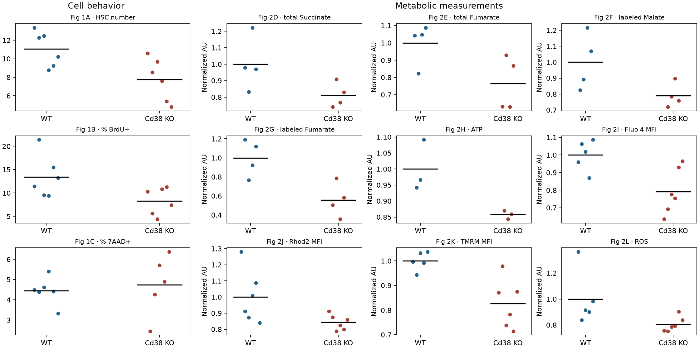
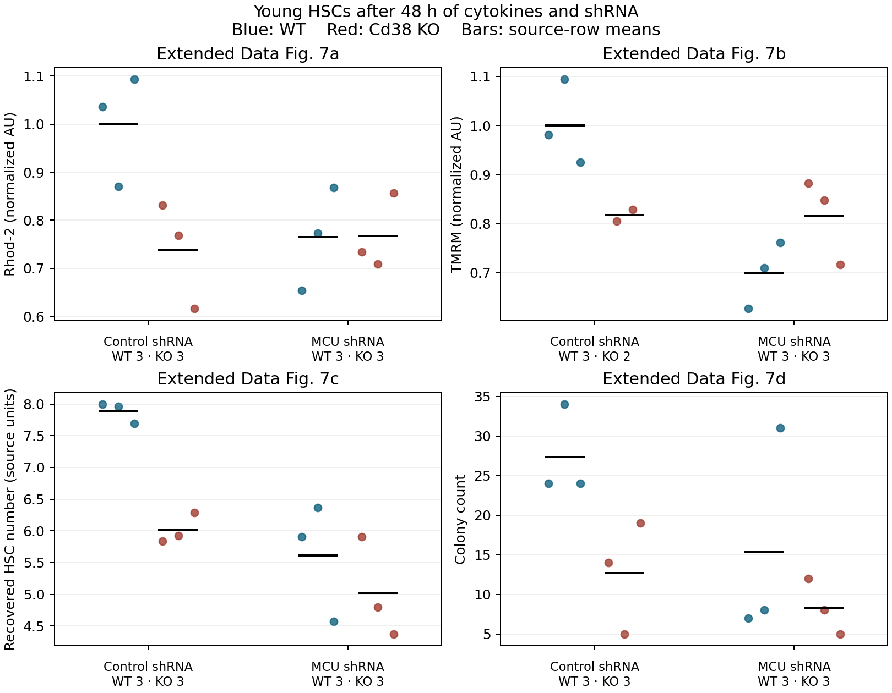
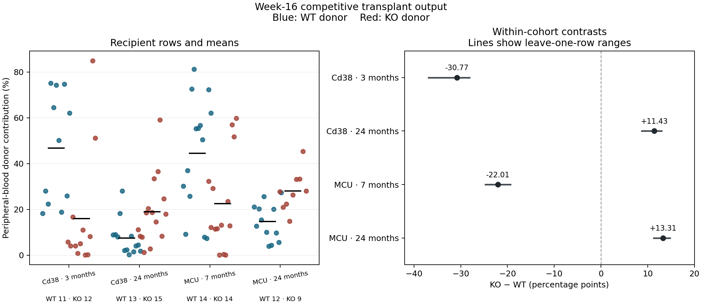

# Song C2 figures and source values

## Young HSC activation

**Legend.** The left panels show recovered HSC number in source units, BrdU-positive percentage and 7-AAD-positive percentage from Fig. 1a–c. The right panels show relative metabolite, ATP and fluorescent measurements from Fig. 2d–l on separate axes. Points are source observations and bars are means. Read the 18-hour activation context and assay distinctions in [S1](RESULTS.md#s1--young-activation). [Workbook cells](../../analysis/research/runs/song24_c2_S1_v2/observations.csv) · [Contrasts](../../analysis/research/runs/song24_c2_S1_v2/contrasts.csv) · [S1 receipt](../../analysis/research/runs/song24_c2_S1_v2/receipt.json)

## Four-group MCU comparison

**Legend.** Points are workbook rows for cytokine-stimulated HSCs after 48 hours under control or MCU shRNA. Bars mark source-row means. Numbers below groups count observed rows. TMRM has one blank in Cd38 KO under control shRNA. Rhod-2 and TMRM use control-normalized arbitrary units, and recovered HSC number and colony count use their source scales. Preparation IDs and pairing are unresolved. [Workbook cells](../../analysis/research/runs/song24_c2_S2_v2/observations.csv) · [Genotype contrasts, difference of contrasts and row sensitivity](../../analysis/research/runs/song24_c2_S2_v2/contrasts.csv) · [S2 receipt](../../analysis/research/runs/song24_c2_S2_v2/receipt.json)

## Week-16 transplant output

**Legend.** The left panel shows peripheral-blood donor contribution as a percentage for each observed recipient row, with group means and row counts. The right panel shows KO minus WT in percentage points within each cohort. Lines show how far each estimate moves when omitting one recipient row. Donor pooling and sharing are unresolved, so the ranges quantify row sensitivity rather than confidence. The aged Cd38 source workbook has 13 WT and 15 KO week-16 rows, while the Fig. 3g legend lists 12 and 14. The young MCU cohort used 7-month donors, versus 3 months for young Cd38 donors. Protocol and donor-allocation limits restrict inference to descriptive within-cohort contrasts. [Workbook cells](../../analysis/research/runs/song24_c2_S4_v2/observations.csv) · [Contrasts](../../analysis/research/runs/song24_c2_S4_v2/contrasts.csv) · [S4 receipt](../../analysis/research/runs/song24_c2_S4_v2/receipt.json)

The [rendering receipt](../../analysis/research/runs/song24_c2_figures_v1/receipt.json) binds both new figures to the verified S2 and S4 tables. [Source files and versions](SOURCE_PROVENANCE.md)
