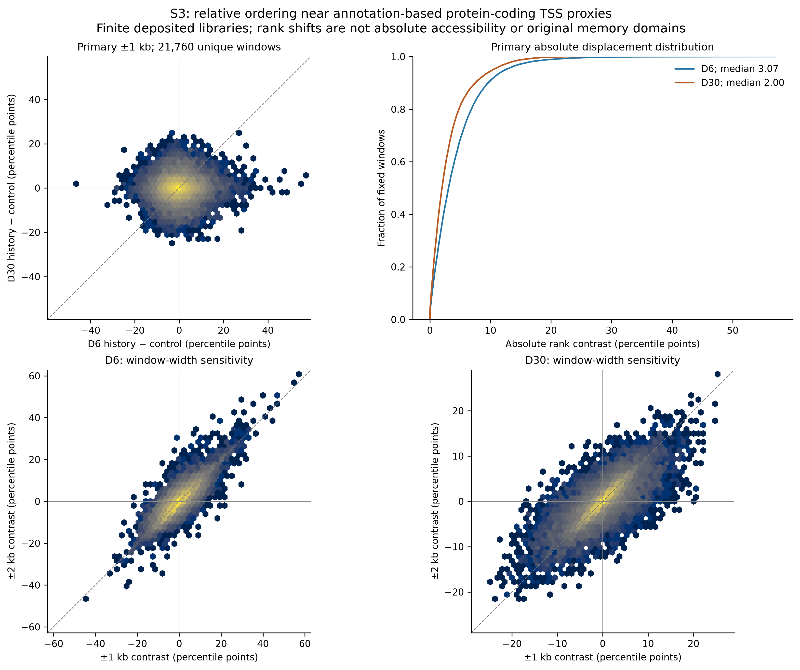
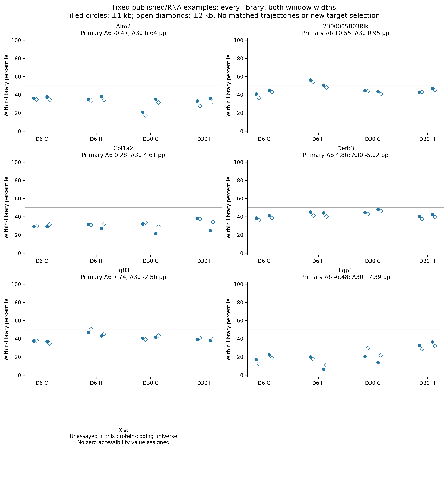

# S3 v1: relative ordering at annotation-based TSS proxies

18 November 2026. Owner `Nk17-P01`. The adapted endpoint is executed and
independently verified and coordinator-reviewed without numerical/figure revision. Across **21,760
unique windows**, the primary median absolute history/control rank contrast is
**3.067 percentile points at D6 and 1.995 at D30**. D30 displacement is smaller
for **61.88%** of windows, but directions and cross-library support remain mixed.
Changing window width changes about **15%** of contrast signs. These are finite
relative-ordering descriptions, not original memory-domain counts or evidence of
absolute opening, intrinsic retention or repair.

## Evidence and executed comparison

The [amendment](S3_AMENDMENT_V1.md) and [method](S3_METHOD_V1.md) were frozen at
`28a62d955fc9c1bb9b03b15f3969278bb6483098` with the
[contract](../../analysis/research/contracts/Nk17-P01.s3_tss_rank_v1.json).
The [receipt](../../analysis/research/runs/naik2017_s3_tss_rank_v1/receipt.json)
records 17 outputs and successful execution; the separate integrity command passed.
[Independent verification](../../analysis/research/runs/naik2017_s3_tss_rank_v1/verification.json)
passed 2,788,974 checks. Source findings and repository measurements remain separate:
[Naik et al. (2017)](https://doi.org/10.1038/nature24271), Figures 3–4, provides the
published chromatin/recall premise; this is exposed shared-source description.

All eight original D6/D30 BigWigs and all **21,775 protein-coding M9 genes on
chr1–19/X** were retained. Identical coordinates give 21,760 windows per width,
15 additional gene mappings and no clipped windows. All overlapping distinct
windows and many-gene mappings are preserved. These gene-feature 5-prime boundaries
are annotation-based TSS proxies, not necessarily dominant or only promoters.
Noncoding/distal regions, Y/M and noncanonical contigs are outside this endpoint.

[S3Q](S3Q_RESULTS_V1.md) qualifies source/chromosome identity but leaves deposited
units, nonlinear processing and original retained-region coordinates unresolved.
All eight ATAC libraries share HiSeq4000/paired-end platform/layout; the RNA
cross-time technical limitation is assay-specific. Source-reported biological
replication/pooling is positive evidence, with exact animals, overlap, composition
and cross-assay matching unresolved. The measured unit is a library, two per
group. Windows, genes and four cross-library contrasts are dependent features,
not extra biological replicates.

## Continuous effects and width sensitivity

Each exact base-resolution mean is ranked within its library and width:
`P = 100 × (average one-based rank − 1)/(N − 1)`. Exact ties receive average ranks;
every library mean is 50 percentile points. Delta is history mean P minus control
mean P; D6 history is acute inflammation and D30 history is recovered baseline.
The four unpaired H_i−C_j differences are spread diagnostics, not confidence
intervals. Complete quantiles remain in the
[summary](../../analysis/research/runs/naik2017_s3_tss_rank_v1/summary.json).

| Window | Time | Median absolute Delta, pp | 95th percentile absolute Delta, pp | Four-contrast range touches zero | Median range width, pp |
|---|---|---:|---:|---:|---:|
| ±1 kb | D6 | 3.067 | 12.470 | 51.76% | 6.112 |
| ±1 kb | D30 | 1.995 | 10.359 | 67.33% | 6.184 |
| ±2 kb | D6 | 3.122 | 12.435 | 48.47% | 5.841 |
| ±2 kb | D30 | 1.911 | 8.852 | 66.70% | 5.932 |

Smaller absolute D30 than D6 displacement occurs for **61.88%** at ±1 kb and
**63.76%** at ±2 kb. Opposite D6/D30 signs occur for **47.95%/48.04%**, respectively.
These are feature-distribution summaries with computational-zero handling, not
recovered/persistent/reversed biological classes or equivalence statements.

Widening from ±1 to ±2 kb gives median absolute contrast shifts of **1.286 pp at
D6** and **0.717 pp at D30**, with sign changes in **15.16%/14.91%** of windows.
The 95th percentiles of absolute width shifts are **7.306/6.829 pp**. Thus aggregate
D30 displacement is smaller at both widths, while individual magnitudes/directions
can depend on the window. Signs near zero are particularly sensitive; no biological
margin or preferred width is selected. All windows remain in both analyses.

[Library diagnostics](../../analysis/research/runs/naik2017_s3_tss_rank_v1/library_diagnostics.tsv)
retain encoded-zero means and ties: ±1 kb zero-mean windows range **804–966** per
library, and tied windows **8,228–10,279**. Encoded zeros were retained; unexpected
missing/nonfinite values were not imputed or excluded. Global average Delta is
zero by construction and cannot measure global opening. Even an encoded-zero
local mean can receive a different rank across libraries if the rest of the
universe or the zero-tie mass changes; rank displacement does not require a
change in that local mean. Preserve these zero-mean/encoded-zero flags in S5M.

[Figure 1 PDF](../../analysis/research/runs/naik2017_s3_tss_rank_v1/fig01_relative_rank_overview.pdf).
Top: primary D6/D30 contrasts and absolute-displacement ECDFs. Bottom: the same
anchors at both widths. Hexagon colours encode within-panel log counts, with
separate colour/axis ranges; colours are not quantitatively comparable across
panels. Dashed lines show equality, not a biological expectation or matched units.

## Fixed examples

All seven requested examples are preserved. Aim2 is a published anchor; the other
six were selected previously in S4 and are outcome-exposed. They do not represent
random genes or new ATAC targets. Values below are percentile-point contrasts;
complete per-library ranks, original means and four-contrast ranges are in
[selected cases](../../analysis/research/runs/naik2017_s3_tss_rank_v1/selected_cases.tsv).

| Fixed example | D6 ±1 kb | D6 ±2 kb | D30 ±1 kb | D30 ±2 kb |
|---|---:|---:|---:|---:|
| Aim2 | -0.47 | -0.52 | +6.64 | +5.57 |
| 2300005B03Rik | +10.55 | +11.21 | +0.95 | +1.87 |
| Col1a2 | +0.28 | +0.98 | +4.61 | +4.49 |
| Defb3 | +4.86 | +3.24 | -5.02 | -5.99 |
| Igfl3 | +7.74 | +11.64 | -2.56 | -1.15 |
| Iigp1 | -6.48 | -1.19 | +17.39 | +4.80 |
| Xist | unassayed | unassayed | unassayed | unassayed |

Aim2's positive D30 mean contrast has a primary four-contrast range of
**−2.01 to +15.28 pp**; the two control libraries differ, so it is not a uniformly
supported increase across cross-library comparisons. Iigp1's D30 contrast changes
from **+17.39 to +4.80 pp** as the window widens; its range changes from entirely
positive to including zero. These examples make library/definition sensitivity
concrete without defining response classes. Xist remains unassayed because this
is a protein-coding universe, not a zero-accessibility observation.

[Figure 2 PDF](../../analysis/research/runs/naik2017_s3_tss_rank_v1/fig02_fixed_examples.pdf).
Filled circles show ±1 kb and open diamonds ±2 kb, with the same 0–100 rank scale.
C/H mean control/history; within-group horizontal positions distinguish deposited
libraries and imply no matching or trajectory. Every eligible example has all
eight libraries; the Xist panel explicitly records its omitted assay universe.
Both PNGs were visually reviewed: all four overview panels and seven example
panels are legible, complete and consistent with the saved tables.

## What changed and the next decision

S3 now supplies a qualified chromatin-associated **relative-ordering endpoint**:
D30 displacements are generally smaller in this proxy universe, but library spread,
mixed directions and width dependence limit a uniform persistence description.
It neither reproduces nor refutes the published distal/retained-domain findings.
A higher rank need not mean more local signal. Positive affine transformations of
window means preserve ranking; unknown nonlinear processing, clipping/smoothing,
mixture and the chosen universe can still change it. Width agreement is not
independent replication. No absolute accessibility, original memory-domain count,
same-cell RNA–ATAC coupling, causal retention or repair is inferred.

The [literature context](LITERATURE_CONTEXT.md) retains Naik, Larsen and Cowley
precedents and source reuse; their domain-level results do not make this proxy
analysis a novel mechanism or a test of all regulatory inputs. The next useful
step, now authorized after S3 preservation, is to examine qualified RNA/rank associations with baseline
components and width/reference sensitivities visible, and reconstruct separately
qualified functional endpoints. The [S5 proposal](S5_PROPOSAL_V1.md) was prepared
during extraction without selecting from partial S3 results. The coordinator
reviewed the actual S3 evidence and both figures without requesting revision,
and authorized S5M after technical delivery/local preservation. S5M has not run;
return its result for review before S5F. S6 and the original retained-region/input
limitations remain unresolved.

## Execution and verification

Preflight matched 23 inputs and six code files. Before freeze, the artificial
pipeline passed 12,238 independent checks (maximum scaled error `6.5370e-15`),
rejected an intentionally corrupted contrast, and passed toy-reader interval
integration and missing/nonfinite rejection. No research-track window was used
in those tests.

The real verifier independently reparsed all coordinates/mappings and recomputed
all ranks, contrasts, summaries and fixed examples: **2,788,974 checks**, maximum
scaled error **4.2633e-14**, below the `1e-10` computational tolerance. A separate
exact interval-length integration reread **608** predetermined window/library
combinations (32 spaced windows plus six examples per width, all eight libraries);
all mean/zero-count comparisons passed, with mean discrepancy **0**. This is
independent arithmetic, not a different BigWig decoder or biological replication.

Extraction visited 1,044,480,000 base values and preserved 348,160 means. It took
**784.33 s**, with **72.02 MiB** peak extractor RSS. The full analysis entrypoint
took **827.11 s**; the receipt spans **871.05 s** including its runner overhead,
excluding the separate earlier preflight. The 17 outputs total **22,079,768 bytes**
(about **21.06 MiB**), within the 50 MiB artifact and two-hour/2 GiB reader budgets.
[Runtime](../../analysis/research/runs/naik2017_s3_tss_rank_v1/runtime.json) and
[progress](../../analysis/research/runs/naik2017_s3_tss_rank_v1/extraction_progress.json)
retain environment/resource evidence. No real S3 run failed. The log contains a
Pandas float-precision argument deprecation warning; exact round-trip parsing and
all numerical checks passed. No frozen source, previous result or runtime setting
was changed to obtain completion.

The full research gate passed against refreshed main `d0429d0`, as did all
**20,170 repository checks**, **380 local file links**, expected-output tracking
and whitespace checks. The coordinator reviewed the actual numerical outputs
and both figures without requesting revision. Local preservation and the next
authorized S5M stage do not supply human scientific acceptance.
