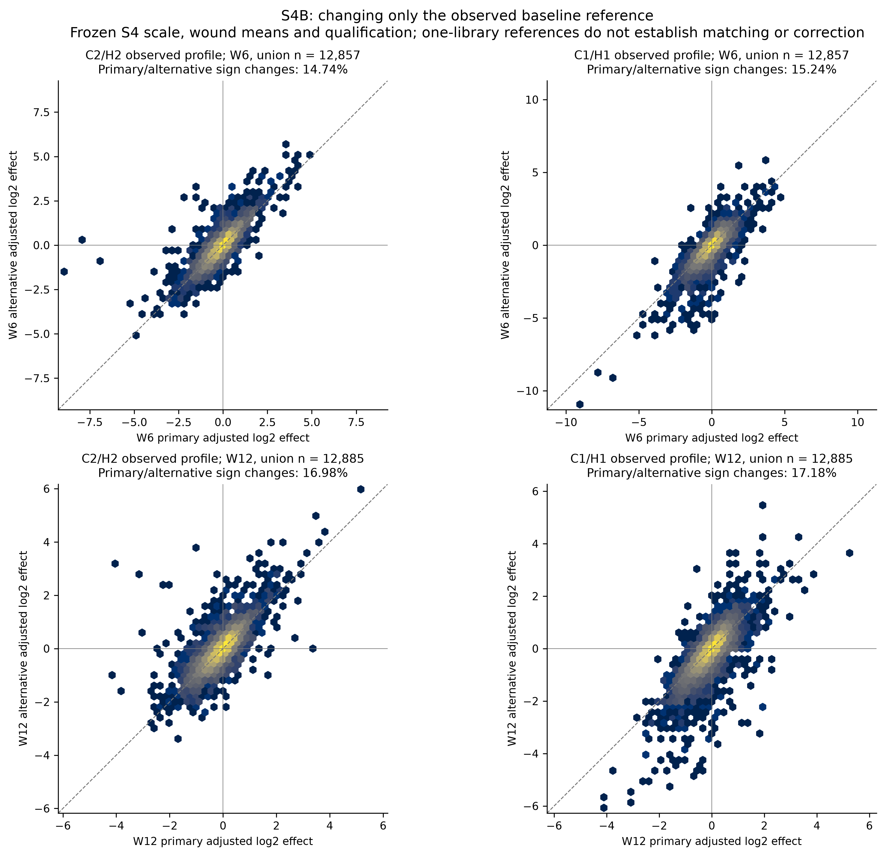

# S4B v1: baseline-reference sensitivity of recall RNA

18 November 2026. Article-local `Nk17-P01`; exposed, finite-library sensitivity
using immutable [S4 outputs](S4_RESULTS_V1.md). The governed run and independent
arithmetic verification are complete. The coordinator reviewed this report,
frozen specification, actual verification and all four panels without requesting
numerical revision, and authorized S3 preparation/qualification. This progression
review does not supply human scientific acceptance.

## What changed in the interpretation

Changing only the baseline reference changes the adjusted effect's sign for
14.74–15.24% of the W6 expression union and 16.98–17.18% of the W12 union.
Median absolute reference shifts are about 0.113–0.115 log2 units, compared with
primary median absolute adjusted effects of 0.238 at W6 and 0.206 at W12.
Similar sensitivity remains in the original baseline-expression intersections.
Thus baseline-reference dependence is consequential for the size and direction
of some source-derived relative RNA effects; it is not confined to all-zero genes.
The distributions retain mixed positive and negative effects, not a uniform
history-dependent amplification result.

Among the six previously selected examples, Col1a2's W12 adjustment changes from
−4.084 with the primary baseline to +3.256 with the C2/H2 reference, while the
C1/H1 reference gives −6.033. Other examples retain their sign while changing
magnitude. These are exposed diagnostic illustrations, not newly selected targets.
Neither alternative is adopted as a corrected or preferred baseline.

S4's uniformly recorded female metadata and two observed baseline Xist/Y profiles
remain unresolved. The alternatives contain one library per history and are not
verified sex strata, matched animals or independent validation. The result cannot
assign the cause of sensitivity to sex, batch, composition or exact pooled animals.
It narrows interpretation of baseline-adjusted RNA without resolving the source
discrepancy, intrinsic memory, accessibility or repair.

## Fixed comparison and provenance

The [method](S4B_METHOD_V1.md) and
[contract](../../analysis/research/contracts/Nk17-P01.s4b_baseline_reference_v1.json)
were frozen before the real calculation in commit
`d5479516c88e6f28a1b44aed095dfffdb0a9b1a5`. The
[receipt](../../analysis/research/runs/naik2017_s4b_baseline_reference_v1/receipt.json)
binds eight frozen S4 inputs, three new code/test files and eight outputs.
The reference choices were explicitly motivated by already-viewed S4 QC; no
prospective freeze erases that exposure or creates biological independence.

| Reference | Baseline history | Baseline control | Observed profile, not assigned identity |
|---|---|---|---|
| Primary | Arithmetic mean of GSM2440991/992 | Arithmetic mean of GSM2440989/990 | Original two-library/group S4 comparison |
| C2/H2 | GSM2440992 | GSM2440990 | Xist-high/Y-low in S4 QC; one library per history |
| C1/H1 | GSM2440991 | GSM2440989 | Xist-low/Y-high in S4 QC; one library per history |

All normalized values, the original 12-library MOR and total-count scaling,
wound group means, post-wound contrasts, 47,729 genes, qualification flags and
six selected examples remain fixed. No raw data were downloaded and no size
factor, gene filter or example selection was refit. All reference outcomes,
including defined unregularized values and zero/low flags, remain in
[reference_effects.tsv.gz](../../analysis/research/runs/naik2017_s4b_baseline_reference_v1/reference_effects.tsv.gz).

For reference r, `L0_r = log2((H_r + 1)/(C_r + 1))` and
`A_t,r = frozen L_t − L0_r`. Therefore
`A_t,r − A_t,primary = L0_primary − L0_r` is **the same at W6 and W12 for each
gene by construction**. It cannot be counted as replicated temporal evidence.
The difference between W6 and W12 adjustments for a given gene is unchanged by
the reference substitution. Small differences between the aggregate W6/W12 shift
summaries below arise from their different frozen gene universes.

## Continuous effects and sign sensitivity

All values are regularized MOR log2 contrasts; sign changes require opposite
nonzero signs under the `1e-10` computational tie rule. This is not a biological
effect threshold, equivalence assessment, confidence interval or population test.

| Phase / frozen universe | Genes | Primary median absolute A | C2/H2 median absolute A | C1/H1 median absolute A | C2/H2 median absolute shift | C1/H1 median absolute shift |
|---|---:|---:|---:|---:|---:|---:|
| W6 union | 12,857 | 0.238 | 0.266 | 0.264 | 0.113 | 0.115 |
| W6 baseline intersection | 11,732 | 0.225 | 0.249 | 0.245 | 0.105 | 0.106 |
| W12 union | 12,885 | 0.206 | 0.235 | 0.238 | 0.113 | 0.115 |
| W12 baseline intersection | 11,772 | 0.193 | 0.221 | 0.223 | 0.105 | 0.106 |

| Phase / universe | Primary → C2/H2 sign changes | Primary → C1/H1 sign changes | C2/H2 MOR/total sign changes | C1/H1 MOR/total sign changes |
|---|---:|---:|---:|---:|
| W6 union | 1,895 / 12,857 (14.74%) | 1,959 / 12,857 (15.24%) | 12.39% | 12.31% |
| W6 baseline intersection | 1,681 / 11,732 (14.33%) | 1,756 / 11,732 (14.97%) | 13.15% | 13.09% |
| W12 union | 2,188 / 12,885 (16.98%) | 2,214 / 12,885 (17.18%) | 17.94% | 16.19% |
| W12 baseline intersection | 1,952 / 11,772 (16.58%) | 2,003 / 11,772 (17.01%) | 18.96% | 17.34% |

The 90th percentile of absolute reference shifts is 0.399/0.452 for C2/H2/C1/H1
in the W6 union and 0.399/0.454 in the W12 union. The corresponding intersection
values are 0.338/0.375 and 0.340/0.375. Full signed and absolute quantiles, including
all-ID summaries, are in
[summary.json](../../analysis/research/runs/naik2017_s4b_baseline_reference_v1/summary.json).
Larger alternative median absolute effects do not imply a more accurate reference
or stronger biological response; the alternatives estimate a different baseline
from one library per history and provide no sampling-variance estimate.

Zero/low-reference cases are 41/101 for C2/H2/C1/H1 in the W6 union and 54/107 in
the W12 union. In the baseline intersections these fall to 0/3 and 0/4, while
direction sensitivity remains around 14–17%. This narrows zero-floor explanations
of the aggregate sensitivity, without removing normalization or preparation
uncertainty. Across all 47,729 IDs, either reference library is zero for 58.97%
under C2/H2 and 64.28% under C1/H1; these rows remain in the complete output.
For these particular fixed scales the low-reference and zero-reference flags
coincide. Undefined unregularized ratios remain `NA`, not substituted zero effects.

## Same six examples, with every reference retained

The order and original S4 selection labels are unchanged. Each cell below lists
primary / C2-H2 / C1-H1 adjusted effects. This display does not select new winners.

| Frozen S4 example | W6 adjusted effects | W12 adjusted effects | What the reference check adds |
|---|---:|---:|---|
| 2300005B03Rik | 4.784 / 5.092 / 3.109 | 2.860 / 3.169 / 1.186 | Positive signs persist, but magnitudes depend on baseline. |
| Col1a2 | −8.922 / −1.582 / −10.871 | −4.084 / 3.256 / −6.033 | W12 direction changes under C2/H2; the primary extreme is not reference-invariant. |
| Defb3 | 5.610 / 6.356 / 3.981 | 5.193 / 5.939 / 3.564 | Positive regularized signs persist; both alternatives retain a zero history baseline and undefined unregularized ratios. W6 remains outside its expression union. |
| Igfl3 | −3.238 / −0.134 / −4.770 | −4.194 / −1.090 / −5.727 | Signs persist, with strong magnitude sensitivity; C1/H1 contains a zero baseline control. |
| Iigp1 | −1.011 / −1.586 / −0.633 | 0.874 / 0.299 / 1.252 | Opposite sampled-time signs persist under both references, without establishing a kinetic switch. |
| Xist | −0.278 / −0.278 / −1.788 | −0.356 / −0.356 / −1.867 | C2/H2 nearly matches the primary; C1/H1 includes a zero control and is pseudocount-sensitive. No sex identity is inferred. |

The complete [selected-case table](../../analysis/research/runs/naik2017_s4b_baseline_reference_v1/selected_cases.tsv)
retains exact IDs, baseline and post-wound components, original qualification,
normalization sensitivity and zero/low flags. The retained primary source report
still supplies each example's original library spread and within-history response.
Unchanged signs in some examples do not validate their function or resolve source
identity; sign changes in others do not invalidate every history comparison.

## Figure, validation and next decision

[PDF export](../../analysis/research/runs/naik2017_s4b_baseline_reference_v1/fig01_baseline_reference.pdf).
The four panels compare primary and alternative adjusted effects in the original
phase-specific unions. Dashed lines show equality; zero lines expose direction
changes. Hexagon colour is within-panel log gene density, with separate colour
and axis ranges across panels. All four panels were visually inspected for
readability. No line joins libraries or implies matched trajectories.

Input preflight, the governed run and receipt integrity verification passed.
Independent standard-library verification passed **3,938,436 checks** across
47,729 genes and all six retained examples; maximum scaled error was
`8.8818e-16` at tolerance `1e-10`. It recalculated the primary baseline from frozen
library values and checked alternative arithmetic, copied fields/qualification,
undefined values, shift identities, all summary quantiles/fractions, example order
and reference identities. See
[verification.json](../../analysis/research/runs/naik2017_s4b_baseline_reference_v1/verification.json).
This is independent arithmetic, not independent biological replication.
The 64-gene pre-freeze test also rejected deliberately corrupted summary output.
No real S4B run failed; no frozen S1M/S2/S4 artifact was changed.
Final integration checks passed against freshly fetched main `d0429d0`: the
research gate, all 20,105 repository checks (including tracked local links), and
whitespace validation. GitHub CLI identity and Xorca attribution were verified.

**Next decision:** carry reference dependence into any later RNA/accessibility
synthesis; do not select either alternative as a correction. Coordinator review
now authorizes S3 runtime preparation, acquisition and header/source qualification.
Prepare a concrete S3 estimand for review before a biological numerical run;
S5/S6 are not yet executed. Original-track acquisition does not establish region
eligibility or a chromatin result. A missing preinstalled reader is an environment
preparation issue, not evidence that the ATAC source is unavailable. Exact source
identity, pooled units and compartment differences remain unresolved. No restricted
broad methods extraction, new mechanistic claim, external inquiry, push, PR,
Notion edit or publication was performed.
