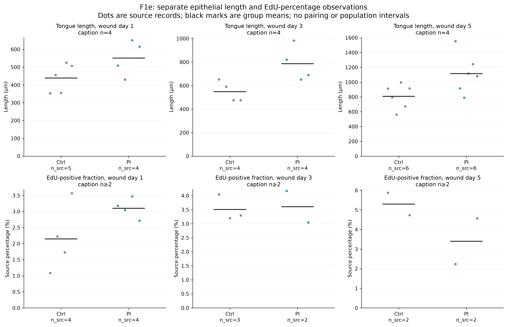
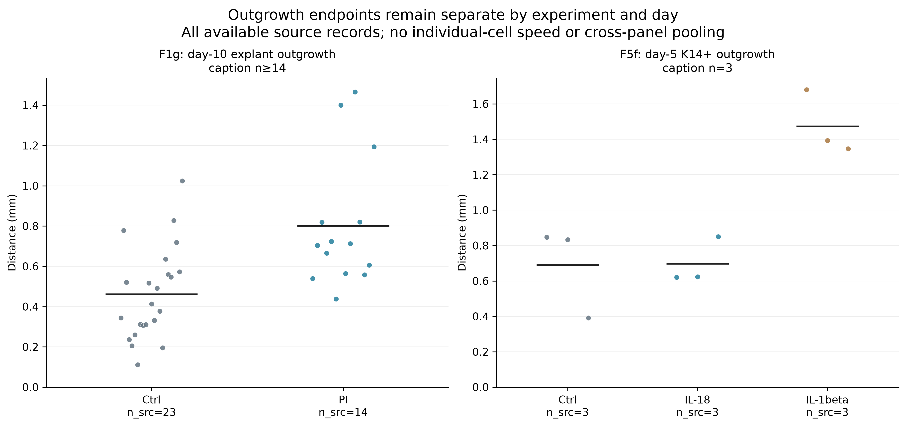
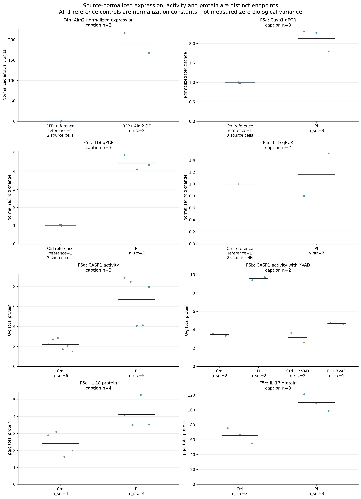
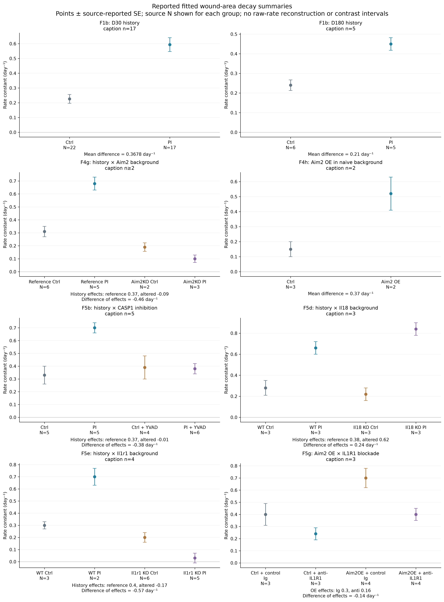
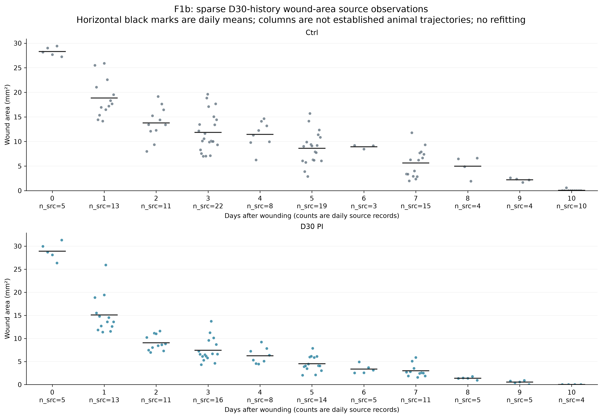

# S5F v1: functional-source contrasts and their measurement boundaries

19 November 2026. Owner `Nk17-P01`. The exposed reconstruction ran from frozen
setup `ff0ed974c71a26b2b1f4bf84896cf383444c2c06` under the
[method](S5F_METHOD_V1.md), [exact source map](S5F_SOURCE_MAP_V1.json) and
[contract](../../analysis/research/contracts/Nk17-P01.s5f_functional_sources_v1.json).
The [receipt](../../analysis/research/runs/naik2017_s5f_functional_sources_v1/receipt.json)
records successful execution; independent source/arithmetic verification passed
13,821 checks. All five actual figures were visually reviewed. The coordinator
reviewed the complete report, figures and numerical results without further
revision. This is agent progression review, not human scientific acceptance;
S6 and prospective extension review remain to be completed.

## Biological purpose and what changed

Naik et al. (2017) connects inflammatory history in mouse epidermis to altered
wound responses. The preceding [S5M v2](S5M_RESULTS_V2.md) describes stronger
acute than recovered/recall RNA–TSS-proxy association, with baseline subtraction
shaping small negative adjusted associations. It does not measure repair or
protein function. S5F therefore reconstructs the separate source measurements:
epithelial tongue length, EdU percentage, explant outgrowth, normalized expression,
CASP1 activity, cytokine protein and reported wound-area decay constants. These
endpoints are retained in their original experimental groups and units.

The finite source contrasts support longer PI epithelial tongues and greater
day-10 outgrowth, but the EdU contrasts are mixed over time. The reported
history advantage in decay constants is absent or reversed under Aim2 knockout,
YVAD or Il1r1 knockout, and remains positive under Il18 knockout. In the separate
Aim2-overexpression/blockade experiment, the reported OE contrast is smaller
under anti-IL1R1 but remains positive within that condition. Returning OE+anti
to the untreated control mean does not establish complete loss of the OE effect.

This is shared-source reconstruction, not independent biological replication.
Captions explicitly describe biologically independent animals, and F1g labels
source rows as biological replicates. Exact animal IDs, cross-panel membership,
some technical aggregation and several source/caption N discrepancies remain
unresolved. The computational unit is the supplied endpoint record or reported
group summary. No invented animal pairing, population inference, equivalence,
chromatin-to-repair mediation or memory-storage mechanism follows from it.

## Source fidelity and denominators

The frozen map binds the original MOESM7/10/11 workbooks and the supplied final
PDF. It yielded **35 endpoints, 83 groups and all 38 declared contrasts**:
57 record groups and 26 reported-summary groups; 20 record-based contrasts and
18 rate-summary contrasts. The 849 requested source cells include labels,
summary fields and blank slots. Of 588 observation slots, 356 are numeric source
records and 232 are blank. These totals are not independent animal counts.

The four all-1 controls (F4h Aim2, F5a Casp1, F5c Il18 and Il1b expression) remain
normalization references. Their empirical SD is NA; their constants are never
deleted in influence diagnostics. They do not demonstrate zero biological
variance. Reported-rate groups preserve source mean, SE and N, with median,
range and SD unavailable. SEs are neither converted to SD nor combined into
contrast intervals. F5b's original `Sd. Error` label remains recorded.

The final-PDF axes explicitly qualify rate constant k as **day^-1** despite the
workbook unit omission: saved text lines 185/329 (Fig. 1), 803/894 (Fig. 4), and
1059/1150–1152 (Fig. 5). All eight axis guards passed. Caption locators are
338–366, 895–923 and 1153–1181. These are wound-area decay summaries, not
instantaneous cell speed. F1b area is mm², not percentage wound area.

The 16 flagged source/caption N discrepancies remain unresolved:

| Endpoint | Discrepant source groups and Ns | Caption N |
|---|---|---:|
| F1e tongue, day 1 | Ctrl 5 | 4 |
| F1e tongue, day 5 | Ctrl 6; PI 6 | 4 |
| F5a CASP1 activity | Ctrl 6; PI 5 | 3 |
| F1b D30 rate | Ctrl 22 | 17 |
| F1b D180 rate | Ctrl 6 | 5 |
| F4h rate | Ctrl 3 | 2 |
| F5b rate | Ctrl+YVAD 4; PI+YVAD 6 | 5 |
| F5e rate | WT Ctrl 3; WT PI 2; KO Ctrl 6; KO PI 5 | 4 |
| F5g rate | OE+Ig 4; OE+anti 4 | 3 |

Other endpoint-specific source counts and caption relations remain in
[groups.tsv](../../analysis/research/runs/naik2017_s5f_functional_sources_v1/groups.tsv).
F1g's 23/14 records satisfy the caption n≥14. F5f has three source values per
group, while its caption describes three animals and three technical replicates
per mouse; the record aggregation/matching is undocumented. No N=9 or pairing
is inferred. F1e EdU is the supplied percentage with the caption's K14+EdU+ /
K17+ denominator; numerator/denominator counts are unavailable. It is not a
direct estimate of division rate.

## Tongue length, EdU and outgrowth

All tables below use source means in the stated units. The median contrast
applies the same coefficients to group medians. The deletion range removes each
eligible nonreference source record once while retaining a nonempty group; it
is **source-record influence, not a confidence interval or an animal jackknife**.
All 152 deletion records are retained in the
[diagnostics](../../analysis/research/runs/naik2017_s5f_functional_sources_v1/deletion_diagnostics.tsv).

| Contrast | Unit | Mean difference | Median difference | Deletion range |
|---|---|---:|---:|---:|
| F1e tongue PI−Ctrl, day 1 | µm | 111.962 | 106.478 | 78.609 to 152.485 |
| F1e tongue PI−Ctrl, day 3 | µm | 237.900 | 222.150 | 172.263 to 282.879 |
| F1e tongue PI−Ctrl, day 5 | µm | 307.547 | 243.597 | 220.253 to 372.913 |
| F1e EdU PI−Ctrl, day 1 | percentage points | 0.9519 | 1.1366 | 0.5960 to 1.4246 |
| F1e EdU PI−Ctrl, day 3 | percentage points | 0.0965 | 0.3142 | −0.4682 to 0.6612 |
| F1e EdU PI−Ctrl, day 5 | percentage points | −1.9006 | −1.9006 | −3.0663 to −0.7348 |
| F1g PI−Ctrl, day 10 | mm | 0.3397 | 0.2950 | 0.2885 to 0.3676 |
| F5f IL18−Ctrl, day 5 | mm | 0.0079 | −0.2091 | −0.1419 to 0.0865 |
| F5f IL1beta−Ctrl, day 5 | mm | 0.7832 | 0.5607 | 0.6334 to 0.8617 |
| F5f IL1beta−IL18, day 5 | mm | 0.7753 | 0.7698 | 0.6716 to 0.8515 |

Longer PI tongues at all three times coexist with positive, near-zero and
negative EdU contrasts. The finite EdU data do not supply a uniform increase
that accounts for tongue length. Outgrowth distances also remain distinct from
individual-cell migration speed, survival and proliferation. The two explant
experiments are not pooled across their different days and treatments.

F5f's IL18−Ctrl mean is near zero, but the median contrast is negative and the
deletion range crosses zero. This does not establish IL18 equivalence or no
biological role. The positive IL1beta contrasts describe this supplied endpoint;
their shared controls do not make them independent comparisons.

[Figure 1 PDF](../../analysis/research/runs/naik2017_s5f_functional_sources_v1/fig01_tongue_edu.pdf).
All source records and arithmetic means are shown; caption and source Ns are
kept separate. The top and bottom rows measure different endpoints.

[Figure 2 PDF](../../analysis/research/runs/naik2017_s5f_functional_sources_v1/fig02_outgrowth.pdf).
F1g day 10 and F5f day 5 retain their own controls, counts and distances.

## Expression, CASP1 activity and protein

| Contrast | Unit | Mean difference | Median difference | Deletion range |
|---|---|---:|---:|---:|
| F4h Aim2 RFP+−RFP− reference | normalized arbitrary units | 191.000 | 191.000 | 167.000 to 215.000 |
| F5a Casp1 PI−reference | normalized fold-change difference | 1.1281 | 1.2755 | 1.0361 to 1.2938 |
| F5a CASP1 activity PI−Ctrl | U/g total protein | 4.5238 | 5.8058 | 3.9765 to 5.1818 |
| F5b CASP1 activity PI−Ctrl, without YVAD | U/g total protein | 6.1200 | 6.1200 | 5.9600 to 6.2800 |
| F5b CASP1 activity PI−Ctrl, with YVAD | U/g total protein | 1.5400 | 1.5400 | 1.0100 to 2.0700 |
| F5b activity: with−without YVAD history effects | U/g total protein | −4.5800 | −4.5800 | −5.1100 to −4.0500 |
| F5c Il18 PI−reference | normalized fold-change difference | 3.4425 | 3.3386 | 3.2171 to 3.6160 |
| F5c Il1b PI−reference | normalized fold-change difference | 0.1550 | 0.1550 | −0.2000 to 0.5100 |
| F5c IL18 protein PI−Ctrl | pg/g total protein | 1.7026 | 1.3763 | 1.3121 to 1.9326 |
| F5c IL1beta protein PI−Ctrl | pg/g total protein | 43.8753 | 42.0844 | 38.2230 to 49.2451 |

F4h RFP+ normalized Aim2 values are 216 and 168 against fixed reference 1.
These expression records are not linked individual-animal repair measurements.
F5a records increased normalized Casp1 and CASP1 activity in the PI group at
12 hours after wounding. F5b's history-related activity contrast is smaller with
YVAD but remains positive in the source values. Activity and fitted repair
rate therefore cannot be substituted for one another.

Naik et al. (2017), Fig. 5c, already reports increased IL-1beta protein without
an Il1b transcript increase. The present source description gives Il1b values
0.80 and 1.51 against reference 1, hence a finite mean difference of +0.155;
this is not literally zero and does not reproduce the paper's inferential test.
The protein contrast is +43.8753 pg/g total protein. Thus weak RNA alignment in
S5M does not alone refute this previously published protein-level observation.
It also does not establish a new post-transcriptional explanation from our
proxy-window associations. [Primary paper, Fig. 5c](https://doi.org/10.1038/nature24271).

[Figure 3 PDF](../../analysis/research/runs/naik2017_s5f_functional_sources_v1/fig03_expression_activity_protein.pdf).
Open reference markers denote the all-1 normalization constants. Their labels
"source cells" count spreadsheet reference entries, not biological cells.
Empirical record clouds and means are shown for the remaining groups. No interval is
drawn for a record-based contrast.

## Reported fitted rates: all 18 contrasts

All entries below are **day^-1** differences of reported group means. The
source means, SEs and Ns are retained in Figure 4 and groups.tsv. No individual
rates were reconstructed, fits rerun, SEs combined or contrast intervals computed.

| Panel / comparison | Reference-context effect | Altered-context effect | Altered−reference effect |
|---|---:|---:|---:|
| F1b D30: PI−Ctrl | 0.3678 | — | — |
| F1b D180: PI−Ctrl | 0.2100 | — | — |
| F4g: PI−Ctrl, reference versus Aim2KO | 0.3700 | −0.0900 | −0.4600 |
| F4h: Aim2OE−Ctrl in naive background | 0.3700 | — | — |
| F5b: PI−Ctrl, without versus with YVAD | 0.3700 | −0.0100 | −0.3800 |
| F5d: PI−Ctrl, WT versus Il18KO | 0.3800 | 0.6200 | 0.2400 |
| F5e: PI−Ctrl, WT versus Il1r1KO | 0.4000 | −0.1700 | −0.5700 |
| F5g: Aim2OE−Ctrl, Ig versus anti-IL1R1 | 0.3000 | 0.1600 | −0.1400 |

F4g's reference groups are retained as supplied; they are not relabelled verified
WT. F5g is an OE-by-blockade comparison, not history by genotype. Its reported
means are Ctrl+Ig 0.40, Ctrl+anti 0.24, OE+Ig 0.70 and OE+anti 0.40 day^-1.
OE+anti equals Ctrl+Ig, but the relevant OE contrast **within anti** is
0.40−0.24 = +0.16. The change in the OE contrast is −0.14. These summaries
support attenuation in this finite comparison, not complete elimination,
statistical interaction or equivalence. The source-N discrepancy remains.

The perturbation-dependent history contrasts bear on the paper's repair-output
argument. Loss of the history advantage is not loss of all repair and does not
identify chromatin-memory establishment or maintenance. The positive Il18KO
history contrast is retained; it cannot be discarded because another perturbation
shows a different direction. [Primary paper, Figs. 4g–h and 5b,d–g](https://doi.org/10.1038/nature24271).

[Figure 4 PDF](../../analysis/research/runs/naik2017_s5f_functional_sources_v1/fig04_reported_rates.pdf).
Bars show source-reported SE only. Each panel retains its own caption N and
group-specific source N. No cross-panel pooling or contrast uncertainty is implied.

## Daily wound area remains a separate descriptive display

F1b includes sparse D30-history wound-area observations at days 0–10. Daily
source Ns are Ctrl 5/13/11/22/8/19/3/15/4/4/10 and PI
5/13/11/16/8/14/5/11/5/5/4. Blanks and true zero areas remain distinct.
The display shows every available point and daily mean without inferring that
source columns are animal trajectories. There is no new daily contrast,
longitudinal model, closure-time calculation or decay refit in this stage.

[Figure 5 PDF](../../analysis/research/runs/naik2017_s5f_functional_sources_v1/fig05_daily_wound_area.pdf).
Daily counts describe source records, not independent animals or a constant
denominator. The main-figure rate summaries' limits do not imply that all raw
wound-area sources are unavailable: separately recovered MOESM16/17 EDF5/6
area sheets are recorded as S6 qualification leads in the
[current literature context](LITERATURE_CONTEXT.md#bounded-functional-source-qualification--19-november-2026).

## Verification, preservation and next decision

The independent verifier reads XLSX through stdlib ZIP/XML and uses 50-digit
Decimal arithmetic, without importing the main openpyxl reader or statistical
helpers. It verifies all 849 requested cells, blanks, headers, Ns, reference
semantics, group summaries, 38 contrasts, 152 deletions and eight PDF-axis guards.
All **13,821 checks passed**, with maximum scaled error
**1.3285744476013776e-14** under the frozen computational tolerance 1e-10.
This establishes source/arithmetic agreement, not biological independence.
[Verification record](../../analysis/research/runs/naik2017_s5f_functional_sources_v1/verification.json).

The four pre-freeze artificial tests and 700 independent fixture checks had
already passed. No real S5F run failed and no frozen output was overwritten.
Openpyxl emitted an unsupported-extension warning during read-only loading;
the reader never saves the original workbooks. Input hashes and receipt output
hashes were verified. Runtime before independent verification was 13.110 seconds
on Python 3.12.10 ARM64, openpyxl 3.1.5 and matplotlib 3.11.1. No earlier
molecular analysis or source fit was rerun. All five PNGs were checked for
readability, units, Ns, reference display and contrast annotations; no revision
was required. [Runtime](../../analysis/research/runs/naik2017_s5f_functional_sources_v1/runtime.json).

Complete evidence: [requested cells](../../analysis/research/runs/naik2017_s5f_functional_sources_v1/source_cells.tsv),
[observations including blanks](../../analysis/research/runs/naik2017_s5f_functional_sources_v1/observations.tsv),
[all group summaries](../../analysis/research/runs/naik2017_s5f_functional_sources_v1/groups.tsv),
[all contrasts](../../analysis/research/runs/naik2017_s5f_functional_sources_v1/contrasts.tsv),
[metadata and N discrepancies](../../analysis/research/runs/naik2017_s5f_functional_sources_v1/metadata.json).
The research gate passed against refreshed main `d0429d0`; all 20,267 repository
checks, 308 local links and whitespace checks passed. All 21 run files are
tracked, including five PDF exports. GitHub is `xorca0711`; commits retain Xorca
author/committer attribution. No publication or account setting changed.

Coordinator stage review is complete, with no further revision requested. The finite F5g
within-blockade contrast motivates assessing whether the separate EDF6g area
records show the same comparison across days, after qualifying labels, units,
occupancy and exposure. That would be a separately frozen descriptive extension,
not a retroactive refit or proof of residual biological independence from IL1R1.
Area-source counts 3/4/3/4 versus main rate-summary Ns 3/3/4/4 are already a
qualification issue. No extension calculation is part of this S5F result.
S6 must connect the full molecular/functional evidence to closest precedents
and an informative bounded next comparison, or document why none is justified;
no global RQ or human retain/reject decision is created here.
