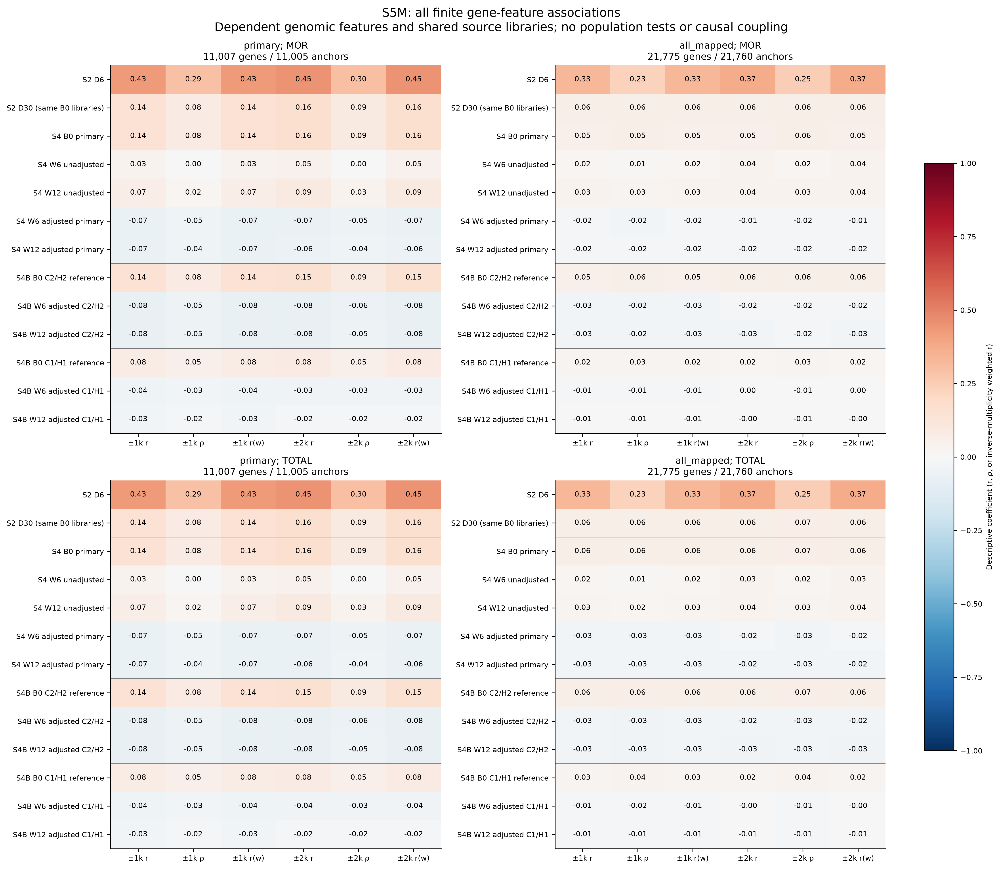
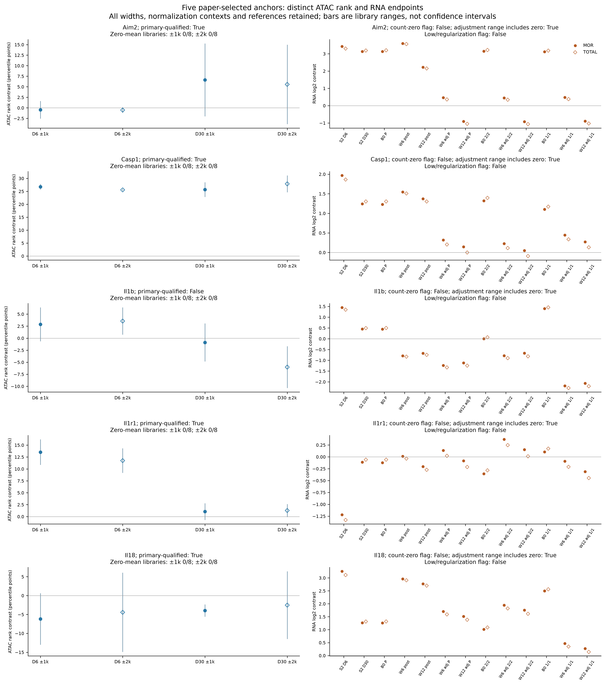

# S5M v2: acute alignment, weaker recovered/recall association, corrected warnings

18 November 2026. Owner `Nk17-P01`. The bounded correction ran from frozen
setup `26d23e8af952177b57d4937a245294a9b3f23328` under the
[v2 amendment](S5M_AMENDMENT_V2.md) and
[contract](../../analysis/research/contracts/Nk17-P01.s5m_molecular_integration_v2.json).
All 312 association coefficients and 96 covariance records are byte-identical to
v1. V2 corrects only the ambiguous aggregate warnings, their summaries and the
anchor display; [v1 and its semantic failure](S5M_RESULTS_V1.md) remain preserved.
The original exposed [S5M method](S5M_METHOD_V1.md) defines the fixed comparisons.

## What the molecular comparison changes

In the primary expression-qualified universe, D6 RNA history effects align more
strongly with D6 TSS-proxy rank contrasts than D30 RNA effects align with D30
ranks. Unadjusted recall associations are small; subtracting the baseline gives
small negative adjusted associations. The actual covariance components below
show that those negatives arise from subtracting a larger positive baseline
component from a smaller positive post-wound component. They do not demonstrate
chromatin repression or causal inhibition of recall.

These are finite associations among dependent gene features from separate
deposited RNA/ATAC libraries. Exact animal membership, cross-assay matching,
composition and deposited ATAC processing remain unresolved. The primary unit
of this description is a gene feature, not an independent animal or cell.
The published inflammatory-memory premise therefore remains broader than this
boundary-proxy comparison; it is not refuted by weak or heterogeneous alignment.

## Corrected warning semantics and preserved universes

The outer join retains 47,729 genes. Of these, 21,775 have S3 proxies;
25,672 are unassayed noncoding genes, 196 are outside the selected chromosomes,
and 86 lack the required annotation. Unassayed values remain NA.

| Frozen universe | Genes / distinct anchors | Any RNA count zero | Any W6/W12 adjustment range includes zero | Range includes zero without count zero | Low/regularization flag |
|---|---:|---:|---:|---:|---:|
| Primary | 11,007 / 11,005 | 2 | 9,966 | 9,964 | 2 |
| All mapped | 21,775 / 21,760 | 8,991 | 20,302 | 11,615 | 8,844 |

Across all 47,729 records, 13,983 v1 aggregate warnings were true despite no raw
count zero. The corrected count-zero flag agrees with the 16 original count
files; the range flag retains its separate contrast meaning. A range containing
zero is neither a count-zero observation nor a confidence interval or equivalence
test. All original source flags and every qualification decision remain intact.

All five paper-selected anchors have **count-zero false**, **adjustment-range
includes-zero true**, and **low/regularization false**. Il1b remains excluded
from the primary universe by frozen expression qualification and retained in
all-mapped analysis and the figure. No anchor was replaced.

ATAC zero means remain a separate concept. In the primary universe, ±1 kb D6/D30
have 23/33 genes with any zero-mean library and 3/5 with all four means zero;
±2 kb has 10/11 and 3/4, respectively. No ATAC-zero filtering was added.
Even unchanged local zero means can acquire a rank contrast when the remaining
universe and tie mass change. Full counts are in the
[summary](../../analysis/research/runs/naik2017_s5m_molecular_integration_v2/universe_summary.json).

## All comparisons retained

The table reports ordinary Pearson under each stage's frozen MOR scale.
The [complete 312-row table](../../analysis/research/runs/naik2017_s5m_molecular_integration_v2/association_results.tsv)
and Figure 1 also retain both total-count normalizations, exact-tie Spearman and
inverse-anchor-multiplicity Pearson. No setting was selected as a winner.

| RNA measurement versus indicated ATAC time | Primary ±1 kb r | Primary ±2 kb r | All-mapped ±1 kb r | All-mapped ±2 kb r |
|---|---:|---:|---:|---:|
| S2 D6 versus D6 | 0.42546 | 0.45113 | 0.33219 | 0.37359 |
| S2 D30 versus D30 | 0.14351 | 0.15775 | 0.05619 | 0.05933 |
| S4 B0 primary versus D30 | 0.14327 | 0.15746 | 0.05177 | 0.05407 |
| S4 W6 post versus D30 | 0.03330 | 0.04679 | 0.02149 | 0.03595 |
| S4 W12 post versus D30 | 0.07008 | 0.08961 | 0.03399 | 0.03899 |
| S4 W6 adjusted primary versus D30 | -0.06945 | -0.06842 | -0.02215 | -0.01389 |
| S4 W12 adjusted primary versus D30 | -0.06536 | -0.06237 | -0.02168 | -0.02046 |
| S4B B0 C2/H2 versus D30 | 0.14067 | 0.15389 | 0.05434 | 0.05916 |
| S4B W6 adjusted C2/H2 versus D30 | -0.07591 | -0.07620 | -0.02687 | -0.02115 |
| S4B W12 adjusted C2/H2 versus D30 | -0.07621 | -0.07512 | -0.02703 | -0.02827 |
| S4B B0 C1/H1 versus D30 | 0.07782 | 0.08355 | 0.02472 | 0.02226 |
| S4B W6 adjusted C1/H1 versus D30 | -0.03988 | -0.03487 | -0.00918 | 0.00067 |
| S4B W12 adjusted C1/H1 versus D30 | -0.02685 | -0.01994 | -0.00689 | -0.00237 |

For primary ±1 kb MOR, Spearman is 0.29034 at D6 and 0.07929 at D30;
unadjusted W6/W12 are 0.00034/0.02107 and primary-adjusted W6/W12 are
-0.04576/-0.04115. The largest coefficient change between frozen MOR/total
scales is 0.009004; the largest ordinary-versus-inverse-anchor Pearson change
is 0.000213. These sensitivities do not provide independent replication.
Expression-universe and reference choices visibly affect magnitudes; near-zero
coefficients can change sign, as the all-mapped C1/H1 W6 width comparison shows.

Figure 1 uses a fixed -1 to +1 scale for all panels. Genes sharing a proxy and
overlapping windows are dependent features. Figure 1 PNG/PDF are byte-identical
to the coordinator-reviewed v1 figure, so that visual review is reused.
[Vector PDF](../../analysis/research/runs/naik2017_s5m_molecular_integration_v2/fig01_associations.pdf).

## Baseline subtraction accounts for the negative adjusted components

For primary genes, ±1 kb and MOR, ordinary covariance is in ATAC percentile
points × RNA log2 units. The complete
[96-row component table](../../analysis/research/runs/naik2017_s5m_molecular_integration_v2/covariance_identity.tsv)
retains both widths/universes/normalizations/weightings and all references.

| Reference | Wound time | Covariance with baseline | With post-wound RNA | With adjusted RNA = post − baseline |
|---|---|---:|---:|---:|
| Primary | W6 | 0.11552238 | 0.03134635 | -0.08417603 |
| Primary | W12 | 0.11552238 | 0.05155380 | -0.06396858 |
| C2/H2 | W6 | 0.13945067 | 0.03134635 | -0.10810432 |
| C2/H2 | W12 | 0.13945067 | 0.05155380 | -0.08789688 |
| C1/H1 | W6 | 0.08348096 | 0.03134635 | -0.05213461 |
| C1/H1 | W12 | 0.08348096 | 0.05155380 | -0.03192716 |

This is an algebraic explanation of the **measured covariance decomposition**,
not a biological explanation of the baseline or evidence of repression.
Correlations themselves are not subtracted. W6 and W12 share L0, so their
adjusted associations are not independent temporal corroboration. S2 D30 and
S4 B0 reuse GSM2440989–992 under different normalization contexts; their similar
coefficients are not a second experiment. C2/H2 and C1/H1 are observed one-library
references, not matched animals, sex assignments or a correction of the recorded
female/Xist/Y-marker discrepancy.

## Published anchors remain heterogeneous across measured layers

All five fixed anchors and all alternatives remain visible. At ±1 kb, Aim2 has
D6/D30 rank contrasts -0.469/+6.635 pp, with D30 library range -2.006 to +15.276;
Casp1 is +26.783/+25.672 pp; Il1b +2.882/-0.888; Il1r1 +13.528/+1.046;
and Il18 -6.184/-3.970. These are boundary-rank effects, not original memory-domain
overlap or absolute opening. Positive RNA effects can coexist with negative
local rank contrasts, as for Il18. The anchors do not establish one uniform
chromatin-to-RNA response pattern.

Figure 2 was visually inspected after correction: all five rows, flags, ranges
and labels are readable. Left bars show four-library contrast ranges, not CIs;
right filled/open markers show MOR/total. RNA and ATAC have separate units and
panel-specific axis ranges. `P` is the primary baseline; `2/2` and `1/1` denote
the C2/H2 and C1/H1 observed references, not animal pairing. No line implies a
trajectory. [Vector PDF](../../analysis/research/runs/naik2017_s5m_molecular_integration_v2/fig02_published_anchors.pdf)
and [all anchor values](../../analysis/research/runs/naik2017_s5m_molecular_integration_v2/anchor_values.tsv).

The published premise is distinct: [Naik et al. (2017)](https://doi.org/10.1038/nature24271),
Figure 3, reports persistent accessibility in its own region universe; Figure 5c
reports increased IL-1beta protein without increased Il1b transcript, as recorded
by the coordinator's bounded primary-source read in the
[literature context](LITERATURE_CONTEXT.md). Weak RNA alignment alone therefore
does not refute the protein/functional premise. Neither that paper attribution
nor this shared-source analysis establishes a new mechanism.

## Verification, preservation and next decision

The [v2 verification](../../analysis/research/runs/naik2017_s5m_molecular_integration_v2/verification.json)
passed **12,361,838** exact checks across all 47,729 genes and 16 original raw-count
libraries. All 23 source count-zero fields agree with raw counts; every other
gene/anchor field and eligibility remains unchanged. Associations, covariance
components, ATAC table and both Figure 1 files are byte-preserved. The
[correction audit](../../analysis/research/runs/naik2017_s5m_molecular_integration_v2/flag_correction_audit.json)
retains the explicit allowlists and the 13,983 removed false count-zero warnings.
V1's 18,810,969 numerical checks remain applicable to unchanged arithmetic,
with their now-documented semantic limitation. This is verification, not
independent biological replication.

The [receipt](../../analysis/research/runs/naik2017_s5m_molecular_integration_v2/receipt.json)
passed integrity verification. V2 entrypoint time was 42.110 seconds; run files
total 43,796,108 bytes. No real v2 run failed, no source analysis or coefficient
was recomputed, and no original output was overwritten.

The molecular comparison narrows a simple expectation of broadly concordant
recovered/recall RNA and boundary-accessibility effects. It leaves original
distal-domain retention, protein/activity, repair and causal mediation unestimated.
The informative next comparison is the already proposed **separate S5F functional
source analysis**, preserving each panel's endpoint and unit. The coordinator
reviewed the complete report, correction audit, raw-count verification and
corrected Figure 2 without requesting numerical/figure revision, and authorized
S5F after local preservation. The research gate against refreshed `d0429d0`,
20,221 repository checks, 111 affected-document links, 17 tracked run files and
whitespace checks passed. S6 remains.
No human scientific acceptance, claim promotion or new target follows here.
