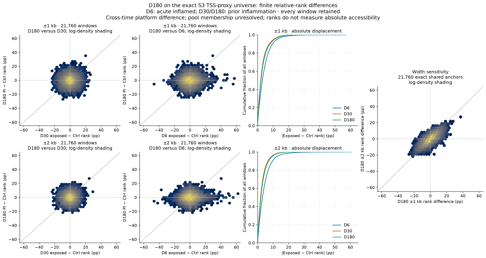
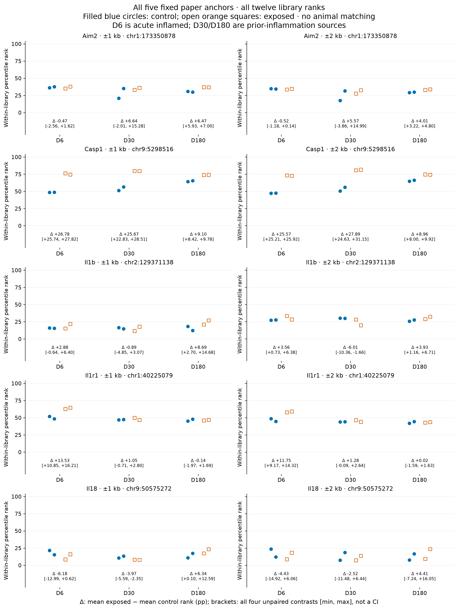

# S6C: heterogeneous D180 relative ranks on the exact S3 proxy universe

19 November 2026. Owner `Nk17-P01`. Exposed, shared-source description from frozen
setup `7563cdf1f1fe614e754d9643219b57bff0668cb5`, completed in a fresh retry after
a preserved pre-signal local WSL access failure. All 21,760 windows per width and
all five fixed anchors are retained. **D180 does not extend the aggregate D6→D30
reduction into a uniform further decrease or stable same-direction pattern.**
The primary median absolute rank difference is 2.166919 pp, versus frozen D30
1.995151 pp and D6 3.067122 pp. D180 is smaller than D30 at 45.55% of windows,
larger at 54.41%, and opposite in sign at 47.92% of the complete universe.
These are finite relative-order descriptions, not accessibility half-lives,
absolute opening, matched-animal trajectories or original memory-domain classes.

Independent verification passed **7,009,534 checks**, maximum scaled error
**5.68434e-14**; all **296 interval-iterator readbacks** matched with maximum
scaled error zero. Receipt integrity passed. Both actual figures were visually
inspected without a numeric or layout issue. The coordinator reviewed the complete report, all ten anchor rows, whole summary
and width sensitivity, verification/receipt/readbacks and both actual figures
without numeric, display or interpretation revision. This is progression review,
not human scientific acceptance.

## Question, source and qualification

Naik et al. (2017), [Fig. 3 and the original GSE92967 deposit](https://www.ncbi.nlm.nih.gov/geo/query/acc.cgi?acc=GSE92967),
provide the published premise of long-lived accessibility after inflammation.
[S3](S3_RESULTS_V1.md) instead measures within-library ordering of fixed
GENCODE M9 annotation-boundary windows. This extension asks how those exact
windows behave at D180 relative to D30, with acute D6 as reference. Its
[approved method](S6C_D180_METHOD_V1.md) and [contract](../../analysis/research/contracts/Nk17-P01.s6c_d180_proxy_v1.json)
were committed before any actual D180 research-window signal was read.

Four original BigWigs, [acquired with hashes](D180_ACQUISITION_V1.md), supplied
GSM2652413/14 PI and GSM2652415/16 control. All four exact source/run/BioSample/
assay/day/history/platform/layout joins qualified. The full 66-entry chromosome
dictionaries are identical to S3; all 20 chromosomes required by the frozen
windows match the stored mm10 lengths. Unused chromosome comparisons remain in
[qualification.json](../../analysis/research/runs/naik2017_s6c_d180_proxy_v1_retry1/qualification.json);
unused contigs do not enlarge the analysis universe. All four headers qualified
before any research-window extraction. Header qualification alone was not treated
as signal qualification: all 174,080 window/library records subsequently passed
complete finite base-array coverage, with no imputation or dropped interval.

The exact S3 windows and gene mapping were copied byte-for-byte and rechecked
against their frozen receipt, including M9 identity: 21,760 anchors and 21,775
protein-coding gene mappings at each of ±1 kb and ±2 kb, chr1–19/X, no clipping.
All old D6/D30 values remain bit-for-bit equal as decoded floats in the combined
export. No old track was re-extracted and no upstream analysis was rerun.

Library is the computational unit. Published pooled-replicate evidence is retained,
but exact animal membership, overlap and cross-time/cross-assay matching remain
unresolved. D180 is HiSeq2500 paired-end versus D6/D30 ATAC HiSeq4000 paired-end.
Track units/processing and mixture remain potential explanations for cross-time
differences. There is no D180 RNA in this map, no paired longitudinal estimate
and no independent biological replication.

## Entire-universe results

P is the exact average-tie within-library percentile rank; Δ is mean PI minus
mean control P. For the D6 reference, exposed means acute inflamed. All quantities
below use the complete 21,760-window denominator for each width.

| Flank | Median abs(Δ6), pp | Median abs(Δ30), pp | Median abs(Δ180), pp | D180 range includes 0 | D180 computational-zero windows |
|---|---:|---:|---:|---:|---:|
| ±1 kb | 3.067122 | 1.995151 | 2.166919 | 65.5055% | 8 / 21,760 |
| ±2 kb | 3.121697 | 1.910704 | 2.134749 | 64.9816% | 5 / 21,760 |

The four-unpaired-comparison range is a finite spread diagnostic, not a CI or
four independent replicates. Its zero inclusion is different from a computationally
zero mean contrast and from encoded-zero local signal. Mean P is 50 in every
library and mean complete-universe Δ180 is 0 (±1 kb) / 1.57e-17 (±2 kb) by rank
construction; this supplies no evidence of unchanged global accessibility.

| Width / reference | D180 abs. smaller | D180 abs. larger | Abs. difference within 1e-10 pp | Opposite signs | Computational-zero status changes |
|---|---:|---:|---:|---:|---:|
| ±1 kb / D30 | 45.5469% | 54.4072% | 0.0460% | 47.9228% | 0.0689% |
| ±1 kb / D6 | 57.0450% | 42.9320% | 0.0230% | 47.9871% | 0.0506% |
| ±2 kb / D30 | 46.1949% | 53.7592% | 0.0460% | 47.1875% | 0.0643% |
| ±2 kb / D6 | 59.1728% | 40.8042% | 0.0230% | 47.8171% | 0.0276% |

Relative to D6, 57.05% / 59.17% of D180 absolute displacements are smaller.
Relative to D30, the direction is mixed, with a slight majority larger. Nearly
half of all windows have opposite D180/reference signs. These statements concern
relative ranks in different finite library sets, not recovery, equivalent states
or a frequency of stable memory cells. The 1e-10 rule is computational, not a
biological margin. No p-value, population CI, correlation model or selected
persistent subset was added.

Changing ±1 kb to ±2 kb changes the D180 sign at **13.6029%** of exact shared
anchors. Median signed width shift is +0.043660 pp; median absolute shift is
0.711200 pp, 95th percentile absolute shift 7.179903 pp. Computational-zero
status changes at 0.0506%. Window width therefore matters for some local
interpretations even though the aggregate absolute-displacement descriptions are
similar. All seven prespecified signed/absolute and cross-time shift quantiles
are retained in [summary.json](../../analysis/research/runs/naik2017_s6c_d180_proxy_v1_retry1/summary.json).

## All five fixed paper anchors

All ten anchor/width records remain in the [complete fixed-anchor table](../../analysis/research/runs/naik2017_s6c_d180_proxy_v1_retry1/fixed_anchors.tsv),
with all twelve library means, encoded-zero counts, local-zero flags, ranks,
three group differences and every unpaired range. They are exposed published
examples, not an outcome-selected representative set.

| Anchor | Flank | Δ6, pp | Δ30, pp | Δ180, pp | D180 four-contrast [min, max], pp |
|---|---|---:|---:|---:|---|
| Aim2 | ±1 kb | -0.468772 | +6.635185 | +6.467439 | [+5.933177, +7.001700] |
| Aim2 | ±2 kb | -0.520474 | +5.567811 | +4.007537 | [+3.219358, +4.795717] |
| Casp1 | ±1 kb | +26.783170 | +25.672136 | +9.097385 | [+8.419505, +9.775265] |
| Casp1 | ±2 kb | +25.568730 | +27.891907 | +8.958362 | [+7.998989, +9.917735] |
| Il1b | ±1 kb | +2.881566 | -0.888138 | +8.689508 | [+2.702330, +14.676686] |
| Il1b | ±2 kb | +3.558298 | -6.011306 | +3.934004 | [+1.155844, +6.712165] |
| Il1r1 | ±1 kb | +13.527736 | +1.045544 | -0.139023 | [-1.967002, +1.688956] |
| Il1r1 | ±2 kb | +11.745714 | +1.276483 | +0.022979 | [-1.585551, +1.631509] |
| Il18 | ±1 kb | -6.183648 | -3.969622 | +6.343352 | [+0.098810, +12.587895] |
| Il18 | ±2 kb | -4.428053 | -2.524243 | +4.405074 | [-7.242980, +16.053127] |

- Aim2 remains positive at D180 in both widths, with all four unpaired comparisons positive. Its primary Δ resembles the positive D30 description; this does not identify maintenance of a specific retained regulatory domain.
- Casp1 remains positive, but its D180 differences are smaller than the D6/D30 descriptions at both widths.
- Il1b changes from negative D30 to positive D180 at both widths. Il18 also changes from negative D30 to positive D180; its ±2 kb unpaired range includes zero, unlike its ±1 kb range.
- Il1r1 has a small negative primary and small positive sensitivity mean difference, while both ranges include zero. These numerical signs do not establish opposite biological states or equivalence.

All four D180 local means are nonzero for each of these fixed anchors. Their
rank descriptions therefore remain distinct from the whole-universe encoded-zero
issue. No anchor was replaced after seeing its result. None of these proxy values
establishes CASP1 activity, cytokine secretion, IL1R1 signaling, wound repair or a
chromatin-maintenance mechanism. The paper’s functional experiments remain
separate evidence, and the S6A EDF6g biological mapping hold is unchanged.

## Zero and tie diagnostics

| Library | Flank | Local mean-zero windows | Tied-window fraction | Largest exact tie group | Mean P |
|---|---|---:|---:|---:|---:|
| GSM2652413 | ±1 kb | 1216 | 39.3980% | 1216 | 50 |
| GSM2652413 | ±2 kb | 785 | 35.8502% | 785 | 50 |
| GSM2652414 | ±1 kb | 980 | 43.4467% | 980 | 50 |
| GSM2652414 | ±2 kb | 675 | 39.2831% | 675 | 50 |
| GSM2652415 | ±1 kb | 1875 | 46.3006% | 1875 | 50 |
| GSM2652415 | ±2 kb | 1071 | 44.0165% | 1071 | 50 |
| GSM2652416 | ±1 kb | 1031 | 46.1351% | 1031 | 50 |
| GSM2652416 | ±2 kb | 704 | 42.9228% | 704 | 50 |

Ties use exact exported means, without rounding into biological categories.
A window with constant local zero signal can have a nonzero rank difference if
other windows or the zero-tie mass differ. The export distinguishes mean-zero,
all-encoded-base-zero, computational-zero contrast and range-includes-zero flags;
none is substituted for another. Raw signal magnitudes remain within-library
inputs to rank calculation, not cross-track normalized accessibility estimates.

## Figures

[Vector PDF](../../analysis/research/runs/naik2017_s6c_d180_proxy_v1_retry1/fig01_D180_universe.pdf).
Every fixed window contributes to the density and empirical cumulative displays.
Density shading is logarithmic within panels; no statistical association is fit.
Both widths use the same rank-difference axis limits.

[Vector PDF](../../analysis/research/runs/naik2017_s6c_d180_proxy_v1_retry1/fig02_five_fixed_anchors.pdf).
Points are individual deposited libraries. No line implies matched animals.
Brackets show the four unpaired comparisons’ min/max, not confidence intervals.
Near-zero rounded labels retain their full values and flags in the table.

## Verification, resources and preserved failure

Both successful execution and its distinct initial failure are preserved:

- [Successful receipt](../../analysis/research/runs/naik2017_s6c_d180_proxy_v1_retry1/receipt.json): 17 exact inputs, eight code dependencies, 21 expected outputs plus receipt/stdout/stderr (24 files; 24,800,451 bytes). Setup preflight/research gate against main `d0429d0`, all 20,367 repository checks and whitespace passed before freeze.
- [Independent verification](../../analysis/research/runs/naik2017_s6c_d180_proxy_v1_retry1/verification.json): separate stdlib sorting/grouping/math.fsum/linear quantiles, all coordinates/mappings, exact preservation of S3 values, all twelve ranks, contrasts, flags, summaries, fixed anchors and metadata joins. 7,009,534 checks; maximum scaled error 5.68434e-14.
- [Readbacks](../../analysis/research/runs/naik2017_s6c_d180_proxy_v1_retry1/mean_readback.tsv): 296 annotation-order/fixed-anchor interval-iterator rereads; complete nonoverlapping coverage, overlap lengths and math.fsum; maximum scaled error zero and exact zero-base counts. This uses the same binary decoder, not an independent biological replicate.
- [Runtime](../../analysis/research/runs/naik2017_s6c_d180_proxy_v1_retry1/runtime.json): entrypoint 489.156 seconds (472.468 before final verification). Extraction 443.049 seconds; extraction reader peak RSS 71.977 MiB, including interval-readback phase peak 146.102 MiB. The 2 GiB / 2 hour / 50 MiB derived-output envelope was respected. Host Python 3.12.10/NumPy 2.5.1/pandas 3.1.1; pinned reader Python 3.13.18/pybbi 0.4.2/NumPy 2.5.5. A pandas future-deprecation warning for the retained round-trip parser was logged; no values were substituted or calculations skipped.
- [Failure archive manifest](../../analysis/research/runs/naik2017_s6c_failed_launch_preservation_v1/failure_archive_manifest.json) and [preservation receipt](../../analysis/research/runs/naik2017_s6c_failed_launch_preservation_v1/receipt.json): the first `naik2017_s6c_d180_proxy_v1` attempt failed at WSL path translation in the default sandbox (`Wsl/E_ACCESSDENIED`); its UTF-16 error output also caused a UTF-8 decode failure. No header or window signal was read. All eight original files were retained intact within the scoped workspace and archived byte-for-byte with a separate diagnostic (nine inputs, ten outputs). The original receipt remains `execution_failed`; successful preservation is not successful scientific execution. Approved local WSL access succeeded and the unchanged scientific contract/code/inputs ran under a fresh retry1 ID. No governance checks, scientific design, runtime installation or source labels changed.

## Eligible subsequent comparisons

The D180 endpoint is now qualified within its stated universe. It adds
heterogeneous long-term relative-order evidence, including favorable, mixed and
width-sensitive anchors. It neither reproduces original retained domains nor
resolves the molecular-to-function or individual-animal mapping gaps. Later
Larsen/Cowley mechanisms remain explicit published premises, not new discoveries
from these proxy ranks. The [existing literature context](LITERATURE_CONTEXT.md)
remains the source-specific boundary for that interpretation.

Completing D6 and D180 is not the end of research-question development. After
coordinator review, final S6 will connect the published findings, actual repository
observations, remaining question and a fit-for-purpose comparison using the
qualified later primary literature. The proposed Hamdan per-donor concurrent-
control interaction is a distinct candidate to assess against its published
four-condition STEM display; no Hamdan gene effect has been computed here and
its concrete method/contract still requires review before execution. A1 and
Arz1 ownership, all existing questions and all frozen Naik results are preserved.
No novel mechanism, external inquiry, publication or human acceptance is asserted.
