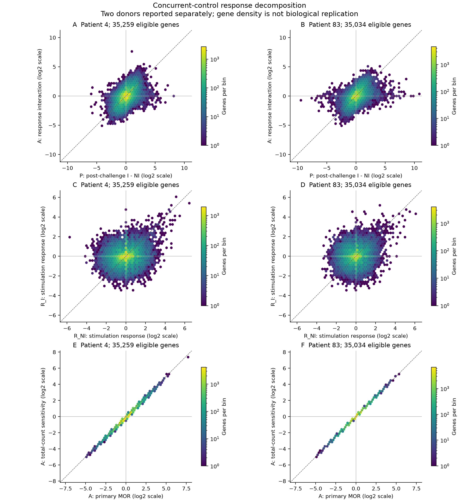

# S7: post-challenge differences and relative RNA responses have different meanings

19 November 2026. Owner `Nk17-P01`. Exposed shared-source descriptive comparison
in Hamdan patients 4 and 83, executed from frozen setup
`a7be7f811f0d868869cac371ef13b61696e4fb9c`. All 64,253 source genes are retained,
with 35,259/35,034 eligible for the respective donor's distributions.
**A positive post-challenge I–NI difference does not uniformly indicate a larger
within-history response.** Under primary MOR, 6,067/16,720 (36.29%) of patient-4
post-positive records and 5,362/16,862 (31.80%) of patient-83 records have negative
response interaction A. The distinction persists among records with no raw zeros.
Neither those fractions nor a positive A establish a patient-population effect,
epigenetic mechanism, speed or repair function.

The [approved method](S7_HAMDAN_RESPONSE_METHOD_V1.md),
[exact map](S7_HAMDAN_SOURCE_MAP_V1.json),
[frozen contract](../../analysis/research/contracts/Nk17-P01.s7_hamdan_response_v1.json)
and [preparation/review record](S7_PREPARATION_V1.md) precede source effects.
The coordinator reviewed the complete actual report, all donor/normalization/
raw-zero tables, source/factors, verification/receipt/resources and all six
figure panels without scientific or plotting revision. This is stage review,
not human scientific acceptance.

## Question, source and arithmetic verification

Hamdan 2026 [Fig. 5 and Supplement S7](https://pmc.ncbi.nlm.nih.gov/articles/PMC13196144/)
provide the published recall premise. Naik S4/S4B motivates separating concurrent
baseline offsets from post-challenge differences; it does not validate the
Hamdan result independently. Source is the original
[GSE282444](https://www.ncbi.nlm.nih.gov/geo/query/acc.cgi?acc=GSE282444) count matrix.
Only the sixteen exact concurrent-control/shared-challenge library columns enter
this comparison; the 36 separate baseline triplicates and four patient-4-only
higher-challenge columns are excluded by their prospectively fixed identities.
All source GeneIds, annotation, row order and observed counts remain; no gene,
biotype/chromosome subset, library pairing or missing-value imputation was added.

Patients are distinct donor labels, while the two library suffixes per cell do
not establish independent patients or matched cultures. Patient pairing does not
remove anatomical-site, culture-composition or preparation alternatives. I means
inflamed-derived in this source, not an assumed recovered human state.
Main/supplement DESeq2/edgeR, GEO/paper HiSeq4000/NextSeq2000 and S7B repeated
patient-4 condition-text discrepancies remain recorded. This is a distinct
explicit estimand, not reproduction of exact STEM inputs, peak/gene membership,
or evidence that the authors ignored baseline. No functional record is joined.
Independent stdlib/50-digit Decimal verification passed **15,807,848 checks**, maximum scaled error **7.0652725e-15**. It verifies every annotation/count/factor/response/flag, all sixteen unpaired library combinations and every full/stratified summary. The complete exports contain **257,012 response rows** and **128,506 sensitivity rows**. See [verification](../../analysis/research/runs/naik2017_s7_hamdan_response_v1/verification.json), [receipt](../../analysis/research/runs/naik2017_s7_hamdan_response_v1/receipt.json), [source samples](../../analysis/research/runs/naik2017_s7_hamdan_response_v1/source_samples.tsv) and [source structure](../../analysis/research/runs/naik2017_s7_hamdan_response_v1/source_structure.json). Receipt integrity passed separately after execution.
## Estimand and denominators

For each donor separately, use primary MOR and total-count sensitivity factors
centered to geometric mean one across its eight libraries. For each condition,
`e = log2(mean of the two normalized counts + 1)`; average before transforming.
`B = I_control−NI_control`, `P = I_T−NI_T`, `R_I = I_T−I_control`,
`R_NI = NI_T−NI_control`, and **`A=P−B=R_I−R_NI`**.
These are relative regularized log contrasts at a single 24-hour endpoint.
Because A=P−B, P and A share terms; their plotted alignment is not independent
validation or an additional association test.

A gene enters that donor's descriptive denominator if any of its eight raw
counts is positive. All-eight-zero genes remain exported but outside that
finite distribution; all their e/contrasts are structurally zero. No expression
or biological-effect threshold is used. Computational sign uses 1e-10 only.
A range including zero describes sixteen unpaired library-combination extrema,
not a confidence interval, sixteen experiments or sixteen independent units.
It differs from a zero mean contrast and from an observed zero count.

| Patient | All source rows | Eligible | All eight raw counts zero | Eligible with any raw zero | Eligible without raw zero / MOR reference |
|---|---:|---:|---:|---:|---:|
| 4 | 64,253 | 35,259 | 28,994 | 15,277 | 19,982 |
| 83 | 64,253 | 35,034 | 29,219 | 13,870 | 21,164 |

## Post-positive records and constituent responses

The denominator below is the stated post-positive subset, not all genes or
patients. No eligible A is computationally zero in any of the four donor/method
combinations. Negative A among positive P means the concurrent-control offset
exceeds the post contrast on the declared scale. It does not show absence of
any stimulation response or disprove the paper's other selected/programme results.

| Patient | Method | P-positive records | A-negative among P-positive | A-positive among P-positive | A-positive records | R_I positive among A-positive | Both R_I/R_NI negative among A-positive |
|---|---|---:|---:|---:|---:|---:|---:|
| 4 | MOR | 16,720 | 6,067 (36.29%) | 10,653 (63.71%) | 17,607 | 10,481 | 6,050 |
| 4 | total | 16,670 | 7,550 (45.29%) | 9,120 (54.71%) | 14,473 | 8,375 | 5,066 |
| 83 | MOR | 16,862 | 5,362 (31.80%) | 11,500 (68.20%) | 17,465 | 11,404 | 4,489 |
| 83 | total | 17,884 | 5,262 (29.42%) | 12,622 (70.58%) | 18,674 | 11,827 | 5,271 |

Positive A is not synonymous with induction. In primary MOR, 6,050/17,607
patient-4 A-positive records and 4,489/17,465 patient-83 records have both
constituent responses negative: less repression on this scale. The remaining
A-positive/R_I-not-positive records have computationally zero R_I. All sign
combinations are retained below, without converting gene counts into patients.

## Raw-zero strata: the distinction persists without zero counts

Strata are defined only from the eight raw counts, within the unchanged eligible
universe. They are descriptive partitions, not replacement primary populations.
The next table expresses a conditional fraction reconstructed from the already
verified joint-table counts; its denominator is P-positive within the stratum.

| Patient | Method | Raw-count stratum | All eligible records in stratum | P-positive in stratum | A-negative among those P-positive |
|---|---|---|---:|---:|---:|
| 4 | MOR | any_raw_zero | 15,277 | 6,905 | 1,601 (23.19%) |
| 4 | MOR | no_raw_zero | 19,982 | 9,815 | 4,466 (45.50%) |
| 4 | total | any_raw_zero | 15,277 | 6,904 | 1,661 (24.06%) |
| 4 | total | no_raw_zero | 19,982 | 9,766 | 5,889 (60.30%) |
| 83 | MOR | any_raw_zero | 13,870 | 6,239 | 1,384 (22.18%) |
| 83 | MOR | no_raw_zero | 21,164 | 10,623 | 3,978 (37.45%) |
| 83 | total | any_raw_zero | 13,870 | 6,249 | 1,354 (21.67%) |
| 83 | total | no_raw_zero | 21,164 | 11,635 | 3,908 (33.59%) |

Under MOR the negative-A fraction among post-positive records without any raw zero
is 45.50% for patient 4 and 37.45% for patient 83; the corresponding any-zero
fractions are 23.19% and 22.18%. Thus the observed distinction cannot be ascribed
only to records containing zeros. This does not remove low-abundance, pseudocount,
relative-scale, composition or normalization dependence. Patient 4's no-zero
conditional fraction increases to 60.30% under total-count normalization, while
patient 83's becomes 33.59%; do not select the favorable donor/method/stratum.
No stratum is empty in this source; the frozen null-empty rule remains unchanged.

The complete tables below report counts, with each row's explicit denominator.
Cell labels are ordered `(first sign, second sign)`. Full and both raw-zero
partitions are shown for both donors/methods. Exact stratum fractions and complete
quantiles are also in the immutable summary JSON.
### All P-versus-A sign counts

| Patient/method | Stratum | N | −,− | −,0 | −,+ | 0,− | 0,0 | 0,+ | +,− | +,0 | +,+ |
|---|---|---:|---:|---:|---:|---:|---:|---:|---:|---:|---:|
| 4_MOR | all eligible | 35,259 | 9,677 | 0 | 5,675 | 1,908 | 0 | 1,279 | 6,067 | 0 | 10,653 |
| 4_MOR | any_raw_zero | 15,277 | 4,151 | 0 | 1,034 | 1,908 | 0 | 1,279 | 1,601 | 0 | 5,304 |
| 4_MOR | no_raw_zero | 19,982 | 5,526 | 0 | 4,641 | 0 | 0 | 0 | 4,466 | 0 | 5,349 |
| 4_total | all eligible | 35,259 | 11,323 | 0 | 4,079 | 1,913 | 0 | 1,274 | 7,550 | 0 | 9,120 |
| 4_total | any_raw_zero | 15,277 | 4,270 | 0 | 916 | 1,913 | 0 | 1,274 | 1,661 | 0 | 5,243 |
| 4_total | no_raw_zero | 19,982 | 7,053 | 0 | 3,163 | 0 | 0 | 0 | 5,889 | 0 | 3,877 |
| 83_MOR | all eligible | 35,034 | 10,810 | 0 | 4,449 | 1,397 | 0 | 1,516 | 5,362 | 0 | 11,500 |
| 83_MOR | any_raw_zero | 13,870 | 3,790 | 0 | 928 | 1,397 | 0 | 1,516 | 1,384 | 0 | 4,855 |
| 83_MOR | no_raw_zero | 21,164 | 7,020 | 0 | 3,521 | 0 | 0 | 0 | 3,978 | 0 | 6,645 |
| 83_total | all eligible | 35,034 | 9,701 | 0 | 4,536 | 1,397 | 0 | 1,516 | 5,262 | 0 | 12,622 |
| 83_total | any_raw_zero | 13,870 | 3,766 | 0 | 942 | 1,397 | 0 | 1,516 | 1,354 | 0 | 4,895 |
| 83_total | no_raw_zero | 21,164 | 5,935 | 0 | 3,594 | 0 | 0 | 0 | 3,908 | 0 | 7,727 |

### All constituent-response sign counts

| Patient/method | Stratum | N | −,− | −,0 | −,+ | 0,− | 0,0 | 0,+ | +,− | +,0 | +,+ |
|---|---|---:|---:|---:|---:|---:|---:|---:|---:|---:|---:|
| 4_MOR | all eligible | 35,259 | 8,916 | 1,076 | 5,573 | 2,215 | 0 | 2,434 | 6,191 | 1,015 | 7,839 |
| 4_MOR | any_raw_zero | 15,277 | 2,421 | 1,076 | 1,839 | 2,215 | 0 | 2,434 | 2,196 | 1,015 | 2,081 |
| 4_MOR | no_raw_zero | 19,982 | 6,495 | 0 | 3,734 | 0 | 0 | 0 | 3,995 | 0 | 5,758 |
| 4_total | all eligible | 35,259 | 8,588 | 1,032 | 3,791 | 2,222 | 0 | 2,427 | 8,371 | 1,059 | 7,769 |
| 4_total | any_raw_zero | 15,277 | 2,306 | 1,032 | 1,676 | 2,222 | 0 | 2,427 | 2,387 | 1,059 | 2,168 |
| 4_total | no_raw_zero | 19,982 | 6,282 | 0 | 2,115 | 0 | 0 | 0 | 5,984 | 0 | 5,601 |
| 83_MOR | all eligible | 35,034 | 8,270 | 1,572 | 6,652 | 1,466 | 0 | 1,504 | 6,291 | 1,444 | 7,835 |
| 83_MOR | any_raw_zero | 13,870 | 1,986 | 1,572 | 2,202 | 1,466 | 0 | 1,504 | 1,742 | 1,444 | 1,954 |
| 83_MOR | no_raw_zero | 21,164 | 6,284 | 0 | 4,450 | 0 | 0 | 0 | 4,549 | 0 | 5,881 |
| 83_total | all eligible | 35,034 | 9,241 | 1,576 | 7,225 | 1,466 | 0 | 1,504 | 5,563 | 1,440 | 7,019 |
| 83_total | any_raw_zero | 13,870 | 2,018 | 1,576 | 2,222 | 1,466 | 0 | 1,504 | 1,717 | 1,440 | 1,927 |
| 83_total | no_raw_zero | 21,164 | 7,223 | 0 | 5,003 | 0 | 0 | 0 | 3,846 | 0 | 5,092 |

## Magnitude, normalization and finite-library support

| Patient/method | Median B | Median P | Median R_NI | Median R_I | Median A | Median abs(A) | A range includes zero / eligible |
|---|---:|---:|---:|---:|---:|---:|---:|
| 4_MOR | 0.000000 | 0.000000 | 0.000000 | 0.000000 | -0.001116 | 0.516934 | 27,854/35,259 (79.00%) |
| 4_total | 0.107033 | 0.000000 | 0.000000 | -0.043072 | -0.148410 | 0.525430 | 28,087/35,259 (79.66%) |
| 83_MOR | 0.000000 | 0.000000 | 0.000000 | 0.000000 | -0.001471 | 0.427519 | 26,820/35,034 (76.55%) |
| 83_total | 0.000000 | 0.016766 | -0.017595 | 0.000000 | 0.037324 | 0.426114 | 26,851/35,034 (76.64%) |

| Patient | Eligible | Opposite A signs across normalizations | A zero-status changes | Median abs(total−MOR A) |
|---|---:|---:|---:|---:|
| 4 | 35,259 | 3,140 (8.91%) | 0 | 0.136999 |
| 83 | 35,034 | 1,211 (3.46%) | 0 | 0.040142 |

The interaction magnitudes can look similar across normalizations while small
values change computational sign. Primary median A is near zero in both donors,
while the total-count median shifts in opposite directions. Neither a near-zero
median nor these sign counts is a population test or biological equivalence
margin. Most unpaired ranges span zero; this limits stable finite-library support
without providing a confidence interval or proving that all responses are absent.

### Complete prespecified quantiles

All entries use the donor's eligible denominator; linear interpolation.

| Patient/method | Endpoint | 2.5% | 25% | 50% | 75% | 97.5% |
|---|---|---:|---:|---:|---:|---:|
| 4_MOR | B | -1.840170 | -0.455988 | 0.000000 | 0.537816 | 2.028696 |
| 4_MOR | P | -1.742467 | -0.359513 | 0.000000 | 0.516909 | 1.923206 |
| 4_MOR | R_NI | -1.750579 | -0.428402 | 0.000000 | 0.391489 | 1.798063 |
| 4_MOR | R_I | -1.467115 | -0.325139 | 0.000000 | 0.264482 | 1.516906 |
| 4_MOR | A | -2.148794 | -0.496450 | -0.001116 | 0.537195 | 2.087073 |
| 4_MOR | abs_A | 0.023423 | 0.228258 | 0.516934 | 0.949261 | 2.551348 |
| 4_total | B | -1.695754 | -0.296878 | 0.107033 | 0.607409 | 2.118842 |
| 4_total | P | -1.749564 | -0.363178 | 0.000000 | 0.515052 | 1.931280 |
| 4_total | R_NI | -1.667493 | -0.305624 | 0.000000 | 0.480485 | 1.835483 |
| 4_total | R_I | -1.517621 | -0.361311 | -0.043072 | 0.216724 | 1.521751 |
| 4_total | A | -2.214757 | -0.599948 | -0.148410 | 0.373515 | 1.968579 |
| 4_total | abs_A | 0.021932 | 0.232717 | 0.525430 | 0.955936 | 2.542658 |
| 83_MOR | B | -1.641471 | -0.364436 | 0.000000 | 0.462328 | 1.963432 |
| 83_MOR | P | -1.573723 | -0.348339 | 0.000000 | 0.495111 | 2.086928 |
| 83_MOR | R_NI | -1.510093 | -0.327507 | 0.000000 | 0.268634 | 1.495262 |
| 83_MOR | R_I | -1.381178 | -0.250237 | 0.000000 | 0.242329 | 1.502434 |
| 83_MOR | A | -1.871676 | -0.393365 | -0.001471 | 0.467629 | 2.063734 |
| 83_MOR | abs_A | 0.014260 | 0.150431 | 0.427519 | 0.887931 | 2.361418 |
| 83_total | B | -1.636587 | -0.357065 | 0.000000 | 0.468346 | 1.973886 |
| 83_total | P | -1.553343 | -0.298460 | 0.016766 | 0.543579 | 2.101088 |
| 83_total | R_NI | -1.521027 | -0.372396 | -0.017595 | 0.220789 | 1.452932 |
| 83_total | R_I | -1.387601 | -0.255918 | 0.000000 | 0.235893 | 1.501719 |
| 83_total | A | -1.855731 | -0.358690 | 0.037324 | 0.497468 | 2.085602 |
| 83_total | abs_A | 0.015168 | 0.150744 | 0.426114 | 0.892660 | 2.359966 |

### Raw versus computational zeros

| Patient/method | Both-zero NI0 | Both-zero NIT | Both-zero I0 | Both-zero IT | Computational-zero B/P/R_NI/R_I/A |
|---|---:|---:|---:|---:|---|
| 4_MOR | 7,370 | 7,452 | 4,969 | 5,477 | 3070/3187/4649/2091/0 |
| 4_total | 7,370 | 7,452 | 4,969 | 5,477 | 3070/3187/4649/2091/0 |
| 83_MOR | 5,555 | 5,978 | 5,462 | 5,677 | 2600/2913/2970/3016/0 |
| 83_total | 5,555 | 5,978 | 5,462 | 5,677 | 2600/2913/2970/3016/0 |

All those counts use eligible rows; the separately reported all-eight-zero
source rows remain in the full exports with structural zero contrasts. No raw
zero is confused with a zero-range flag or a computational sign classification.

## Exact library totals and factors

No factor was estimated across donors. The no-raw-zero stratum is also the all-
eight-positive MOR reference: 19,982 and 21,164 genes respectively.

| Patient | Library key | Total source gene counts | MOR factor | Total-count factor |
|---|---|---:|---:|---:|
| 4 | NI0_1 | 23,096,222 | 0.690067564 | 0.846924639 |
| 4 | NI0_2 | 25,057,831 | 0.967504116 | 0.918855668 |
| 4 | NIT_1 | 21,231,340 | 0.794333143 | 0.778540532 |
| 4 | NIT_2 | 22,927,409 | 0.848675240 | 0.840734368 |
| 4 | I0_1 | 47,911,795 | 1.845736551 | 1.756896851 |
| 4 | I0_2 | 26,442,425 | 1.017951391 | 0.969627901 |
| 4 | IT_1 | 29,016,376 | 1.074248730 | 1.064013144 |
| 4 | IT_2 | 29,536,955 | 1.100803362 | 1.083102464 |
| 83 | NI0_1 | 29,048,362 | 0.860683811 | 0.854614407 |
| 83 | NI0_2 | 39,680,346 | 1.175751510 | 1.167411621 |
| 83 | NIT_1 | 34,965,147 | 0.989068865 | 1.028688584 |
| 83 | NIT_2 | 35,188,563 | 1.019581420 | 1.035261572 |
| 83 | I0_1 | 35,655,915 | 1.061660479 | 1.049011254 |
| 83 | I0_2 | 34,822,889 | 1.037699489 | 1.024503296 |
| 83 | IT_1 | 32,567,725 | 0.972912288 | 0.958155471 |
| 83 | IT_2 | 31,066,599 | 0.914242560 | 0.913991745 |

Exact source-column/GSM mapping is in [source_samples.tsv](../../analysis/research/runs/naik2017_s7_hamdan_response_v1/source_samples.tsv); full precision is in [normalization.tsv](../../analysis/research/runs/naik2017_s7_hamdan_response_v1/normalization.tsv).

## Actual complete-universe figure and exports

[Vector PDF](../../analysis/research/runs/naik2017_s7_hamdan_response_v1/fig01_response_decomposition.pdf). All eligible records enter
each density plot; no axis trimming, selected genes or gene-as-patient inference.
A/B show P versus A under MOR; C/D show R_NI versus R_I; E/F show MOR versus total A.
Dashed lines denote equality; solid horizontal/vertical reference lines denote
zero. The actual PNG was visually inspected for all six panels and labels.
Numeric magnitude similarity in E/F does not erase sign sensitivity near zero.

[All response rows](../../analysis/research/runs/naik2017_s7_hamdan_response_v1/gene_responses.tsv.gz) retain source annotation, eight
raw and normalized counts, four means/e values, B/P/R_I/R_NI/A, extrema and zero
flags. [All normalization comparisons](../../analysis/research/runs/naik2017_s7_hamdan_response_v1/normalization_sensitivity.tsv.gz)
retain every gene in both donors. [Full summary](../../analysis/research/runs/naik2017_s7_hamdan_response_v1/summary.json) contains all
joint-table counts/fractions/denominators and quantiles, including the raw-zero
partitions. No output is a new independent biological sample.

## Interpretation and next decision

The comparison adds an explicit, audited response decomposition beyond copying
published figures. It shows that a substantial subset of positive post-challenge
history differences has a negative relative response interaction, including
records with no observed zero counts. Normalization changes the extent differently
by donor. A positive interaction can also mean less repression. These are useful
measurement/estimand distinctions; they are not new mechanistic evidence.

The inspected STEM four-condition ordering and the present interaction are
different estimands, with exact STEM transformation/membership unresolved. This
all-gene description does not directly test the authors' selected profiles,
consensus peaks, pathways or functional claims, and does not show an author error.
Naik/Larsen/Cowley/Hamdan/Falvo mechanisms and endpoint boundaries remain published
premises, not newly discovered explanations. See the [source context](LITERATURE_CONTEXT.md)
and [pre-execution S6 rationale](S6_DECISION_V2.md).

The bounded comparison is complete at the computational level. Coordinator review of the whole actual result/figure is complete; the current
[S6/S7 synthesis](S6_SYNTHESIS_V3.md) records the bounded stopping disposition.
No further score/cohort/pathway is added to obtain a positive result. A molecular-
to-function comparison still needs individual phenotype records and exact
culture/time joins beyond observed donor overlap; within-state versus composition
and linked early-to-later output remain distinct Arz1/A1 questions. No new global
RQ, human retain/reject decision, claim grade or publication follows.

## Execution and preservation

Fresh run `naik2017_s7_hamdan_response_v1`; no failed scientific attempt or frozen
code/input change occurred. Ten expected outputs plus receipt/stdout/stderr are
preserved. Main elapsed time before runtime record: 519.572 s;
independent verification 460.380 s. Main peak process memory
376.570 MiB; verifier peak
177.273 MiB. Actual run files total
37,035,114 bytes. Declared
2 GiB process / 30 minute / 500 MiB bounds are respected. These observed checks
are cooperative resource evidence, not an OS sandbox or a patient-level precision
calculation. [Runtime](../../analysis/research/runs/naik2017_s7_hamdan_response_v1/runtime.json) records Python/NumPy/pandas versions.

Setup: fourteen constructed tests, 3,578 independent fixture checks, input
preflight, research gate and 20,416 repository checks passed before frozen
execution. Result-stage receipt/gate/repository checks and coordinator review
are recorded in the delivery update below; no biological rerun is required for
that documentation step.

## Delivery review

Receipt integrity, the final research gate against refreshed `origin/main`
`d0429d0`, all 20,462 final repository checks (including local links) and
whitespace passed. Coordinator full-result/figure review is complete without
scientific or plotting revision. The complete outputs and final synthesis are
preserved locally; no biological rerun, claim promotion or external publication. No scientific acceptance is inferred from execution.
