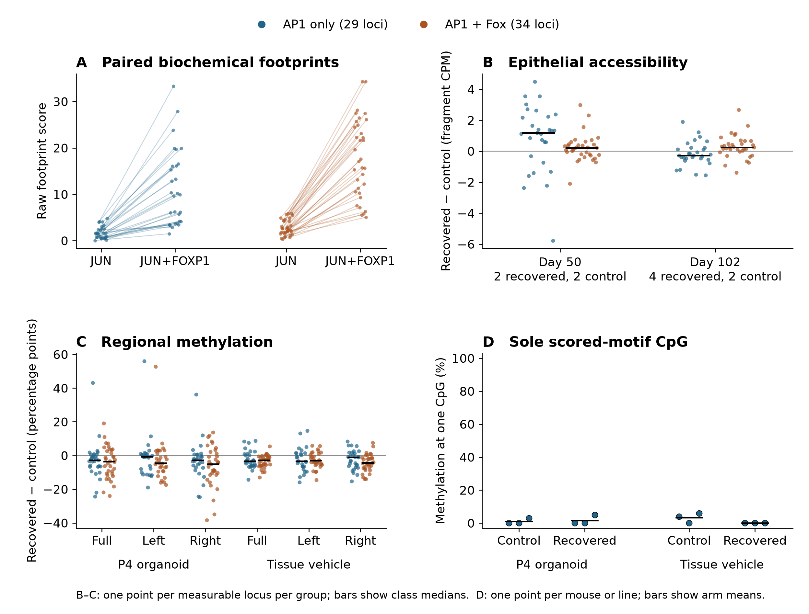

# JUN–FOXP1 footprints and native history differences at 63 colonic loci

**Stage 2 measurement checkpoint · 21 November 2026.** Adding FOXP1 to JUN increased the raw footprint at every selected sequence. The size of that change depends on how it is expressed. Native recovered-minus-control differences span both directions, and the separate methylation and accessibility cohorts have no matched individuals. The frozen subsequent question is whether a larger biochemical increment tracks a larger day-102 accessibility difference across the 63 loci. That relationship awaits review and analysis. [63-row measurement table](../../../../analysis/research/runs/ng26_jf_measurements_v1/locus_measurements.tsv) · [Prospective design, frozen at `8c83d4e`](DESIGN.md) · [Stage 1 eligibility and provenance](../stage1/ELIGIBILITY.md)

**Figure.** A connects the two raw Table 6 measurements from each sequence. B shows the difference between mouse-group means for each fixed amplicon. C shows separate whole-amplicon, left-flank and right-flank differences in P4 organoids and vehicle-treated tissue. Each dot in B and C is one locus and black bars give class medians. D shows all three mice or lines per arm at the sole scored-motif CpG, with black bars for arm means. The shared motif-class colors identify sequence classes. [Figure PDF](../../../../analysis/research/runs/ng26_jf_measurements_v1/locus_measurements.pdf)

## FOS-free biochemical comparison

| Motif class | Sequences | Median JUN score | Median JUN+FOXP1 score | Median paired increment | Median paired fold change |
|---|---:|---:|---:|---:|---:|
| AP1 only | 29 | 1.56 | 9.95 | +8.55 | 7.41× |
| AP1 + Fox | 34 | 2.46 | 17.35 | +15.61 | 6.57× |

The composite class had the larger median gain in raw footprint-score units. Its higher JUN-alone baseline matters for the ratio, which had a larger median in the AP1-only class. All 63 denominators were positive. Each class summary uses within-sequence differences or ratios before taking the median. There was one binding library per protein condition. The published JUN+FOS-normalized comparison uses a different denominator. [Paired raw scores and Table 6 addresses](../../../../analysis/research/runs/ng26_jf_measurements_v1/biochemical_loci.tsv) · [Class counts and medians](../../../../analysis/research/runs/ng26_jf_measurements_v1/binding_by_class.tsv) · [Published comparison and deposited material](../../post_s5/JUN_FOXP1_DEPOSIT_SCAN.md)

## Accessibility across recovered epithelium

| Day | Recovered / control mice | Median difference across 63 loci (CPM) | Locus range (CPM) | Positive / negative |
|---|---:|---:|---:|---:|
| 50 | 2 / 2 | +0.388 | −5.767 to +4.493 | 42 / 21 |
| 102 | 4 / 2 | +0.122 | −1.546 to +2.665 | 35 / 28 |

Each barcode needed at least 300 unique autosomal fragments. For each mouse, CPM uses unique fragments overlapping the fixed amplicon per million autosomal unique fragments from its retained barcodes. Mice receive equal weight in their group mean. All nine observed mouse–locus zeros are included. The 899–924 bp amplicons have a secondary difference in CPM/kb. These samples cover EPCAM-positive epithelial cells across states. [Fragment counts, mouse depths, zero and missing values](../../../../analysis/research/runs/ng26_jf_measurements_v1/atac_specimens.tsv) · [Group baselines, counts and history differences](../../../../analysis/research/runs/ng26_jf_measurements_v1/atac_history.tsv)

**Day 79.** Recovered mouse DSS39 m2 (`IGVFSM1292EWZQ`) had 5,352 retained barcodes and 6,592,124 autosomal fragments. Its 63 measurements ranged from 0 to 19.569 CPM. Recovered mouse DSS39 m1 (`IGVFSM8251ZRQL`) had 6,938 retained barcodes and 8,925,719 autosomal fragments. Its range was 0.224 to 13.668 CPM. The control identity conflict leaves the history contrast unestimable. [Specimen ledger and source map conflict](../stage1/ELIGIBILITY.md)

## Residual-history methylation

| Window | Measurable loci per model | Common CpGs across loci per model | Median P4 difference (pp) | Median tissue vehicle difference (pp) |
|---|---:|---:|---:|---:|
| Whole amplicon | 63 | 557 | −3.33 | −3.00 |
| Left flank | 58 | 282 | −1.96 | −3.43 |
| Right flank | 62 | 273 | −3.62 | −3.67 |
| Scored motif | 1 | 1 | +0.67 | −3.33 |

Each locus contributes one contrast per model and window. CpGs measured in all six specimens receive equal weight within specimen, then the three mouse lines or mice receive equal weight within arm. Each full amplicon contained 2–20 common CpGs. Across the 63 amplicons, P4 differences ranged from −24.22 to +43.21 percentage points and tissue vehicle differences from −14.27 to +8.67 points. The table records width, reference opportunity, six-specimen common sites, separate arm means and usable counts. A window with no CpG has a missing estimate. Flanks exclude the scored interval and annotated composite envelope. [Regional contrasts and common coordinates](../../../../analysis/research/runs/ng26_jf_measurements_v1/methylation_history.tsv) · [Specimen means](../../../../analysis/research/runs/ng26_jf_measurements_v1/methylation_specimens.tsv.gz) · [Original plus-C fractions](../../../../analysis/research/runs/ng26_jf_measurements_v1/methylation_sites.tsv.gz)

At the one scored-motif CpG (mm10 chr13, zero-based plus-C 52,892,163, AP1 only), mean P4 methylation went from 1.00% in controls to 1.67% in recovered lines. Mean tissue methylation went from 3.33% in controls to 0% in recovered vehicle mice. None of the 34 annotated composite cores contained a reference CpG. Regional methylation supplies a flanking-context measure across the panel. Direct motif methylation supplies one descriptive example. [Stage 1 sequence geometry](../../../../analysis/research/runs/ng26_jf_methylation_v1/mm10_windows.tsv)

The subsequent day-102 partial rank comparison and checks for class, baseline coupling, width, CpG opportunity, influential loci and mouse or line omission were frozen before any cross-locus relationships were inspected. The present measurements leave late JUN–FOXP1 occupancy and the direction of dependence unresolved. [Design](DESIGN.md) · [Execution receipt](../../../../analysis/research/runs/ng26_jf_measurements_v1/receipt.json)
