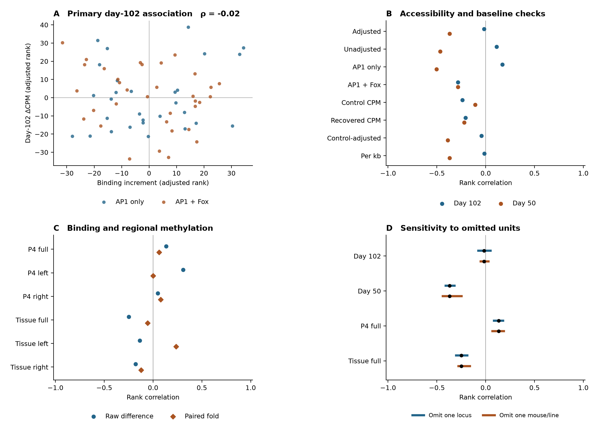
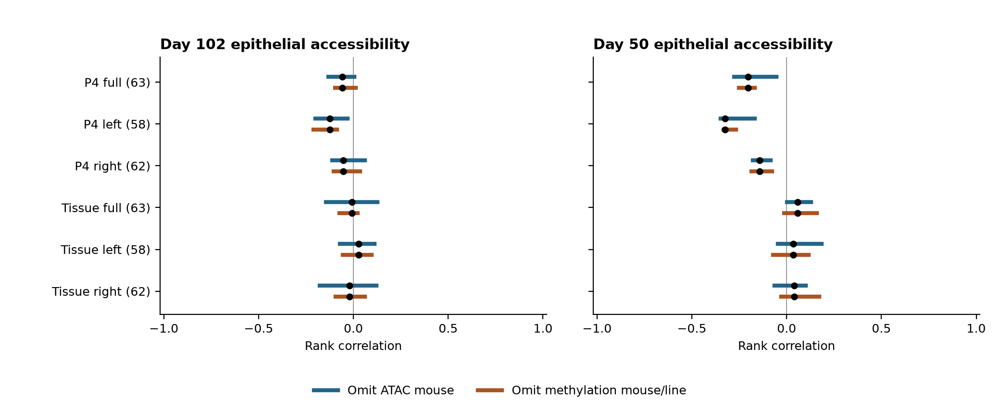

# Does the JUN–FOXP1 footprint gain predict which loci stay more accessible?

**Day 102, primary comparison.** Across all 63 selected loci, the partial rank correlation between the paired raw footprint increment and the recovered-minus-control epithelial accessibility difference was **−0.015**. Loci with a larger biochemical gain had essentially the same spread of late accessibility differences as loci with a smaller gain. The statistic adjusts for motif class, amplicon width and reference CpG density. It uses four recovered and two control mice, with one binding library per protein condition. All 63 raw footprints increased with FOXP1. The magnitude of that increase did little to order the late tissue response. [Frozen comparison](../stage2/DESIGN.md) · [Per-locus source measurements](../stage2/MEASUREMENTS.md) · [Rank pairs and source-scale values](../../../../analysis/research/runs/ng26_jf_association_v1/locus_pairs.tsv.gz)

## Accessibility at day 102 and day 50

| Binding increment versus ATAC | Day 102 (4 recovered / 2 control) | Day 50 (2 recovered / 2 control) |
|---|---:|---:|
| Primary geometry/class-adjusted ρ | −0.015 | −0.370 |
| Unadjusted ρ | +0.112 | −0.467 |
| AP1 only / AP1 + Fox, unadjusted | +0.171 / −0.284 | −0.504 / −0.284 |
| Control CPM / recovered CPM separately, adjusted | −0.239 / −0.206 | −0.108 / −0.219 |
| Add mean control CPM as a covariate | −0.043 | −0.388 |
| Split controls, each held mouse used as baseline in turn | −0.028 / +0.004 | −0.437 / −0.252 |
| Adjusted, CPM per kb | −0.013 | −0.370 |
| Paired fold in place of the raw increment | −0.071 | −0.121 |
| Omit one locus, raw increment range | −0.075 to +0.049 | −0.409 to −0.319 |
| Omit one mouse, raw increment range | −0.052 to +0.029 | −0.439 to −0.248 |

**Day 50.** The inverse direction survived every one-mouse and one-locus omission. Changing the biochemical predictor to the paired fold reduced its magnitude by about two-thirds. Raw JUN alone and raw JUN+FOXP1 gave −0.255 and −0.378 at day 50, versus −0.039 and −0.026 at day 102. The earlier inverse result runs opposite to the prediction that stronger biochemical gain tracks greater opening. The samples give two separate cross-sectional comparisons; they do not follow individual mice through recovery. [All estimates, baseline rotations and counts](../../../../analysis/research/runs/ng26_jf_association_v1/associations.tsv)

At day 102, even the direction differed by motif class and changed on two of six mouse omissions. Separating the two sparse control baselines gave estimates close to zero in both rotations. At both days, omitting mm10 scored interval `chr10:97793976-97793988` shifted the primary raw-increment estimate most among the 63 locus omissions. The largest single-mouse changes were from recovered mouse `IGVFSM5378XGMM` at day 102 and control `IGVFSM5944AGZN` at day 50. Every estimate retains the observed omission or full set to which it refers. These ranges measure dependence on the observed units and provide no population confidence interval. Day 79 has two recovered mice and no usable control contrast. [Omission ranges and influential IDs](../../../../analysis/research/runs/ng26_jf_association_v1/omission_ranges.tsv) · [Every omitted locus and animal](../../../../analysis/research/runs/ng26_jf_association_v1/omissions.tsv.gz)

**Figure 1.** A shows each selected locus after residualizing both ranked measurements. B compares day 102 and day 50. C compares the two biochemical denominators against native methylation. D shows the range after omitting each indicated unit and the full-sample coefficient in black. The corrected export includes both lower legends. [PDF](../../../../analysis/research/runs/ng26_jf_binding_display_v2/binding_associations.pdf) · [Display checks](../../../../analysis/research/runs/ng26_jf_binding_display_v2/render_checks.json) · [Numerical receipt](../../../../analysis/research/runs/ng26_jf_association_v1/receipt.json)

## Binding and residual-history methylation

Each model has three control and three recovered mice or mouse-derived lines. Negative coefficients agree with the proposed direction of a larger binding increment at loci with more methylation loss. The full and flank comparisons use each window’s own width and CpG density and retain sites measured in all six specimens.

| Model and window | Loci | Raw increment ρ | Paired fold ρ | Raw increment, omit one mouse or line | Split control, raw increment range |
|---|---:|---:|---:|---:|---:|
| P4 organoid, whole amplicon | 63 | +0.133 | +0.062 | +0.068 to +0.187 | +0.168 to +0.265 |
| P4 organoid, left flank | 58 | +0.309 | +0.001 | +0.205 to +0.365 | +0.238 to +0.394 |
| P4 organoid, right flank | 62 | +0.049 | +0.079 | −0.001 to +0.131 | +0.089 to +0.236 |
| Tissue vehicle, whole amplicon | 63 | −0.248 | −0.055 | −0.278 to −0.161 | −0.220 to −0.093 |
| Tissue vehicle, left flank | 58 | −0.135 | +0.235 | −0.216 to −0.045 | −0.219 to −0.026 |
| Tissue vehicle, right flank | 62 | −0.180 | −0.122 | −0.270 to −0.006 | −0.233 to +0.094 |

The full-amplicon tissue result had the predicted sign under each mouse omission; P4 organoids had the opposite sign under each line omission. Adding the common-site count gave −0.253 in tissue and +0.123 in P4. Accounting for the coupled mean control baseline attenuated the tissue estimate to −0.148. The biochemical denominator matters most clearly in the tissue left flank, whose estimate changed sign, and the P4 left flank, whose estimate fell from +0.309 to +0.001. Most measured CpGs were regional. One scored motif, at mm10 chr13 plus-C 52,892,163, had a CpG. Its descriptive differences were +0.67 percentage points in P4 and −3.33 in tissue vehicle. No annotated composite core contained a CpG. [Model and window estimates](../../../../analysis/research/runs/ng26_jf_association_v1/associations.tsv) · [Common CpGs, original arm means and differences](../../../../analysis/research/runs/ng26_jf_measurements_v1/methylation_history.tsv)

## Do regional methylation and accessibility differences align?

This separately frozen secondary analysis paired genomic intervals across independently sampled assay cohorts. The left and right methylation measurements each used the same whole-amplicon ATAC endpoint. A negative coefficient means that loci with greater methylation loss tended to have a greater accessibility gain. [Secondary design](SECONDARY.md) · [Native locus pairs and source scales](../../../../analysis/research/runs/ng26_jf_native_secondary_v1/native_pairs.tsv.gz)

| Model (whole / left / right) | Day 102 adjusted ρ | Day 50 adjusted ρ |
|---|---|---|
| P4 organoid | −0.060 / −0.124 / −0.053 | −0.204 / −0.324 / −0.142 |
| Tissue vehicle | −0.007 / +0.027 / −0.021 | +0.057 / +0.035 / +0.040 |

Whole-colon regional methylation supplied little day-102 ordering of accessibility differences. Its whole-amplicon coefficient ranged from −0.144 to +0.127 across ATAC mouse omissions. P4 had an inverse day-50 relationship, strongest on the left flank. That left-flank estimate stayed negative under every single ATAC mouse omission (−0.349 to −0.167) and P4 line omission (−0.332 to −0.265). Within the two motif classes, the corresponding unadjusted estimates were −0.688 for AP1 only and +0.142 for AP1 + Fox. The day-50 P4 pattern therefore has limited reach across contexts. The methylation model, anatomical material, time and motif class all matter to its interpretation. [Secondary coefficient and baseline checks](../../../../analysis/research/runs/ng26_jf_native_secondary_v1/native_associations.tsv) · [Omission ranges](../../../../analysis/research/runs/ng26_jf_native_secondary_v1/native_omission_ranges.tsv) · [Every omission](../../../../analysis/research/runs/ng26_jf_native_secondary_v1/native_omissions.tsv.gz)

**Figure 2.** Black points show full eligible-locus estimates. Colored bars show how each estimate changed when one animal or line from the indicated assay was omitted. There is no matched individual across assays. [PDF](../../../../analysis/research/runs/ng26_jf_native_secondary_v1/native_associations.pdf) · [Secondary numerical receipt](../../../../analysis/research/runs/ng26_jf_native_secondary_v1/receipt.json)

## What this changes for the two external candidates

**Yin methylation-sensitive binding libraries.** The late tissue result weakens the premise that a larger biochemical increment generally predicts greater retained accessibility. An isolated-factor assay could still test whether JUN or FOXP1 recognizes a methylated CpG in a specified sequence context. With only one native scored-motif CpG and none in the 34 annotated composite cores, that question applies directly to very little of this panel. The existing candidate uses each protein separately. Establishing methylation-dependent binding of the pair would require evidence varying methylation in the paired-protein assay. [Existing candidate source audit](../../post_s5/JUN_FOXP1_DEPOSIT_SCAN.md)

**Independent mouse colon methylation array.** The inverse whole-tissue binding–methylation association gives a reason to ask whether residual regional methylation differences recur in other colonic material. Its attenuation on the fold scale, the opposite P4 direction, and the near-zero tissue methylation–ATAC association at day 102 narrow what a concordant external result could explain. The earlier source scan found eight eligible probes in five amplicons and zero scored motifs. That overlap could address a regional methylation question at those intervals. Direct late occupancy, pairing of the factors and direction of causation remain open. Stage 3 used only the reviewed Nagaraja measurements. External qualification awaits owner review. [Existing array overlap and study design](../../post_s5/JUN_FOXP1_DEPOSIT_SCAN.md)
