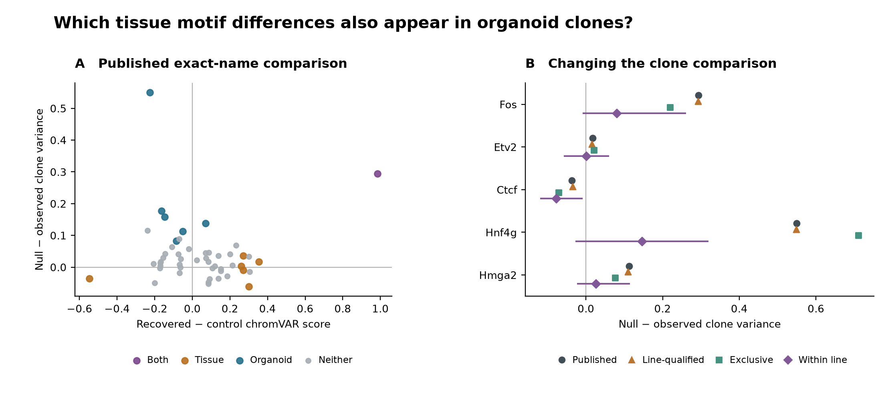

# Which motif families show memory in both recovered colon and organoid clones?

**Fos, the AP-1 reporter, was the only one of 50 exact reporter matches that crossed both published thresholds.** Its recovered stem/progenitor chromVAR score was 0.986 units higher than control (BH q = .00127). In organoids its observed median clone variance was 1.864, compared with 2.158 under the published global shuffle (variance deficit +0.294, q = .00570). Removing ambiguous assignments and conditioning on donor line retained a smaller positive deficit (+0.081). The observed variance then fell inside the conditional null interval. These findings reproduce the authors’ overlap and narrow the evidence for resemblance beyond donor line. [Nagaraja et al., Figs. 1g and 2h, Extended Data Fig. 4h](https://pmc.ncbi.nlm.nih.gov/articles/PMC13083248/) · [All 299 reported organoid leaders and tissue-test status](../../../analysis/research/runs/ng26_post_s5_v1/family_evidence.tsv)

Panel A shows all 50 matched reporters. Colors identify the original discoveries within each setting. Tissue significance includes losses as well as gains. Panel B uses separate symbols for the published result, clone IDs qualified by mouse line, exclusive assignments with a global shuffle, and exclusive assignments with exchange restricted to donor line. Purple segments span the 5th–95th percentiles from 64 draws retaining half the eligible clones in each line. A segment summarizes clone sampling. The purple diamond uses all 121 eligible clones. [Vector figure](../../../analysis/research/runs/ng26_post_s5_v1/family_evidence.pdf)

## What the published comparison measures

Tissue Table 3 reports the 50 leaders with the largest across-replicate variation in stem/progenitors. For each, the authors compared mouse replicate means in recovered tissue (5 mice) versus control (9 mice) by Welch's t-test and adjusted the 50 p-values within that state and comparison. Fig. 1g's display can include leaders significant at **any** sampled stage. The reconstruction uses the **recovered** row and q < .05. Organoid Table 4 reports 299 leaders, with 280 finite q-values. The authors tested median within-clone sample variance against a distribution from 1,000 shuffled assignments, using a two-sided normal approximation and BH adjustment. A clonal hit requires **less** observed dispersion and q < .05. Positive values on the displayed organoid scale mean tighter clones; the tissue scale retains the direction of the accessibility shift. Tissue histories are compared directly. The organoid test pools clone resemblance across histories. [Original Supplementary Tables 2–4 (workbook archive)](https://pmc-oa-opendata.s3.amazonaws.com/PMC13083248.1/41586_2026_10258_MOESM5_ESM.zip) · [Tissue methods](https://github.com/snagaraja13/colitis_memory/blob/v1.0.1/2_SHAREseq_testing/02a_diff_motifs.R) · [Organoid methods](https://github.com/snagaraja13/colitis_memory/blob/v1.0.1/3_SHARE_TRACE/04_SHARE_TRACE.variance_testing.R)

| Evidence in the published tables | Count | Reporters |
|---|---:|---|
| Tissue difference and tighter clones | 1 | Fos |
| Tissue difference only among tested reporters | 6 | Etv2, Spi1, Spib, Bcl11a and Rorc gained accessibility. Ctcf lost accessibility. |
| Tighter clones with tested, subthreshold tissue effect | 6 | Hhex, Hmga2, Hnf4g, Hoxd10, Sox9 and Zfp580 |
| Both settings tested, neither threshold met | 37 | All effects and directions retained in the inventory |
| Tighter clones, tissue comparison unavailable | 2 | Runx1 and Tcf7l2 |
| Tissue comparison unavailable, organoid result a nonhit or unevaluable | 247 | 228 tested organoid nonhits and 19 nonfinite tests |

**Family names.** Exact Table 3 and Table 4 leaders agree for all 50 tested tissue rows. The article describes 299 families, while the released Table 2 workbook lists 361 groups. We indexed every member as written, preserving many individual motif names under one representative (for example Fos, Jun and Fosl1 under Fos). Each of the 299 Table 4 leaders mapped to a distinct catalog group. Thirteen *tested* leaders, including Hnf4g and Ctcf, were members under a different Table 2 leader (de_novo_141 and de_novo_155, respectively). None of the 50 tested groups contained a second organoid reporter. The broader membership rule consequently adds zero cross-reporter comparisons. The remaining 62 catalog groups have no Table 3 or 4 reporter. A bag label does not identify the bound protein. [361 groups with original membership and assay coverage](../../../analysis/research/runs/ng26_post_s5_v1/table2_catalog.tsv) · [Every cross-setting match](../../../analysis/research/runs/ng26_post_s5_v1/reporter_links.tsv)

## What changes after qualifying the clone comparison?

| Reporter | Tissue difference (q) | Published deficit (q) | Line-qualified deficit (q) | Exclusive global deficit (q) | Exclusive within-line deficit (empirical lower-tail p) |
|---|---:|---:|---:|---:|---:|
| Fos / AP-1 | +0.986 (.0013) | +0.294 (.0057) | +0.293 (.0032) | +0.219 (.300) | +0.081 (.188) |
| Etv2 / ETS | +0.353 (.0124) | +0.018 (.891) | +0.015 (.910) | +0.021 (.982) | +0.001 (.473) |
| Ctcf | −0.548 (.0088) | −0.036 (.869) | −0.034 (.861) | −0.071 (.654) | −0.078 (.952) |
| Hnf4g / HNF4–PPAR | −0.225 (.636) | +0.549 (<.001) | +0.548 (<.001) | +0.710 (<.001) | +0.146 (.022) |
| Hmga2 | −0.050 (.698) | +0.113 (.0476) | +0.109 (.107) | +0.076 (.541) | +0.026 (.259) |

S2's three assignment variants use the global shuffle. In the new within-line comparison, **none of 50** crossed the two-sided matched-panel BH threshold. Fos has observed variance 1.888 against a within-line null mean of 1.969 (MCSE .00285, central 95% null interval 1.809–2.146). S5's higher-precision single-Fos run gave a +.0846 deficit and empirical p = .172 using 5,000 shuffles. The complete-panel repeat uses 1,000. Hhex and Hnf4g showed some within-line resemblance (empirical lower-tail p = .004 and .022, matched-panel q = .142 and .543), with weak recovered-tissue evidence. Etv2 and Spi1 had small positive organoid deficits that approached zero within line. Sox9 had a small positive tissue difference (+.071, q = .698) alongside published clonal evidence. Such directionally compatible observations differ from a second dual-threshold family. Hmga2 also moved across the original significance boundary in S2’s independent permutation replay. [S2 original and assignment-sensitive estimates](../s2/RESULTS.md) · [S5 single-reporter result](../s5/RESULTS.md) · [All family effects and q-values](../../../analysis/research/runs/ng26_post_s5_v1/family_evidence.tsv)

## How much did observed clone number matter?

All 50 matched reporters had complete scores on the same 3,572 exclusive cells. The six mouse lines supplied **45, 15, 13, 21, 19 and 8 clones** with at least two cells. Each draw selected whole clones within each line without replacement. Its null shuffled only its selected cells within the retained line and preserved the sizes of those clone slots. The tests weight clones equally. The six omissions delete a whole donor line and all its clones. [Per-draw clone IDs, donors and achieved counts](../../../analysis/research/runs/ng26_post_s5_v1/clone_selections.tsv)

| Retained substrate | Achieved cells | Fos variance deficit | Positive direction | Passed matched-panel BH |
|---|---:|---:|---:|---:|
| 58 clones, all 6 lines (50% target, rounded down per line) | 927–2,181 | Median +.098, 5th–95th percentile −.007 to +.259 | 58/64 | 0/64 |
| 88 clones, all 6 lines (75% target) | 1,988–3,008 | Median +.094, 5th–95th percentile +.041 to +.192 | 64/64 | 0/64 |
| 76–113 clones, 5 lines (one omission at a time) | 2,582–3,273 | +.062 to +.131 across all six omissions | 6/6 | 0/6 |
| 121 clones, all 6 lines | 3,572 | +.081 | Positive | No |

No reporter crossed the matched-panel threshold in any five-line omission. Hnf4g's deficit changed sign on omission of control line m7 (−.132). Some individual clone samples crossed the threshold. Hnf4g crossed in 2/64 half-clone and 1/64 three-quarter-clone draws, Hhex in 1/64 and 5/64, and Nfya in 0/64 and 1/64. Clone composition can shift threshold calls in either direction. Each reduced-clone draw used 96 conditional shuffles. The fractions have finite Monte Carlo uncertainty (maximum sampling SE .063 over 64 draws) and conditional shuffle noise. These are observed sensitivities on six donor lines. They supply no estimate of the chance of finding an unknown factor in a larger cohort. The authors already reported clone-number-dependent detection under their original global downsampling in ED4h. The within-line resampling here answers a different question on the qualified cells. [Family-by-family stability](../../../analysis/research/runs/ng26_post_s5_v1/stability.tsv) · [Effects, null ranges and tests for every draw](../../../analysis/research/runs/ng26_post_s5_v1/conditional_draws.tsv) · [Original ED4h](https://pmc.ncbi.nlm.nih.gov/articles/PMC13083248/#Fig8)

## Recommendation for S6

Carry forward the original AP-1 overlap as a reproduced published result. Describe its within-line component as a smaller directionally persistent estimate with substantial uncertainty. Keep tissue-only, ex-vivo-only and untested reporters visible. The five-day intervention, methylation readbacks and separate adenoma cohorts leave the maintenance carrier and mediation unresolved. A graded closeout can preserve these results and identify the missing discrimination without expanding the analysis. The requested checkpoint ends here for owner review before S6. [Maintenance assessment](MAINTENANCE.md) · [Frozen outcome-exposed design](../../../analysis/research/contracts/Ng26-P01.post_s5_v1.json) · [Execution receipt](../../../analysis/research/runs/ng26_post_s5_v1/receipt.json)
