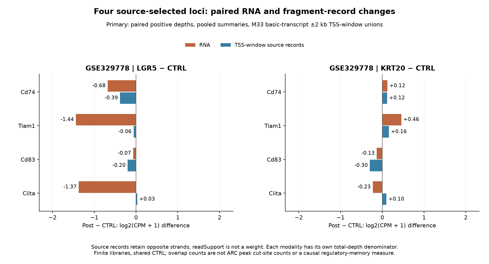
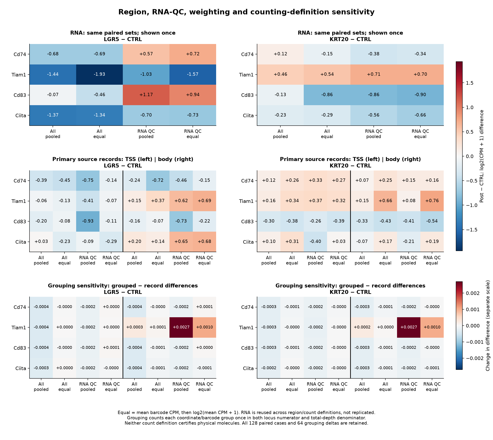

# Q4a: paired RNA and fixed-locus fragment descriptions

1 November 2026. Arz1-P01; GSE329778 only. All three complete sources qualified,
all four fixed loci qualified, and **all 128 paired cases are defined**. The
[v2 receipt](../../analysis/research/runs/arz1_accessibility_description_v2/receipt.json)
records execution, not scientific acceptance. The independent raw-source audit
and visual reviews of the corrected primary and unchanged sensitivity figures
passed; [validation](ACCESSIBILITY_VALIDATION.md) records their exact scope. The
[v1 source-identity hold](ACCESSIBILITY_V1_HOLD.md) and its 64 held cases remain
unchanged; v2 is the reviewed prospective amendment, not an overwrite.

## Question and measured endpoint

The source paper's Figure 5d/e names Cd74, Tiam1, Cd83 and Ciita in its
accessibility analysis ([published article](https://doi.org/10.1038/s41467-026-79014-6)).
This adaptation asks how their RNA and fixed-region fragment measurements differ
between deposited LGR5 or KRT20 libraries and their shared CTRL, and how the
description changes with barcode QC, weighting, region and count definition.
The descriptive observation unit is the finite deposited library; nested barcodes
are not independent mice. The underlying biological mouse/pool/preparation
identities and their independence remain unvalidated; author state maps are unknown.

The endpoint is post-minus-CTRL **log2(CPM + 1) difference**, separately for RNA
and fragment overlap. Primary fragment counts retain unique strand-labelled
source records; sensitivity counts each coordinate/barcode group once across
opposite strands. Each definition supplies both its locus numerator and its own
all-canonical-nuclear denominator. readSupport is not a weight. The strand field
distinguishes source records; fragments are not filtered to the gene's strand.
Neither definition independently certifies physical molecules. Fragment-overlap
counts differ from ARC Peaks matrix cut-site counts.

Regions use public GRCm39 GENCODE M33 basic-transcript TSSs, merged +/-2 kb windows,
with gene bodies as the fixed sensitivity. All four source TSS spans match M33
exactly; no all-transcript fallback was needed. Exact intervals and transcript
provenance are in [region provenance](../../analysis/research/runs/arz1_accessibility_description_v2/region_provenance.json).
The deposited GRCm39/ARC 2.1 headers conflict with article/GEO mm10/ARC 2.0.2
descriptions; this adaptation does not resolve that discrepancy or reconstruct the
custom TdTomato reference. TSS windows are not experimentally validated promoters.

Pooled summaries divide total locus counts by total relevant depth. Equal-barcode
summaries average barcode CPM before log transformation. Both modalities use the
same positive-RNA/positive-fragment barcodes; the sensitivity subset intersects
the unchanged prior RNA-only QC. See the
[frozen v2 contract](config/accessibility_contract_v2.json) and
[reviewed amendment](config/ACCESSIBILITY_AMENDMENT_V2.md) for the full specification.

## Full source traversal and paired populations

The run traversed **152,186,923 fragment records** through valid gzip EOF/CRC.
Structural checks found no same-strand duplicate-key or other source failure.
Positive-depth and paired barcode sets are identical between count definitions.
No RNA barcode was removed for zero nuclear-fragment depth, and every RNA
depth/QC reconstruction and all 48 same-selection RNA reuse checks passed.

| Library | Source records | Primary canonical allowlisted denominator | Grouped denominator | Opposite-strand groups, all / canonical allowlisted | Affected canonical allowlisted barcodes |
|---|---:|---:|---:|---:|---:|
| CTRL | 36,427,592 | 25,448,985 | 25,440,023 | 9,040 / 8,962 | 922 |
| KRT20 | 44,639,326 | 28,201,254 | 28,196,831 | 4,517 / 4,423 | 992 |
| LGR5 | 71,120,005 | 40,642,682 | 40,639,240 | 3,574 / 3,442 | 1,176 |

Two source records belong to each opposite-strand coordinate/barcode group.
Canonical nonallowlisted records were 10,944,145 / 16,396,487 / 30,407,482
for CTRL / KRT20 / LGR5; noncanonical records were 34,462 / 41,585 / 69,841.
Contigs and all accounting are retained in
[source validation](../../analysis/research/runs/arz1_accessibility_description_v2/source_validation.json),
[affected barcodes](../../analysis/research/runs/arz1_accessibility_description_v2/collision_barcodes.csv.gz)
and [locus/region collisions](../../analysis/research/runs/arz1_accessibility_description_v2/collision_locus_regions.csv).

| Library | All paired barcodes | Prior RNA-QC paired barcodes |
|---|---:|---:|
| CTRL | 5,164 | 1,650 |
| KRT20 | 7,896 | 2,711 |
| LGR5 | 6,921 | 635 |

These are 19,981 nested barcode pairs, not 19,981 biological replicates.
Both definitions retain the same populations and RNA values. Repeated RNA rows
across region/count definitions are explicitly labelled as reuse. Full depths,
counts and selected denominators are in
[barcode depths](../../analysis/research/runs/arz1_accessibility_description_v2/barcode_depths.csv.gz),
[barcode locus counts](../../analysis/research/runs/arz1_accessibility_description_v2/barcode_locus_counts.csv.gz)
and [paired populations](../../analysis/research/runs/arz1_accessibility_description_v2/paired_populations.csv).

## Primary descriptive results

All paired barcodes, pooled weighting, TSS-window unions, strand-record counts:

| Locus | LGR5 minus CTRL: RNA | LGR5 minus CTRL: fragments | KRT20 minus CTRL: RNA | KRT20 minus CTRL: fragments |
|---|---:|---:|---:|---:|
| Cd74 | -0.68071 | -0.38521 | +0.12409 | +0.11545 |
| Tiam1 | -1.43918 | -0.05850 | +0.45651 | +0.15978 |
| Cd83 | -0.07033 | -0.20106 | -0.13347 | -0.29652 |
| Ciita | -1.37365 | +0.02672 | -0.22846 | +0.09962 |

This displayed primary figure is the separately frozen
[render-only spacing correction](../../analysis/research/runs/arz1_accessibility_primary_render_v1/receipt.json).
It supersedes the original presentation only; all 16 plotted values and bar x
positions are unchanged. The original v2 primary figure remains preserved.

Small fragment differences and sparse detection require their count context.
For example, the primary Ciita TSS measurements are 128 / 154 / 209 records,
detected in 114 / 138 / 134 barcodes, for CTRL / KRT20 / LGR5. Full raw counts,
detection fractions, pooled/equal CPM and transformed values are retained in
[fragment summaries](../../analysis/research/runs/arz1_accessibility_description_v2/library_fragment_summaries.csv)
and [RNA summaries](../../analysis/research/runs/arz1_accessibility_description_v2/library_rna_summaries.csv).
No meaningful-effect margin or population precision is inferred from these numbers.

## Prespecified sensitivities

All [128 paired rows](../../analysis/research/runs/arz1_accessibility_description_v2/paired_contrasts.csv)
and [64 counting-definition deltas](../../analysis/research/runs/arz1_accessibility_description_v2/count_definition_deltas.csv)
remain available. Grouping opposite strands changes the largest fragment contrast
by **0.00270523** log2(CPM + 1), at LGR5 minus CTRL, RNA-QC, pooled, Tiam1 gene body.
It changes no fragment-contrast sign in these 64 paired comparisons; every RNA
definition delta is exactly zero. This bounded sensitivity does not prove which
record definition represents physical molecules.

QC, weighting and region choice have larger consequences for some cases. LGR5
Cd74 and Cd83 RNA differences switch from negative to positive in the frozen
RNA-QC subset, while their TSS-fragment differences remain negative. LGR5 Tiam1
has negative TSS-window and positive gene-body differences under every fixed
QC/weight choice. Ciita's TSS sign varies with QC/weighting. KRT20 Cd74's positive
primary RNA difference becomes negative with equal weighting or RNA-QC selection,
while its TSS-fragment differences stay positive. These are selection and
measurement sensitivities, not validated within-state effects.

The bottom row has a separate, explicitly labelled scale. RNA is shown once
because region/count-definition repetitions are reused measurements. The
[corrected primary SVG](../../analysis/research/runs/arz1_accessibility_primary_render_v1/figure_01_paired_primary_corrected.svg)
and unchanged [sensitivity SVG](../../analysis/research/runs/arz1_accessibility_description_v2/figure_02_paired_sensitivity.svg)
are available. Original v2
[primary PNG](../../analysis/research/runs/arz1_accessibility_description_v2/figure_01_paired_primary.png)
and [primary SVG](../../analysis/research/runs/arz1_accessibility_description_v2/figure_01_paired_primary.svg)
remain byte-identical. Only the new primary render changes layout; no biological
analysis or contrast was rerun.

## Interpretation and remaining limits

This completes the eligible Q4a finite-library adaptation. Composition, sorting,
lineage/genotype differences, sparse detection and annotation-defined intervals
remain consequential alternatives. Shared CTRL and pooled/unknown underlying
sample identities prevent a population-level interpretation. No tests, confidence
intervals, FDR, fitted four-gene correlation, state assignments or mechanism claims
were added.

The original state-resolved Q4, exact author consensus-peak/custom-reference
replay, and linked functional interpretation remain held. Source qualification
does not supply an author cell-state map, independent-animal join, validated
promoter activity, TF occupancy or the functional discriminator needed to call
regulatory memory or regeneration. These results neither establish nor refute
the paper's within-state mechanistic interpretation.
