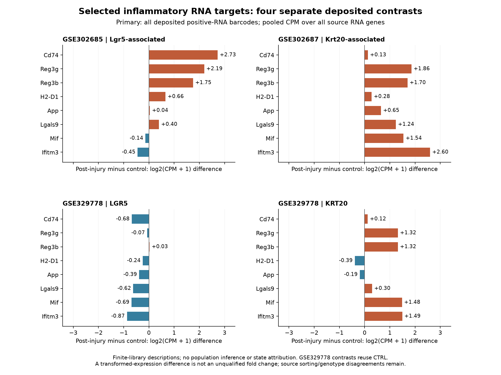
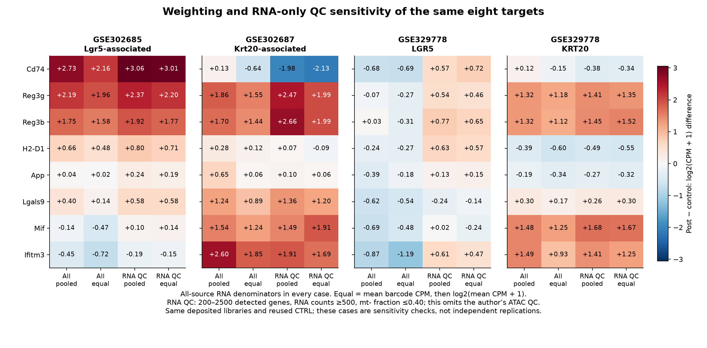

# Arozamena figure gallery

1 November 2026. Two RNA figure plates are reviewed. PNG and SVG are alternate
formats of the same plate, not separate analyses. [Results](RNA_RESULTS.md),
[originating review](ORIGINATING_REVIEW.md) and [job ledger](README.md) give the
scope and remaining holds. Accessibility figures will be added only after their
separate execution and review; none is implied by source qualification.

## Figure 1: separate deposited RNA contrasts

Eight paper-selected targets, each post-injury library minus its own control,
in log2(CPM+1) units using all-source RNA denominators. Three panels have mostly
positive changes; GSE329778 LGR5 has seven negative targets. These whole-library
descriptions do not isolate ISC/state-specific expression. The two GSE329778
contrasts reuse CTRL. [SVG](../../analysis/research/runs/arz1_rna_description_v1/figure_01_primary.svg) ·
[Exact plotting values](../../analysis/research/runs/arz1_rna_description_v1/selected_target_contrasts.csv).

## Figure 2: weighting and RNA-only QC sensitivity

The same targets and contrasts under four fixed cases. Equal-barcode CPM is
averaged before transformation. RNA QC applies the source's RNA thresholds and
an explicit mt- naming convention; it omits ATAC QC. GSE329778 LGR5's panel median
changes from -0.506 to +0.556 under pooled RNA QC, retaining 635/6,921 barcodes.
Selection sensitivity does not identify the true biological direction. These
cases are not independent replicates or uncertainty intervals.
[SVG](../../analysis/research/runs/arz1_rna_description_v1/figure_02_sensitivity.svg) ·
[Panel summaries](../../analysis/research/runs/arz1_rna_description_v1/selected_target_summary.csv).
