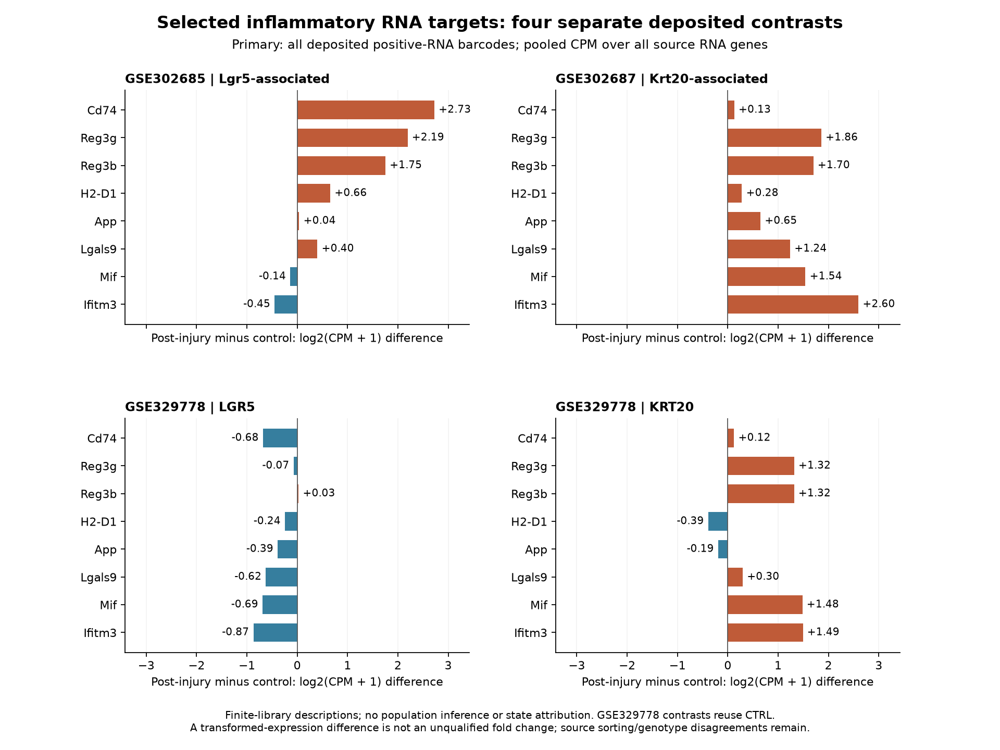
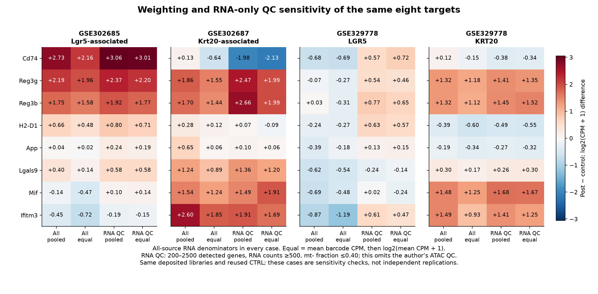

# Deposited-library RNA reproduction: mixed directions and QC sensitivity

1 November 2026. **Arz1-P01 Q3a/Q5a executed; scientific acceptance not assessed.**
The eight source-selected targets do not show one stable direction across all
four deposited contrasts. Three primary panels have mostly positive changes;
GSE329778 LGR5 is mostly negative and reverses its panel median under RNA-only QC.
These are finite-library descriptions, not an ISC/state-resolved reproduction,
population inference, pathway activation or evidence that cellular memory causes
later regeneration. Every negative/mixed case is retained.

## Question, specification and provenance

The [parent brief](RNA_EXTENSION_BRIEF.md) asks whether the source's reported
inflammatory RNA directions recur in each deposited comparison and how depth
weighting/RNA-only QC affect that description. Article Results Sec5 / Fig. 3j
selected Cd74, Reg3g, Reg3b, H2-D1, App, Lgals9, Mif and Ifitm3 before these
outcomes were inspected. Their source symbols each map uniquely to one shared
stable ID across all seven libraries; no alias repair or target replacement was
needed. [Literature context](LITERATURE_CONTEXT.md).

Freeze **`a9e469e8fbd09ccbaeae3610bdeae2e69497c616`** contains the
[numerical contract](config/rna_contract_v1.json),
[implementation choices](config/RNA_IMPLEMENTATION_V1.md) and an exact Git-byte
[copy of the approved brief](config/RNA_EXTENSION_BRIEF_FROZEN_V1.txt).
[Run receipt](../../analysis/research/runs/arz1_rna_description_v1/receipt.json):
`arz1_rna_description_v1`, completed with no mapping, empty-subset or execution
holds. It binds 24 inputs, five code/specification files and 15 outputs.
[Validation and limits](RNA_VALIDATION.md).

The observational unit is the deposited library. Conditions stay accession-specific:
GSE302685 irradiated/control (GEO Lgr5-associated), GSE302687 irradiated/control
(GEO Krt20-associated), and GSE329778 LGR5/CTRL and KRT20/CTRL. The latter two reuse
CTRL. Barcode counts do not become independent animal counts. The paper/GEO run
number and sorting disagreements, lineage/genotype selection and unknown pooled
identities remain unresolved. Composition and processing can explain changes
without persistent expression within the same epithelial state.

Before the RNA freeze, bounded fragment reads additionally showed GSE329778
ARC 2.1.0 / GRCm39-2024-A_TdTomato headers, conflicting with article/GEO
ARC 2.0.2/mm10 metadata. The RNA comparison uses matched stable IDs and symbols,
not genomic interval transfer. Reference/processing differences further limit
cross-deposit concordance. [Exact source conflict and Q4a feasibility](Q4A_FEASIBILITY.md).
The earlier source report is a preserved pre-prefix checkpoint, not authority
for assuming all deposits use one coordinate assembly.

## Endpoint and full fixed sensitivity family

All 31,950 shared RNA IDs are reported, but each denominator uses **all source
RNA features** (32,285 or 33,696). ATAC counts and the common reporting subset
never define RNA depth. Pooled CPM divides the summed gene counts by summed
all-source RNA depth. Equal-barcode CPM averages each positive-depth barcode's
gene CPM; **log2(mean CPM + 1) is applied after averaging**. Each reported change
is post-injury minus its own control in log2(CPM+1) units, not an unqualified
fold change. No p-values, FDR, confidence intervals or aggregate four-contrast
effect was calculated.

The RNA-only subset applies 200–2,500 detected source RNA genes, at least 500 RNA
counts, and mitochondrial fraction at most 0.40. The mitochondrial definition
is the same 13 source `mt-`-prefixed gene IDs in all libraries; coordinates are
missing for those genes, so it remains an explicitly operational naming rule.
This subset omits the author's ATAC-specific QC and does not reconstruct the
integrated Seurat/ISC analysis. All barcodes had positive RNA depth; none were
excluded from primary normalization for zero depth. No subset was empty.

Panel medians are within each fixed eight-target panel, not across cohorts:

| Deposited contrast | All / pooled | All / equal | RNA QC / pooled | RNA QC / equal |
|---|---:|---:|---:|---:|
| GSE302685 Lgr5-associated | +0.529 (6+/2−) | +0.310 (6+/2−) | +0.689 (7+/1−) | +0.645 (7+/1−) |
| GSE302687 Krt20-associated | +1.391 (8+/0−) | +1.069 (7+/1−) | +1.423 (7+/1−) | +1.445 (6+/2−) |
| GSE329778 LGR5 | −0.506 (1+/7−) | −0.395 (0+/8−) | +0.556 (7+/1−) | +0.462 (6+/2−) |
| GSE329778 KRT20 | +0.808 (6+/2−) | +0.546 (5+/3−) | +0.834 (5+/3−) | +0.776 (5+/3−) |

All 16 cases have eight defined targets, zero exact-zero changes and no held
target. [Exact medians/direction counts](../../analysis/research/runs/arz1_rna_description_v1/selected_target_summary.csv).

The whole panel must not hide individual discordance. Cd74 in GSE302687 changes
from +0.129 in all/pooled to −0.639 in all/equal and approximately −1.983 / −2.126
in RNA-QC pooled/equal cases. In GSE329778 KRT20, H2-D1 and App remain negative
across cases. Ifitm3 remains negative in GSE302685. GSE329778 LGR5 Lgals9 remains
negative even after QC; other target directions change. The figures/table retain
every value rather than selecting only agreement with the published premise.

## Retention and interpretation

| Library | Deposited positive-RNA barcodes | RNA-QC retained |
|---|---:|---:|
| GSE302685 control | 6,942 | 2,977 |
| GSE302685 irradiated | 8,405 | 2,368 |
| GSE302687 control | 9,897 | 911 |
| GSE302687 irradiated | 10,362 | 1,135 |
| GSE329778 CTRL | 5,164 | 1,650 |
| GSE329778 KRT20 | 7,896 | 2,711 |
| GSE329778 LGR5 | 6,921 | 635 |

Retained sets differ substantially by library. In particular, GSE329778 LGR5
retains only 635 of 6,921 barcodes. Its median sign reversal is therefore a
selection-sensitive description, not evidence that QC recovered a true biological
direction. The fixed thresholds were source-derived and frozen before outcomes;
they were not tuned to obtain agreement. Weighting sensitivity similarly reflects
which measured barcodes contribute most, without identifying a cell-state mechanism.

[Library QC and denominator summaries](../../analysis/research/runs/arz1_rna_description_v1/library_qc_summary.json)
include all-source denominators, common-gene count sums, overlapping failure counts
and depth/detection/mitochondrial quantiles. The failure counts overlap and must
not be summed as mutually exclusive exclusions.

## Figures and complete numerical outputs

The two frozen figure families are ready for originating numerical/visual review.
They show separate contrasts, signed units and explicit sensitivity cases, with
no significance markers. No figure was edited after execution.

[Primary SVG](../../analysis/research/runs/arz1_rna_description_v1/figure_01_primary.svg).

[Sensitivity SVG](../../analysis/research/runs/arz1_rna_description_v1/figure_02_sensitivity.svg).
Both use the [128-row selected-target plotting input](../../analysis/research/runs/arz1_rna_description_v1/selected_target_contrasts.csv).

- [Complete gene contrasts](../../analysis/research/runs/arz1_rna_description_v1/gene_contrasts.csv.gz): 511,200 rows, all common IDs x four contrasts x four cases.
- [Library gene summaries](../../analysis/research/runs/arz1_rna_description_v1/library_gene_summaries.csv.gz): both subsets, counts, denominators, both CPM summaries and transformed values.
- [Barcode QC](../../analysis/research/runs/arz1_rna_description_v1/barcode_qc.csv.gz): every deposited barcode, all-RNA depth/detection, mitochondrial fraction and retention flag.
- [All source gene symbols](../../analysis/research/runs/arz1_rna_description_v1/gene_symbol_mapping.csv.gz), [selected mappings](../../analysis/research/runs/arz1_rna_description_v1/selected_target_mapping.csv), [mitochondrial convention](../../analysis/research/runs/arz1_rna_description_v1/mitochondrial_mapping.csv), and [input hashes](../../analysis/research/runs/arz1_rna_description_v1/source_hashes.csv).

Q3a/Q5a execution does not remove the original within-state Q3, all-run
cross-condition Q4 or early-to-later-function Q6 prerequisites. Q4a now has a
concrete conditional GRCm39 recount route, requiring its own reviewed brief and
full-source qualification. No novel mechanism, canonical RQ change or human
retain/reject decision follows from this run. Parent-owned README, PROGRESS and
PR #157 integration follow originating review.
