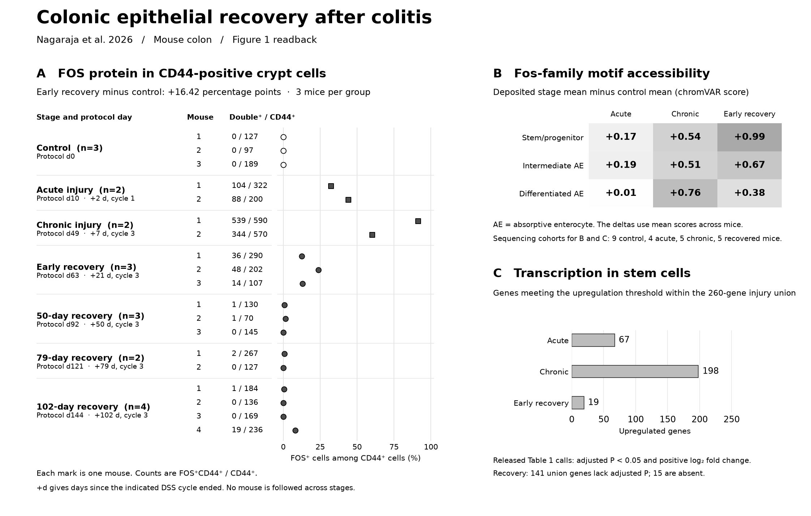

# Nagaraja figure gallery

## S1 · Colonic epithelial recovery after colitis

The 19 staining samples are displayed individually. Sequencing stages use author summaries and have their own axes and mouse counts. The [S1 result](s1/RESULTS.md) explains the denominators, inference limits and difference between the published and released-table RNA gene sets.

| Export or source | Location |
|---|---|
| Current figure | [PNG](../../analysis/research/runs/ng26_s1_figure_v2/fig1_recovery_v2.png) · [PDF](../../analysis/research/runs/ng26_s1_figure_v2/fig1_recovery_v2.pdf) |
| Figure data | [Mouse counts and clocks](../../analysis/research/runs/ng26_s1_v1/fos_mice.tsv) · [Primary contrast](../../analysis/research/runs/ng26_s1_v1/fos_primary.tsv) · [Motif deltas](../../analysis/research/runs/ng26_s1_v1/fos_motif_by_state.tsv) · [RNA stage summary](../../analysis/research/runs/ng26_s1_v1/rna_stages.tsv) |
| Provenance | [Numerical receipt and original export hashes](../../analysis/research/runs/ng26_s1_v1/receipt.json) · [Display amendment](../../analysis/research/contracts/Ng26-P01.s1_figure_v2.json) · [Current display receipt](../../analysis/research/runs/ng26_s1_figure_v2/receipt.json) |

## Figure style for subsequent stages

Use the academic-plotting data-figure guidance and DejaVu Sans throughout this package. Render text in black, including facet headings, axes, ticks, annotations and legends. Distinguish groups with direct labels, marker shapes, line styles or neutral fills that remain legible in grayscale. Reserve accessible color for data marks when it adds information. Show units and biological sample sizes, align panels, and inspect the PNG and rendered PDF for readability and clipping at final size. For the S1 display, all 103 PDF text spans are black, within page bounds and at least 8 pt. [Render checks](../../analysis/research/runs/ng26_s1_figure_v2/render_checks.json)
