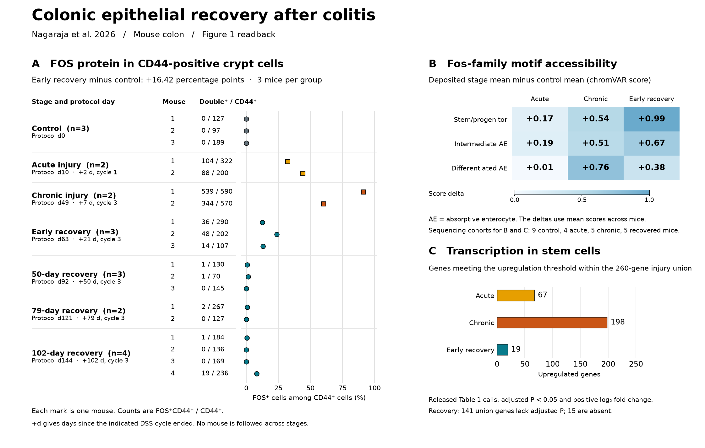

# Nagaraja figure gallery

## S1 · Colonic epithelial recovery after colitis

The 19 staining samples are displayed individually. Sequencing stages use author summaries and have their own axes and mouse counts. The [S1 result](s1/RESULTS.md) explains the denominators, inference limits and difference between the published and released-table RNA gene sets.

| Export or source | Location |
|---|---|
| Current figure | [PNG](../../analysis/research/runs/ng26_s1_figure_v3/fig1_recovery_v3.png) · [PDF](../../analysis/research/runs/ng26_s1_figure_v3/fig1_recovery_v3.pdf) |
| Figure data | [Mouse counts and clocks](../../analysis/research/runs/ng26_s1_v1/fos_mice.tsv) · [Primary contrast](../../analysis/research/runs/ng26_s1_v1/fos_primary.tsv) · [Motif deltas](../../analysis/research/runs/ng26_s1_v1/fos_motif_by_state.tsv) · [RNA stage summary](../../analysis/research/runs/ng26_s1_v1/rna_stages.tsv) |
| Provenance | [Numerical receipt and original export hashes](../../analysis/research/runs/ng26_s1_v1/receipt.json) · [Display amendment](../../analysis/research/contracts/Ng26-P01.s1_figure_v3.json) · [Current display receipt](../../analysis/research/runs/ng26_s1_figure_v3/receipt.json) |

## Figure style for subsequent stages

Use the academic-plotting data-figure guidance and DejaVu Sans throughout this package. Render all figure text in black, including facet headings, axes, tick labels, annotations, legends and colorbar labels. Choose scientifically appropriate colors for data marks, groups, lines and heatmaps. Use a continuous scale for magnitude or a diverging scale when a meaningful midpoint separates directions. Keep the meaning of group colors consistent across related panels. Show units and biological sample sizes, align panels, and inspect both PNG and rendered PDF for readability and clipping at final size. In the current S1 export, all 107 PDF text spans use black DejaVu Sans, are within the page bounds and are at least 8 pt. [Render checks](../../analysis/research/runs/ng26_s1_figure_v3/render_checks.json)
